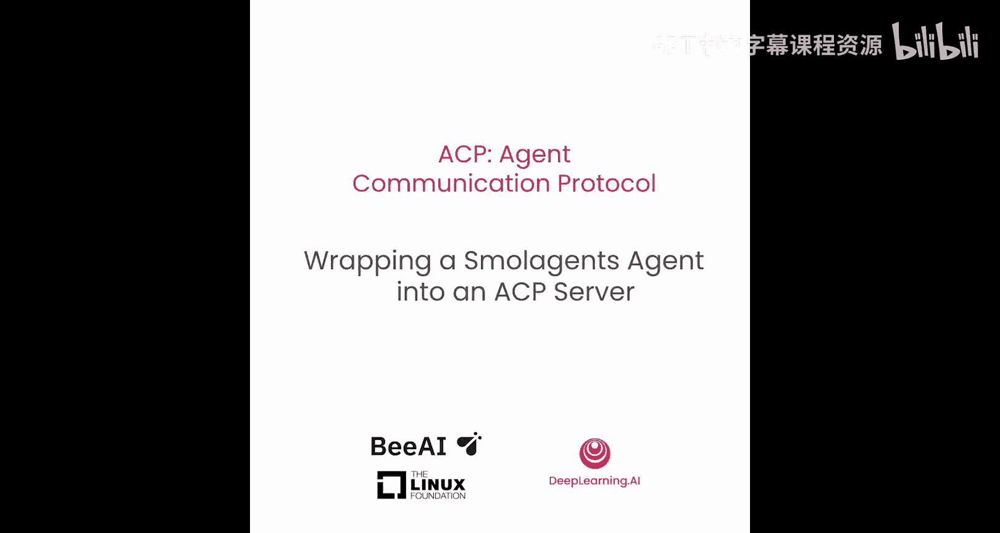
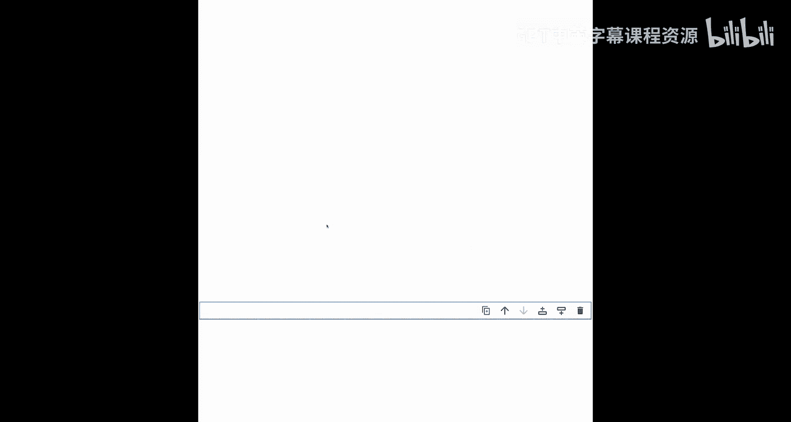
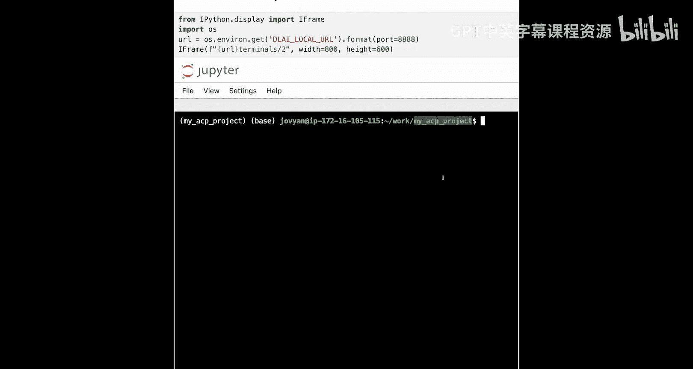
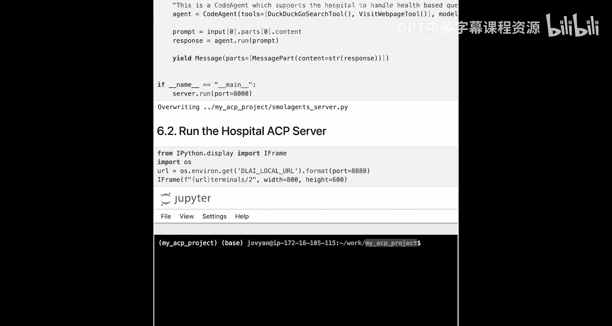
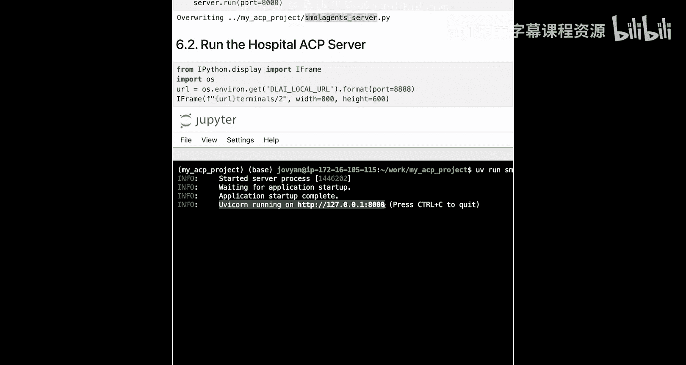
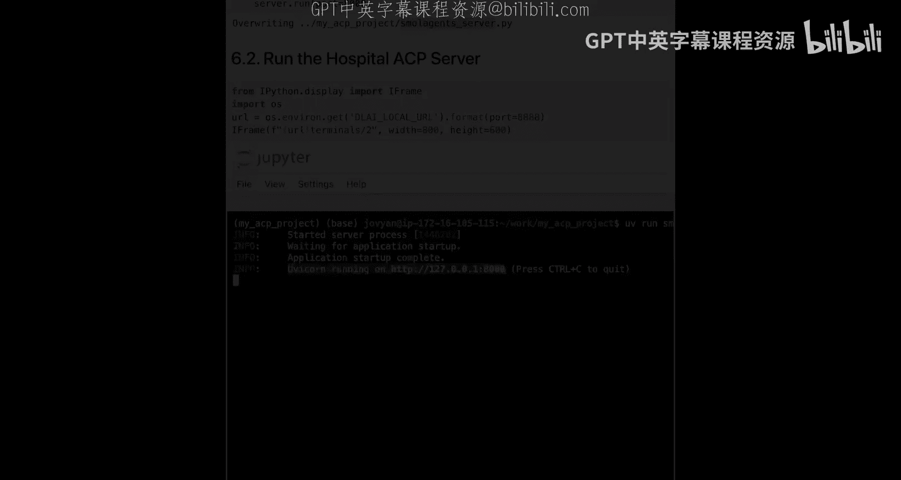

# 吴恩达《代理通信协议｜ACP： Agent Communication Protocol》中英字幕 - P7：7.wrapping-a-smolagents-agent-into-an-acp-server.zh_en - GPT中英字幕课程资源 - BV1VfgrznEjS

You've gone and created an AP server and you've defined an agent running on it。

 and you've been able to call out to it via a client。

 But this doesn't really demonstrate interagent opability。 does it。

 We've only call out to a single agent。 Well， we're going to define another AP server and begin the process of sequentially training these agent calls。

 The first thing that we need to do is create our second server。 And in this case。

 we're going to create a hospital AP server to work with our insurance server。

 So we've gone to our first AP server， The insurance server。 we're going to another AP server。

 but this one's going be more focused on a hospital。

 If you imagine this might be a common pattern when it comes to different organizations might use differentP server to communicate across those different organizations。

 Maybe you might even define different AP servers to communicate across different teams。

 In this case， we're going have a hospital to ensure a type relationship when it comes to working with our different AP servers。

 So we're going to start in a similar manner or what we did for the。😊。

the first thing that we're going to go on ahead and do is we're going to create a server and we're going to output this into our my ACP project repository or directory to do that。

 we're going to use the right file magic function inside of our Jupyter notebook and then we're going to export this file into the ACP project directory and the file we're going to be outputting is small agents underscore server small agents I'll come back to this in a set The next thing that we need to do is bring in a couple of dependencies Now these dependencies are going to be pretty much the same as what we brought into our insurance server from an ACP standpoint。

 the agent stuff is going be a little bit different。

 So first up what we're going do is we're going bring in the a generator class from collections ABc This is going to be used as the type when it comes to defining our agent function。

 we're then going to import the message and message part class from ak models we're going to use this to structure the output that we send back from our ACP server and specifically our agent on that ACP。

😊，Sver then we're going bring in a couple more dependencies from our ACP SDK do server class。

 We're going to bring in run yield runy resume and the server itself。

 run yield and run yield resume are going to form part of our asynchronous generator and the server is going to form the context of our ACP server altogether Now why did we call that small agents server Well rather than using crew A like we did for our insurance server。

 we're going to use the small agents framework this time this sort of shows that you've got the ability to use different agent frameworks when it comes to working with ACP So what do we need to bring in from a small agents perspective。

 we're going go from small agents we're going to import the code agent。

 we're going to import theduct go search tool So this going to form our search tool we're also going bring in the light LLM model class and the visit webage tool。

 So the code agent is going to form the crux of our agent and this means that it's going to be writing out Python functions to be able to call out to different tools theduct go search tool and the visit webpage tool are going to allow us to access the Internet and the light。

😊，LLM model is going to form the basis for the LLM that we're going to use inside of our agent。

 Those are the main dependencies now imported。 Now we're going to follow pretty similar structure when it comes to defining our ACP server。

 So what we're going to do is we're going to create a new server。

 And this is an instance of our ACP server that we define over there。

 We're then going to define our LLM model。 So to do that。

 we're going to use our light LLM model class and we're going to pass through our model I which in this case is going to be openaiI G4。

 but again， you could use your own LM provider， you could use o Lama， you could use local L。

 you've got the ability to use a number of different choices。

 if you wanted to use whatsson X or o Lama。 Those are the other ones that I mainly use。😊。

Then we're going define the maximum number of tokens for our agent。 We're going set that to 2，0，4，8。

 We needed a few extra when it comes to using small agents。

 So that is our server now defined and our Lm now defined Now we're going to define our agent。

 So to do that， we're going to use the server do agent decorator and then we're going to define another asynchronous function。

 And this time we're going call this agent health agent。

 remember when we define our last agent was called policy agent。

 Then when we use the client we called the policy agent to be able to send our prompt to it。

 And again， this is going to have one argument。 and it's going to be the input。

 and this is going to be a list of messages。 We're again going to return our asynchronous generator。

 and that's going to take in run yield and run yield resume。

 Then what we're going do is begin building out our agent。

 remember one of the most important things is defining our doc string because this is going provide metadata about the agent that we've got on our AP server。

 So we are going to define doc string。 So we're going say this is a code agent which supports a hospital to handle healthbased。

😊，For patients，Currental prospective patients can use it to finance answers about their health and hospital treatments。

 full stop， So that's our doctoring now defined。 Now when it comes actually building up our agent。

 we're going to create a new agent and that as our code agent from small agents over here。

 we then need to pass through a couple of。 So to the tools argument。

 we're gonna pass through two things。 theduct go search tool and the visit web page tool。

 Then we need to pass through our model。 So we've now got our tools defined， we also need our L。

 we're going set our model equal to model， which in this case is set to our openaiI G for class。

 Then what we want to do is we want to get our prompt。

 And if you remember when we our insurance agent， we're able to unpack our input grab the first prompt from the list and then grab the first part from that prompt and then grab the content value。

 So if we go and do that again， we should be able to grab our prompt。

 So we're going a new variable and we're going set that equal to prompt and then we're gonna get the input。

 grab the first prompt grab the first part of that prompt and then grab the content。

 Then we can take。😊，Prot and pass it through to our agent using agent run。

 and then we're gonna pass our prompt over there。 So now what we should be doing is we'll be getting our standardized prompt from the ACP client we'll be unpacking that so that we get it into a format that we can pass it through to our small agent code agent and then we're going to be running it using an agent run over here we're going to return our response。

 And again， we're going to use the message and message part format because this is the way that we structure our outputs using ACP So we're going to yield message and then we're going to specify the parts and the parts are going to be an instance of our message part。

 We're going set the content value to a string and that string is going to take in our response that we had over here。

 So now we've got a similar input structure're unpacking it over here to get our prompt。

 and then we've got a similar output structure， which is ACP compliant to output this when a user goes and makes a call via a client。

 All that's left to do is go and run it。 So again we're going to use a similar Python structure。😊。

So we're going go if name is equal to main then what we're going do is we're gonna run that server and we're gonna run it on port 8000。

 remember we run the insurance server on port 8001 we don't want them to clash so we're going run this particular server on a separate server now if we go and run this that's going to overwrite whatever we had inside of my ACP project and specifically it's going to overwrite the small agents underscore server but this is really our hospital server now defined so how do we go about running this similar to what we did previously for the insurance server we're going to run this inside of a terminal so to go on ahead and start up our hospital server。

 we're going create a new instance of an iframe but this time we're going get terminal2 so previously we got terminal1 to run our insurance server we're going to run the hospital server inside of a terminal so when you're doing this locally you just create another terminal if you're running on Mac you might create a bash terminal if you're running on Windows you might create another powerhe。

😊，In， to run this second server， we're going to specify the height and width of this particular terminal。

 So We're going to set the width to 800 and the height to 600。 And if we go and run this。

 we should get our terminal back。

Take a look。 That's our terminal running。 And again， we're running inside of the my ACP project file。

 So if we were to go inside of our folder， we should see our insurance server。

 but also our hospital server now。 Now， if we want to go and run our hospital server。

 we can run U V run。

And we are running what was our filecode， small agent server dot pi。So if we scroll and over。

 you can see that we're going to be running U run， small agents underscore server do pi。

 and all things holding equal that should kick off our hospital server。😊，And take a look。

 we've now got our hospital ACP server running on port 800s who've now gone and defined a second ACP server。

 this one's defined using small agents and we've now started it up running on a separate port。

