# 吴恩达《代理通信协议｜ACP： Agent Communication Protocol》中英字幕 - P8：8.sequentially-chaining-the-agent-calls.zh_en - GPT中英字幕课程资源 - BV1VfgrznEjS

You've now gone and to find a insurance AP server。 You've also built out a hospital AP server。

 And keep in mind that hospital AP server is running on a different framework as opposed to the insurance server。

 So sort of shows that AP can handle a number of different frameworks。

 But how do we get them to talk to each other。 Can we pass context from one to the other and build sequential calls。

 That's exactly what we're about to cover。 So we're now going chain our agent calls。

 The first thing that we need to do is once again， just make sure that our AP servers are up and running。

 So to do that， we're first up going connect to terminal1。 If we going ahead and run this。

 Let's double check to see if our insurance server is up and running。😊。

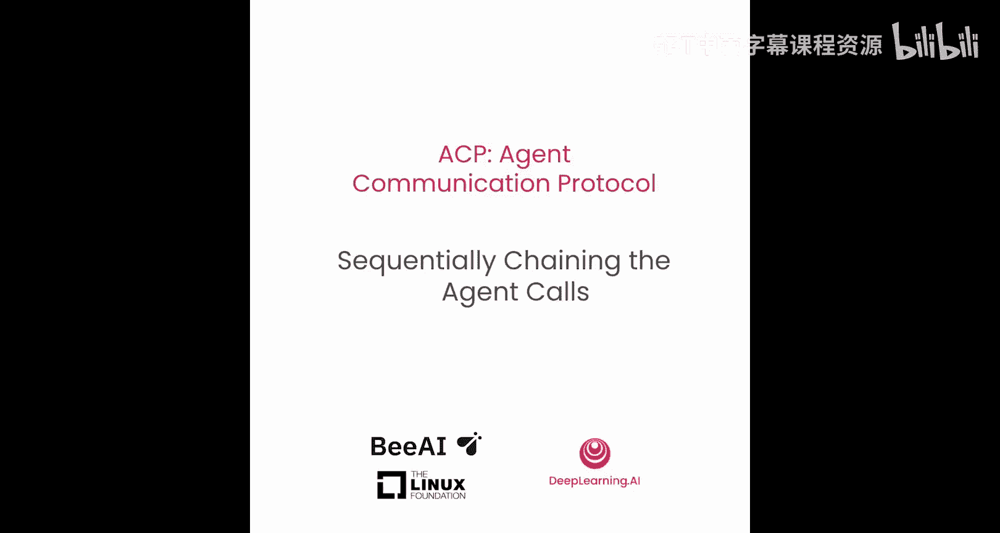

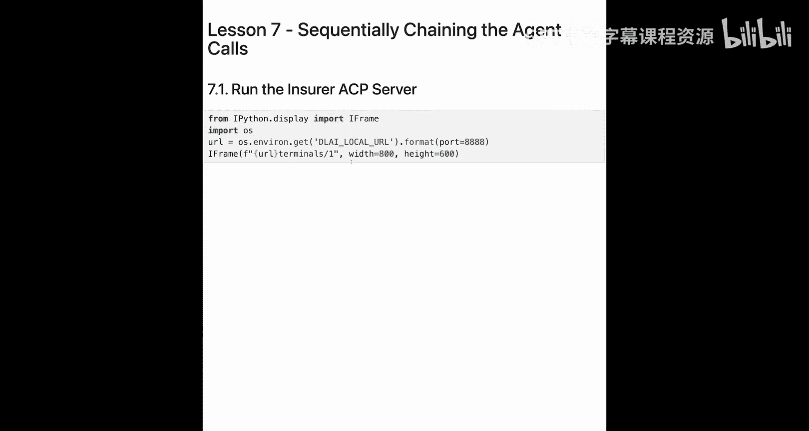

And take a look， looks like it's still up and running and we can see the last call that we made to it from a previous lesson。

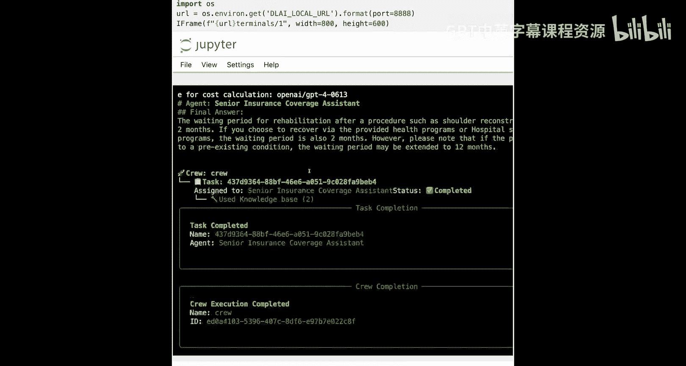

Let's do the same for our hospital server。 Remember， the insurance server is running using crew AI。

 and it's a retrieval augmented generation agent。 Our hospital server is using small agents。

 and it's using a code agent。 Okay， so for our hospital server， we're again going to import Iframe。

 we're going import O， grab the local URL and then run the terminal。 But remember。

 the hospital server is running on terminal2 as you can see So if we go ahead and run that。

 let's double check if our hospital server is still up and running and take a look。

 it does look like it is up and running over there。😊。

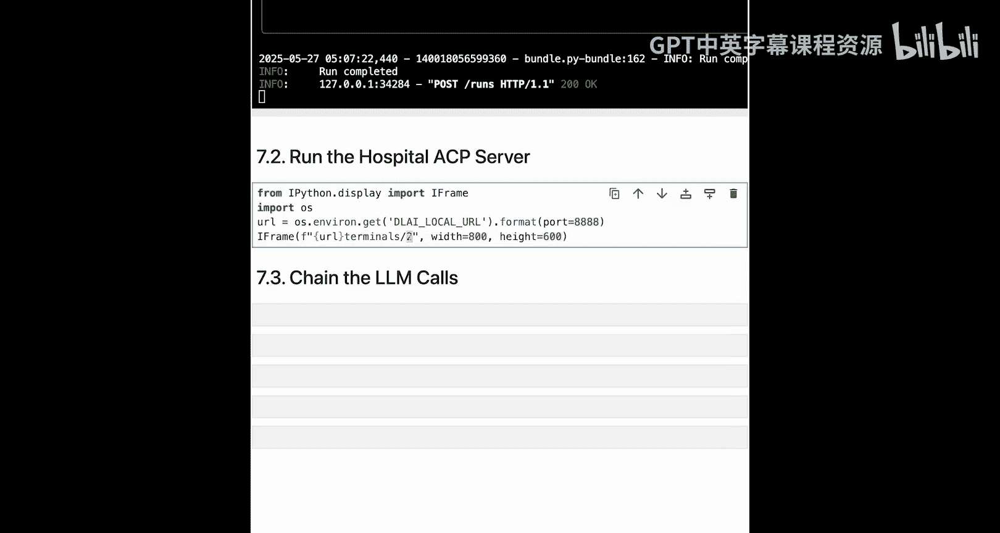

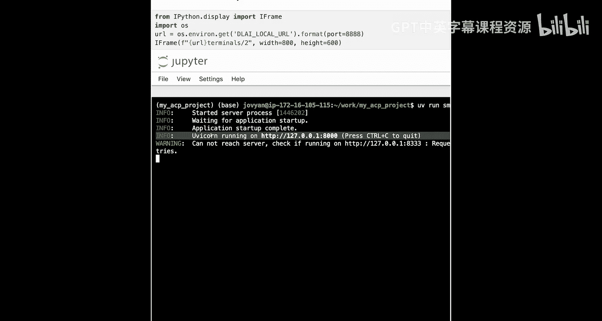

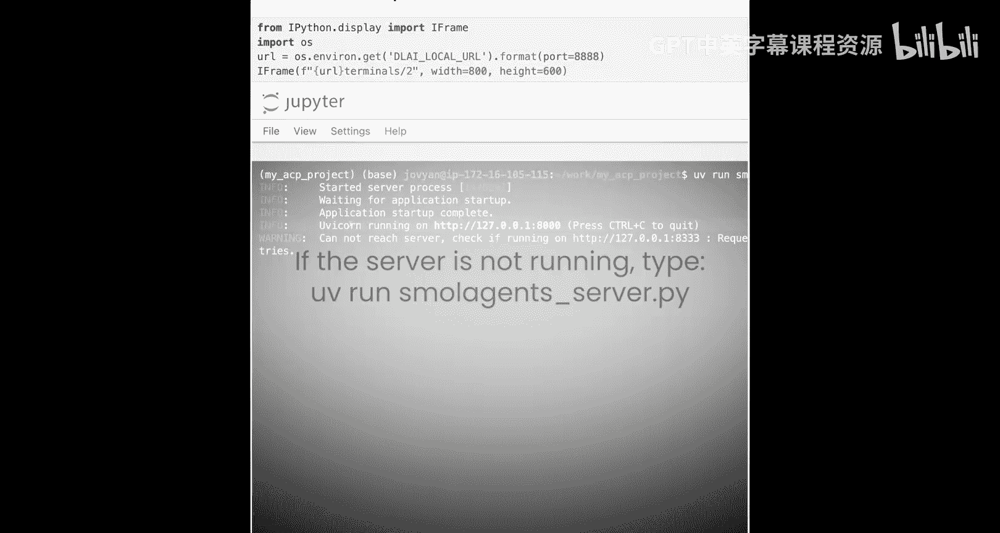

Okay， so the next thing that we want to go in ahead and do is chain our LLM calls。

 We're going import N asynch Io to make sure that we can nest our calls and apply it to our environment。

 Okay now comes the crux of it。 So to go and make asynchronous calls。

 what we're going to do is first make a call to our hospital server and we're going to ask do we need rehabilitation after shoulder surgery。

 And then what we're going do is we're going to unpack and get the response and pass that through a context into the next call to our insurance server and we're specifically going to be calling out to our policy agent。

 So again， we're going to bring in our client from the ACps SDK and we're going to bring in four from coloror as well。

 we're then going to define an asynchronous function and this is going to be called hospital workflow。

 So we're going to run this when it comes to running our chain calls。

 This is going to return nothing。 Now we want to go ahead and create two clients to connect to our two servers because remember we've got our first server。

 which is the insurance server， which is running in port 8001 and then。😊。

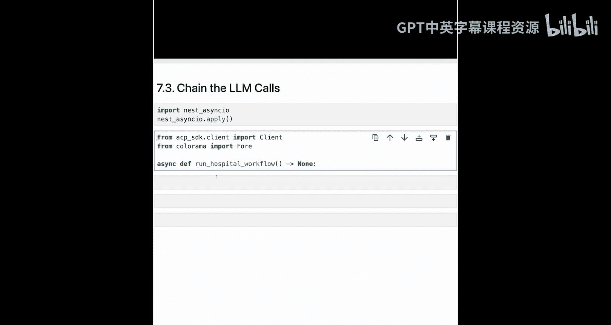

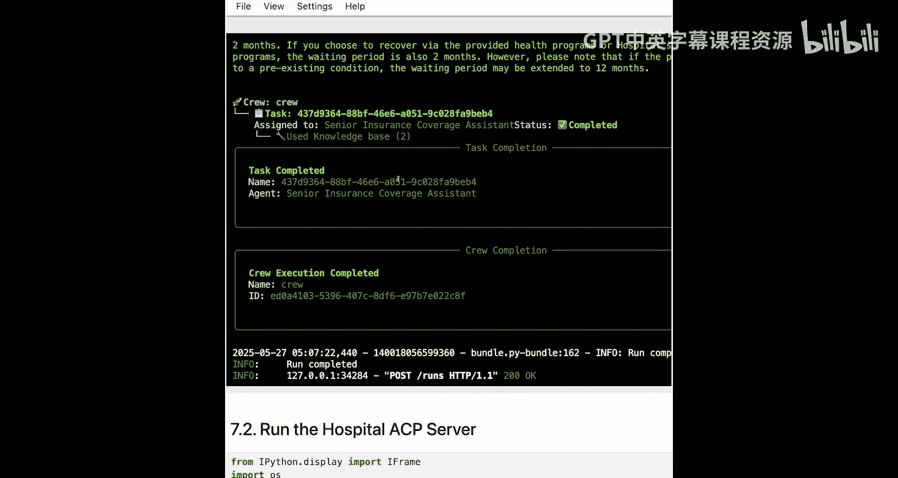

We've got our second server， which is our hospital server running on poor 8000。

 So we now need to connect to both of those servers。

 So we're going create an asynchronous connection and we're to create the first client to connect to the first server and label the client as the insurer and then we're going to create the second client to connect to our second server and label that as the hospital So those are our two clients。

 So this is our first client， which is going to be our insurer and then this is going to be our second client which is going to be connecting to our hospital but it shows you that you can connect to different aP servers。

 which is ultra useful if you have agents in different organizations if you have a different specialized agents and they're running in different places。

 This gives you a way to connect them all。 But how do we pass contact between them so that we can make sequential calls So first up what we're going do is we're going to connect to our hospital client and we're going run aynchronous function and we're going to call out to our health agent and then we're going pass through our prompt。

 So our prompt is going to be passed through into the input variable and we're going set that too do I need rehabilitation after。

😊。

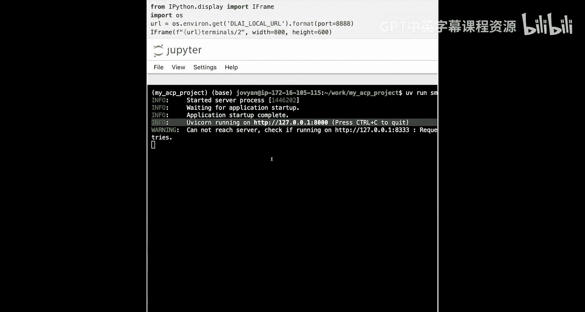

A shoulder reconstruction。Now， once we've gone and run this particular prompt。

 we'll be able to unpack that。 remember we're able to unpack using the message and message parts format so to get our output or to get the specific text from our output。

 we're going to go to our run we're going get the output and we're going get the first example because remember if you have multiple prompts you're able to get multiple responses back and we're going grab the first part because we're sending it all as one output and then get the content from that。

 Now to make sure that we can see what we're outputting， I'm going to print this out。

 So we're going print it out in light magenta using colororama。

 So over here we've got our terminal formatting。 we're append the content and then we're going reset to make sure that we go back to white。

 Then we're going run our second call。 So this is effectively our first call to our first ACP server Now what we want to do is make our second call and we want to take this。

 which is effectively our output from our first call and append that as context to the next one。

 So we're pretty much going replicate what you can see here But this time。

 what we're going to do is we're going connect。😊，our insurance client。

 and we are going connect to our policy agent， and we're going to take this content。

 which we've already captured from our first run， and we're gonna to append it to our prompt。

 So prior to asking our question， we're going append our context。

 And you can see here I'm just doing a little bit of text formatting。

 And then I'm going to pass through my second question。

 So what is the waitinging period for rehabilitation。 So now we should know。

 do we need rehabilitation， and then we're passing that same context to our next L core。

 and we're going print this output out as well。 So we're printing out the output from our hospital run in light magenta and we're gonna to print out the output from our insurance agent in let's print it out in yellow。

 So again， we're going unpack the results of that。 So it's going be run to do output。

 we're gonna get the result of the first prompt we're outputting everything in a single part。

 So we're gonna grab that part。 and we're going grab the content from that。

 And then we're gonna reformat our terminal。 So this should give us a sequential ACP call We're going to run。

😊，The first call here， we're then going to get that context， pass it over here。

 and then we're going to run that second call。 So we're taking the output from this。

 passing it to this。If we go and run that call using asnc IO， So we're going to import asncio。

 and then we're going to use the run method， and we're going to run the hospital workflow from over here。

Now， if this all works correctly， we should see， so we are hitting the hospital server first。

 so we'll see this server running first and then we'll see this server running。

 So let's kick this off and see how we go。😊。

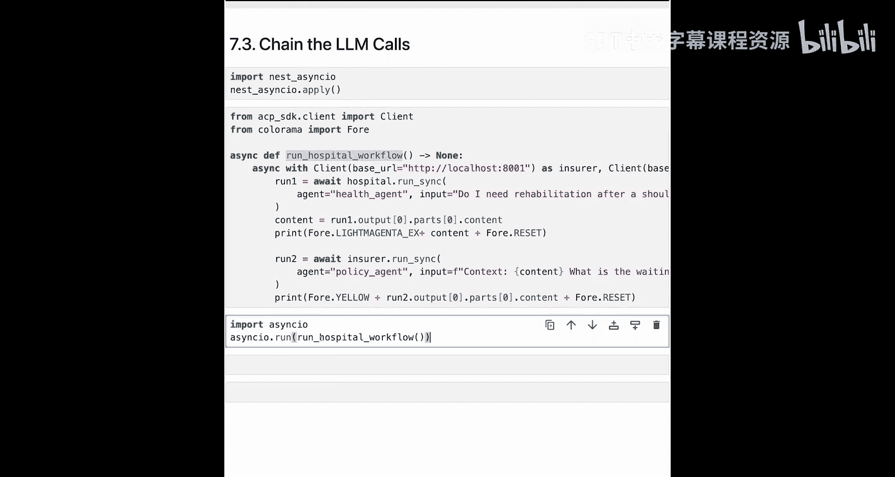

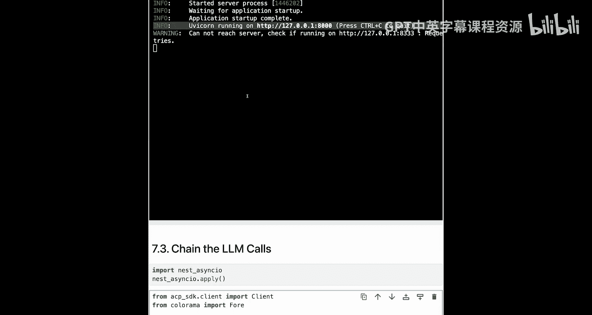

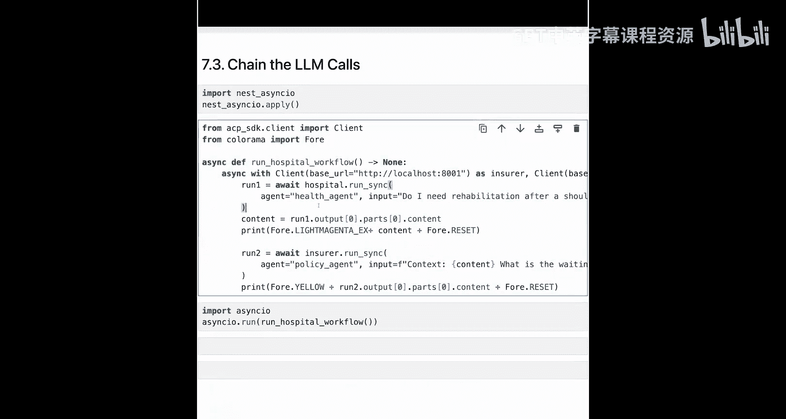

So if we go and run this cell so take a look， we've already kicked off that first call or do I need rehabilitation after a shoulder reconstruction We've got some output from the net so you can see that we're actually calling out。

 we've got some results from a number of different websites and take a look we've got our final answer。

 Yes， you do need rehabilitation after a shoulder reconstruction you can see that's printed out in light magenta if we go and take a look at our crew AI agent。

 take a look that's running as well over here。😊。

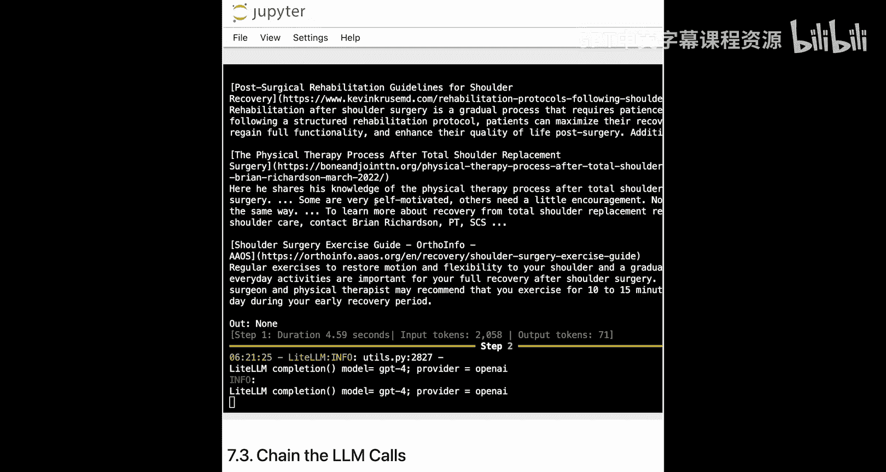

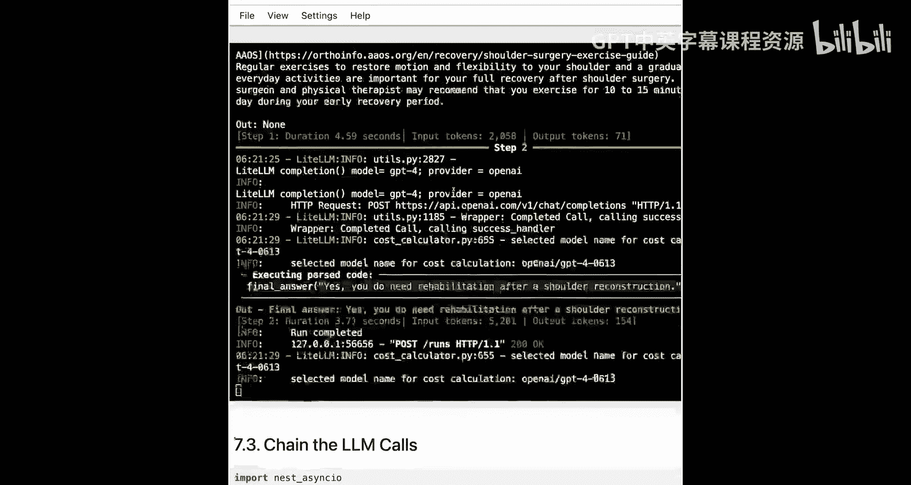

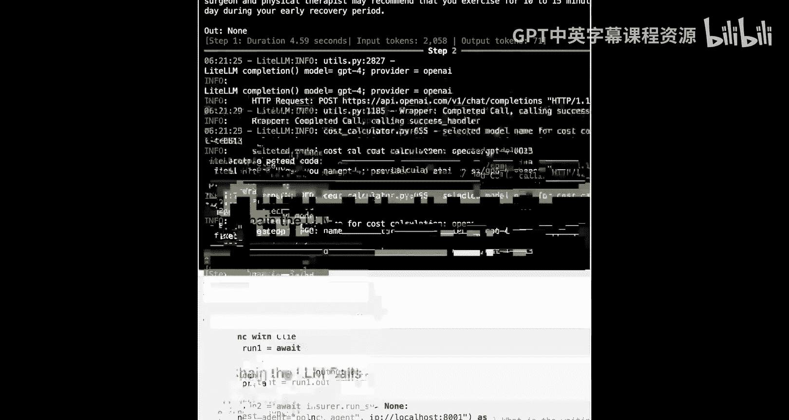

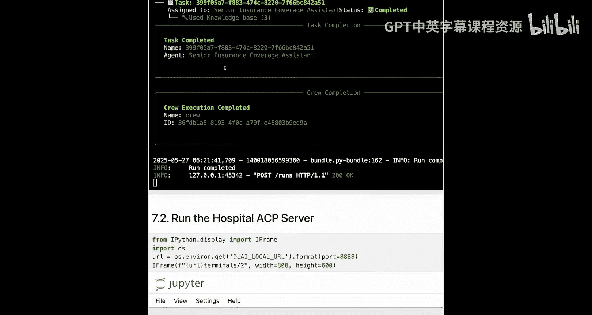

And we should get our looks like we've already completed as well。 So we do we have our final answer。

 We do。 The waiting period for a shorter reconstruction is is typically two months under the gold cover plan。

 So take a look。 we've now gone and sequentially run ACP calls。

 So this is the result of our first call。 and this is the result of our second call with the context appendit。

 But it sort of shows you the possibility。 If you needed to change different processes together。

 This is the way that you'd be able to do it。😊。

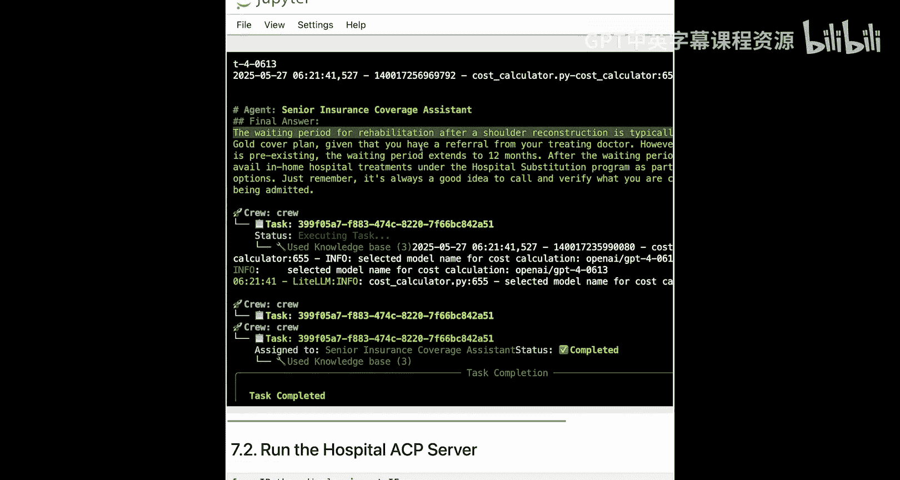

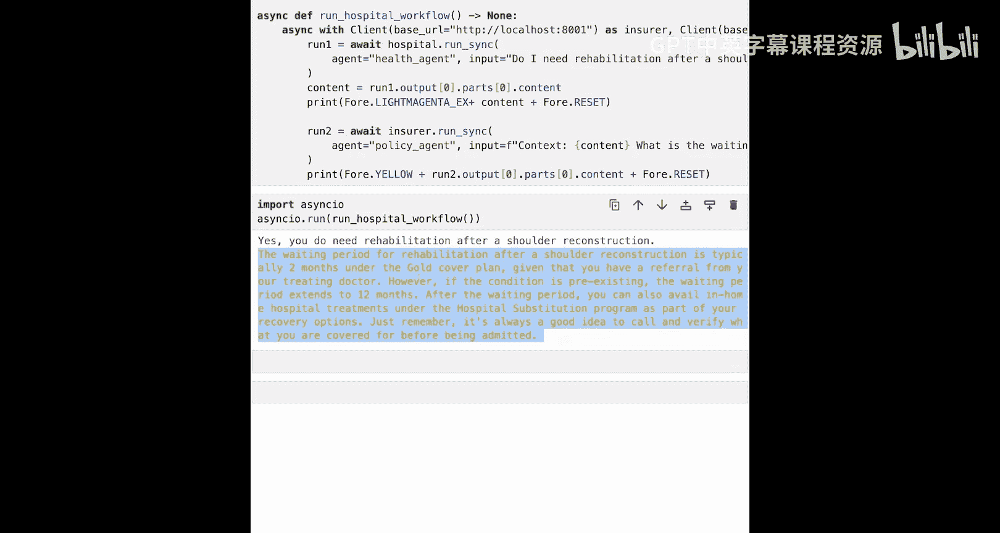