# 吴恩达《代理通信协议｜ACP： Agent Communication Protocol》中英字幕 - P9：9.hierarchically-chaining-the-agent-calls-using-a-router-agent.zh_en - GPT中英字幕课程资源 - BV1VfgrznEjS

You've now built up AP servers and connected them together using sequential agent calls。

 But what if we wanted to use a router agent to be able to navigate the different AP servers by themselves。

 How might we go about doing that？ Well， this brings us to this lesson， making hierarchical calls。

 So we've gone and run through sequential chaining。

 But now we want to be able to go and hierarchically chain these agents together。

 use a router agent to be able to automatically navigate how to best answer a question。

 And the way that we're going do this is we're actually going to use a prompt。

 which is a combination of what we've done before， So rather than asking。

 do I need rehab and then what is the waiting period， We're actually going to combine it。

 So the final prompt that we ask is do I need rehabilitation after a shoulder reconstruction and what is the waiting period from my insurance。

 So that way， our router agent sort of needs to navigate between both of our AP service to determine how best to answer this question。

 So how do we go about doing this？ Well， first up， we've got to make sure that both of。😊。

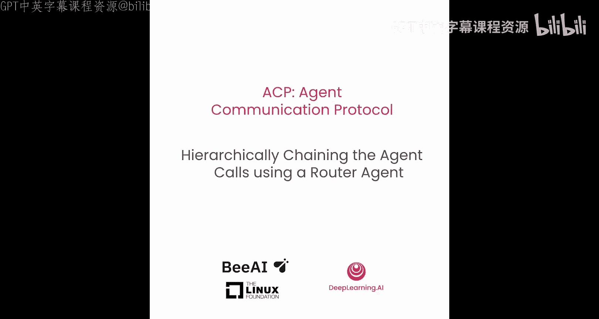

ACP servers are up and running and again you've probably done this a few times now。

 but we want to make sure that they're up and running because there's a limit of 120 minutes when we're running it via this lesson if you're running it locally it's as and when you are running that Python far but for now let's go ahead and double check that both of our ACP servers are still up and running we're going to first up bring up terminal one which should have our insurance server。

 let's just make sure that's still up and running。😊。

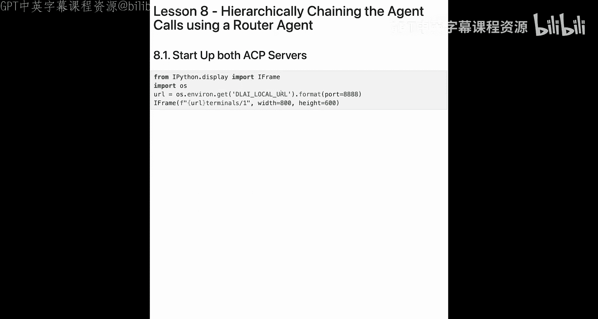

And that looks all well and good。 lookss like we've still got the output from our sequential call up and running there。

 Okay， now what we want to go in ahead and do is make sure that our hospital server is up and running as well。

 So again， we'll grab our second eyeframe and we're gonna grab terminal2 now。 Let's run that。😊。

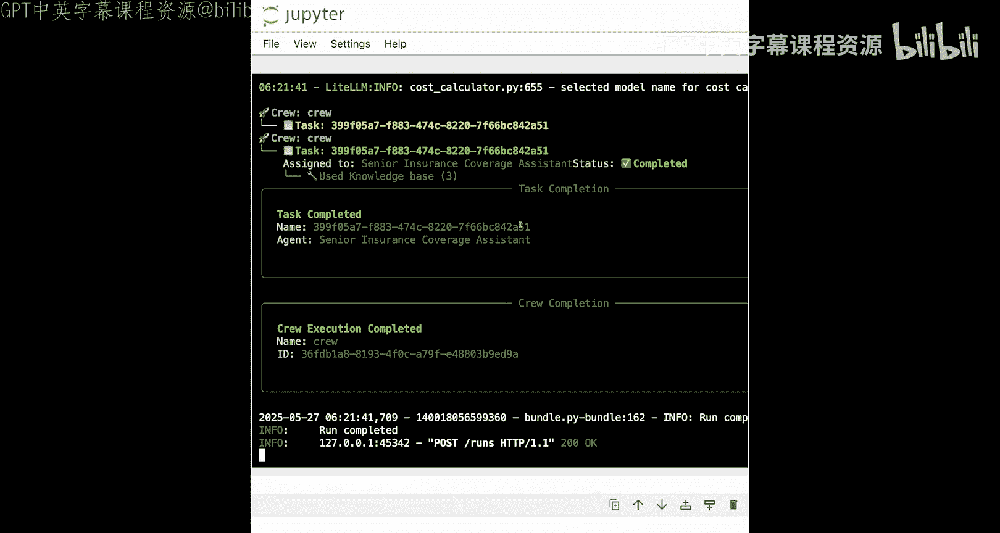

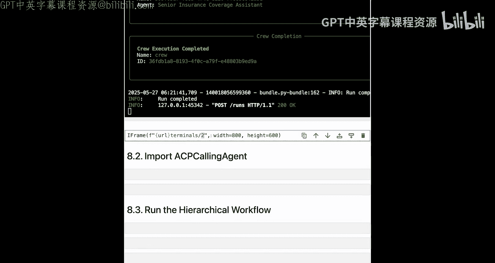

That still looks like it's up and running。 So that's looking pretty good。

 Now we're going to get into the ACP calling agent。

 So this is a mockup router agent that I've gone and built to demonstrate how we might go about running hierarchical workflow So to begin with we first up need to bring in a couple of dependencies So we're going bring in asyncch Io to be able to run our server。

 We're going to bring a nest Asyncch Io so that we can nest them。

 We're also going bring in the ACP SDk client。 This is going to be used for a really specific reason。

 when we go and run this hierarchical workflow。 We're first up going to discover what agents we've got available。

 then pass it to our router agents so it can automatically navigate which agents it should be calling on which ACP server。

 Then we're going bring in small agents and I'm mainly using this so that I can access their light LM model class。

 you could also use the completions capability direct from light LM。

 but I really like the small agents implementation。 then we're going bring in my special class。

 which is fast ACP。 but really it's just an example。😊。

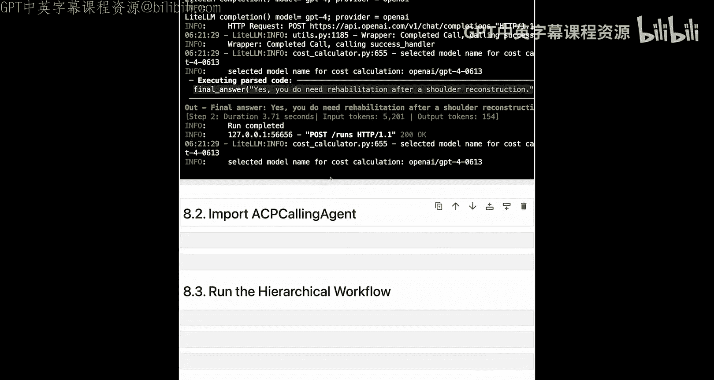

Of how you might go about building your own hierarchical workflow。 So to do this。

 we're going to bring in from fast ACP we're going to bring in the agent collection and the ACP calling agent。

 So first up the agent collection is going to structure our ACP agents in a format that we're able to use them and then we're going to take the agents from here and eventually pass them to our ACP calling agent。

 which is really just a router agent So it automatically navigates which ACP agent is best to call to answer a particular question but it'll break up our prompt eventually you should see this when we because we've got a concatenated prompt。

 it's going to break it up and work out which agent is best to answer which part of that question and we're also going to bring in colorama and specifically before capability。

 So that way we've got a little bit of terminal formatting。

 if we go and run this it looks like we've got a bit of a warning， but that's perfectly fine。

 Now let me give you a quick deep dive into the ACP calling agent So if I go and print out the doc string you can see that it's the agent。

😊，using Jason like ACP agent calls similar to the tool calling agent from small agents I've sort of mimicted off that。

 but rather than calling tools it's going to call different agents So whereas the tool calling agent is able to navigate between different tool this ACP calling agent is able to navigate between different agents and it takes in the ACP agents a model prompt templates planning interval so on and so forth but we're mainly going to use the agents and the model for now but those are our ACP calling agent depend is now imported now what we want to go ahead and do is run our hierarchical workflow first up we're just going to make sure that we're able to nest our ACync IO call so that should be perfectly fine and then we're going to begin building our hierarchical workflow so again this is going to look pretty similar to the sequential call the main difference is that rather than using the client directly and sending a prompt direct to that client we're going to use the ACP calling agent and let automatically navigate which ACP server and。

Wwhich agent on which AP server should be calling up。

 So the first thing that I'm going to define is the model that I want to go and use for our router agent。

 So we're going to use the light Lm capability from small agents for this and the model that we're going use is open AI and specifically G4 as usual if you wanted to use a different model you've got the ability to do that when I run on ma I usually use2。

514 when I use what's an x A I typically use one of the ma for family of models that is our light L model now defined now we're going to define our hospital workflow。

 So we've defined this previously when we did our sequential API calls。

 but we're going to do it again this time we're going to focus on our aP calling agent or our hierarchical router type agent So let's go ahead and do this so we're going to define an asynchronous function。

 and this is going to be called run hospital workflow。

 It's going to output none and then we're going create two clients to connect to our server。

 So our first client is going to connect to the local host at 8001， which I believe。

The insurance server， we're going to label it as the insurer。

 and then we're going to create another client to connect to our other server。

 which is our local host port 8000， which should be our hospital server。

 And you can see we're connecting to that over there。 perfect Okay。

 then what we want to do first is we want to get all of our different agents。 So to do that。

 we're going to use the agent collection over here。😊，So let's go and define an instance of this。

 So we're going to define a new variable called agent collection。

 And we're going to await an agent collection dot from ACP call。 So to this method。

 we're going to pass all of our different AP clients。

 So we're going pass through the insurer and the hospital。 So these are two different clients。

 Now via the agent collection。 We're able to discover all of the different ACP servers that we've got available and all of the agents that we've got available on those ACP servers。

 So if we now go and reformat this into a method that we can use to pass our ACP calling agent before we pass it to our agent。

 let's print it out。 So let's go and loop through each one of these。

 So we're going for client an agent in our collection dot agents。

 we're then going to create another dictionary and that dictionary is going to have the keys of the agent name。

 and it's going have two parts to it。 It's going to have the agent itself。

 and then it's going have the client。 So once we know which agent we want to call。

 we want to make sure that we use the right client to call out to it。😊。

So we're going append a client here to that as well。 So this means that if our router agent is like。

 oh， I should call the policy agent， well it's going to be able to grab the insurer client and call out to that policy agent。

 Now let's go ahead and also print out these ACP agents so you can sort of see what they look like And what we can do before we actually go and call to out to our ACP calling agent。

 let's just make sure that we get these agents back。

 So if we go and use Async do run and run our hospital workflow， we should get back our ACP agents。

 So let's run this。😊，So we've now gone and discovered all of our agents。

 so you can see that we've got our policy agent over here and we've also got our health agent over here。

 and you can see that we've also gone and appended our clients。 We've got a bunch of information。

 remember how I said that when you go and define that function。

 It's going to take on the name of SA agents。 So you can see here that this is directly from ACP。

 So it's grabbing the name of the agent， but it's also grabbing the dock string。

 remember how we defined our dock string that is coming through when we go and discover our different agent。

 So down here inside of this description， you can see that our policy agent is described as this is an agent for questions around policy coverage uses a rag pattern to find answers based on policy documentation Use to help answer questions on coverage or waiting periods。

 So we're able to not only call out to these different agents， but also discover them。😊。

So how do we go about making this hierarchical call now， well， let's go ahead and do that。😊。

So we're going to define a new agent now。 And this is going to be our ACP calling agent， Aka。

 our router agent。 And that is going to be an instance of the ACP calling agent。

 which will take in our ACP agents， which we've defined over here。

 So it's all of them right across both servers。 And then we need to pass through which LLM that we're going to use。

 So we are going to be using G4。 So we're just going to define that as model is equal to model。

 So our model argument is equal to this model over here。😊。

Then what we need to do is pass through our prompt。

 so we are going to create a new variable quarter result and we're going to wait a ACP agent call。

To that， we're going to pass through our prompt， which is going to be do I need rehabilitation after a shoulder reconstruction and what is the waiting period？

From my insurance。 So this means that， so there's a key difference here， right。

 So when we previously asked our prompts， we separated them out and targeted them to the specific agents on a specific AP server。

 Now， we're just combining them all and allowing our router agent to determine how we should best answer that。

 because there's really two questions there， Do I need rehab after a shoulder reconstruction。

 And then what is the waiting period for that rehab if I need to get it。Now。

 what we're going to do is we're also going to print out the output So the final results。

 So we're going to print it out using coloramas， we'll print it out in yellow。

 and we're just going to construct it as a formatted string。 So we'll get our final result。

 we'll append the result that we've got from here and we'll just make sure that we reset our terminal。

 So now we've got our hierarchical workflow defined。 So if we go and run this cell again。

 So we've now not only just doing discovery， we're also actually going and triggering that call。

 So if we go and run this cell again， we should see these calls go back out to our agent。

 So we're now going to be calling out to our insurance client out to our hospital client to be able to go and answer our kincatenated prompt。

 So let's go and run this。😊。

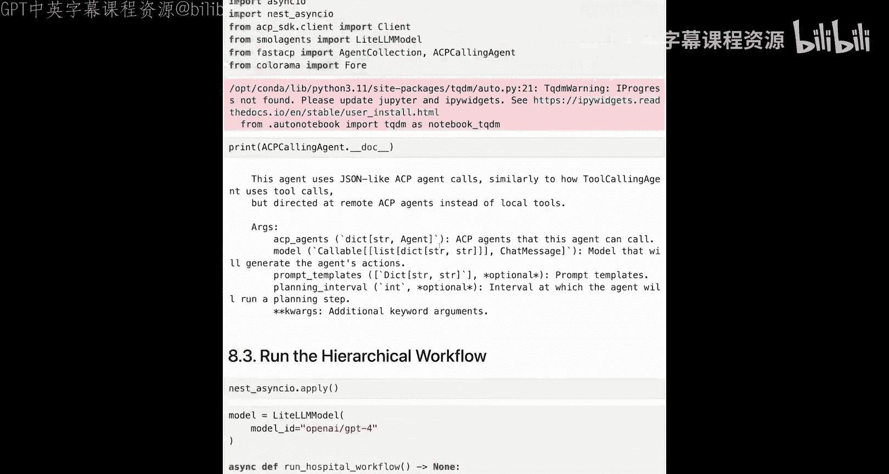

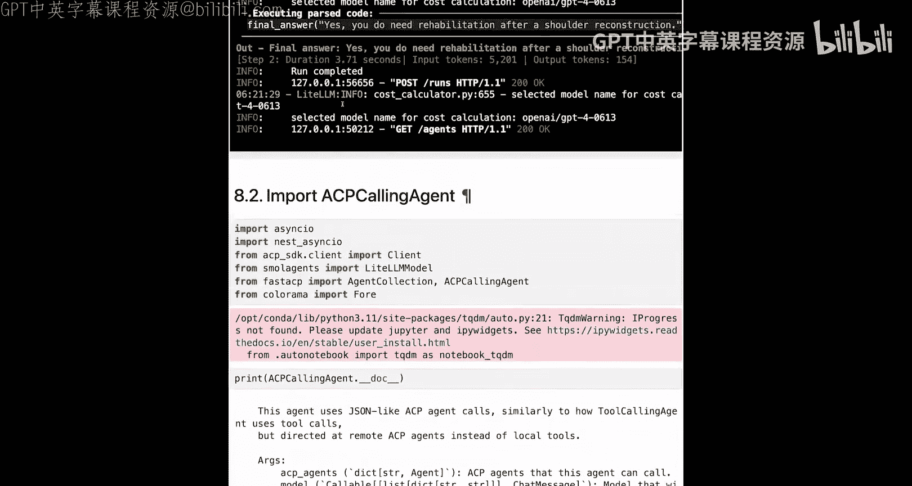

So we've discovered our agents again and take a look。

 you can see that we're calling out to our different agents。😊。

So we've got our input being sent through to our health agent， which is our hospital server。

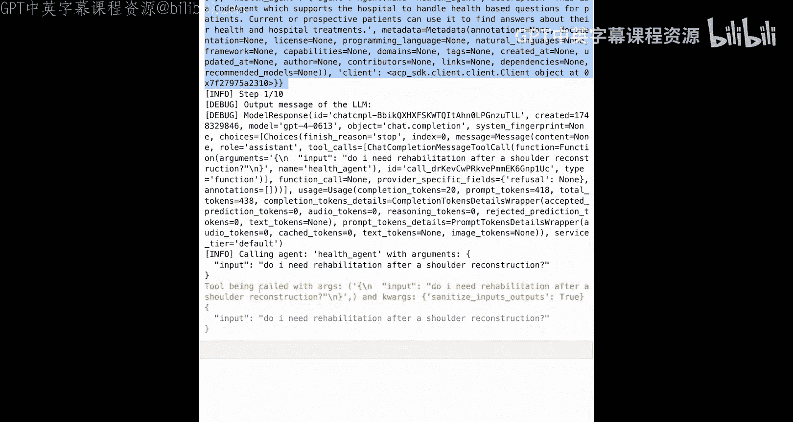

Looks like we've got some responses back。 And if we go and scroll up to our server as well。

 you can see that we're actually triggering this。 So our first response， yes。

 rehab is typically required。 And if we go and take a look at our previous one。

 looks like our crew AI is running。 Let's see。😊。

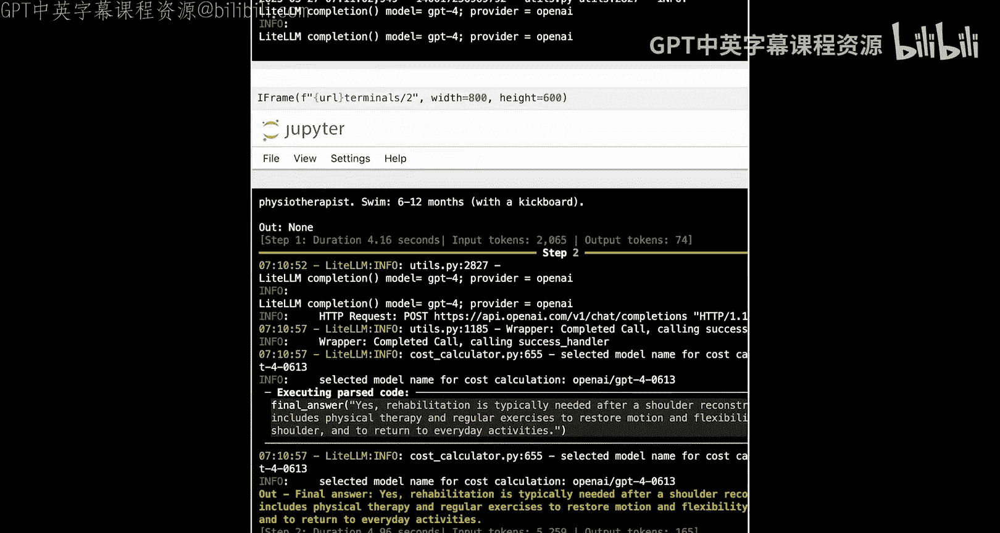

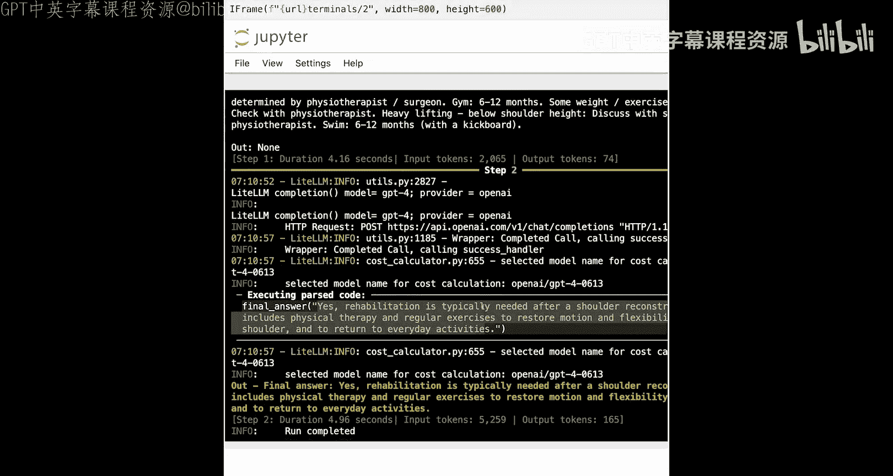

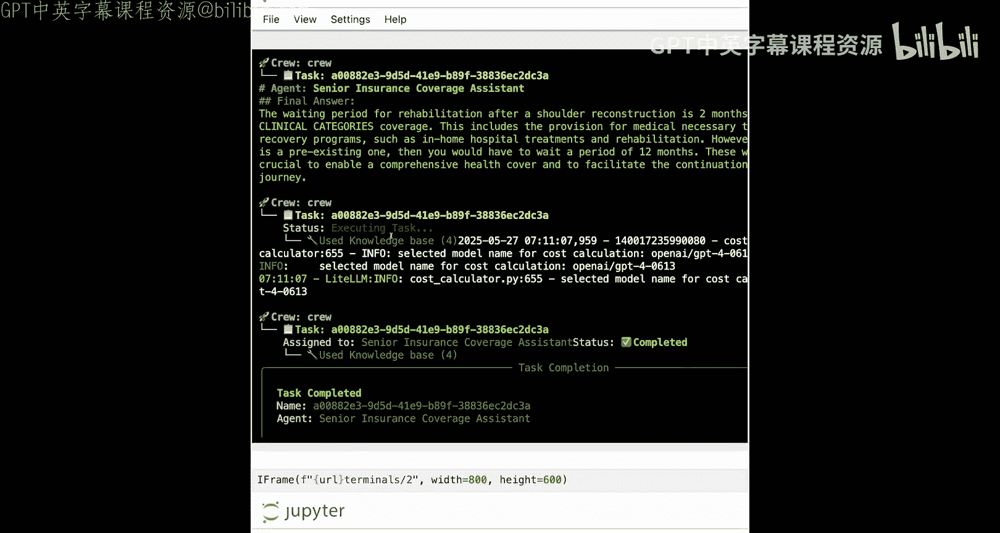

There we go。 The waiting period for rehabilitation after shoulder reconstruction is two months。

 So we have our final output。 Let's scroll on down。

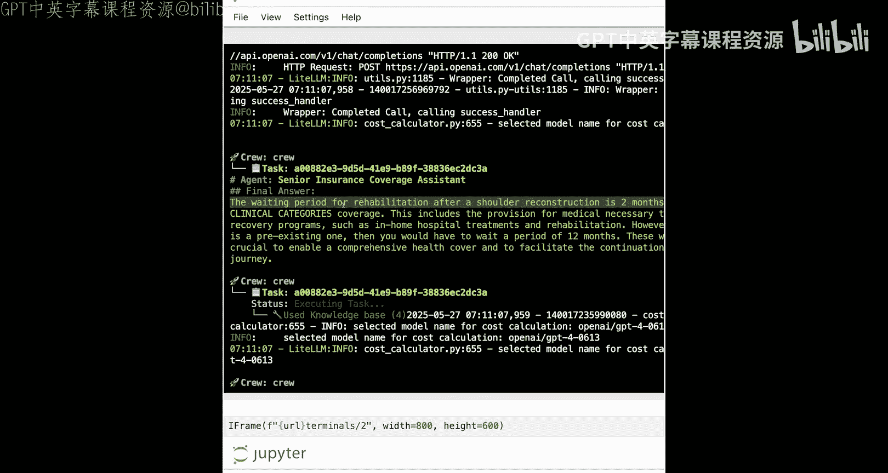

There's our final result。 So you can see that it's automatically navigated between the two different ACP servers to generate a response to effectively a prompt that's being concatedninated together。

 So our final response is yes， rehab is typically needed after shoulder reconstruction。

 it includes physical therapy and regular exercises to restore motion and flexibility to the shoulder and to return it to everyday activities。

 In terms of insurance coverage。 the waiting period for rehab after shoulder reconstruction is two months as para clinicallin categories coverage。

 Remember， that's from the rag agent。 This includes a provision for medically necessary treatments。

 However， if the condition is a preexisting one， then you would have to wait a period of 12 months。

 So we've now gone and automatically navigated through our different ACP servers and the agents on those servers using a hierarchical calling agent。

😊。

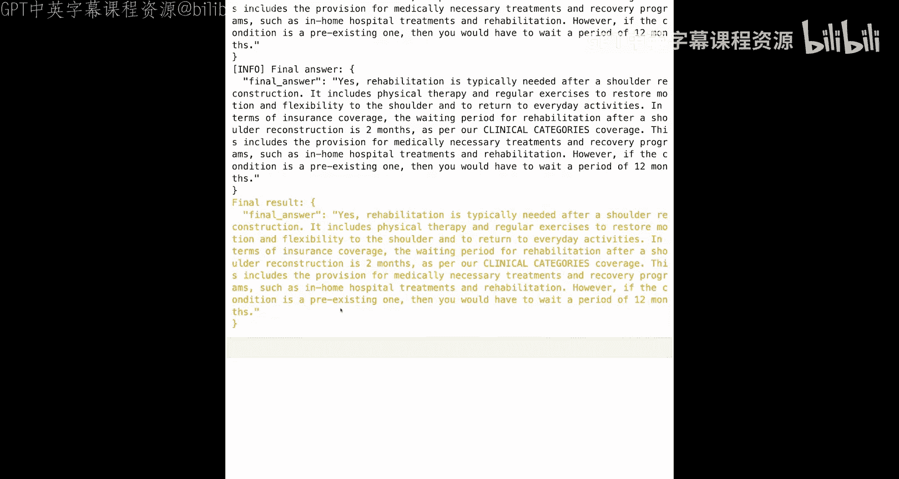