# 吴恩达《以强大的RAG分析提升您的RAG应用｜Turbocharge Your RAG App with Powerful RAG Analytics》中英字幕 - P1：Turbocharge Your RAG Applications with Powerful RAG Analytics.zh - GPT中英字幕课程资源 - BV1HZ421h7p1

🎼。

Hey everyone， my name is Dah Chan Morgan and I run all things community here at deeplearning。

AI today we have a very special workshop where we're going to be focusing on RaG retrieval augmented generation。

As this has emerged as a leading approach in developing generative AI applications， however。

 building air-free RAG systems comes from significant challenges including maintaining chunk and document quality。

 refining prompts and addressing output hallucinations。

 in this session will distill our learnings from conversations with hundreds of AI teams utilizing RAG our focus will include overcoming the five major Roblolocks and RAG application development。

 effective strategies for mitigating these five challenges。

 introducing four robust evaluation metrics to identify and rectify issues in your RAG system and how to build production ready RAG powered applications 10 times faster。

😊，Today's event will be recorded and the slides will go out afterwards。

 please ask questions for the speakers we have dropped a link in the YouTube live chat on Sdo where you'll be able to vote upon what are the best questions for us to answer。

😊，For our first event partner， I want to introduce Brain Fourthbin is an AI and ML education company where they offer workshops for engineers and data scientists and generative AI and other ML topics they also have offerings for executives and leaders on how to adopt AI in your organization you can then learn more at fourthbrain。

AI。And now for our presenting speaker we have Galileo。

 Galileo is a generative AI evaluation observability solution that helps enterprise teams bring production ready applications to market faster。

😊，Galileo instantly integrates into any AI environment and enhances critical workflows with collaborative tools and research backed evaluation metrics Today。

 Galileo is trusted by AI builders from cutting edge startups to Fortune 500 companies。

 I'd love to introduce our first speaker， Vikram Chatterje， Hey Vikram。😊，Hey Diana。

 thanks for having me Abutely so prior to Galileo Vikram led product management at Google AI where his team leveraged language models to build models for the Fortune 2000 across Re financial services healthcare and contact centers he also led product for Google Pay in India taking it from zero to 100 million monthly users the most downloaded Fintech app globally Vikram was one of the early members of the Android OS team and believe JenAI is ehering in a similar technological wave to mobile。

For a second speaker Id love to introduce Atton Atton was an engineering leader at Uber AI responsible for various machine learning initiatives at the company。

 he is one of the architects of the world's first feature store Michelangelo and early engineers on Si to Apple。

Building their foundational technology and infrastructure that democratize ML and Apple， Hey Atton。

Hey， Anna， thanks for having me。Absolutely， and we also have some of their the Galileo team in the chat。

 we have KiK and Jonathan who will also be answering questions in the live chat other than that。

 I'd love for you guys to take it away。Awesome thanks Diana， good morning everyone。

 super super excited to have you here for the session today。

 thanks so much for making the time Athen and I promise that we'll try to make this as educational as productive for US possible and just in general over the past year we've spoken with hundreds of different AI teams building applications that are leveraging large language models and honestly RAG has bubbled up to being one of the most predominant parts of the stack it keeps coming up and a lot of you here today are probably here because you're either leveraging RAG already in production or in your applications pre-production or are super curious about what that looks like and what the pitfalls might be。

😊，To effectively use RAG， it becomes critical to know its potential failure points and how we can qualitatively as well as quantitatively evaluate the health of our RAG systems。

 and that's exactly what we aim to cover today。

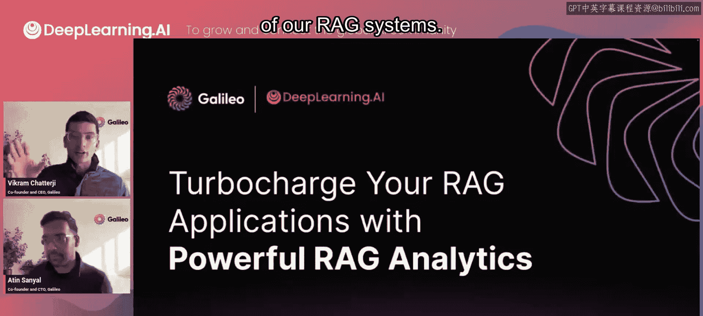

So here's what we will cover today first we will provide an overview of RG and the common but supercrit roadblocks that AI teams face from there we'll provide a practical RG evaluation guide with some qualitative methods as well as some very powerful quantitative methods and metrics for evaluation。

We'll then practice what we preach by actually diving into a live demo for where we showcase how you can evaluate RG systems using everything that we mentioned in the guide before that。

 including the quantitative and quantitative metrics。😊。

We'll also be sharing an exciting announcement at the end pertaining to RG evaluation from our research。

 so do stay tuned for that we'd love to hear your thoughts and feedback and as we go and speak more and talk more during the session we'd love to hear from you so do drop in any questions that you might have in the chat and we'll keep addressing them as we go so please feel free to drop in your questions as we go。

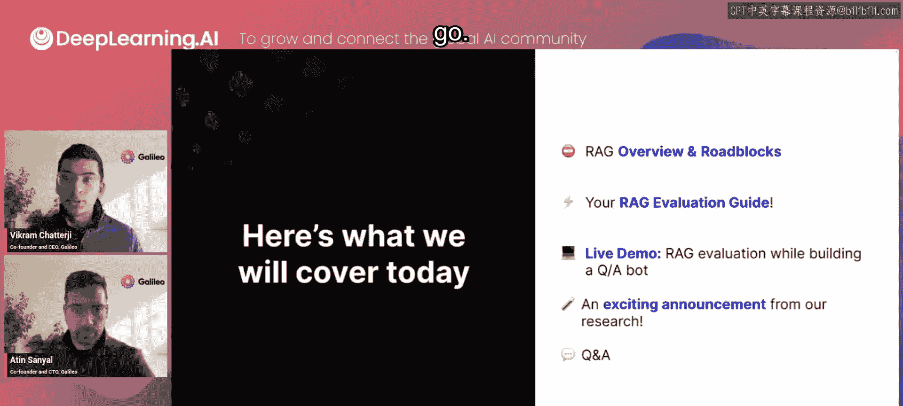

All right， so with that to kick things off and begin。

 let's take a step back really quick and look at what the three big trends have been in GenAI for 2024 first while we saw AI teams experiment and create demo apps in 2023 with a fledgling AI stack in some really clever prompt engineering right we're now starting to see that that AI stack is getting more firmed up with a multitude of powerful close in open source LLMs coming about many。

 many different embedding models getting presented。

 vector databases becoming really powerful part of the stack and inference optimization techniques that have emerged to make productionization cheaper and faster and given this we are starting to see more and more GenI applications getting introduced and productionized。

And this trend will likely only increase in 2024， it's already begun。

The second trend we're seeing is that REG is proving to be quite the winning strategy to productionize LLM applications and the reasons for this are kind of obvious because REG allows users to leverage their external external data as well as their large language models on this proprietary data which is pretty much their boat without having to fine tune in your own models which is also viable strategy but REG be tends to short circuit that you can get to a use case delineation sooner。

 so it's a quick and cheap way to build really good and powerful applications and we're just seeing that that trend increase in 2024。

And however， most users still are lacking a way of building trust and confidence in the quality of their systems。

 given how non-deterministic， especially generative models and sequence to sequence models can be products are getting stuck in that prototype phase because teams and companies are lacking this way of proving to themselves and others that this application can work and actually establishing trust in their application。

 whether it's from a hallucination perspective， privacy， security perspective etc。

 so evaluation continues to be a big challenge on the parts of productionization but there is a solve for that right so therefore in today's talk。

 what we'll focus on。A specifically the last two pieces here， RAG and evaluation。

 and we'll go deeper into both。

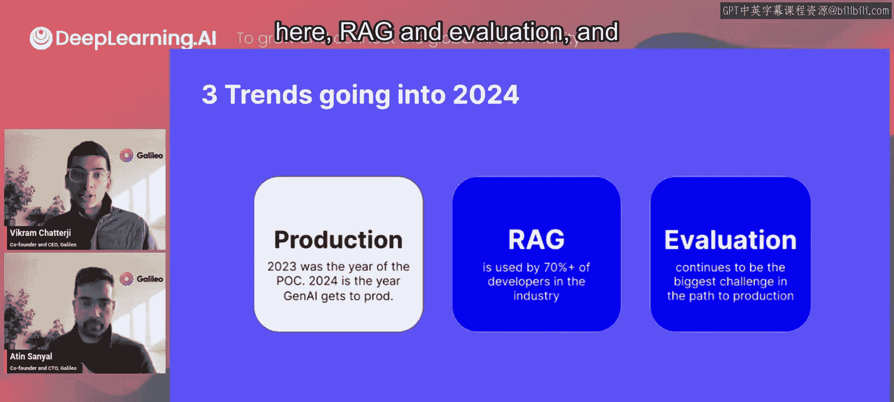

And since 2024 is the year where we as a community productionize more Gen AI models and applications do join us on March 13th for a free virtual session where AI leaders from LinkedIn。

 Commcast， fidelity Doctorctor and gamble and more as well as founders fromI from Lama index viiate fireworks readyb which are emerging as very critical parts of the AI stack we'll talk about the challenges and practical solutions for productionizing GenI applications。

 so truly truly hearing from people in the trenches， practical advice， no exact talk。

 itll be truly practical advice about how you about the pitfalls and challenges and solutions for productionizing General AI you can register for free run Galileo。

 io/ JenAI productionize 2024 look forward to seeing you there。

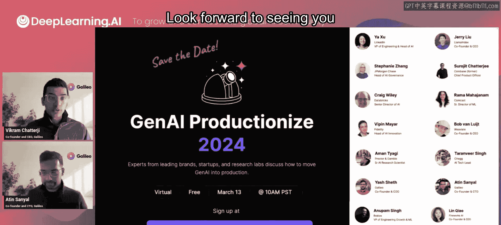

All right， let's now dive into the first part here。

 which is a quick overview of REG and some common but critical roadblocks that teams typically face。

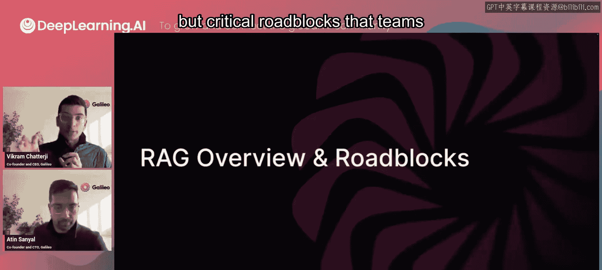

Now just to rewind and take us back to maybe mid 2023 or early 2023。

 if you will right we started with vanilla prompt engineering where everyone was all about you know taking a user query and adding a prompt a system prompt etc and from there having a model in the loop which would then go about and provide and provide a response that would be that would be generated now now this prompt as well as this model in the loop was basically the combination that everyone was using now this model then generates a response。

Which mostly what we noticed was could tend to be hallucinatory so you could see here in the user query that it says the question was what are the common side effects of metformin now this actually happened an AI team at a healthcare company that we work with where you the response from the model was said the side effects for this drug which is a pretty popular drug for especially for type 2 diabetes。

 the side effects for this drug include nausea as well as trouble breathing now mostly the LLM's responses tend to be believable for the person without information and knowledge and in this case when you actually look under under the surface。

Breathing trouble is actually not a common side effect for metformin we we're not experts。

 but we extensively Google searched this before just to make sure that that that was the case and that's where this came to the fore for us but however it is a common side effect for other similar kinds of drugs right and so in somewhere in the embedding space the LLM basically got confused and so these kinds of hallucinatory responses are number one common right because LLMs by nature are basically like these dream engines where they constantly hallucinating responses but the whole our job as an AI community is to mitigate any kind of nondeterministic response which can harm the user so。

The second issue with prompt engineering starts to become the fact that you're always restricted to the data the LLM was pretrained with right so its and you're not 100% sure about whether what data exactly open AI was pretrained whether maybe when La mind the Lama models have been pretrained with there's some level of opacity around that is also the issue of the fact that they were not necessarily pretrained with the most current information and so there's a huge dependency on that so if you're working in a domain where you need very specific kind of information it may or may not exist in the pretrained data that the model had the third issue becomes the fact that your proprietary data cannot be leveraged at all to provide contact so in this case as an example in the case of this healthcare company the proprietary knowledge from their medical database is completely locked away from their GenAI systems and so those are the three big issues the fact that there's a huge tendency to be。

Unable to contain the hallucinations。There's a restriction around the fact that there is opacity for around what the model was pretrained with as well as the lack of introducing your proprietary data。

 all three of these kind of let us all to start to figure out are there different ways by which we can just bring our data into the mix and have more control over the outcome of the model and so that's where specifically RAG started to become more popular right now I will preface this by saying that of course you can also fine tune your your language model as well right and it's in either R it's not you can do either either one of them you can do both it's completely fine however what we've also noticed is when you start to fine tune your model right you need labeled data that can be expensive to label that data or create that synthetically it is more involved whereas RAG has emerged as a faster way of getting to that point where you can actually create a pretty well-functioning application quickly that's a big reason why it's become very popular。

However， do keep in mind that fine tuning RAG can happen both in tandem and most likely in 2024 they are going to start happening together so again。

 so going back to the RAG piece here。So let's look at the same user query again where the question was。

 what are the common side effects of metformin？Right and while coming up with this response， right。

 remember all of that data that was locked before from being available to the model， Well。

 let's take that data back。 let's take all of that domain data back and let's chunk them。

 that's what that's typically what we do in RG in India there are many。

 many different chunking strategies， by the way， which which we can get into And once you've chunked all of this data into smaller bits and pieces you can push them into an embedding model Now this embedding model。

 What this does is basically it's it's。Taking all of these chunks of data and placing them in an ndimenal space this is just a screen grab from Galileo where you can see the embeddings。

 you can see these specific data in the ndimensal space projected in a two-disal space but this is what an embedding model typically does it just project that organize the chunks in the n-disal space there are many different embedding models for you to choose from if you simply go to the MT leader board on hugging face as an example。

 there are lots of open source of options there many close source options available as well a very powerful one is from open AI。

 the AD embedding embedding model so the many of these embedding models to choose from however when you are choosing embedding models right you have to be careful about the different parameters like what are the max tokens you're looking at how do you create what about the re-ranking averages for these embedding models so you have to be mindful about those pieces as well。

Once you're actually using one of these embedding models to keep on your chunks in those embedding models。

 that's when the vector database comes in to be able to retrieve the specific kind of chunks that are useful for responding to that particular user query and that's stored inside of this vector database from here。

 it's then passed into also there are many popular vector databases， by the way。

 there's weviiate PineCone， which is closed source Melvis。

 which is open source and many others that are powerful and come up often when we speak with with people and practitioners out there who are actually building these applications with RG。

But with this vector database what it then does is once it's retrieving all of these chunks。

 it then takes these specific chunks which are most apt for responding to that question like as in this case you can see the first one is about vitamin B12 deficiency。

 the next one is about metformin being used in certain in certain use cases all of these chunks are then sent into the prompt the prompt that you have created and so now if you remember from the prompt engineering workflow is simply the prompt。

 but in this case it's the prompt plus very specific context that is useful for that particular question that was asked and from there once you've augmented the prompt with the right kind of context it goes into your model。

And from the model the the response is generated。 So instead of it now saying previously it was saying that there's trouble breathing versus now you can actually get a better response where it talks about the side effects include gastrointestinal issues including nausea and abdominal pain。

 which from our deep Google research we figured out that this is actually accurate。

 So very quickly using RAG in sort of prompt engineering at bare minimum。

 you can get to more precise answers and unlock all of your data So needless to say it's very powerful and a lot of you probably already know about all of this with RA but hopefully this was helpful as a quick primer now given all of these different pieces in the mix right a lot of things can go wrong。

So many， many pitfalls along the way which which I wanted to call out number one。

 when you actually have all of this domain data you have to make sure that you have sufficient sufficient data as well as the quality of the data is high and so there should be a good distribution of data you know your data best but we've often seen people just pull in a couple of PDFs and expect magic to happen that doesnt doesn't work that way you have to know what data to add also when it comes to the chunking strategies you have to make sure that you're writing using the right chunk sizes there are downsides of having very large chunks and very tiny chunks as well。

 which we'll talk about in the guide in the next step in the next section apart from this when it comes to the embedding model itself theres many different parameters that you would need to optimize as an example you can see in different communities that people have been talking about how there is a bunch of different parameters to optimize and sometimes it can come across as a black art as。

And this kind of this dark art concept of using REG has we've heard of this multiple， multiple times。

 which is specifically why evaluation analytics becomes very important。Apart from this。

 when you actually go and start to。And start to retrieve the different chunks， the question becomes。

 you given the user query。As well as the context that that is being provided in through all of the knowledge and the chunks is the retriever really retrieving the right chunks or not what's the quality of the retriever it's a very important question to figure out like are the chunks actually high quality and a good measure of this is to see if are these chunks actually attributing to the response or not it's possible that it's the retrievers spitting out five different chunks but zero out of five of them are actually attributing to the response and maybe just one of them which is again very wasteful when you productionize different models。

Apart from that， when you actually go to the next step and you have your own prompt， you know。

 the question is is this the best prompt for this task or not？

When you actually then pass all of the prompts and the context to the large language model and generates a response。

 the immediate question that comes to mind is great。

 but you know is this model's response actually adhering to that context that I provided with in the domain data or is it going out of syllabus going back to the what was pre-trained with and maybe hallucinating a lot in its responses。

 how much is it actually adhering to the context I provided especially when you're building out these GenI systems at scale it's really hard on a query by query basis to figure out whether whether this adherence was actually happening or not so we will talk about how you you can measure this for your own GenI applications but this is super super important to figure out because this is where hallucinations come in even with ourG use cases and apart from that the other piece here is given the question that was asked by the user did the model actually completely answer the user's question or not right so a bunch of different。

Questions acrosss the entire flow and therefore we we feel like you know careful evaluations and experiments across the entire RG stack are very critical for high quality application development you have to be able to answer most of these questions such that your RG applications can actually be high quality it's super super important otherwise you'll use RG but the models of haveinate production in production your entire applications can be super expensive you can mitigate costs improve your model quality by taking some very quick steps so let's talk about that I'll pass it over to then now to talk about practical RG evaluation guide。

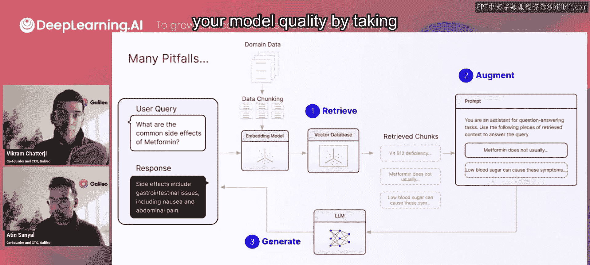

Awesome thank you Vikram yeah good morning everyone or good evening depending on where you are I'm going to just sort of give you a highle sort of evaluation guide provide you with that more generally for all kinds of RA systems and sort of walk you through the key components you already got like the high-leve workflow but the key sort of different parts of the data that sort of go into your RA system and the key questions that you want to ask to assert the quality of your RAG system' going to go deeper into that and also give you a nice little demo。

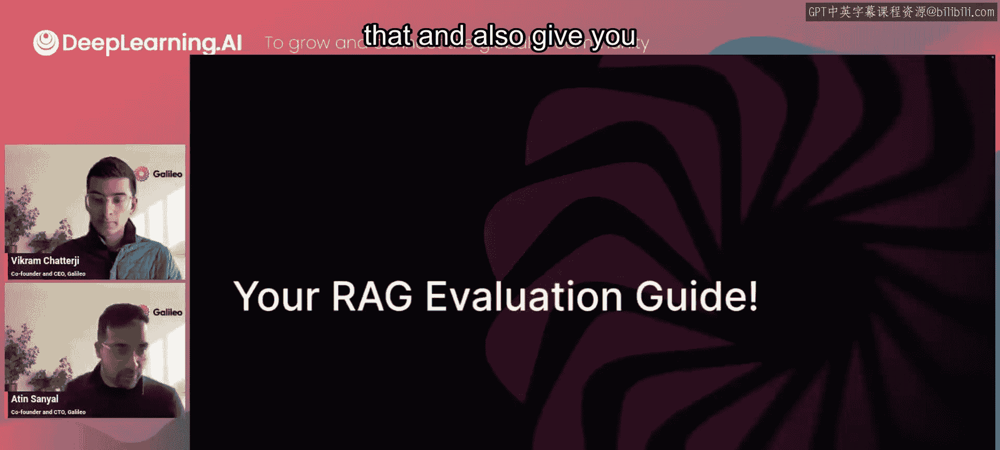

So to start with， I'm going to present like a simplified view of the inputs and outputs to any RA system。

So on the input side， you have the prompt， the instructions， the query， as well as the context and。

On the input front， the goal of a practitioner is to essentially try to curate the most relevant query。

 the most relevant prompt with minimal， accurate and precise context。By minimal and accurate。

 what I essentially mean is something that can be。knowThat's dense in information that can be packed with as much information just enough for the LLM to produce a high quality output because there's also the issue of cost and the number of tokens which you want to be precise with。

安啲。The inputs of course go into your RA system which produces your output and on the output side the user's intention is to essentially construct an accurate and a correct response that completely and comprehensively answers the query that was provided。

Now， for us， in order to sort of accomplish these goals。

 there's four key questions that any RAG practitioner would ask related to both the input and the output data。

 but also related to your RAG parameters， whether it's the chunks or anything to do with the RAG workflow。

The first question is essentially around the output of the model。

 how much of it is actually sticking to the context that was provided。

 I think we already gave an example of hallucination that we saw when the model went back to its sort of training syllabus and stepped out of the context。

The second question is again， around the output quality。

 which is whether the model is answering all parts of the query that's been provided。

The third and the fourth are more parameters or questions around the retrieval strategy。

 the first one being whether the chunks which are retrieved are truly attributing to the model's generation。

 whether the model is actually using the chunks in its reasoning process。

And then the fourth one is within a chunk that's attributed to how much of the chunk is really being utilized to generate the response now you will see how all these four questions sort of interrelate with each other。

 but we're going to go one by one and see specific examples of the importance of each of these questions so let's start with the first one。

The first question is essentially around the output of the model how much it is sticking to the syllabus that the context is providing。

 which is essentially the main principle of RAG right you're trying to you know you build a rag system to prevent an LLM from spitting out a general response which is why you provide the context that the model should use so one of the key things to measure or to look at is the ability to which the model is。

Actually sticking to the response while answering the question。

 here's an example question that we just saw， what are the common side effects of midmorphin。

 the first response from the LLM was side effects include nausea and trouble breathing at the onset this looks like a fairly coherent response it could be correct。

But if you look at the context that's provided here it's very easy to see that there's the breathing difficulties is not part of the the highlighted section which which is what the model picked up in its reasoning and this is a real customer example that we're sharing with you so what does this suggest it essentially suggests a。

It's basically a hallucination right where the breathing difficulty is not in the context and here the adherence to the context is low and it matters because of the main reason where you want to mitigate the LLM from hallucinating and saying things you're not wanting it to say。

The second question is again around the quality of the output now we spoke about you know the importance of the LLM's adhering to the syllabus that the context is providing but is that really enough to assert quality not really because there's the other aspect of output quality which is the comprehensiveness of the output now let's take a simple example here the same question what are the side effects of metmorphine you did another query to the LLM this time it gave a slightly better response and it stuck to the context there's little hallucinations here if you look at the context you know you could see that it's sticking to what's provided and answering based on it。

But there's much more information in the chunk itself。

 which sort of talks about the effects of lactic acid， etc cetera。

 which which also are the common side effects of metamorphin in which the model did not pick up in its response。

 so what this suggests is that the response is adherent。

 but the completeness is low because it did not answer。

 it did not pick up enough information and the comprehensiveness of the answer was low and that suggests poor quality output。

Now the third and the fourth one are more related to the vector store retrieval strategy。

 the first one， this one is mostly around the quality of the retrieval part。

So you're checking here basically you're trying to see whether the LLMs outward is attributed by the chunks that are provided an example here is this is a query for recommendations for blood pressure management。

And let's look at the answer right it says recommendations for managing high blood pressure includes weight loss。

 lifestyle changes and a balanced diet seems like a pretty decent generic sort of an answer。

 but it's interesting when we sort of dive a little bit deeper into the documents or the context that was provided。

So here you see that we provided sort of three categories of chunks。

 one was more around blood pressure docs， BMI docs and then dietary management docs。

 and just looking at the response， it's clear that the model sort of attributed the BMI chunks to this response。

 which is why the output is more around weight loss and lifestyle changes， which is correct。

But there's clearly a lot more information that's potentially present in the other docs。

 like there's a blood pressure chunk which likely has a lot of useful information which the model or the LLMs generation did not pick up。

So here you're seeing that the， the number of chunks being attributed。

are used in the responses low and there's two aspects to this either you know the LM did not leverage the chunks because they are irrelevant which essentially implies that the amount of context that you there's a lot of wasteful tokens and wasteful information in the context that you supplied or the model essentially did not pick up relevant information in other chunks。

 which means that the output was incomplete and low quality。

The fourth and the final question is essentially around。

Sort of attribution within the chunks so this is like a coar measure of intra chunk utilization and this one is related to the third question。

 but let's take an example to clarify same question recommendation for managing blood pressure let's look at the output here this time the model's response was more around sodium intake and maintaining a healthy weight which is again a fairly cohesive correct response which can see that it clearly this time chose the dietary management chunk and here it picked up you the first you section of the chunk to answer this question which rendered the utilization low and as a result the response was fairly high level correct but high level and it only focused on you a small part of the chunk this is why utilization measuring utilization is important。

Because again， it attributes to two things， either the model is generating based on a low utilization because there's little information in the rest of the tokens or the models simply missing out on useful information that it should include in its output。

Now all these four questions sort of， you know， to solve them， you know。

 we need to be able to quantify them and for every single you input output request that we get。

So here I'll be talking about four metrics that we've created to help quantify these four questions that we just discussed。

Just to quickly walk you through and introduce these metrics to you， the first is context adherence。

 which is essentially a measure of how much the output is adhering to the context that's provided。

 completeness as the name suggests it's measuring the comprehensiveness of the output。

 whether it's able to answer all aspects of the query， or did it leave behind key information or not。

Attribution is a course measure of context quality。

 the number of chunks involved in the decision making process of the LLM。And finally。

 there's utilization， which is measuring intra chunk precision， so within the chunk。

 the extent to which how how much of the sentences and the tokens were utilized in the reasoning process。

You can see that the comprehensiveness of these metrics sort of go from very top level holistic semantic understanding and completeness。

 comprehensiveness of the output all the way to token level sort of sentence level utilization in the reasoning process and all these four questions interrelate and correlate with each other as you'll see from the demo。

But before that， I want to highlight how these metrics came to be and to create these metrics。

 we essentially built a framework for for quantifying a lot of these issues we see with modern LLMs because the main starting point for creating this framework was to mitigate or quantify hallucinations。

 the method is called chain pole which is a combination of chain of thought prompting and ensembling which helps us create some of these metrics and we have a paper here。

 the chain pole there's the paper references linked here and you'll have access to these slides after。

And if I talk about the results of Cha pole， you can see that the chain pole methodology for hallucinations。

 it beats any existing technique， any modern technique to detect rag hallucinations。

And for the other metrics measuring you know output quality and chunk retrieval quality for them as well。

 number one， there's no metrics today in the industry to surface you this level of insights so we created the best possible technique that practitioners would use after conversations with many RA practitioners like yourselves and we created a very strong prompt to GT ChaGD 3。

5 and we compared that technique with the chain pole technique and we saw it significantly outperforms across all the four metrics by over 160%。

Just to dive a little bit deeper into the results， we of course do our research experiments pretty comprehensively we have over two dozen benchmark dataset sets that we run our experiments on。

 this is one example data and the results for all the four metrics if you keep an eye on the blue lines and the blue bars you'll notice that the chain pole technique for that created the four Rag metrics that we just spoke about it significantly outperformed some of the standard techniques which are used like Raga's faithfulness as well as the openAI GPT baseline that we that we tested it against so all this is to say these metrics of course are extremely precise they're backed by a lot of research many months and years at this point of research that we've done but also they're built for low latency and high throughput because we've baked it into the Galileier platform and we do a lot of very interesting things like。

Btch ensembling and batch inferencing to make sure that you know these results are quantified in the minimal amount of time and with the minimal payloads and essentially can handle a lot of scale。

One last thing before we get into the demo is to highlight the importance of actionability of all these metrics。

 so as part of this evaluation guide I do want to you leave you with。This this almost table。

 if you will of you know if you detect low or high values for each of these metrics what do you really do what steps do you take so in the first case let's talk about adherence right if you detect low adherence in your system what all can you do you can essentially tune your prompt to to tell the model to maybe look at certain parts of your context you can tune the chunk size maybe increase it incorporate more data so that the。

The LLM has more data to work with， or it might be just suggestive of low quality data in your vector store。

 which means that you add new data。Then there's low completeness here is of course this is an output quality metrics so how do you increase complete completeness in your response you add more data to it so either you tune your chunk size to add more data or more relevant data you can even explore a new embedding model because sometimes in real life applications we've seen that the quality of the embeddings like was mentioned before plays a significant role in the quality of the chunks that are retrieved from the vector store。

 the vector store is simply gonna store your vectors and give you similar data。

 but it's really the quality of the embeddings which decides the semantic quality of the data that context that you're adding。

Then there's low utilization， this is a very interesting one because number one it's a rag parameter or it's a rag metric vector store metric but it correlates very very tightly with output quality for example。

 if there's low utilization and the LLM seems to have answered the completeness is high so there's all aspects of the query are answered what that essentially means you want to reduce the chunk size because you are essentially wasting tokens because the models answering fully but not really utilizing much of the context that you're providing it on the other hand of the completeness is low。

 that's a quality issue and you want to increase the chunk size and add more data and inspect your data in the vector store。

So all these metrics correlate with each other and play well with one another and finally there's low attribution。

 very similar to low utilization， you want to again tune your vector store parameters to increase attribution that might include you removing data from the vector store so that you're supplying clean data and the LLM can attribute more for every request。

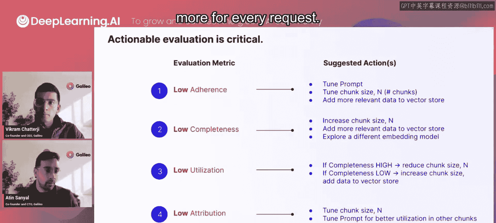

So enough talk， we're going to see all of this in action just to preface the demo that I'm going to do with just to let you know what the use case is。

It's essentially a think of a Q&A chatbot that's a useful tool for a data analyst and the tool what it does is it looks at earn call transcripts and it gives you a sort of a knowledge base or and an querying system on top of that and it's。

This is a very common use case in the industry like a lot of people are building Q&H adbot systems on top of their data to increase productivity in this case if the user is an analyst I mean they usually have to sift through hours and hours of content and it takes them so long to get to some kind of conclusion around the queries they are trying to answer so a system like this is extremely beneficial so it's a very popular very practical system a lot of open source tools also have these kind of demo applications as part of their documentation the stack we're using're using P cone for the vector store Lcha to create the chain itself open AI and Galileileo for evaluations。

The goal here is to you know basically do a bunch of requests and really evaluate and improve my not only the output quality。

 which is of course what I care about a lot， but also see how I can get to a very high quality output with minimum chunks minimum vector store data and really tune these at a request level so let me dive right into the demo。

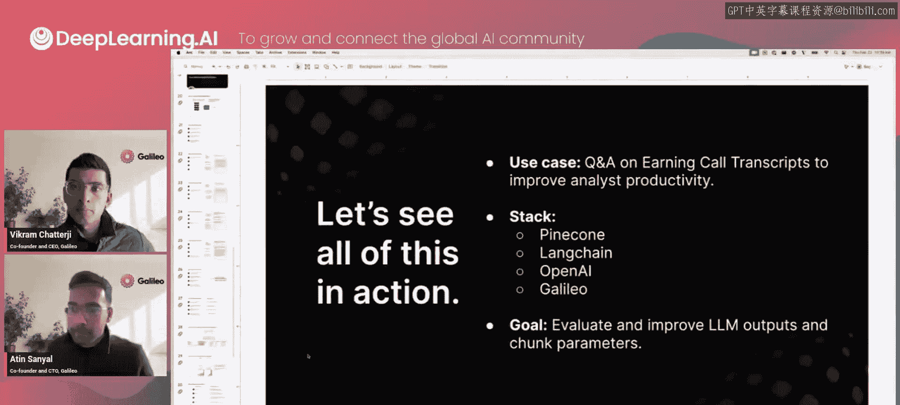

So I'll start the demo with a notebook that we've created that essentially tests out that Q&A bo。

I'm going to run it right in front of you so you here we just install you know the libraries that we need。

 I'm going to set a few environment variables here。And here I instant P con。I'm using GPbD 3。

5 as my model。Here I instantiate the vector Db index。

Now these are the kind of questions I'm going to ask。

 so I'm testing my system with the usual questions。

 which I'm going to ask and this is mostly about asking for various companies revenues in different quarters and doing a quarter by quarter comparison。

 So that's the use case here。诶。Here I'm going to just create a list of all the prompts that I want to test out with。

Here is where I install or start using Galileo so our Python client is called Pro quality and within prompt quality we have a bunch of scoreooters like there's a whole host of metrics that we offer as part of our guardrails metrics store and these metrics are most of them are very proprietary to Galileo and they have a lot of research baked in for example the first three sort of talk about the metrics that we just spoke about so the brand new metrics and along with that you can also there's other outof the box metrics we provide to you as a user so I'm going to just instantiate all these metrics here Galileo also allows you to add a custom metrics so if there's a metric that we don't offer in our roster and there's a specific metric that you've created you can just upload that as a Python function and we host that for you and manage it for you so it's a very flexible customizable platform if I run that。

Then the first thing I do is I'm going to do a Tq。 login。

 which is basically just starting Galileo and it takes me to this Galileo screen here。

 I just zoom in a bit， I copy this API key。Paste it in here。

And this creates a Galileo session so now my notebook is ready to be used by Galileo with Galileo and here this is where I'm creating the chain so nothing out of the ordinary here。

 it's a fairly standard chain that I've created it's a rag chain and here I've using pine cone as the vector retriever the models the prompts and I stitch them together into a chain instantiate the chain and now the question is how do you incorporate Galileo into your workflow so this is a very like lang chain specific thing that we've shown it's a one line callback that you add to your lang chain input before you actually call invoke your chain but we have similar hooks for most of the popular ragbased framework so whether you're using Lama index or any other sort of custom framework we have a low hooks to hook into any of them in this case we add this one liner prompt callback。

I'm going to execute the chain， so this has。Invoked the chain。

 It's running on all the data that I provided。 And at the end of it， you should see a。A processing。

The model will Galileo will process the chain and it'll give you this link and you go to this link you basically come here and I'm just going to walk you through this is the Galileo console the Galo UI which allows you to do rapid experimentation and evaluations at the top we give you a lot of these metrics which are bucketed into into different categories。

 my interest is in the rag metrics here and you can see that。

The adherence and attribution they are all fairly on the lower side。

 so immediately you get a high level signal of something's going wrong here。Below this。

You see that there's this chain experimentation list which basically entails or lists down all the inputs and outputs that were invoked as part of the experiment。

So let's go into one of them。 So the first one was the question around the prompt was query was the the costco revenue in Q1 and how it compared to the previous quarter Let's go into that。

咩。just let it load here， you can see that it's interesting here because the completeness of this particular request is high but the utilization and adherence is low so what does this suggest if you really think a little bit about it for a second completeness is high means that the output had all aspects of the query which was answered and that's evident in the response you can see here I have the revenue for Q1 I also have a quarter by quarter figure here of 6。

1 so completeness is high but utilization and adherence is low。

 low adherence symbolizes hallucination so I'll be very curious to go into you know why the hallucination is happening and what part of the output has hallucinations so I'm going to dive a little bit deeper into the let's look at the chat openaiI here so here I can see the entire in this node。

I can see the full request， but this is a lot to sort of sift through manually。

 but the final output I can see that it has the 56。

7 billion which was the quarter revenue value and then the 6。1 is the quarter by quarter increase。

Now， because the adherence is low here as the signal suggests。

 I'm going to go into the vector store retrieval and the first thing I want to see is that in the retriever。

Did。Did the output get attributed to any of the chunks and the first signal I have here is one of the four chunks attributed to the LLM response so that means the LLM found the answer but yet and it produced the answer that we saw the 6。

1 and the 56 billion。But clearly something's wrong so let's see which chunk was attributed here I found the fourth chunk which said attribution less equal to yes there's a 11% utilization so part of the chunk was utilized and if you really look then I found my answer here。

It says the 56 billion figure is there and the 6。1 figure is also there， but the 6。

1 increase is essentially a year over year increase instead of a quarter over quarter increase which is why the completeness was low and sorry completeness was high because the figure was there but thence in adherence was low which means the quality of the output was that so you can see how we used a combination of these metrics to figure out a very。

Very hard to point out hallucination， which your standard metrics and basic things will it'll take you days to read through all this context and really get down to that level of detail。

One other interesting example， I'll show you where all the rack quality metrics are low。

 so there's low utilization， low completeness and low adherence。

And what that suspects to me is that probably the output is completely wrong or low quality or was not answered。

 so let's take a look， let's go inside and see what what the output was。So in this case。

 the question was around gaps Q3 revenue and its comparison with the previous quarter and。

You know my hunch was right the model said that this information is not present so it's a complete ignorance of the of the question and it said that sorry I cannot it refuse to answer it。

 which is why there's all three metrics are low but because adherence。And utilization is low， I am。

Interested in going into the vector store to see what happened。The first thing I notice is that。

 again， attribution is。Present， so the model found the answer。

 but refused to answer it so that's getting into very interesting territory。

So let's go into the chunk that was actually attributed to while making the answer。

 I'll just zoom in a little bit more here。If you read through this particular chunk。

 you can see that there's certain numbers which which tend to be signaling to the answer like net sales of 3。

8 billion decreased 7% versus last year sales were down 2% so the answer is here and the model。

So reasoning did attribute it to this bit， but it did not pick it up and the reason why it did not pick it up is because the phrase is net sales。

And the phrase in the question， which is revenue， was a bit confusing to the model。

And now you would wonder how I found that information out。

You can either assert it yourself by reading it， but the magic of Galileia is that all of this that we just did。

 you get it out of the box in a single shot and how you do it is by hovering over the low adherence let me show you this example here sorry。

Or here you can see this is the first example of the。Which company was this？

This is for Brocom and you can see the adherence was low because。Broadcom's revenue was 9。3 billion。

 However， the claim there was no information provided how it compared to the previous quarter。

 which is incorrect， so you can see that。The chain pole magic sort of gave you this whole reasoning that we。

Alread， like without Galileo， this would have taken you hours and days。

With Galileo manual inspection it took you a couple of minutes and with this explanation it would literally take you a second to debug this。

 so imagine the power of automating all of this and you get all these insights and explanations out of the box。

So that is a blitzkriek demo of the capabilities of Galilelia。

 of course you can take a lot of actions in the tool itself， which I had mentioned previously。

But coming back to just talking about。

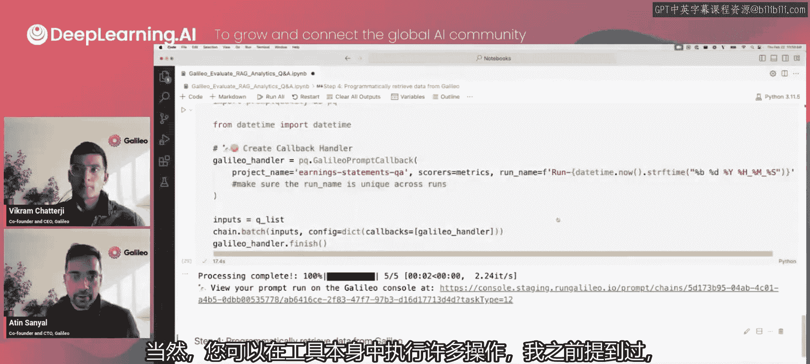

The one last thing here。Which is you saw the power of Cha pole and you saw how we give you these metrics and give you explanations for all these very hard to find issues in your RA system。

And Chain pole was designed to figure out very nuanced errors in your RA workflows。

 but one of the limitations of chain pole was that while it's extremely state of the art。

 it can get expensive because it's employing the chain pole the chain pole workflow employs LLMs behind the scenes to do chain of thought prompting or ensembling which tended to in some cases be more expensive than。

What people would want， although we did tons of optimizations on batchge infferencing and making sure the scale is not exponential as you do more requests was essentially just linear and subline。

 but it was still of course making third party calls， so there was the issue with privacy as well。啊。

What we realized though， is that we wanted to evolve Chafold to the point where you get this kind of production grade evaluation metrics。

 but at low cost， possibly free in a private manner without sacrificing for accuracy。

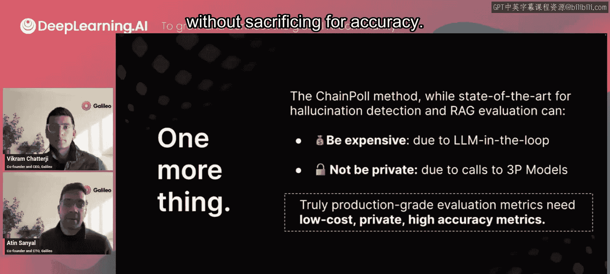

So we've over the last few months we've evolved Chain pole to come up with the next version of Chainpo which is Chain pole local。

 we call it local because we employ essentially run Cha pole in a private manner so there's zero costs associated with it。

 we work very hard to make sure the accuracy of Cha pole does not suffer and it's built the models。

 the LLMs we replace them with in-house Galileo fine tune models which are very lightweight models。

 they're 400 million parameter models which can essentially run on CPUs。

And just to show you some very fresh off the oven results here。

 this is a comparison of the Cha pole local technique with the original Cha pole technique which used open AI models and in some cases in some data sets you can see that the power of the fine tuneune model it beats out open AI。

So we've built these Cha pole local so that you get rag metrics without depending on LLMs。

 it is private and very cost effective and the performance and accuracy of the results is not sacrificed。

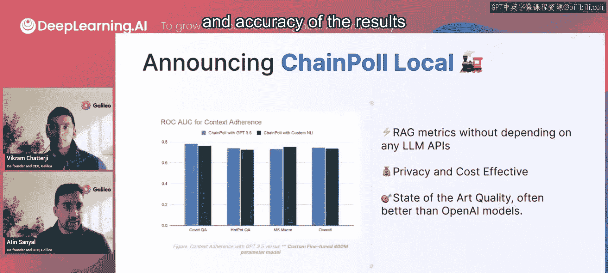

And with that， that's the end of the presentation， we're happy to take any questions。

Absolutely thank you so much I know our community really enjoyed this presentation so yeah let's dive into a few questions I'm just going to remove the slides。

😊。

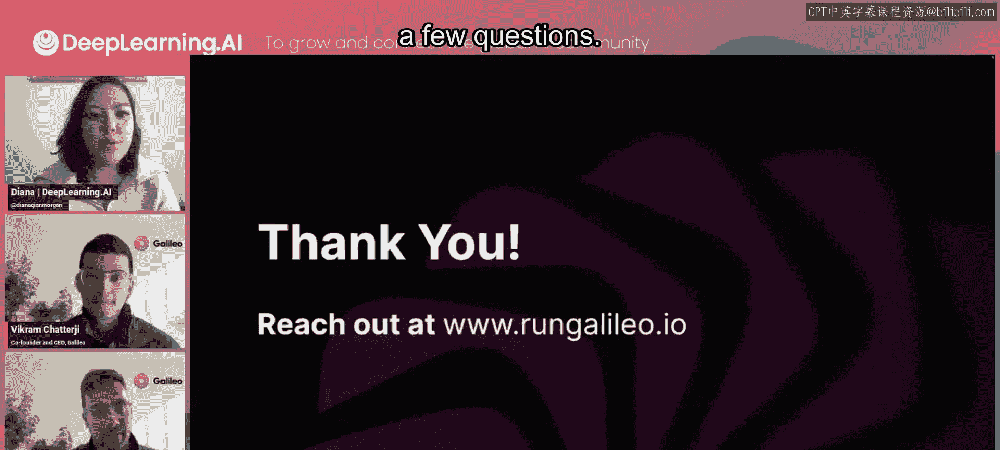

Allright。What is the best approach of data security is of highest importance， for example。

 no usage of external APIs and both model and RA knowledge sources all on premise。

Yeah I can take a stab at this really quick so that is actually quite a common request because especially when you're using your own proprietary data there is no way you can just send it externally to most services there are lots of options there so for instance when it comes to vector databases in RG there's a lot of open source options as well that we see people using like devviiate Chrome IDDb many others Milviss is a very popular one in the enterprise which are available offline right are within your own cloud environment so if you manage your own instance you can just host them locally and none of the data needs to necessarily leave。

Yeah， just to add to that， I think one of the challenges in that case would be evaluation is this other area where you。

 how do you do private evaluations without， you know。

 without losing know the power of these thirdparty LLMs and which we've been working very extensively on like how to bring the power of open AI into your private environments and it's all these like researchback metrics which aims to essentially give you the power to do rapid experimentation and figure out what's drawn with your rack system without sacrificing on privacy。

Absolutely。Great， well， our next question， as calculating the embeddings is an expensive task and needs a lot of computational resource for large dataset sets。

 what is the solution if context is really large？😊，Yeah。

 I think the reason why chunking was sort of created was to solve this problem where you essentially size your data up to the point where the embeddings are generated in in a less expensive way。

 but again chunking also has。There's many strategies to chunking and it also is very subjective。

 it really depends on how you chunk would depend on the kind of data you have because at the end of the day what you're trying to do is you want to measure holistically the kind of use case that you're solving and the kind of queries you would get and your goal should be to chunk in a way where for every category of requests that you get data that's fetched from the vector Db is fully sufficient and fully complete like the metrics that we showed you so these metrics play a key role in even deciding the chunking strategy because at the end of the day you want high quality outputs from your LMs with minimal context and minimal minimal data in the chunks so the chunking strategy。

These metrics play a key role in formulating the strategy for chunking。Absolutely。

 well that definitely loop into our next question， how do you determine and balance between the costs and size of the context window。

 any guidance on trunk size？😊，Maybe I can yeah just take a stab。

 there's no silver bullet honestly with with the having a like one sort of chunk size it again depends on you know what your appetite is of course you everyone wants cost less of the cost the better but the more context you give it。

 there is of course a balance of you don't want to send too much context and too much chunks。

 too many chunks， there's a famous paper called Los in the middle which essentially entails the models reasoning process gets diluted。

 the more data you send it。In general， think the lesser the better and how do you achieve that like there's no silver bullet to achieving lesser。

 it really depends on the categories of requests that you get but。Again。

 highlighting the importance of these metrics like measuring chunk attribution， chunk utilization。

 we go to the token level to show you how many tokens were used in the chunk that should be the guiding light for figuring out the chunk size which is usually dynamic there's no one chunk size which will solve all your problems。

 but it's important to use these metrics to you determine。

 say for future requests of that category whether the chunk size size should be high or low。

Absolutely。Okay I think we have one or two more questions left。

 is there a specific technique to deal with documents like PDFs provided to RAG。

 but instead of text that contains images of text， is the performance compromised？Yeah。

 there are many different techniques to do this and it's again very pretty common for PDFs to have you know text tables。

 images， etcter， and I think typically the first step is to just quickly split the file into its raw elements and then take it from there towards chunking you can also use a lot of open source tools which help you do that unstructured as a popular one which is open source which helps you parse these images and text and tables from documents and PDFs into digestible JSsonN which can then be easily consumed by different vector databases。

Absolutely， and I think our last question， is there a way to untrain a model that was trained with RaG with wrong knowledge like wrong documents or text？

That's interesting how RAG is essentially an inference technique。

 so there's no training per se that's happening like you're not modifying model weights。

 but the whole purpose of RAG is to make sure you untrain a model in the sense that you bias it less towards the training data of the model in the first place。

As far as you know preventing wrong knowledge and wrong documents， I think again。

 like I don't want to make this a rhetoric， but coming back to the metrics again。

 the whole point of these metrics， the four metrics we spoke about。Is to prevent。Two things， right。

 prevent bad quality， which can often happen with the right knowledge。Provided。

 but that's indicative of just a bad model request or model response。

But also those metrics are indicative of bad documents or bad knowledge that you're supplying the text with many in the slide where I showed the four metrics and the actions you take a lot of these actions were pointing towards getting new data or replacing your old data to supply better the right knowledge if you will for your requests it also comes down to the embeddings。

 the quality of the embeddings plays a significant role in the quality of your responses so it's good to experiment with those as well because embeddings can they are basically the knowledge so if you use the wrong embeddings its wrong knowledge in the first place so there's all these different techniques but these metrics whether know through gallia or otherwise these questions that we showed they are the guiding light towards tuning your ragg applications。

Absolutely well I think that's all that we have time for today thank you so much to Galilee with Viro Menetin for presenting such a wonderful workshop on RaG I hope everyone learned something new today and the slides will be available after this event so we hope to see you next time Thank you everyone bye。

😊，Thank you， Thank you。