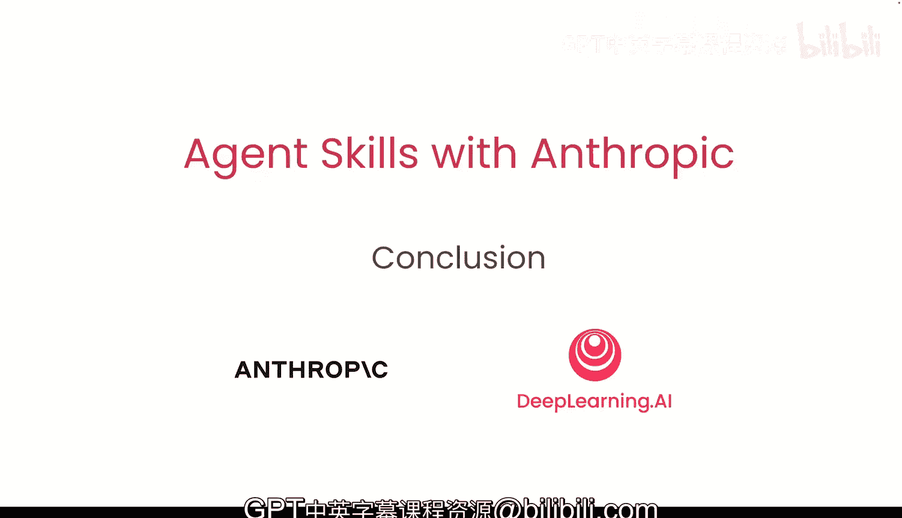
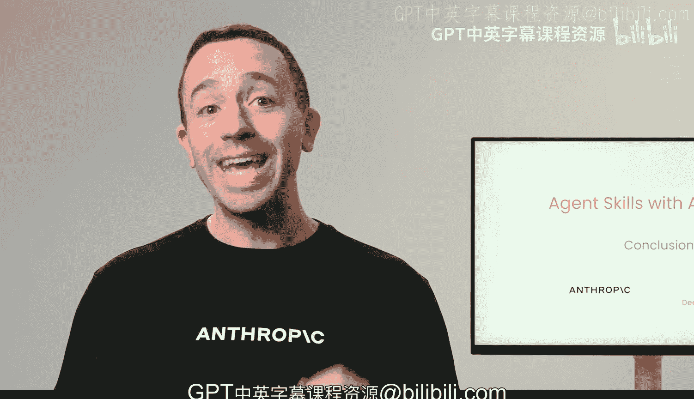

# 吴恩达《使用 Anthropic 的智能体技能｜Agent Skills with Anthropic》中英字幕 - P10：10.conclusion.zh_en - GPT中英字幕课程资源 - BV13w6CBGEQ5

Congratulations on making it this far。 you've learned how to create skills。

 explore their best practices， and seen them in action across different platforms。

 When creating a skill， start with basic markdown instructions。

 then expand later following progressive disclosure。😊。

Monitor how your agent uses your skill in real scenarios and iterate based on observations。

Make sure the description contains enough detail for your agent to know when to use it。Don't forget。

 Claude is very knowledgeable about what skills are。

 so you can always start with a simple conversation to begin creating skills and then use the skill creator skill to follow best practices。

 Thank you for joining me in this journey and I can't wait to see what you build with agent skills。

