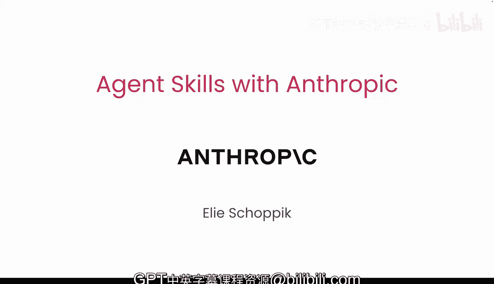
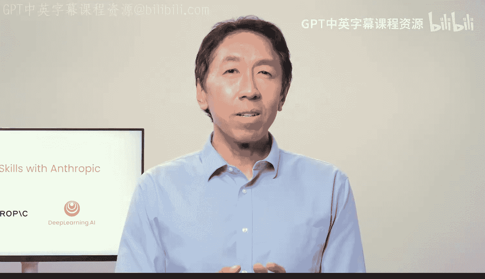
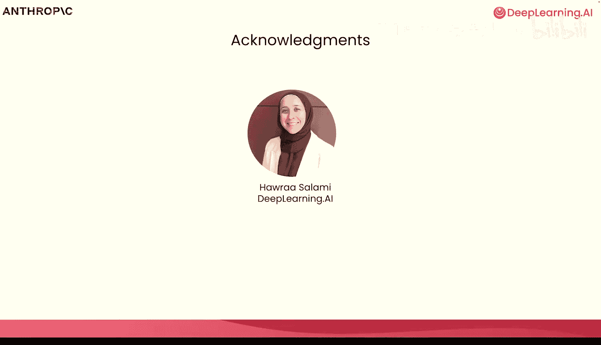

# 吴恩达《使用 Anthropic 的智能体技能｜Agent Skills with Anthropic》中英字幕 - P1：1.intro.zh_en - GPT中英字幕课程资源 - BV13w6CBGEQ5

Welcome to this course on Age skills， built in partnership with Anthropic and taught by returning instructor El Showe。

😊。

Skills give Chical and other agents new abilities to carry out tasks I thrilled to any maturityity teach。

 Thank you， Andrew， I'm happy to be back and work with you all on this one。

 S are photos of instructions that extend your agent' capabilities with specialized knowledge In this course。

 you learn how skills work learn best practices for creating them and build skills for different use cases including coding and research and data analysis and more What's exciting about skills is they're now an open standard which means they have a standardized format that work with any skills compatible agent So you can build your skills once and deploy them across multiple agent products。

 Any skill should include a skill do Md markdown file， which contains the skills name。

 description and main instructions The main instructions can also refer to other files such as scripts。

 additional markdown files and assets such as templates and images。😊。

Skills are progressively disclosed to the agent， which means that the skills name and description always live in your agent's context window。

 but the agent does not load the rest of the instructions into this context until a usage request。

 matches the skills description At that point， the agent might then additionally load the reference and asset files if needed as well to use the skill your agent needs a basic set of tools filess an access to read write files and batchsh to to execute code and these tools enable your agent to execute whether commands a skill requires your agent can combine skills with MCP and subagent to create powerful agent workflows For example。

 it can use MCP to get data from external sources then rely on a skill to know what to do with that data or how to retrieve it efficiently It can also delegate tasks to a subagent with isolated context which can itself use skills for specialized knowledge In this course we'll start with cloud AI where we'll create a skill for a marketing campaign and combine it with the pre-built skills for Excel。

And PowerPoint then we'll create two skills for content creation and data analysis workflows and try them with a cloud API。

😊，After that， we'll use skills with Cla code for reviewing and testing code， and finally。

 we'll build a research agent with a ClaD agent SDK that uses a skill to combine research results。

I'd like to thank Harra Salami from Deepleer AI who contributed to this course。

 So how do you know when to use a skill， Let's say you have a workflow that you repeatedly ask your agent to implement Instead of explaining the same workflow every time you can package it as a skill so your agent automatically knows what to do。

😊。

That's exactly what you learn with El in that first lesson。

 so please go on to the next video to learn more。😊。

