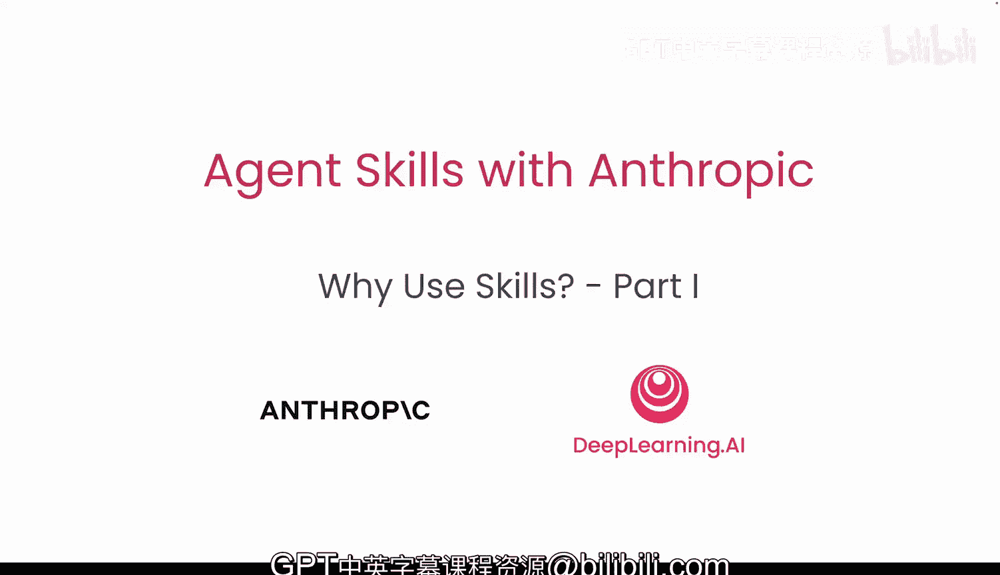
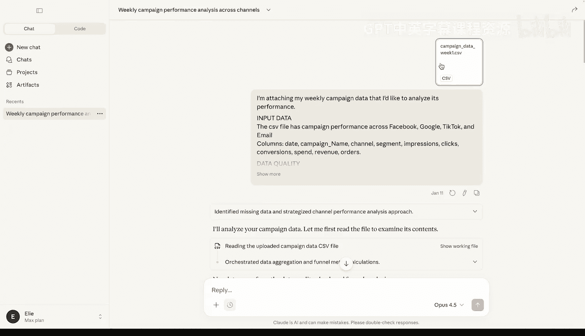
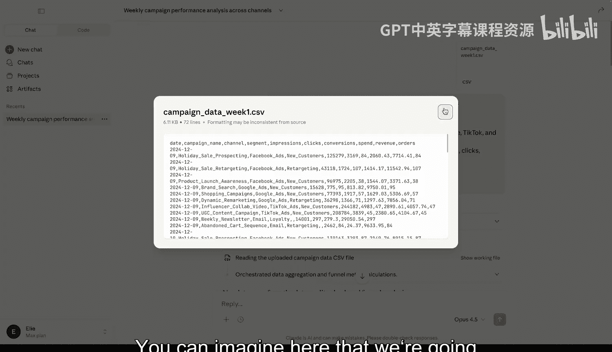
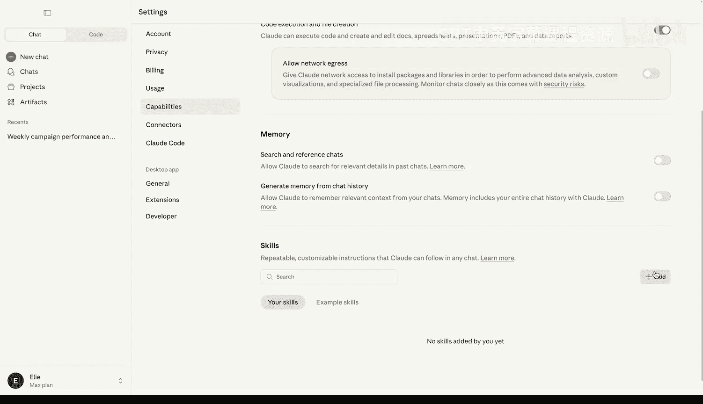
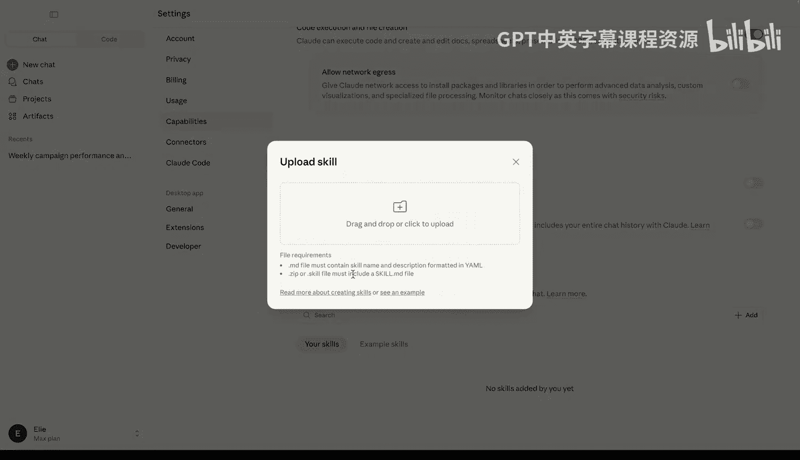
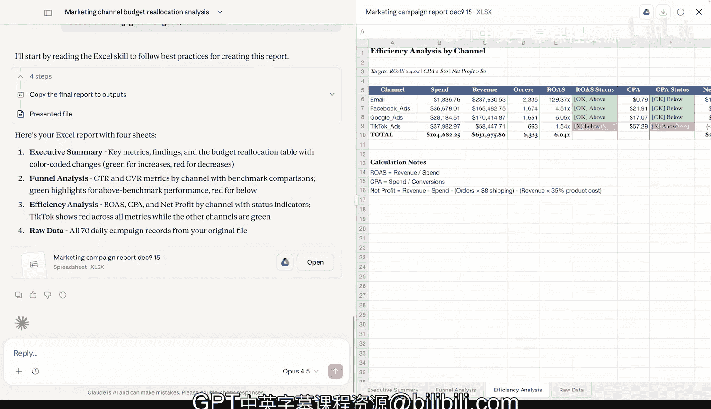

# 吴恩达《使用 Anthropic 的智能体技能｜Agent Skills with Anthropic》中英字幕 - P2：2.why-use-skills---part-i.zh_en - GPT中英字幕课程资源 - BV13w6CBGEQ5

Skills are folders of instructions that package repeated workflows。

 specialized knowledge or new capabilities for your agent。

 If you find yourself typing the same prompt across conversations。

 you should consider transforming that into a skill。 Let's explore how to do that using cloud AI。

 So before we talk a little bit more about skills and dive into what a skill looks like and how it works。

 Let's walk through a scenario to showcase why skills are so useful。 right here。

 I've got some campaign data in a CSv that I like to analyze the performance of。

 So just to show you what this looks like。 I've got a date， a campaign name， impressions。

 clicks conversions。 you can imagine here that we're gonna to take in some marketing data and use cloud to analyze this information。

 So in my first prompt， I'm attaching this data explaining what the input data looks like asking to check for quality funnel analysis and some useful metrics around what I expect for clickthrough rates and conversion rates。

 at the bottom， I've got an output format that I'm requesting。😊。

This particular piece of data。Now， you can imagine it would be valuable to not have to include this prompt every time and to have that packaged up。

As we take a look at what we're seeing in our campaign data， Claude is going to read this CSV。

 it's then going to perform the data quality check and funnel analysis and give us back our campaign performance analysis Here is going to show the total records。

 any missing data and any anomalies in the data that exist。 If we take a look a little bit further。

 we'll see our funnel analysis versus the benchmark data that we were looking for before。

We can see here some things that are working better， some things that are not working as well。

 we're getting a lot of useful data back that we can take action around。

 change our marketing campaigns and move forward。😊。

We got a nice interpretation of what Clade is telling us what's working， what's not working。

 And now we're going to go ahead and ask for additional computations of certain efficiency metrics for marketing。

 These include return on our ad spend， cost per acquisition and net profit and so on。

 We're also going to ask for an output format in a certain fashion。

We'll see the results from this efficiency analysis， we'll see what's working， again。

 what's not working， and some interpretations。We'll see our portfolio performance and our total net profit looks like we're making money here。

 but there's still much more that I'm sure we can do。

 The next step that we're going to do here is to take in an additional piece of data。

 our budget reallocation rules。 The idea here is that we have extra money to play around with and think about allocating towards other marketing channels。

 You can imagine this file has quite a bit of data around the rules for allocating what we're trying to figure out and how best to decide where to increase our budget。

 This could also lead to maintaining a budget or decreasing a budget based on this framework that we have here。

 Again， this is a lot of data that is specific to our particular use case。

 Claude knows how to handle particular decisions and analyze marketing metrics。

 But here we're specifying exactly the way that we want to do things。

 This requires me bringing in external documentation， finding the right people。

 And even if I'm not the most knowledgeable about this。 hoping that I get it right。

 We're going to go ahead and see these allocation rules，😊，ComWe can see what's passing。

 what's not passing and a proposed reallocation here， freeing up some budget。

 analyzing what's working and where to allocate additional budget tos。

What we've seen here is a step by step process that requires us as the user to put in the necessary documentation and have the necessary pre-existing knowledge。

 Not only that， but everything that I'm putting in here is immediately getting added to the context window。

 What happens if I want to ask something different。

 What happens if I want to have a different kind of conversation。

 This information here is not always necessary for everything I'm going to do。

 What we're going to take a look at here is how we can take this information and package it into a skill。

 a standalone asset a folder really， that contains instructions for how to go about performing the campaign analysis while also being intentional about what information goes into the context window and what information doesn't As we've seen This is a weekly campaign performance analysis。

 So this isn't something that I want to have to repeat on my own every single week。

 with this particular prompt by copying and pasting This is going to be much nicer to have prepackaged that I can use。

Myself， share with members of the team and edit as necessary。 So with that。

 let's take a look at what a skill dot M file is。 This file needs to be named skillki dot M in markdown format。

 And this is going to be the underlying set of instructions to perform the task that we saw。

In this markdown file， I have very similar information to what I included in the previous prompt。

 I have my input requirements， a data quality check。

 funnel analysis with the metrics that we were working at before and historical benchmarks。😡。

I have that same efficiency analysis， as well as the output format that I expect。 Finally。

 I have a note here on budget reallocation that references a different file only when the user asks about budget reallocation。

 So we talked a little bit about how this can be much more efficient with context。

 This is one example where I'm only going to be reading and using this file if a user asks about that particular piece of information。

In order to get this skill to work as expected， there's one more piece of data that I need to add to the beginning here。

 This data is in a data format called Yaml， and here's what it looks like。

Every skill that you make across the entire standard requires a name， as well as a description。

 The name of the skill is going to be important for referencing when to use it and in the viewi that we're working with if it's being used and the description is important so that the model that we're working with can understand when to use this particular skill。

 when you make a skill the name and description are required。 So we've got our skill M file。

 And the second file I want to show you is just this budget reallocation rules file。

 which is very similar to the other prompt that we saw。 When you make a skill。

 your skill can reference other files as long as they're all in the same parent folder。

 These budget reallocation rules are exactly what I put in that previous conversation with cloud AI。

 So what we're doing here is we're moving away from putting in instructions directly in our conversation and instead putting it into a folder。

Now that I've got this skill file as well as any external files。

What I'm going to do here is make a new folder。And I'll name that folder the name of the skill。

 analyzing marketing campaign。There are some high level rules around naming skills。

 stick with lowercase letters， use dashes between words。

 and don't use reserve keywords like Claude or Anthropic。

Now that I've created this folder for the skill that I'm making。

 I'm going to go ahead and make another folder called references。

When we look at the open standard for skills， we're going to see that this actually is a specific name that we use when there are external references that the skill uses。

 and inside of our skill M， we linked to references slash budget reallocation rules。

 So I'll go ahead and put that file in this folder。

 I'll put the folder inside of our marketing campaign。

 and then I'll put the skill M at the top level of this folder。

If we take a quick look at what's inside， we should see our skillki MD。

 as well as our references folder that contains that additional budget allocation file。

Now I'm going to go ahead and create a zip file from this folder。

 and I'm going to go ahead and upload that to Cloud AI Once I upload that skill。

 I should be able to start using it in future conversations。😡。

I'm going to head over to my settings right over here， and I'm going to go to capabilities。😊。

As I navigate to the bottom of capabilities， we're going to see this section on skills。

 there are some example ones that we'll talk a little bit about later。

 But right now I want to add my own。 So I'm going to go ahead and add。

 and I'm going to upload the skill in a zip file that I created。

 We're going to go ahead and drag and drop that zip file and give that a second to upload。

 once that's done， we can see the name of our skill as well as that description。

 Now that we've uploaded our skill。 Let's go see this in action。

I'm going to start with a new chat。I'm going to go ahead and ask Claude a similar prompt to what I had before。

 and I'm going to go ahead now and attach the same CV that I was working with before。

 If this works is expected， we should start to see Claude pick up the skill for our weekly marketing campaign。

 Claude should then perform the tasks required in that skill。

 and the need for us to have all that prompt back and forth is no longer there。

So let's go ahead and see what Claude can do here。😊。

We'll see here it's going to read the skill file to ensure its's following the right instructions。

 The name of our skill， as well as the description， is what is allowing Claude to pick this up。

 Since we're asking about reallocating the budget。 It's going to go ahead and read that additional file that we uploaded to our skill。

 We'll then go ahead and analyze the data。 If we want to see the code that Claude is running and executing here。

 we can always open this up and take a look at what's happening behind the scenes。

What we're going to see here is something very similar to what we saw before。

 we're going to analyze channels that may have additional challenges in this case， TikTok。

 we may see things that are working as well as recommended reallocations。But in this case。

 we didn't have to add all of the prompting ourselves。

 This skill can be shared across many different platforms， and since skills are an open standard。

 this is supported in other coding environments like Codex， Gemini CI， and much more。

So not only have we created a way to take this data and package it up into a centralized place。

 We're being more efficient with the context window and the portability here is extremely valuable。

 Now， let's go ahead and create a report with the data that we found。

 We're going to go ahead and create an Excel report with the following pieces of information。

 as well as a color coding that we're recommending。Under the hood。

 the ability to create spreadsheets and execute necessary code to do so actually lives in a skill that comes built in to clo。

 So we're actually going to see the underlying skill being used。

 code being run to create this Excel file， and then finally the output based on the requirements that we specified。

We've got our spreadsheet now here we can see we've got an executive summary， funnel analysis。

 efficiency analysis。And we can go and open this in Google Drive or download the spreadsheet。

Through the use of our skill to analyze data and give us what we need。

 as well as built in skills to create spreadsheets， we can transform data from CSvs into meaningful。

 actionable insights in many different kinds of file formats。 Next。

 we'll explore in a little bit more depth。 what a skill looks like。

 how it works and where it fits into the entire AI ecosystem。

