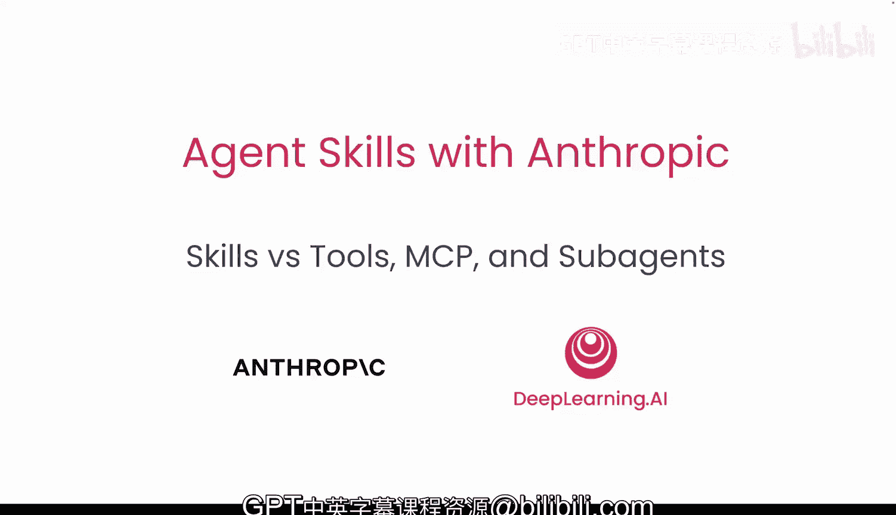
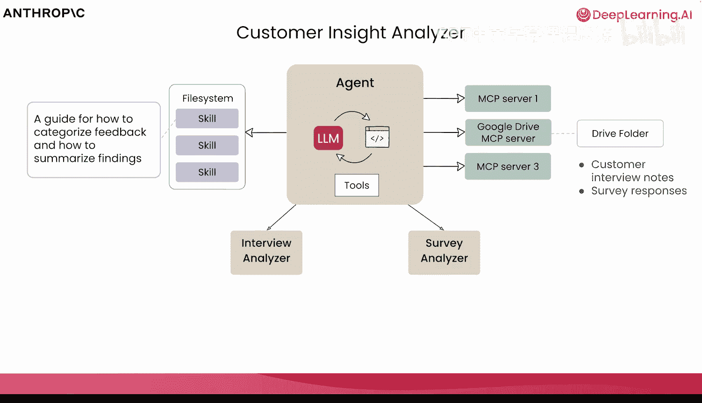
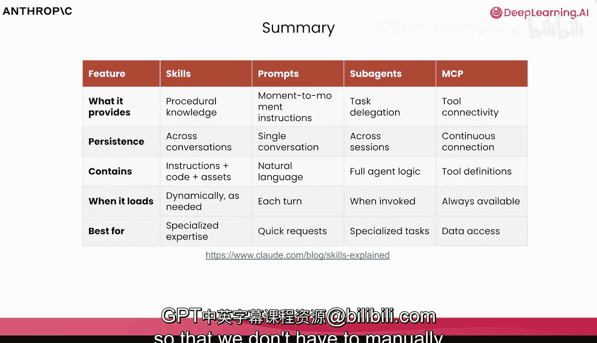

# 吴恩达《使用 Anthropic 的智能体技能｜Agent Skills with Anthropic》中英字幕 - P4：4.skills-vs-tools-mcp-and-subagents.zh_en - GPT中英字幕课程资源 - BV13w6CBGEQ5

You can combine skills with tools， MCP and subagents to create powerful agent workflows。

Let's go through each component， see how they work together。

 and learn when to use what I'll see you there。In this lesson。

 we're going to explore how skills fit in to the agent ecosystem with so many different technologies like MCP S。

 tools and subagents。 Let's make sure we understand how they all work together in your existing applications We can bring in MCP servers for the context that we need。

 leveragever subagents for their own main thread and parallelization and bring in skills for those repeatable workflows。

 Let's see this in a little more depth。When we compare skills with the model context protocol。

 we want to think a lot about working with external data systems and bringing in the tools and resources that we need the model context protocol connects our agent or AI applications with external systems and data that could be in external database data from Google Drive using a various array of systems but any time that you need external data and context that the model doesn't know about the model context protocol is extremely helpful the skills that you have can leverage those underlying tools and data from the model context protocol to teach your agent what to do with that data。

 think of the model context protocol as bringing in all of the underlying tooling that we need and the skill as the set of instructions to put those tools together to build particular workflows that are repeatable and produce the kind of data that you want as we think about leverage。

external data to compute metrics and research and calculate data。

 All of those underlying tools can be provided externally through the model context protocol。

 we think a little bit about skills versus tools。 I like to draw the analogy of tools as a little bit more lower level。

 You can imagine that you have tools like a hammer and a saw and some nails and you have a skill like how to build a bookshelf。

 The tools themselves are underlying ways of accessing systems and providing agents with the capabilities they need to accomplish a task。

 In fact， tools are used under the hood to power the ability to generate skills to read skills and even to produce a file system for executing code and loading these skills。

 S extend capabilities with specialized knowledge bringing in additional files and scripts that need to be executed。

 but the ability to execute those underlying scripts and。

Those files and folders is provided by tools。 There are tools that are built in to certain agent ecosystems。

 There are tools that we can write on our own， and tools that we can load through the model context protocol tool definitions always live in the context window。

 whereas skills are progressively loaded when necessary。 When we think about how these work together。

 S allow us to create predictable workflows， and those skills can bring in scripts that can be executed。

 kind of like a tool on demand。 if there is a tool that we do not need in every single conversation。

 we can use that only when needed through skills and progressive disclosure。

When we think about how subagents fit into the mix， let's first define what we think of as a subag。

 We have a main agent that can spawn or create subagent that can report back to the parent agent。

 These subagents can be created through ecosystems like cloud code or the agent SDK。

 or we can also make our own。When we think of the value that subagents provide。

 we think a lot about having an isolated context with finegra permissions as well as executing tasks in parallel When we think about what these subagent can access we have limited tool permissions。

 and we also can specify what skills each subagent can access So while the main agent can serve as an orchestrator and can leverage whatever skills necessary。

 Subagents can do the same type of idea with making use of particular skills。

 Subagents work quite nicely with skills where we can have a particular subagent like a code reviewer whose sole task is to analyze and review a code base and leverages skills which specify exactly how you。

 your team or your company might perform a code review。When we put this all together。

 we can provide an analogy of a customer insight analyzer。

 Let's think about how this all works together。 We have a main agent that is given a set of tools。

 Those tools could be provided from MCP servers we can bring in the data， the resources。

 the tools necessary to perform the tasks needed for dispatching subagents to analyze customers。

 we might analyze interviews from customers or surveys from customers and do those in isolation and parallelize them to get data back even faster。

 When we think about how to actually analyze insights from customers， how to categorize feedback。

 summarize findings， how to analyze interviews and surveys and how to make sure we do those in a predictable fashion with the right tools loaded at the right time。

 that's where skills come into play。 We bring in data externally。

 we leverage subagents if we need to parallel and execute in a separate thread and context window and we bring in skills to consume all。

😊，This information in a predictable， repeatable and portable fashion to summarize this。

 there are many different pieces in the AI ecosystem。 when we think about building AI applications。

 fundamentally， we have prompts。 the underlying most atomic unit in a conversation。

 prompts or the underlying tool for us to communicate with models but prompts themselves don't scale very well across teams and companies to bundle these underlying prompts and conversations and code and assets。

 we can leverage skills Subagents that we have tasks delegated to can make use of skills。

 those subagents can then consume tools necessary from a main agent that are defined through the model context protocol as we think about what these particular features aim to solve We want to be really intentional about how we're loading this information and what this is best used for。

 When we think about the context window as a public good。

 We want to be intentional about when subagents can help us minimize。😊。

What goes in the main context window and how MCP can load the data necessary and skills can load it progressively when we talk a little bit about the persistence and how we can think about drawing things into a longer term memory with subagents。

 we can persist across many different sessions from the subagent and the parent agent with skills。

 we can persist across conversations that we have with the user and the AI application。

 so as we think about where each of these steps are used， we want to use skills for procedural。

 predictable workflows and subagents for full agentic logic only when necessary for specialized tasks。

In the next lesson， we'll take a look at some of the prebuilt skills that come with Claude。

 we'll take a look at the repository for these skills， dive deep into some of the skill MD files。

 and talk about a very useful skill called the skill creator so that we don't have to manually create all of our skills from scratch。

