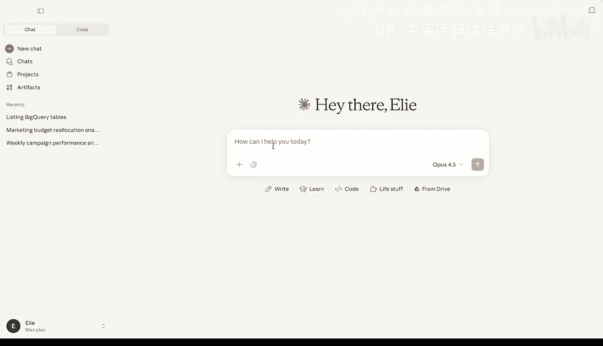
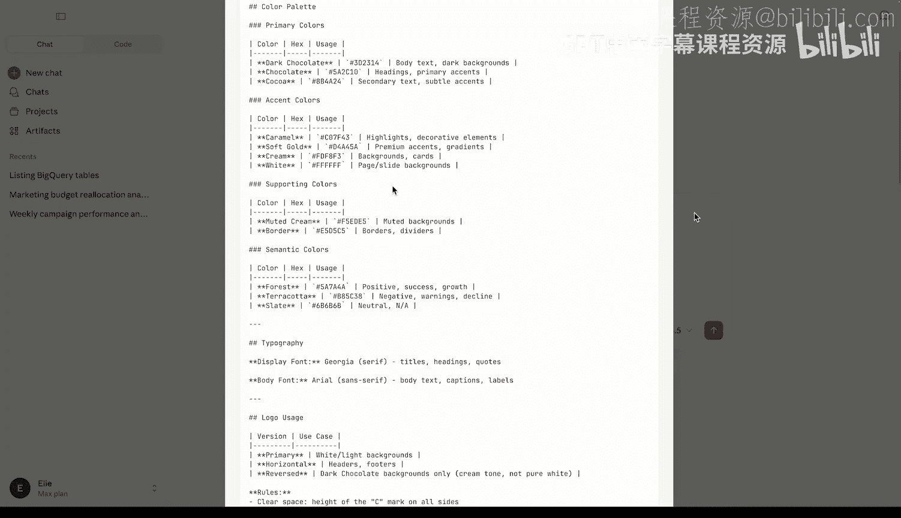
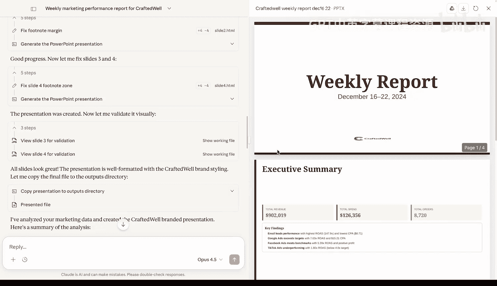

# 吴恩达《使用 Anthropic 的智能体技能｜Agent Skills with Anthropic》中英字幕 - P5：5.exploring-pre-built-skills.zh_en - GPT中英字幕课程资源 - BV13w6CBGEQ5

In the first lesson， Claud AI used the Excel skill to create spreadsheets displaying the marketing results。

The Excel skill is one of Anthropic's preilt skills， which also include a PowerPoint。

 word and PDFf skill， as well as a skill creation skill。

 Let's take a look at those Now that we've seen how skills fit in the entire AI ecosystem。

 Let's take a look at some of the prebuilt skills that you can use out of the box with cloud AI and cloud desktop and that you can install yourself with tools like cloudcode In of this repository that lives at Github。

 co slash anthropic/ skills Let's take a look at the skills folder and see which built in ones that we have all of these are ready for production usage and we actually saw in a previous lesson the use case of this Excel skill。

😊，It's important to note that this list of skills while created at Anthropic is actually bucketed into two different sections。

 The skills for Microsoft docs， Pfs， PowerPoins and Excel are known as document skills。

 These are built in and always used in tools like cloud AI， The remainder of these skills。

 are examples that we've created that you can toggle on and off in Claude。

 but by default with the exception of skill creator are toggled off。

 Let's first start by analyzing the PowerPoint skill。

We can see just like other structures that we have a skill MD file。

 as well as other files and folders to reference。Inside of this skill MD。

 we have that same Yaml front matter that includes the name and the description。

What you're seeing here is how Gitthub is rendering this markdown file。

 but the underlying code looks very similar to what we've made before。

 You can view it this way if you're familiar with markdown files。

 I'll switch back to the preview because it looks a little bit nicer。

When we take a look at how this skill works and what it does。We've got an overview。

 The users may ask to create， edit， analyze contents of a PowerPoint file。 Here's what it looks like。

 Here's how you read it。 And if there are particular tasks that need to be done。

 There are underlying scripts to go ahead and execute。 Remember。

 these are not executed right out of the box。 These are only loaded and executed when necessary。

 There's quite a bit that we can do with PowerPoint presentations， colors， topography。

 As you can imagine， this is how we can start to make things that look nicer and look more like real world presentations out of the box。

There are design principles that we have， requirements that are necessary。

 and color palette selections that we can have Cla pick from when the user does not specify them。

This skill MD is quite long as there is quite a bit that we can do with PowerPoint presentations。

 but what we're going to see later in this lesson is how to actually use this skill to take existing data and turn it into a beautiful looking presentation。

The next skill I want to show you is a little bit of a meta idea here。

 and that's called the skill creator， and the skill creator is a skill that serves the purpose of programmatically creating skills for you instead of having to do things from scratch and create the necessary files and folder structure。

 the skill creator can do that for you。 Let's take a look at the skill M file and see what's happening here。

 similar to our other skills。 we have a name and a description。

 and I'm actually going to take a look at the underlying code here since it's a little bit easier to follow。

😊，We specify in this skill MD file what a skill is， what it provides。

 and then we include some of the best practices associated with skills。

We're going to dive into those best practices in the next lesson。

 But you can imagine when Claude is programmatically creating skills for you。

 we want to leverage some of these best practices。 When we take a look at the skill creation process。

😊，We're extremely explicit with the steps that we have here。

 Since we want to use this skill to create a predictable workflow。

 we want to be extremely explicit with what the steps are。

 how to follow them and what to skip only If some reason exists。 We start with concrete examples。

 we plan reusable skill contents And here you can start to see examples that are very helpful for clogged to pattern match when there's a skill you'd like to create。

 When we start initializing the skill here， we're running underlying Python scripts to perform the task necessary。

 Let's take a look at what those scripts do。😊，Inside of the Scripps folder。

 I have three Python files here。A script to initialize the skill and provide the underlying text。

 a Python file to package that skill。And then a script to validate that skill。

Let's take a look at what this underlying code does to initialize a skill。

 We take an existing template that we have with some Yaml front matter and some placeholders and to dos。

 and we fill that in based on the data that is coming in。

 This underlying script allows us to create the necessary text files when making our skills。

Once we've generated the necessary files， we can package that up here you can see we're bringing in the necessary modules to zip our skill necessary and make sure that we're doing this in the right folder and file structure。

Finally， we have one last script to perform a validation of our skill。

 make sure that a skill MD exists， validate some of the Yaml front matter。

 and make sure that what we put inside of our folder and files is correct。

We're going to be leveraging this skill creator skill to take existing content that we have and package it up into a reusable and modular script。

 Now let's go ahead and shift gears back to Claude and see how to put together built in skills。

 our own skills and a predictable workflow with an MCP server。😊，Back in Claude。

 let's go and take a look and make sure that we have the correct skills enabled and where those live。

Back in settings， In of capabilities。We saw previously we can create skills in this section。

What I want to show you are the example skills that we have， and this should look pretty familiar。

 This is what we saw on GitHub。😊，By default， these skills are turned off。

 If we want to toggle them on。 We can absolutely do so。

 The skill that is toggled on by default is the skill creator that we just saw。

 It's important to note that while the skill creator is extremely effective at creating underlying skills and structure necessary。

 we still have to be intentional about the prompt that we provide and the data that goes in to the skill that we're going to make。

😊，What we're going to do now is put all of these ideas around skills， MCP and prompting together。

 First， we're going to modify our previous skill that we created for analyzing campaigns。

 to not use a CSv for data， but instead， Big query。 if you're not familiar。

 Bigque as a data store powered by Google， and in order to bring in the necessary tooling and context to work with Bigque。

 We're going to connect an MCP server。 So we're going to use the skill creator skill to modify our previous marketing analyzing skill to use Bigquery。

 We're then going to use skill creator to create another skill。

 This will be for the purpose of brand guidelines We'll include a file that specifies the guidelines as well as logos and we'll build for ourselves another skill to perform that task。

 Finally， we'll take our two skills that we used to extract and analyze data。😊。

And to leverage brand guidelines and combine them with a built in skill for creating PowerPoint presentations to create a workflow that makes use of prompting。

 skills and the model context protocol。 before we jump in。

 you might be wondering where the Excel and PowerPoint and other document skills that we saw before live。

 These are built in to cloud A eye。 and are not things that can be toggled on and enough。😊。

So with that in mind， let's start this workflow before we modify our analyzing marketing campaign skill to use BigQuery。

 let's also make a note that we're using cloudde desktopsk here to connect to a local MCP server to leverage BigQury。

😡，So let's take a look at how that Big query server is configured。I'm going to head over to settings。

 developer， and here we can take a look at the underlying command and arguments and environment variables for the particular project and where my credentials live。

 For this example， we don't have to use Bigquery。 You can use a database， some external data store。

 but we just want to showcase what it looks like with skills and MCP servers working together。😊。

And if you're interested in seeing that underlying config file。

 here's what it looks like in this config file， we specify the servers we want to connect to and the underlying commands to run when cloud desktopstop starts。

With that in mind， let's go ahead and modify our previous skill to now use BigQury instead of CSVs for data access。

To make sure this is working correctly， let's first ask Claude to list the tables in BigQuery。

That exists。This is going to make use of the MCP server that we have， we're going to allow this。

And we should get back the list of tables， in this case， we only have one。

So here we can see there's a data set called marketing that contains a single table。

 Now we're going to ask Claude to show me。The schema of the table。

Hopefully Claude can pick up that small spelling mistake and we should be in business。

Here we're specifying what the table looks like， and this looks great。

 and we're going to make use of this schema when we go ahead and update our analyzing marketing campaign skill。

😊，What we're going to do now is ask Claude to update our analyzing marketing campaign skill so that instead of a CSV upload。

 we pull from BigQu。 we specify the data from the Bigque table。

 specifically the schema that we just saw above since we're all in one single conversation Claude should have no problem。

 taking a look at what the schema is， we're specifying some requirements for this。

 And just like in our existing skill， we want to make sure that the reference to our budget reallocation rules does not get modified。

 Like we spoke about earlier， the skill creator skill is extremely helpful and efficient。

 but we still need to give the contexts necessary。😊，Notice here。

 the first thing it's going to do is analyze the necessary skill structure and use our skill creator skill to modify the existing skill and follow best practices。

We're going to go ahead now and create the updated skill with a new skill MD file。😊。

Here we can start to see something that feels similar to our previous skill。But instead。

 adding BigQury instead of CSV uploads。Under the hood。

 we're using the file system and bash tools to create the necessary file and folder structure for us。

What we can see here is instead of using a CSV， we're using BigQu。

 and we're following the best practice of using MCP servers with skills or we specify the server and the name of the tool。

 The skill creator is following best practices to take our existing skill and modify it。😊。

So as we instructed skill creator， when we specified our required input。

 we're seeing this in practice right now。 it's best practice not to use an ambiguous date range or the entire range。

 So we ask the user to clarify， and when we show an example of querying we're specifying a date range。

 So some of the tools and requirements that we put in are being directly applied when we update this skill。

So our skill looks like it's in great shape。 in order to make sure this is saved to subsequent conversations。

 let's go ahead and copy this skill。😊，Now we're going to shift gears and create a new skill for brand guidelines that we'll use alongside this skill to create a compelling data driven PowerPoint presentation。

😊，So let's go ahead and start with a new chat and we're going to ask Claude to create a brand guideline skill from files that we upload the first thing I'm going to do is upload a file with my brand guidelines as well as some logos to be used in the presentation。

Before we go ahead and create this skill， let me just show you what these brand guidelines look like。

 I've got a color palette supporting colors， topography。 Claude knows how to design things。

 but where skills really shine are where you can tell Claude exactly how you want things done for your company。

 logos， colors， fonts， Great example。 Now， let's go ahead and create a skill from these files that we can apply to future presentations and documents。

😊。

What we're going to see here is the skill creator skill in action again。

 we're leveraging the existing tooling and skills that we have to use best practices。

 as well as the guideline and logos to make a skill that is repeatable and portable。😊。

We're going to analyze other existing skills to see what patterns they use and make sure that this new skill we're creating can complement them。

And this is extremely valuable since we're going to be using this with PowerPoint presentations。😊。

Now that we have a good idea of what needs to be done。

 let's run that a knit skill Python script that we saw before。This will create the underlying skill。

 and now we can start adding our assets to the skillss As folder。

We're going to start to see colors populate， accent colors， fonts， topography， and in a bit。

 we'll have a skill that we can start adding to all future conversations when there's design that we need done。

Our logos are being pulled in， Word documents and PDFs are specified。

 and presentation layouts are the way that we want them to be。😡。

The skill creator has finished running。 And here we have a skill M D file that's been created following best practices with a name and a description。

 as well as underlying folders with the necessary data and logos that we need。

 There's one more step we need to do to make sure that this gets added to future conversations。

 in order to make sure this is saved to subsequent conversations。 Let's go ahead and copy this skill。

😊，Once this is done， we should see this skill in the list of skills that we've created。

Now that we've updated our skill to move from CSVs to BigQuery and created a new skill for our brand guidelines。

 let's combine that to build a workflow alongside the built in PowerPoint presentation skill to first analyze our data and then generate a presentation so we're going to first analyze our marketing data for a different week in BigQu to see how each channel is doing。

 and then based on that data， generate a presentation with our brand guidelines。

 let's see what this looks like。First， we're going to go ahead and read the relevant skill files。

 this includes our marketing campaign analysis and will include our Big Que guidelines as well。

We're going to go ahead and make sure we have the correct PowerPoint presentation skill。

 as well as our brand skill for styling。😊，Inside of the underlying PowerPoint presentation skill。

 there's additional documentation for presentation creation。😊，First。

 we're going to go ahead and start with Big query。 We're going to query what's necessary。

We can take a look and see the underlying SQL that's being written， and like we saw before。

 that date range that we're looking for。Now that we have the data。

 we're going to use these metrics to go ahead and generate a PowerPoint presentation。

 We're going to do so with the styling that we've advised in our brand style and turn this into a PowerPoint presentation。

 Can see here the underlying CSS and H being written for our slides。

And then we're going to lean into the built in skill for creating the underlying presentation。😊。

Now that we've got the right HTML files， let's go ahead and create our presentation。

Here we're using the native PowerPoint skill。And writing the necessary code to create the presentation。

😊，We can see here even when there are particular issues， the model will go back。

 edit anything necessary， and lean on the exact workflow not only for running code necessary。

 but validating what needs to be done。😡，This ability that the model has the backt and follow particular patterns allows for us to create presentations that don't come with built in issues that we need to immediately。

 then correct。So we're seeing that Cla's done as verification， the slides look great。

 now it's going to go ahead and generate that underlying PowerPoint presentation。😊。

Which I can open up in Google Drive and use as Google Slides， or I can download directly。

We can see here I've got some really nice looking slides with the colors， fonts， logos。

 and everything that I want from my particular company。We have our efficiency analysis。

 funnel analysis， and the executive summary that highlights what needs review and what's doing quite well。

I can download this presentation。 I can continue to build off of it， and again。

 open it up in Google Drive to share with teammates。

 I can continue prompting and working with this presentation。

 But what we're seeing here is an underlying PowerPoint presentation created from a built in skill combined with two skills that we've made alongside an MCP server pulling in data from BigQury In the next lesson。

 we'll explore some of the best practices around creating skills and take a look at two other custom skills that we create and see if we're following the best practices。

😊。

