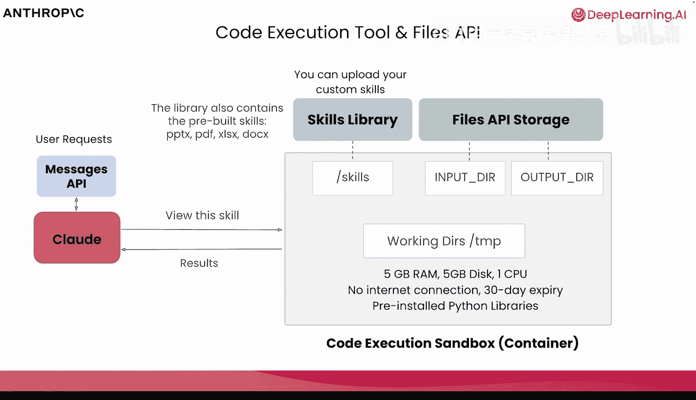
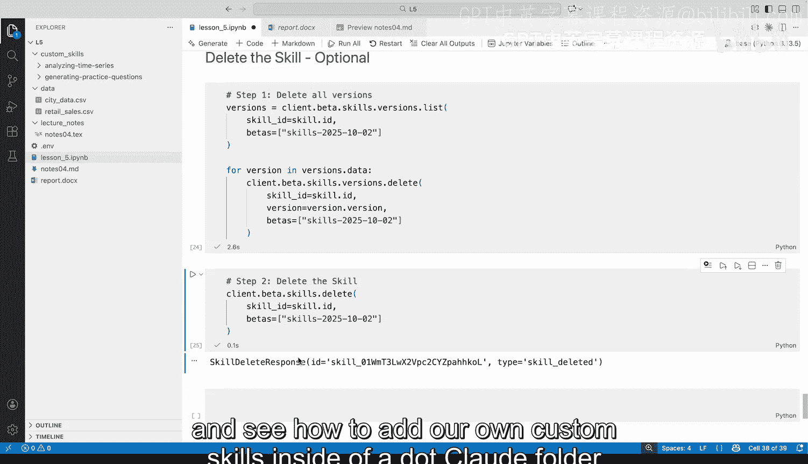
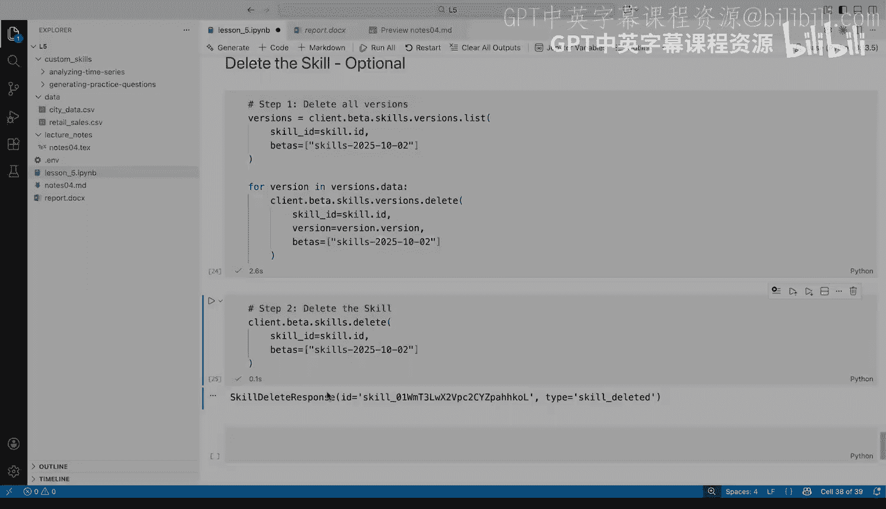

# 吴恩达《使用 Anthropic 的智能体技能｜Agent Skills with Anthropic》中英字幕 - P7：7.skills-with-the-claude-api.zh_en - GPT中英字幕课程资源 - BV13w6CBGEQ5

In the first lesson， you saw how skills work with Cloud AI。

 Now we'll work with the cloud API to test the two skills we made from the previous lesson。

To use skills with the cloud API， we'll need to use the code execution tool and the files API。

This will equip Claud with file system access for reading and writing files and with dashash for executing code。

 Let's get to it。We've talked quite a bit about how skills work and how to create them。

 and we talked a little bit as well about the portability of skills across different environments in the cloudD ecosystem。

 as well as many other agentic applications。We started by looking at skills in cloud AI and cloud desktopstop。

 and now we're going to move to talk about how to use skills using the Cla Mess API。

 There are two things that are important to note。 First。

 skills that you create in cloud AI and cloud desktopstop are not shared in the cloud API or cloud code。

The second important piece is that in order for skills to work。

 we need the ability for Cloud to execute code， create and edit documents， presentations。

 PDFs and data reports， and work with a file system。

 This is something that we're going to have to manually do when we work with a cloud API。

 and this is something that is actually configured for you right away when using cloududI and cloud desktop。

InCud desktopsktop or Cloud AI。If I go to settings。And I take a look at the capabilities。

 You can see here that there's a section for code execution and file creation。

 This is what we're going to talk about in more depth when we work with the API directly。

 but this is a setting that is enabled by default that allows Claud to execute code。

 create doc spreadsheets presentations and more。 This essentially gives cloud Ai and cloud desktop。

 a computer or a virtual machine to execute code and perform all those tasks that make skills happen。

 if this is disabled， we will actually see that we need to turn this on to even be able to use skills。

😊，Now let's shift back and talk a little bit about how this code execution tool and file creation works。

 because we're going to need to enable this manually when we work with the API。

When working with tools like cloud code and the cloud agent， you have direct access to a file system。

 whereas using the cloud API， we do not and need a container to execute code and a file system to work with with cloud AI and cloud desktop that containerized environment and file system is given to you and not something you have to implement At the end of the day。

 the functionality is all the same， but the way in which we utilize skills is slightly different。

 the skills themselves do not change the format of those skills do not change。

 but depending on the environment that you're in， you may utilize the way in which skills work slightly differently。

As we start to explore the messages API， we're going to use the code execution tool。

 the code execution tool allows Claud to run baash or shellll commands to perform all these actions that we saw when working with skills。

 creating， viewing editing files and writing code all in a sandbox environment。

 the code execution tool gives our application the ability to have a separate dedicated container to execute code and work with a file system。

As you've seen with all the things that skills can do。

 that is mission critical for reading our skills， executing code within those skills。

 and working with other files that we might want to edit and view and create。

To give you a visualization of what this looks like， when we include the code execution tool。

 we give Claude an execution sandbox or a container。When we ask Claude to create and execute files。

 these are executed in a safe and isolated environment， there are limitations for the RA， the disk。

 the CPU， and more importantly there is no internet connection provided。

 and there are pre-installed libraries that you get out of the box。

 so this does not work with every single kind of coding environment。

 there are some limitations here to be mindful of。At the same time。

 we also get access to a file system that we can start adding directories to。

 You might have even seen hints of that when we worked with cloud desktops and cloud AI。

 This limitation of no Internet connection is something that is specific to the Me API when we're using the code execution tool in cloud AI or cloud desktop we do have access to an Internet connection and we can download and install packages。

 The code execution tool works quite nicely with another set of APIs that cloud API allows us to work with。

As you can imagine， when we're working with files， adding， creating， writing， modifying files。

 we need some mechanism for actually storing those underlying files。

 the cloud API includes a set of APIs called the files API to upload and download files that can be run and worked on inside of the container。

You can imagine a scenario where the user asks to summarize some input and save the summary to a text file。

 we upload that input file， send it to the container。

 download generated files with this file's API we're going to be seeing this shortly in code when we see the IDs that we get back from uploading and downloading files and how this works nicely with skills and our code execution tool and this is exactly where skills come into play。

The library of skills that we get out of the box in tools like cloud AI or that we can include if we want using the API。

 those live in a directory that are powered in the container。

 as we start to read from this skills directory as we start to add information to our skills or use those underlying skills to create new files that we can download or upload This is where skills come into play。

 and we're going to see a requirement when working with the API when we want to use skills。

 we need to use the code execution tool as well。 Now that we have a good sense of what the code execution tool and files API allow us to do Let's see how to use this in action。

 We're going to go and revisit the two previous custom skills that we built for generating practice questions as well as time series analysis。

 So let's head over to a Jupyter notebook and explore this right here。

 I have my two custom skills that we've worked with before。

 I also have a folder for data that I'm going to be using to analyze time series data。😊。

I also have a folder for lecture notes that I'll be using when I use my generating practice questions skill to get started in this notebook。

 I'm going to load the environment variables that I need。

 as well as a helper to help me find particular files from a directory。

 We're going to see this in action when we start using our skills。 To start。

 I'm going to begin using my generating practice questions skill。

 So let's go ahead and take a look at the first part that I need to do。😊，To begin。

 I need to upload the skill directory here you can see we're using that files from D helper function as well as the necessary beta headers for skills once this is done。

 I should be able to see the skill ID that I've created。😊。

This beta's list are particular headers that I add when I make a request to the Me API under the hood。

 these are turning into request headers to make sure that I'm getting the right data back and communicating appropriately with the API。

To take a look at all the skills that I have， I can use this dotless method。

 and I'm going to pass in a source of custom so that we don't load all the built in skills。

 and instead just confirm that I've created the ones as expected。

 And here I can see the title as well as the unique skill Id that I'm going to be using shortly。😊。

In order for this to work as expected， we're going to need to make use of the lawte file where we're going to generate practice questions from。

Here， I'll use the Fis API to upload this particular Lotech file。

 make sure that it's set for reading。😊，And then get back a file object。

I'll be using this file object in conjunction with the skills necessary to make sure that it's all working as expected。

😊，I'm using Sonet here， and I'm passing in the necessary beta headers not only for skills。

 but in order for skills to work as expected when talking to the model。

 I need to make sure I have the code execution beta as well， and since I'm sending a file here。

 we have to make sure we have the files API header as well。😊，When working with skills。

 these skills are set in a keyword argument called container。

 and here is where I pass in the list of skills。 these could be custom ones or built in ones as I create many different versions of the skills。

 I can reference a particular timestamp or just use the latest one that I have as I start to communicate with the model I ask it to generate practice questions and then specify the file that I'm working with。

 This file object was previously created when I uploaded the logte file。

 We finally make sure we're bringing in the correct tools for code execution。

 and send a message to our API。😊，Now let's go take a look at the response that we got back。

 We can see here that there are multiple different pieces being used， tools on the server。

 code execution， additional tools being used， and then finally a bash code execution result。

To make this a little bit cleaner to look at， let's add some nice formatting so that we can go ahead and take a look and analyze different text responses and tool use。

 We're going to go ahead and see in this particular series what's happening one step at a time。

 When we take a look at what the response is， which includes our text in our tool use and tool results。

 The first thing the model is telling us is it can help generate questions from these notes。

 and it's going to start by reading the skill file and examining the lecture notes。😊。

Notice here it's detected the skill that it needs to use， but it's only reading the skill M。

 We're going to see later on if there are additional files that need to be read。

 will'll make use of that progressive disclosure。 We're also going to review in our input。

 that Lote file as well。 We're going to go ahead and see the underlying data that comes from these files。

 This is the Yammo front manner that we've seen before。

 as well as the late from our notes for thet file。 Next。

 we're going to go ahead and check the markdown template to use the proper structure。

 because we want our output to be in markdown。Here is where we're going to leverage a bit more of that progressive disclosure。

Here's where we're going to read inside of the assets folder that markdown template M。

 We'll get back the response that we've read， and now we'll generate the questions based on the lecture notes that we've passed here we're going to use our code execution tool to create a particular file。

 We'll give that file text in markdown， and we'll get back the result of that file。

We're going to go ahead and copy that to an output directory and use our files API to get back a file ID that we can download later on。

Once we get back that result， we can take a look at the underlying file that's been generated and make use of that file I to programmatically download it。

We can see here it's been saved and is ready for use。Using that file ID that we saw above。

 let's go ahead and download the file。We'll go ahead and check in this response and make sure that we have the file I correctly extracted。

 and if we have that， which we expect to do， we should be able to download that particular file。

 We'll go ahead and write to a file called Note4 MD with that content。

 that content includes the file I as well as the necessary beta headers to communicate with the API。

We can see here we've downloaded that Notes4 MD file。

 and this is coming from the files API with a code execution tool all generated with the model and a skill。

Inside of this file that we've downloaded， we can see that we're following those exact parts that we had in the skill。

 starting with true and false questions， moving on to explanatory questions to codingding questions。

 and finally to use case applications。We can preview this in Markdown to see what that would look like。

 and here we can see our use case application， all the things necessary。😊。

Now is a good time to evaluate this particular output。 Did we do exactly what the skill wanted。

 It looks good to start， But bringing in some unit tests can really take this to the next level。

 If we need， we can go back and modify the skill， just like we saw before， using the API。

 the code execution tool and the files API as well。😊。

We also have the ability to delete skills programmatically in order to delete a skill。

 we first have to find all of the versions associated with that skill and then delete them。

 Once those versions are deleted， we should be able to delete the underlying skill right here。😊，Next。

 we're going to go ahead and use our analyzing time series skill alongside another skill。

 this is going to look pretty familiar to what we saw above， so let's go through these steps。First。

 we're going to upload our custom skill， get back a skill I。

And confirm that we've done that as expected here， we can also see that we're not loading only the custom skills。

 We can see the built in skills as well。 These should look pretty familiar as we saw them as well in Claudy eye。

Next we're going to go ahead and upload our input file。

 this is going to be our retail sales CSV file。We're going to build a message to send to the API。

 and just like before， we're going to go ahead and use our skill。

 but here we're also going to include the Doc skill as well。

We're going to use this because we want to create a word doc summarizing the results and the plots。

 So here we're seeing a combination of custom skills with the skill I that we have as well as the version and using anthropic built in skills。

 in this case， the Doc X skill。😊，We're passing in the same headers that we had to pass in before。

 skills， code execution， and the files API。Now that this is finished running。

 we can examine the particular type of response that we get。

 we're going to see something similar to what we saw before。

 but this time there's just a little bit more happening。

Let's go and see what's happening under the hood with our nice formatting。

So here the model is going to respond by helping us analyze time series data。

 and just like before we're going to start reading the entirety of these skill MD files。

 we're going to read our custom skill as well as the built in DocX skill。

 which we're going to need to use。We can see the result of those include the content starting from the beginning of the file and including the entire skill MD。

 Next， we're going to go ahead and examine the data to run our time series analysis。

 We're going to look at just the first 20 lines of this CSv to examine the names of the columns and the type of data that we're working with。

Since this is working as expected， we're going to go ahead and run the diagnostics and create the visualizations。

 These particular commands that we need to run are coming directly from our skill。

 Here is where we're going to go ahead， read those underlying files。 Ex that code。

 and hand that back to Claude to work with。We're going to get back the result of these executions。

 we're going to get that back for diagnosis as well as visualize。

We're then going to read the summaryum and Dgnotics。

 which is the result of our script that comes in a file called Sumary。txD。

Once we have that particular file created， we can then go ahead and create a Word document。

The builtt in DocX skill includes the correct content for how to work with Word Docs。

We're going to go ahead and take a look at how best to generate that document and leverage progressive disclosure here。

 We don't need everything from the docX skill just using a way to get to those markeddown files。

 Once we have that we'll create the comprehensive word document using the skill necessary。

 execute the code to make it do that and generate the underlying word document。

Once we have that word document， we'll copy that to the output directory and just like we saw before。

 get back a file ID that we can use if we want to download this word document。

We can see a summary of what this data looks like， and now we can download the file， Similarlyly。

 we'll go ahead and find that file ID if it exists。

 We're going to go ahead and download that particular file with the necessary contents as a DocX file。

😊，If we take a look at what this looks like， we now have a word document with our findings。

 our overview， our statistics。 We can see that we brought in those plots and visualizations。

 as well as the statistical analysis that we've requested。

 This is also a great time to not only evaluate if what we're doing is expected in the skill。

 but that we're doing this in a predictable fashion。😊，As we continue to evaluate。

 we can always modify this skill as much as we want。

 but all this data is coming in from the skill as well as the doc X skill to create this individual file。

😊，Like we saw before， if we want to delete this skill。

 we can list all the versions and delete all those versions and once those versions are deleted。

 delete the underlying skill。In this lesson， we've combined our knowledge of the Me API。

 the code execution tool， the files API， and skills to take our custom skills and work with them programmatically In the next lesson。

 we're going to move to cloud code and see how to add our own custom skills inside of a dot cloud folder and build a more sophisticated command line application。

