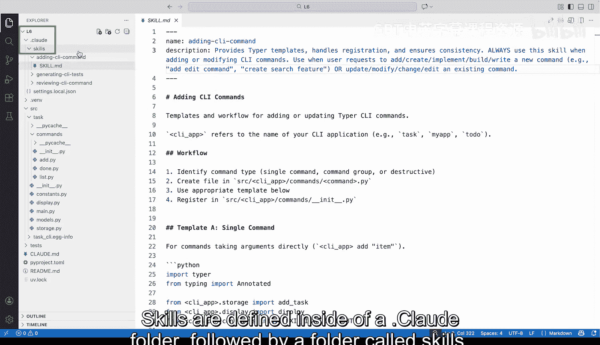
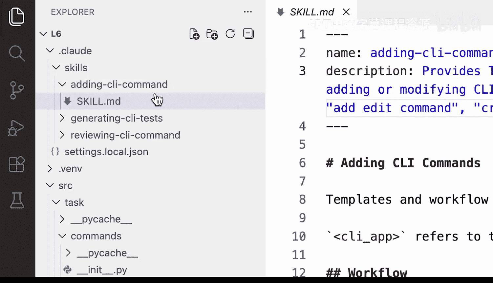
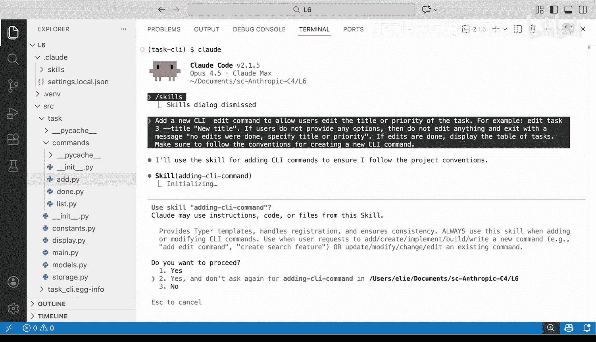
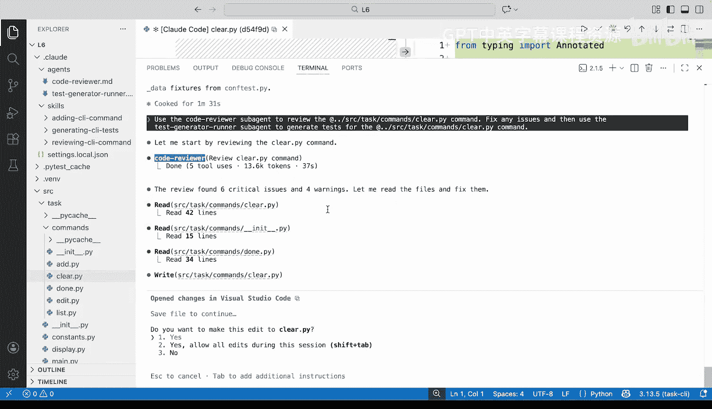
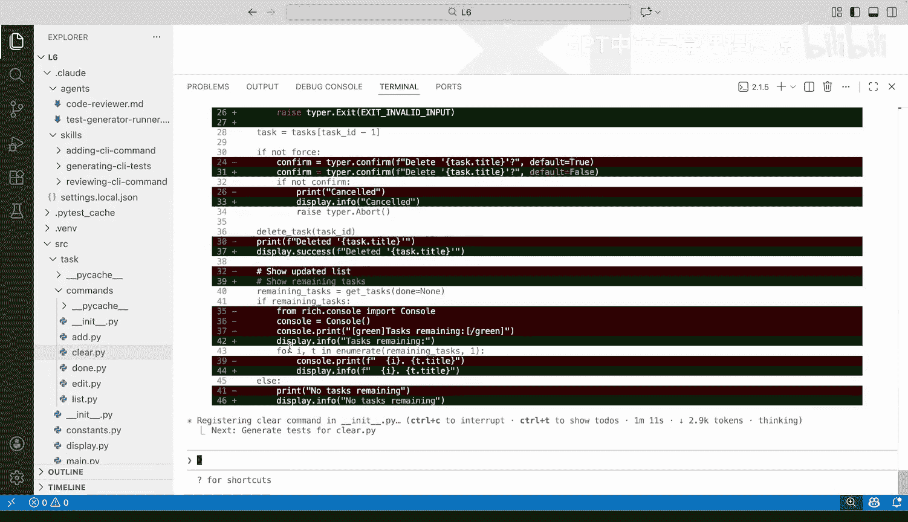
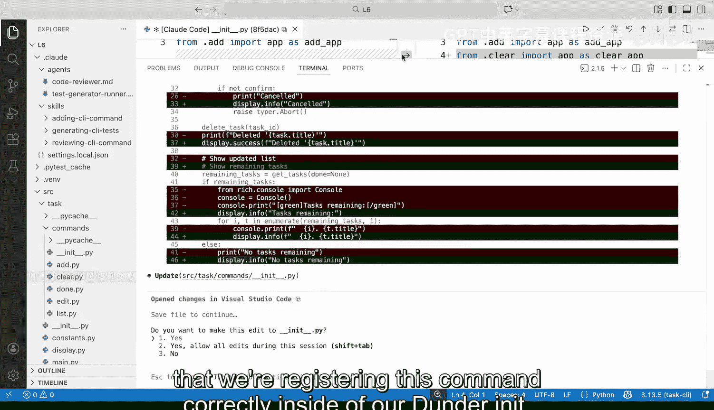
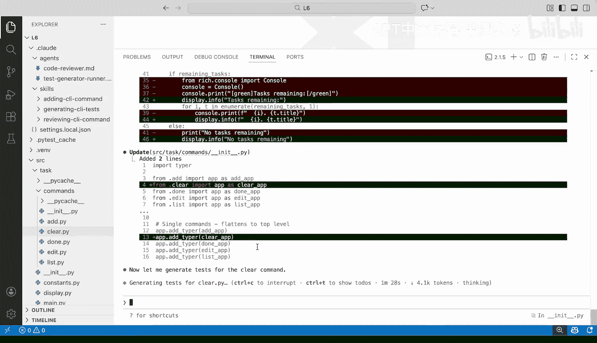
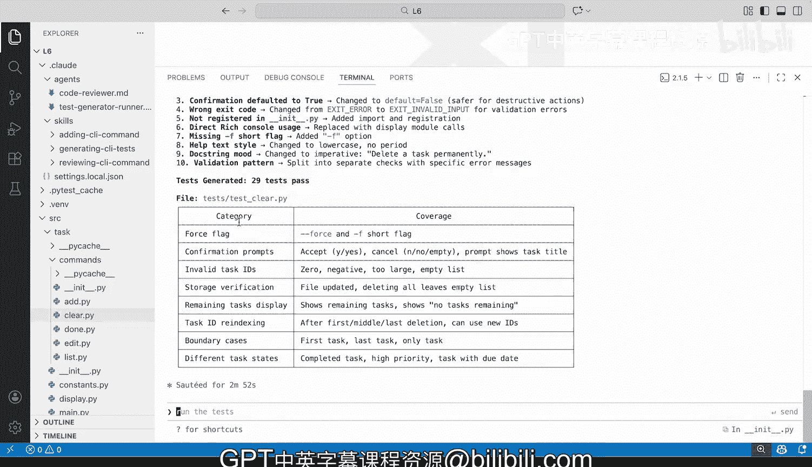

# 吴恩达《使用 Anthropic 的智能体技能｜Agent Skills with Anthropic》中英字幕 - P8：8.skills-with-claude-code.zh_en - GPT中英字幕课程资源 - BV13w6CBGEQ5

We'll now switch to cloud code and use skills for code generation， reviewing and testing。

 We'll also set up subagents and equip them with skills。Let's have some fun。 So far。

 we've seen how to use skills in cloud AI and using the Cla messages API。 Now。

 let's talk about how to use skills in cloud code in a bit more depth。

 The application that I'm using is a command line application for creating to dos that need to be completed and listing them and eventually editing and clearing。

 I'm going to show the cloud M file to give you a sense of what this project does。

 And now we're going to do a little demo before we jump into each of the individual files。

 in cloud code， you have the ability to create a Cla M file。

 This file is created using the slash a knit command or manually by the user。

 This file is always in your context and specific to your project。

 This is where you can specify general instructions about the codeb project you're working on technology stack and things that Clade needs to know in every single conversation。

 So again， we're building a command line task management application using Python。😊。

As our CI framework， using data classes rich， we're storing information in a JSson file for persistence and using U for dependency management。

 Our architecture follows according to this pattern。

 we've got our entry point and all of our commands get their own individual Python file。

 we set up our data class in our models do pi， our logic for storing serialializing Desializing in our storage do pi。

 and then to display things nicely in the terminal， our display do pi。

 We have a couple constants and then our tests。We can see in this file we have our priority our task as data models。

 how data has persisted， and remember again for this cloud MD。

 this is data that is always available in context in every conversation that we have This is useful information to help Clade figure out where to find things and how best to structure information So with that in mind。

 let's hop in and play around with this application。😊，First。

 I'm going to go ahead and activate the virtual environment。 So I'll source。Then then activate。

Once I've got that set up， make sure my dependencies are in order with UV Snc。

And once I've done that， I can actually start using this task command directly in the command line。

 If I take a look at the command， I see I have commands like add and done and list。

 as well as some additional options。 So let's go ahead and take a look at the tasks that I have right here。

 Right now， I have none of them that are found。 I'll clear the terminal so I can start from the top。

 let's go ahead and add a task right here。 We'll call this write the final report。

And we'll give this a priority of high。And we'll give this a date to be done。With the following。

We can see here I've added that successfully， so let's go take a look。😊。

You've got our task right there， our display do pi doing some nice formatting of that information。

 Now let's go ahead and complete it。😊，I'll go ahead and mark that as done with the correct ID。

 And then if I go ahead and take a look at my list。😊。

I can see with that flag that I have this task that is done。

The plan for this lesson here is to add another command line command for edit。

 so we're going to have to go to SRC to task and add another command here for editing。

 but we also want to make sure that when we add these additional commands。

 we're following the correct workflow we're following a proper way of adding commands the right way to pattern match a bit of what we've done in this codebase in order to do so。

 we're going to be using a skill here that we've added called adding CI command Ski are defined find inside of a dot cloud folder followed by a folder called skills。

 When we take a look at this skill， first， not only we can see that this is available at the project level。

 we can also create skills at the user level in our home directory if we'd like as well。

 For this example well be focusing in project specific skills。😊。

So let's dive into what's happening for this particular skill。 just like we saw before。

 we have a name and a description。 And here we're going to really lean into the particular coding styles and functionality that we want when creating new commands。

 We're going to start by identifying the workflow necessary and creating files in the appropriate directories。

 just like we have commands for add and done and list we want to make sure that when we make new files for commands it lives there。

 We also want to make sure that these commands are registered in our Dunder and knit do pi file that lives in the command folder。

 when we think about how to create different commands。 There may be lots of different kinds。

 There may be commands that involve subcommans or flags or additional arguments you can provide plain text instructions to Cla。

 but especially for coding examples， Claud does really well when you tell it exactly what pattern and style you want to follow in the type or library。

 there are many different ways of accomplishing particular tasks。😊，For example。

 there are many different ways of adding type annotations to arguments that are being decorated。

 In this particular case， This is the convention we want to follow as it's a little bit more modern。

 you can imagine in libraries and code bases that you use。

 There are many different ways of doing things。 but what's useful about skills is it gives us that predictable workflow for a set of tasks。

 we also want to make sure we're using this display object here and calling methods like success in info。

 to make sure that when we add a command， we're not only executing the business logic but displaying the correct information to the user at the end。

 when we work with flags， we want particular shorthand。

 we want particular longer ways of addressing it， we want to make sure that there's help text as well。

 All of these pieces， type annotations default arguments。

 certain return values are valuable to add in your skill。

 so that you know how best the pattern match and follow predictable workflows。

 as we think about commands with subcommands， not only can you see here。😊。

How we want to structure individual commands， but also how we want to display when things like migrations or versions are changed。

As we imagine commands that might be destructive as we start adding functionality to clear。

 we might want to specify what kind of delete we're doing if we choose to do a hard delete。

 we want to make sure that we confirm before we go ahead and delete that particular task。

 This pattern can be followed as clause starts to see additional commands that might need to involve some kind of deletion。

As we think about registering， we want to be intentional about how to add single commands and command groups。

 so not only are we giving Cla instructions for how to register commands。

 we' being very specific with what conventions to follow。And finally， as we talk about conventions。

 here's where we can lean into requirements on our doc strings。

 being mindful of exit codes and following constants that we have。

 being mindful of commands that are destructive， this is a really useful place so that when we build our predictable workflows。

 we know exactly what conventions were're following these are not conventions that have to exist everywhere in the code basease and have to be loaded everywhere in context。

 If so we could put them in the cloudM but in this case just for adding individual commands。

 there's a subset of conventions to follow， let's only load those when necessary。

 and not only are we using generic naming like CI app。

 we can use this skill across any platform that follows the agent skills convention。

 and depending on whatever CI you're building， if you want Cla to follow these particular patterns。

 this skill can easily be adapted to do that。😊，Now that we have a skill for adding CI commands。

 let's also make sure that when we start to do this particular workflow of adding commands。

 we're being mindful of testing and also validating the commands that we write。

 This is another great use case for another skill In our second skill for generating CI tests we generate pi test tests for type or commands。

 We include here what kinds of fixtures we want， how to handle edge cases。

 And this is really important that we add what to do and how to trigger this particular skill。

 You can see here， use when the user asks to write tests， test for my CI or add test coverage。

 It's always important to be very explicit not only in what the description is but how clogged can detect how to run it。

😊，Similar to other skills， we specify the workflow that we want when writing tests。

 it's often best practice to leverage fixtures。 You can think of fixtures as information that is run each time as you arrange your tests to set up information to set up dummy data as well as any kind of mocking or test infrastructure that you need for each of the tests that you write。

 for example， here， we specify what our temporary storage might look like and we specify what some sample data might look like。

 as we run each of these tests。 This information will be exposed to allow us to arrange and set up the tests necessary when we test individual files。

 folders and workflows。As we take a look at the test structure。

 we're following a pattern of arranging， like we mentioned with our fixtures。

 invoking some kind of action， and then asserting that the result is the case right here。

 we're simply trying to build patterns that C can use and follow when the skill is leveraged we can continue on with how we want this test runner to be done and how to test scenarios by a command type as we read as we add here are examples for what we want our test to look like As with many testing libraries。

 There are lots of ways to accomplish a similar kind of task for these examples here is the pattern we want to follow。

As we wrap towards the end of this skill， we want to think a little bit about edge cases to cover when writing tests。

 we want to think about invalid input， any kind of state confirmation or what happens when things are not found or don't exist。

 we want to make sure that we're following a checklist as well when we go ahead and write our tests。

 And then finally， to make sure we're running tests correctly， providing the correct commands。

 as well as how to run in a verbose mode and for specific files。

The last skill that we have here is to wrap up and review and make sure that we're executing the commands as expected。

 Once we've generated the tests and the tests are running。

 let's make sure we're following the correct conventions。 Just like we saw with other skills。

 there are ways in which we can execute the task necessary and then come back and validate that things are working as expected。

 As we think about reviewing these commands， Not only do we think about the underlying structure。

 Is this in the right location， Is this using the right decorator Is this registered correctly。

 But we're also making sure that some of those practices we wanted around type annotations or options for parameters or flags when possible。

 always are included。 It's often helpful to provide positive and negative examples。

 So as we mentioned， using this annotated type versus a different kind of way to type your arguments。

😊，As we think more about error handling and output。

 we make sure that this checklist exists so that the skill can go through and confirm that all of these pieces are as expected。

 We're not telling Claude how to perform these actions like adding commands and generating tests。

 We're making sure that it's working as expected。 You can think of this like an evaluation almost for the other skills that we have and including this skill as part of our workflow。

As we take a look at the bottom， making sure that our best practices are followed。

 as well as examples of mistakes we might see and fixes for those。

 as we take a look at the output format of this skill。

 we want to make sure that all of our checklist is addressed including a summer A and suggested fixes。

 It's very useful to have this underlying review so that when features are finished。

 we can start by taking a look at this review， include this even as part of our code review。

 make sure we're building production grade features back by tests following best practices。

 With mind， let's start to put all of these skills together， The first thing we're going to do here。

 is to add a new command that allows us to edit individual tasks。

 we're going to want to make sure we edit the title and priority and pass in an I that is valid。 Now。

 let's hop into cloud code and use these skills。😊，To make sure that I've registered these correctly。

 I'm first going to just type in slash skills。This is going to list the available skills that I have to me these are project skills we also mention we can add skills in our home directory。

 but right now we're just dealing with project skills。

 we can also see the amount of tokens that these skills are taking as we just think about the name and description necessary。

😊，When you create a new skill in cloud code， you want to make sure that you close cloud code and open it up again so that skill can be identified。

 so if you find yourself looking at your list of skills but you're missing the one that you might have just created。

 make sure to close that instance of cloud code， open it up again and you should be in good shape。

Now that our skills are loaded correctly， let's go ahead and add a new edit command to allow users to edit the title and priority。

 We're adding a little example here and ensuring that we follow the conventions for creating a new CI command。

 So let's give this a shot。😊，We can see here that cloud code is prompting to use the adding CI command skill and that's great。

 We'll go ahead and make sure that in the future it doesn't prompt us to do so。

 We can see here we're going to read the existing files and storage to understand the convention。

 as well as take a look at examples of other commands for reference。😊。

Now that we know the conventions， let's go ahead and create that particular file。

 We can see here there's a new file edit up pi being created。

 and we're going to go ahead and make that change。 We'll see here edit appears。

 and we're now going to register that command following the order that the skill has set out for us。

We can see here that the command is being registered inside of our Dunder end knit as expected。

 we're going to go ahead and make that change as well。

So we'll go ahead and let it proceed and run this command to test out and make sure it's working as expected。

 Looks like we're seeing what we expect， and that's in good shape。

It's now going to run the add command and then go ahead and run the list to make sure we've added successfully。

 It's seeding some data that we can then make sure the edit command works as expected。

We'll go ahead and edit that particular task。 And we'll see here that we didn't specify a title or priority。

 We'll then go ahead and put in that title。 And here we'll see that edited as expected。

It's going to ask me again to edit this task。 And this is going to happen over and over as we start to test all kinds of examples。

 And while I could proceed over and over again， we can imagine that this might start to fill up the context window quite a bit。

 And if this were a larger scale system might be very time intensive and even compute intensive。

 So what we're going to do here is something slightly different。

 We're going to leverage the functionality that cloud code has for using subagents。

 We're going to have one subagent to review code and follow the criteria so that the main agent can focus on the development。

 We're then going to have another subag to generate and run the tests using the skill that we have。😊。

What's going to be useful about this is that we can have the main agent focus on development while subagents in their own context window focus on generating the tests and reviewing the code。

 we can then take the feedback and tests generated。

 bring it back to the main agent with a much more context efficient approach。

It's important to note that subagents do not inherit skills from a parent。

 so we need to be explicit with the skills that we give to each subagent that we make。

There are multiple ways of passing skills to subagents。

 One way we're going to show you is being explicit with the name of the skill in the subagent。

 Another option that will link in the notes is where you can provide the exact agent name and how best to run it from the skill directly。

 With that in mind， let's go ahead and create our subagents。

The first agent we're going to make is our code reviewer。

 and we're going to create these agents using the slash agents command。

 We're going to create a new agent。 We're going to do that on a project basis。

 but instead of generating with Claude， we're going to follow a manual configuration so you can see what it looks like to add a name。

 description， tools and most importantly skills for each of our agents。

 The first one I'll make will call code reviewer。😊，This will be the unique identifier for our agent。

 and then we'll pass a prompt to it。We're going to paste in a prompt that we'll take a look at once we've created this。

 but is going to look very familiar to how we review and how we're specific and actionable in the insights we make when doing the code review。

😊，We're going to go ahead and give this agent a description for when it should go ahead and be used。

 We're going to review for code quality， security and so on。

 We're going to try to make this agent as generic as possible。For the set of tools that we want here。

We want to be very specific with the tools that our subag has access to。

 So we'll make sure that if there's code that needs to be executed， we give a bash。

 Gobbing Gp for finding files and read to read underlying files that we're going to be reviewing。

 Once we've selected these tools， we can go ahead and continue。

We'll decide to inherit from the parent with the model that we use。

And we'll go ahead and give this a color of purple。Once we've got this set up。

 we'll go ahead and save this agent。We can see here now in our agents folder that we have a code reviewer agent to work with。

😊，We've got the code reviewer， a description， tools， and all of the wonderful pieces that we added。

 It's now time to make sure we specify the skills that we want this subag to use。

 We'll do that using the skills field and specify the name of the skill that we're working with。😊。

In our case， reviewing CLI command。Before we create our next agent。

 let's do a quick review of what we made here。 Our agent has a name and description， tools available。

 a model that we inherit， a color and skills that we brought in。 We can add multiple skills。

 but right now， we're going to stick with one In our prompt。

 we mention it's a code reviewer ensuring high standards。😊，As we specify what this agent is。

 we specify when it's invoked general quality checks。 If we're working with Python。

 how to be intentional， CI commands the same way and a particular output format。 Like we mentioned。

 this agent is a bit more generic。 And while we're using it in the context of our specific application。

 skills can help us be more particular。 but this agent might need to be used across a different variety of applications。

 So we want to be a little bit more generic for what we're trying to do here。

It's important to note that skills operate slightly differently as subagents in cloud code when this subagent is dispatched and created。

 the skill is not only loading the name and description， but the entire skill M。

 the skills are preloaded when the agent is dispatched if there is additional progressive disclosure reading of other files or other commands that is not done。

 but the entire skill MD is read when the subagent is dispatched。

Now that we've got our code reviewer agent， let's add another agent for generating and running our tests。

Let's go ahead and make our second agent。We're going to go create a new agent in our project。

 using the manual configuration。And we'll call that test generator runner。

We're going to go ahead and add a prompt here that we'll review a little bit later。

 but it's going to follow similar patterns to what we saw with the other agent that we made。

 We'll go ahead and specify a description for this agent where we'll specify that it should run tests and generate them if missing。

 When the user asks to test or run tests。 Let's go ahead and make sure that this agent is dispatched。

Like we saw before， instead of giving access to all tools， let's go to our advanced options。

In our advanced options， we're going to go ahead and disable all of our tools。

 And here we'll make sure we have a bash tool， Gob and Gr， read as well。

 But we're also going to need to edit and write individual files。 and in our case。

 edit files that may already exist。 Once we've got these tools set up。 Let's move on。😊。

Talk a little bit about the model we're going to be using just like before。

 we'll inherit from the parent。And we'll go ahead and use yellow for this subagent。😊。

This looks good to us， so we'll go ahead and see it。😊，Once we've created this agent。

 we also want to make sure we specify what skills are being used in this case。

 the skills that we're going to be using。sThe generating CLI tests skill。Again。

 we could add multiple skills， but in this case we're just going to use that individual one。

As we saw before， we specify when it's invoked。 We show how to discover tests and the output format that we want。

And then some underlying rules to make sure that things are working as expected。

 and just like our other agent to be a little bit more generic and lean on skills to provide consistent workflows。

 Now that we've created our subagent and our skills。

 Let's put this all together to make sure that when we add new commands。

 we dispatch subagent when necessary using the skills that we want。

 Let's go ahead and start by using our code reviewer subagent to review the edit pi command that we made。

 This should not only dispatch the subagent， but also make use of the skill that we provided to that subagent。

 We're going to see here that the code reviewer agent has been dispatched。😊。

And now we're going to go ahead and use the necessary skills and tools that we've defined。

We can see here what's working and what's not working。 No critical results。

 but we've got some warnings， issues to fix and suggested fixes。

 We can go ahead and use the main agent to implement those， if we' like。

 We're then going to use our test runner subag to generate the tests for our edit op pi command。

 So we'll go ahead and make sure that we're referencing the edit op pi file。

And go ahead and dispatch the second subagent。We can see here it's generated the necessary commands。

 and it's prompting me to make sure that we want to make this edit。

 so we'll go ahead and do so as we add tests for editing。

It can confirm that the tests are working using this command UV run。

And then we'll go ahead and run all of our tests with verbose mode to make sure things are passing and there are no regressions。

Once this is done， we can see that all of our tests are passing， none are failing。

 and here's a summary as well。We made use of two different subagents leveraging multiple skills。

 and as we start to add more features and functionality， we can put these all together。

The next thing we're going to do is see our code reviewer subagent and our test runner subagent in action。

Let's imagine there's a clear Dot P file， a new command that's been added by someone on the team who hasn't followed best practices and maybe didn't use all the skills and infrastructure that we set up。

We're going to go ahead and use our code reviewer subagent。

 as well as our test runner subagent to figure out how best to fix the clearear dot Pi file。

We're going to dispatch our code reviewer to review the clear dot pi command。

 and then we're going to use our test generator runner to generate the test necessary for this command。

😊，We'll validate finally that things are working as expected and make sure all the tests are passing and following the best practices that we've standardized。

We can see here there are quite a few issues and some warnings。 Now that we found these issues。

 let's make sure that the main agent is reading the files and fixing them。

 We're going to want to make sure that we allow for these edits to clear up pi。

 And here we can see things like displaying things to the console are done using the correct methods like display。

 as mentioned in our best practices。 We also want to make sure that we're registering this command correctly inside of our Dunder and it。

The main agent itself is not adding additional context for the reviewing and generating tests。

 it's simply taking the output of the subag to better execute these tasks。

Next up， it's time to generate tests for the clear command that is following our best practices。

We can see here it's adding a file to test this clear command， and let's go ahead and approve that。

Now that we've created this file， let's go ahead and run the tests。

 make sure they're working as expected。And now we can get a summary of what's been completed。

6 critical issues，4 warnings， and all of them fixed Instead of using incorrect methods。

 instead of using flags that are not the right format that we want， incorrect Exocodes。

 we fixed quite a few different issues。 We've then added tests on top of that to make sure that we're confirming that all these best practices are done as expected。

 and the functionality is working that we'd like。In the next lesson。

 we'll shift away from Cloud code and move to the CloudD agentnt SDK and showcase how to use skills when building your own agents using the same harness that Cloudcode uses。

