# 吴恩达《使用 Anthropic 的智能体技能｜Agent Skills with Anthropic》中英字幕 - P9：9.skills-with-the-claude-agent-sdk.zh_en - GPT中英字幕课程资源 - BV13w6CBGEQ5

In this final lesson， we'll create a research agent using the cloud agent SDK。

 The agent will use the skill to create a learning guide for an open source tool based on its documentation。

 Gitthub repo and web search。 Let's go。😊。

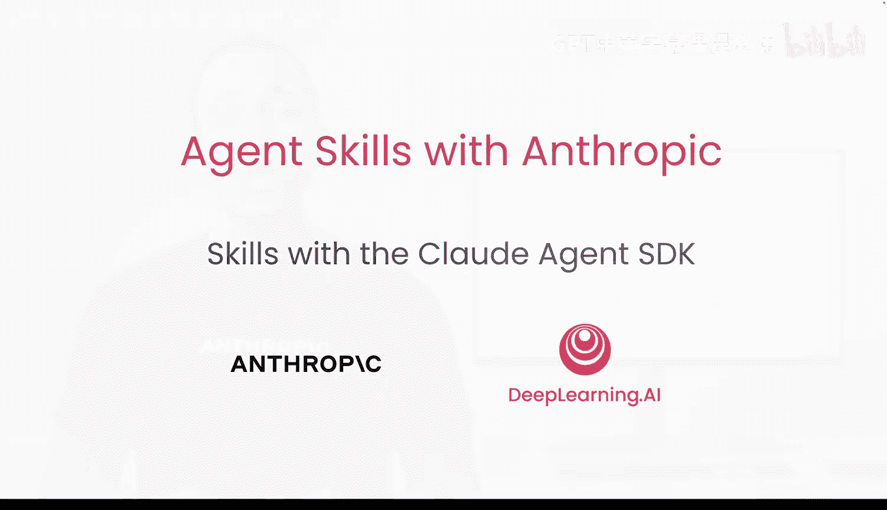

Now that we've seen how to use skills on the web with Clade using the messages API and Cla code。

 let's talk about how to use skills with the cloud agent SDK as a refresher。

 the Cla agent SDK is a programmatic way of building your own agentic applications that use the same internal harness that Cla code does what we're gonna to be building here is a general purpose research agent The main agent is going to be able to research information from multiple sources and synthesize a summary it will dispatch three different subagents for analyzing documentation analyzing and downloading repositories and researching information by searching the web Let's take a look at those prompts and then we'll take a look at a skill that's used to guide the main agent with a research methodology and what needs to be extracted and synthesized to start we have our main agent prompt。

 This is the orchestratrator that has access to three available subagents with the following capabilities finding information from。

😊。

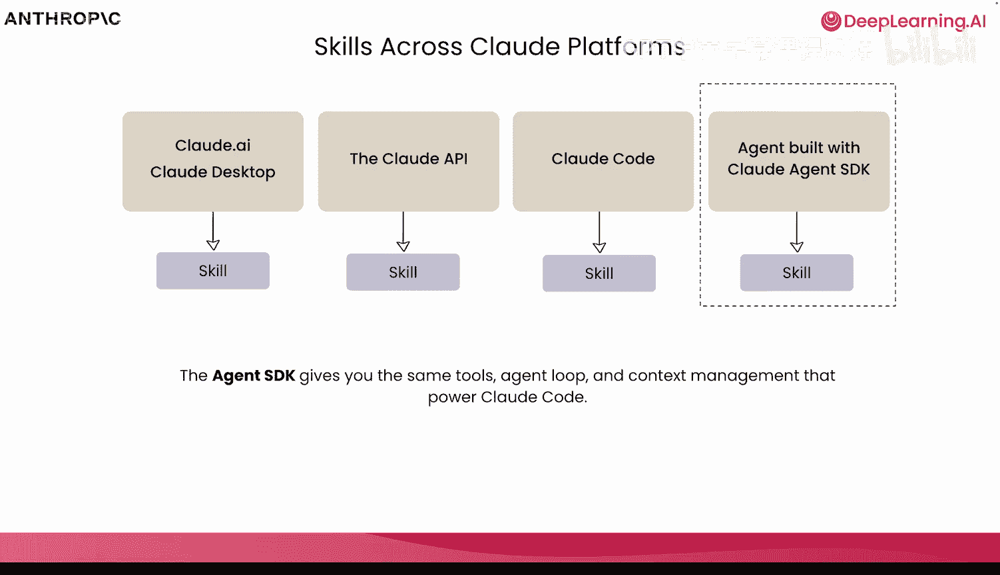

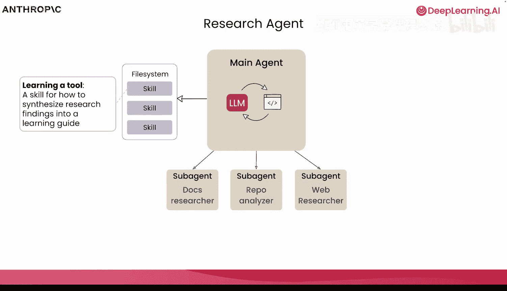

Documentation， analyzing repository structures， finding articles。

 videos and community content to bring it all together in this particular application。

 we mention that if the skill is provided， we want it to follow a particular pattern。

 It's possible that skills may or may not be provided for the application we're building。

 but in our case we're going to provide one。 If the skill matches the user's request。

 We need to follow that skills instructions precisely。

 Since we're starting from scratch with this agentic application。

 we want to be very intentional about what to do when skills are provided or when they're not。

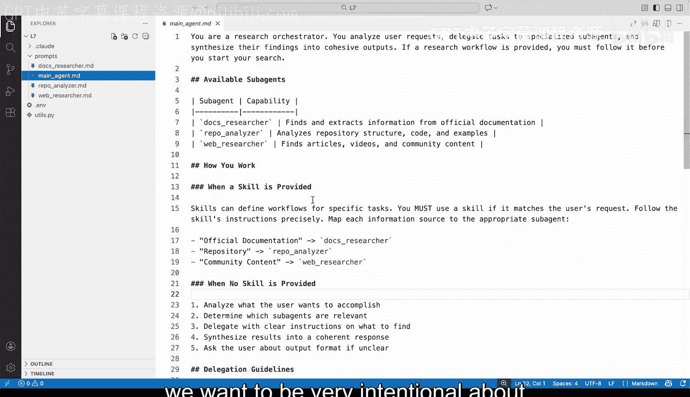

As we continue， we have a couple high level delegation guidelines for how to spawn subagents and after receiving results。

 how to synthesize all of those pieces of information。

 let's briefly dive into some of the prompts for our subagents。

 for the documentation researcher will have access to web search and web fetchtch we provide a process to locate documentation。

 particular input formats， guidelines and an output to return findings in a certain way。

For the repository analyzer， we also provide web search to find repositories。

 dashash commands to clone and run Git， and then the ability to read and find files and data within files。

 Similarlyly， we provide a process， an input format， guidelines and an output。

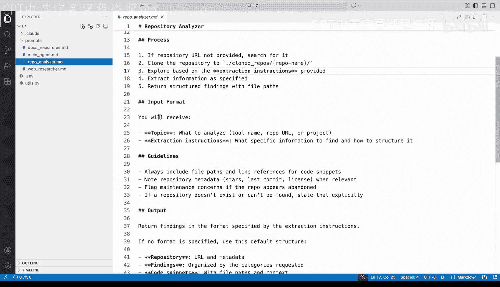

Finally， our web researcher makes use of web search and web fetchtch as well。

 This allows us to search for content relevant to that topic and to receive extraction instructions as well from the main agent。

 We also provide guidelines as well as an output format that's necessary and if no output format is specified。

 follow a default structure。 All of these prompts will be used together when we set up the code necessary to make our agent work。

😊，Finally， let's talk about the skill we're going to be using here。

 We have a skill named Learning a tool。The purpose of this skill here is to guide the main orchestrator we will not be using the skill in our individual subagents。

 but we're using this skill as a way to create a predictable pattern so that the main agent knows the ideal workflow and what and how to dispatch subagents。

We give the skill a name and a description， and in this case。

 we want to create learning paths for programming tools to find what information should be researched and specify how best to follow an approach to researching all the way towards creating a comprehensive learning path to start。

 we have a very particular workflow that we have here。

 we start with a research phase and we specify for official documentation for that subagent exactly what to look for for the repository analyzer。

 a similar kind of approach and for our web researcher very similar as well。

 So we're using this skill to provide a constant and predictable workflow for how best to work alongside the subagents that the main agent has。

😊。

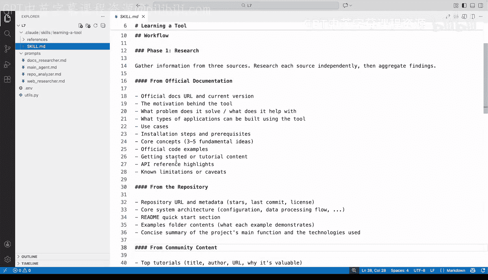

Once that data is given to us， we then organize that content into progressive levels here。

 we're using progressive disclosure to lean in to loading another markdown file as the source of truth in our progressive learning file。

 we can see there's quite a bit around the individual levels that we want starting from an overview and motivation all the way towards installing core concepts。

 practical patterns and then where to go next。 This progressive learning allows us to build levels so that we know how to start from the beginning and know eventually where to go deeper。

 While this initial skill is useful for learning a tool。

 you can also imagine that we might have additional skills for maybe comparing one tool with another depending on the data that we're working with。

😊。

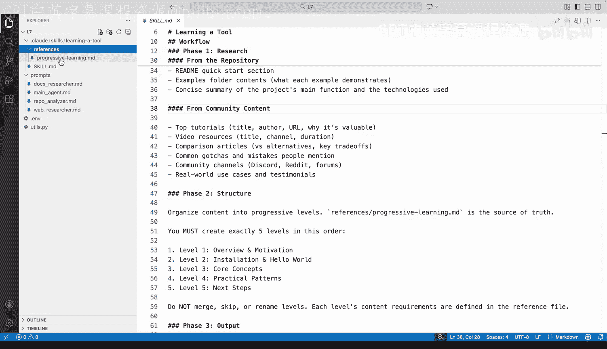

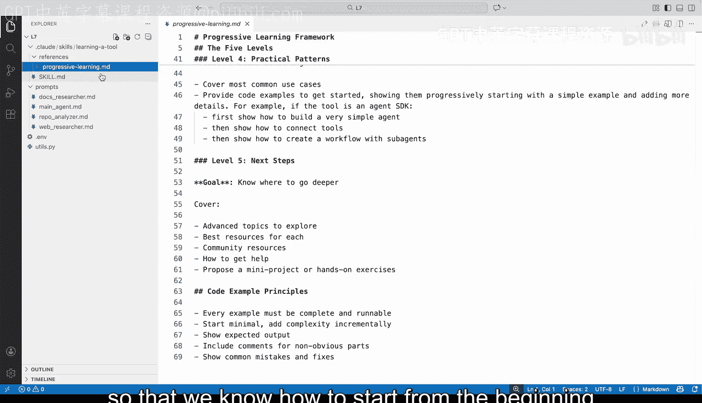

As we move towards the additional phases of working with this skill。

 we take that data and specify a structure and then specify an output。 We're very。

 very particular with the exact format that we're working with。

The goal here is to get access to a learning environment that gives us an overview， resources。

 a path， and code examples The goal here is to combine the research from all of our subagents into a particular output format that we want and do that with consistency and predictability。

Now that we've seen at a high level of the application we're going to build。

 there's one last piece that will layer on。 we can imagine that we want to take the output and write it to a centralized place that we can share with teammates that might have a nicer interface and to do that。

 we're going to use notion to connect to notion， we're going to use an MCP server and bring in the tools necessary to go ahead and execute that。

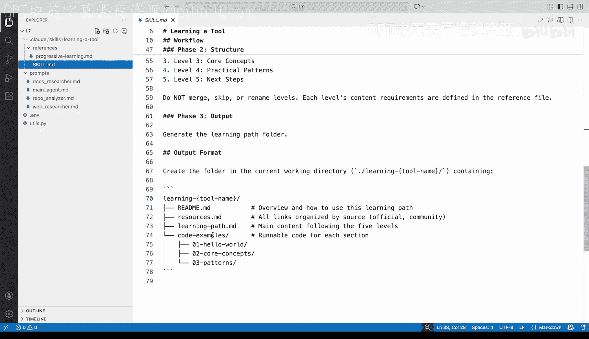

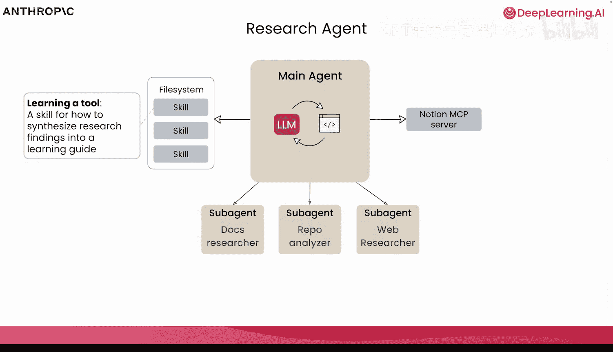

Now that we've examined the underlying prompts for our main agent and subagents as well as the skill we're going to be using。

 let's go ahead and begin by running UV init and initialize a project and add the necessary dependencies like Cloududagent SDK。

 Python。 Ev， and Async IO。Once we've installed these dependencies。

 let's go ahead and create a file called Age dotpi。

 so I'll go ahead and make a new file called that agent dotpi。Inside of our agent toppi。

 I'm going to be adding the necessary code to just get started with a small example using the cloud agent SDK。

😊，The boiler platelate here brings in asychio to run this environment。

 Ev to load environment variables， and then from our UTs the display message function。

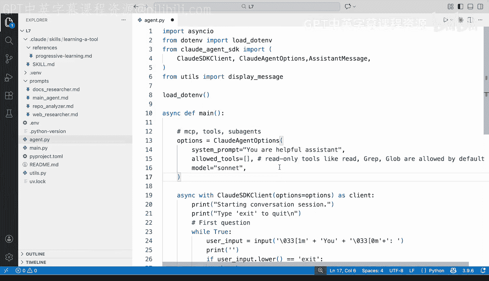

Just to give some context， display message gives us a bunch of helpers for truncating and formatting input。

 and it gives us a nice way to visually display information from the main agent and the subag。

 This is very similar code to what we saw when we worked with the API and we got that nice output for what's happening in each tool action and iteration。

😊。

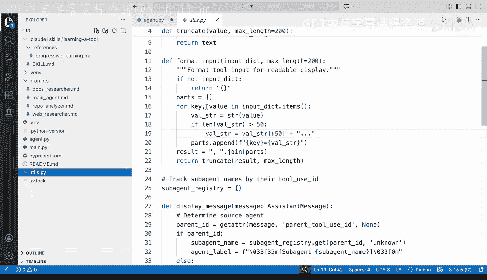

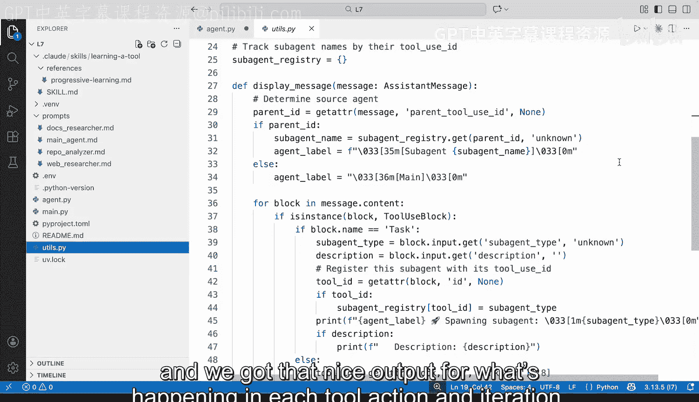

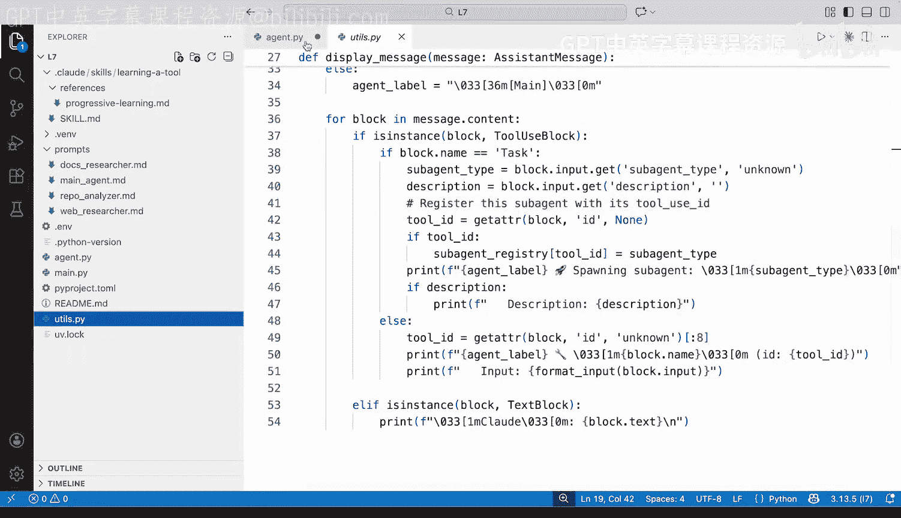

To start， we set up our cloud agent， we pass in a system prompt here， this is going to change。

 we pass in allowed tools， this is also going to change。

 but we just want to start with the basics here。

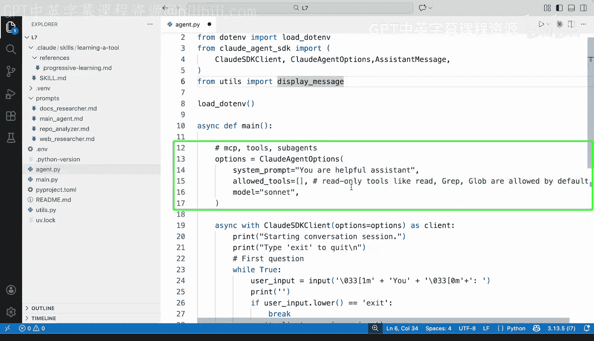

To get started with a simple conversation， we set up a loop。😊，Acept some user input。

Run that through our model and take back the response and send that back to the user。

 Let's go and see what that looks like。 I'm going to open the terminal again。

And we're going to go ahead and run UV Run Agent Dpi。

This is going to provide a terminal environment to us where we can start a conversation。

I'll just start by asking， how are you？In this case。

 I'm not going to get a ton of valuable information here because I just have a helpful assistant。

 so what we're going to start layering on now is the ability for our agent to get access to MCP servers and the correct tools as well。

Let's go ahead and make some modifications to our main function。Like we mentioned。

 the allowed tools are going to change。 So what we're going to start doing is adding the tools that our subagents need to use so that they can be working as expected。

 Read only tools like read and Gr and Gob are allowed by default。

 But when we want to start doing things like writing files。

 searching the web and executing commands by bash。 We need to pass that in explicitly。

 So we'll bring in the right tool。 the bash tool。😊，And are web search and web fetchch tools。

We saw previously that our subagents are going to be making use of these particular tools。

 our agent that's analyzing repositories needs bash to run git commands and writing files。

 and our Docs researcher and web researcher will make use of searching and fetching。

Now that we brought in these tools， the next thing we're going to add are MCP servers to connect to。

We'll use the MCP server's keyword argument and specify the name of the MCP server。

 which in our case is Not。We're going to pass in some default configuration。

And we're going to specify the command to run the notion server alongside a notion environment variable that we have。

 So we're going to make sure before we go ahead from our dot Ev file。

 Lo in our notion token and import the Os module to make sure that we can read that file correctly。

 Now that we've loaded our MCP server correctly。 We need to make use of the tools that Not provides。

 If we would like， we can ask Claude right now， What are all the tools that you get from this MCP server。

 or we can go ahead and add those explicitly。😊。

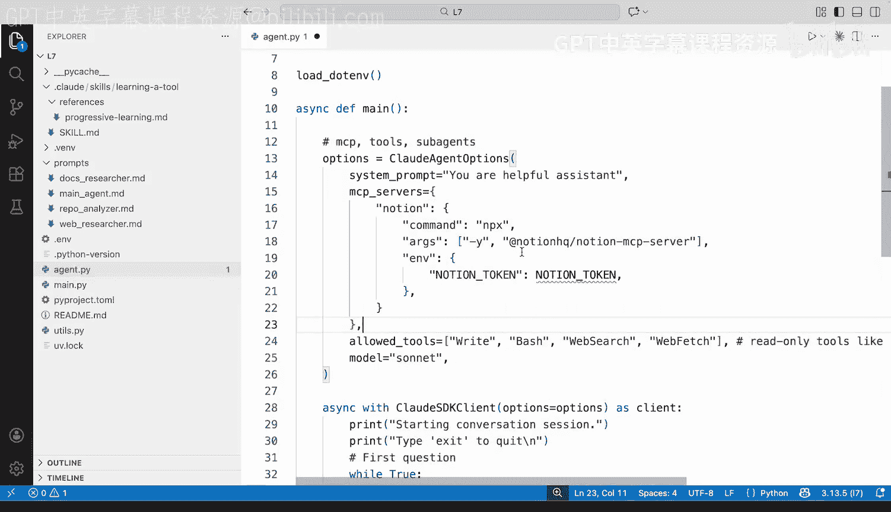

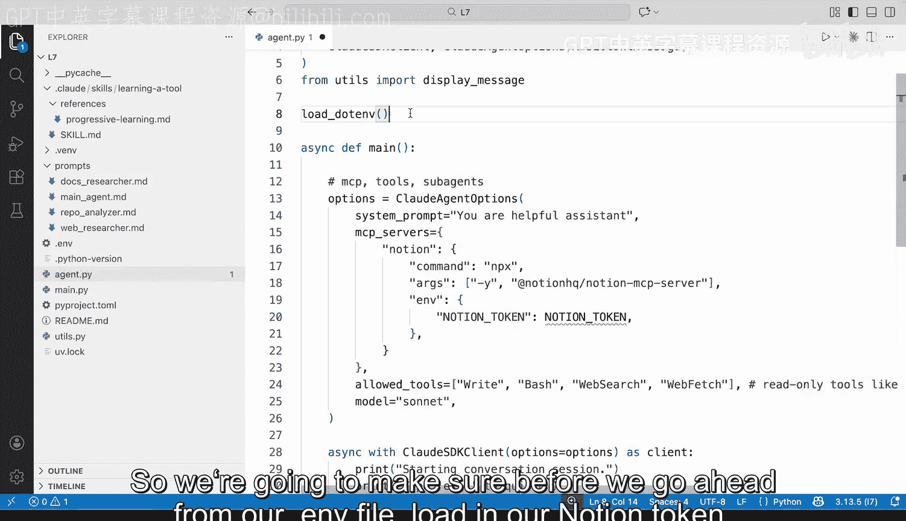

By using MCP， the name of our server， followed by the name of the tool， in this case。

 we're going to be using all of the tools that notion provides to us。

We need to make sure that this MCP notion exists in allowed tools so that we can give the main agent permission to use this set of tools。

 we can explicitly add the name of the tool or in our case we're just going to include all the tools available that MCP Not provides to us。

Now that we've set up our MCP servers and our allowed tools。

 let's go ahead and bring in our subagent and definitions for them。

 We mentioned that our system prompt is going to change。 And to start。

 we're going to go ahead and load all of the prompts that we have。 we'll bring in。

A constant and a helper function that we have to load all of these prompts。

We're going to go ahead and call that function to go ahead and bring in these prompts inside of our main function。

 We're going to make use of these markeddown files to load in the text necessary and pass them to our agent options。

😊，Before we go ahead and update the main agent， we're going to add a dictionary that references all of our agents with a definition。

 we're bringing in the agent definition class， which we'll want to make sure we import correctly。

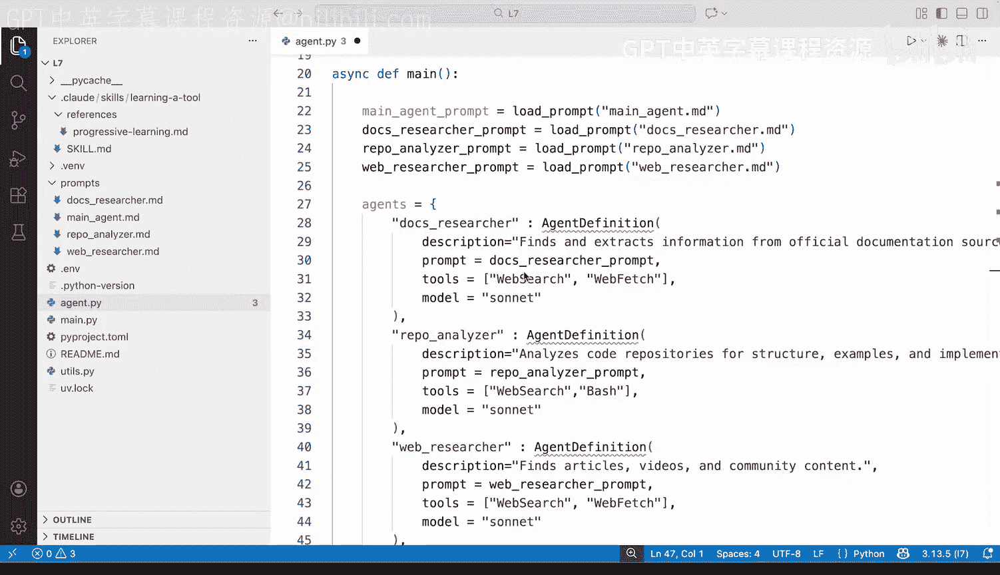

We can see in the agent definition we have a description for our subagent。

 a prompt that specifies the instructions for the agent。

 and then the tools that we want that agent to use。

 similar configuration to what we did in cloud code。 You can see here。

 we still need to use our main agent prompt， as well as this dictionary of agents。

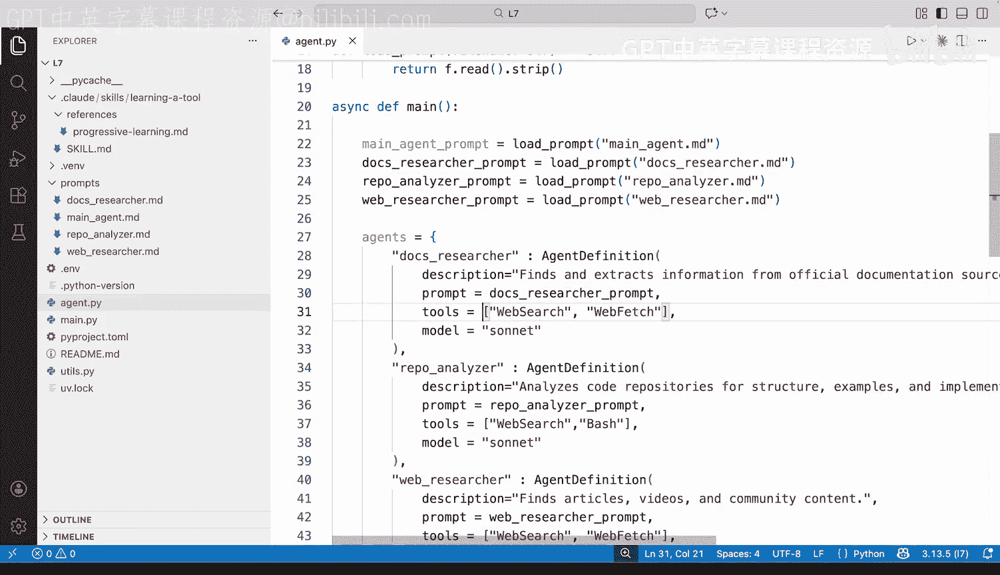

So we'll update our system prompt with the main agent prompt。

And then we'll make sure to pass in an additional keyword argument of agents that references our dictionary with our agent definitions。

As you can see here， our researcher， our analyzer and our web researcher are using tools that we defined here as well。

 it's important to make sure that you list all of the tools that your main agent and your subagents will need to use inside of your allowed tools。

 or else your subagents will not allow them， even if you include the tools here。

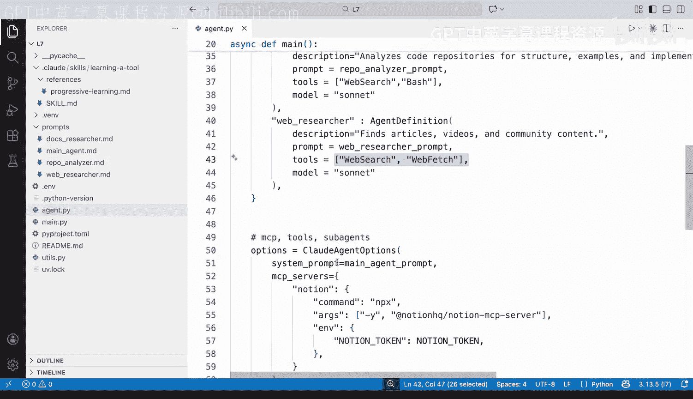

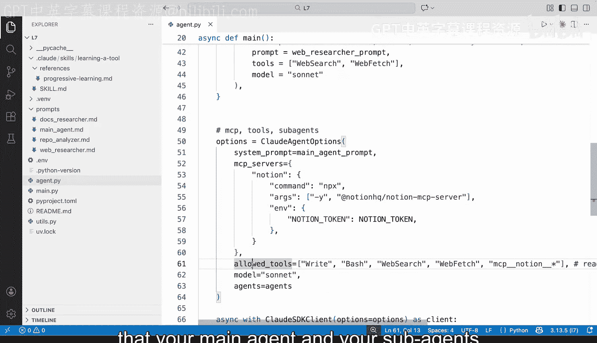

Now that we've set up our agents， we need to make sure we also include the all important task tool to make sure that we can dispatch subagents and assign tasks to them。

The last piece we need to add here are skills and the good news is in order to add skills。

 there' is just one more tool that we need to add， and that is the skill tool since we have an environment here where there's a file system and the ability to execute code using the bash tool。

 all we need to add is this skill tool so that we can correctly read skills and understand how best to use them。

😊，Similar to cloud code， skills are defined inside of a dot cloud folder。

 followed by a folder called Skills， make sure your markdown files are skill。

md and your folder is called skillss in the plural。

Now that we've added the tool for working with skills。

 there is one more keyword argument that we need to pass in here。

 We need to specify where we find this particular set of skills。

 and we do so with a keyword argument called Se sources and here we're going to specify that we want to find skills inside of the user directory if we have skills in our home directory as well as project which is where we've loaded the skills for this particular application。

Now that we put this all together， let's go ahead and test out our agent。

We going open up the terminal again。I'm going to go ahead and exit。

 and let's run this application again with the changes that we've made。😊。

We're going to start by learning a little bit about Min U for those of you not familiar。

 Min U is an open library for PDF extraction， and the reason we're using this example is because this is not something that Claude might know a ton of from its initial training data。

 this is going to require external research， analyzing code repositories。

 community documents and other sources。😡，We're going to ask to create a learning guide and then show me the plan first。

Here we're going to start to see that the skill is invoked。

 and the input here is that skill called learning a tool with the arguments that we specified。

So here we can see that we've first specified the plan。

We still have to go ahead and run what the subagents are going to do。

 but just like with cloud code and plan mode， we might' want to see what the plan is before we start acting and consuming tokens and taking time。

We can see the research phase of parallel investigation with our different researchers。

 we can see the structure necessary according to the skill。

 and then finally the output that we're expecting。This looks like a good plan。

So we'll just go ahead and ask it to proceed。😊，It's going to start by spawning the Dos Research Subagent。

 spawning the repo analyzer and Web researcher， and executing these in parallel。

 using the tools that we've added under the allowed tools that we've also passed in to our subag。

We can see in parallel the Docs researcher is heading to the documentation。

 the Repo analyzer is looking on GitHub， and the web researcher is searching across tutorials and YouTube guides。

 we're extracting the information from GitHub repositories using the Bsh commands。

 while at the same time searching a YouTube channel for video demonstrations。

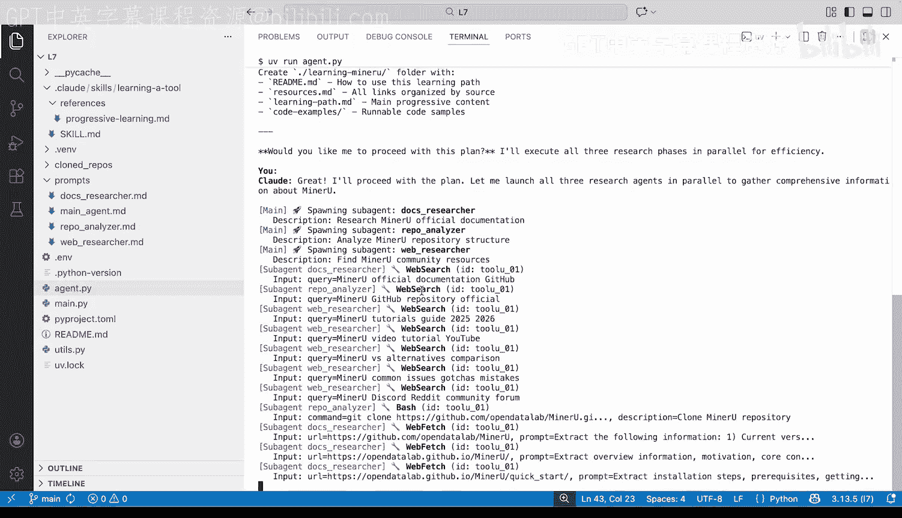

These agents are interacting in parallel， fetching from different data sources to bring this all together into a compelling tutorial。

Now that the subagents have finished completing their work。

 we're going to create the comprehensive guide， pull together all the necessary files based on this research that we have here。

As instructed in the repository analyzer， we've cloned the repository for minor U and keeping that here。

 and we started to build the folder structure for learning this。

 We can see here we have our readme and resources， as well as code examples that are being put together。

We can see here in the Readme file it provides the learning path to us。 what we're going to learn。

 how to use this guide。 and importantly， time estimates that we might need。

 We can see here it's created for us the Readme， the resources and the learning path is still in progress。

 In of our resources。 We have links and references for minor you。 So let's take a look at that。😊。

Inside of our resources， we have documentation， the repository， PiP package。

 and the paper underlying this library， we have Quick Start guides。

 documentation and related projects。As we pull in additional information from the community。

 we have all kinds of deep dives across a variety of different articles and news coverage。

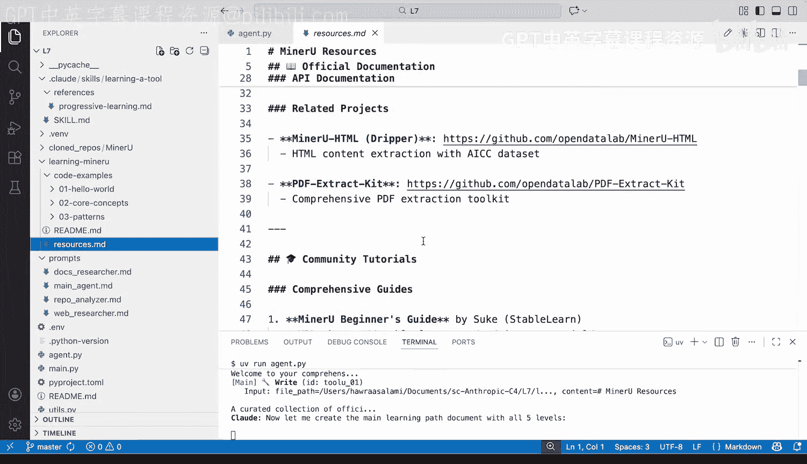

Now we can see that the learning path has been created。

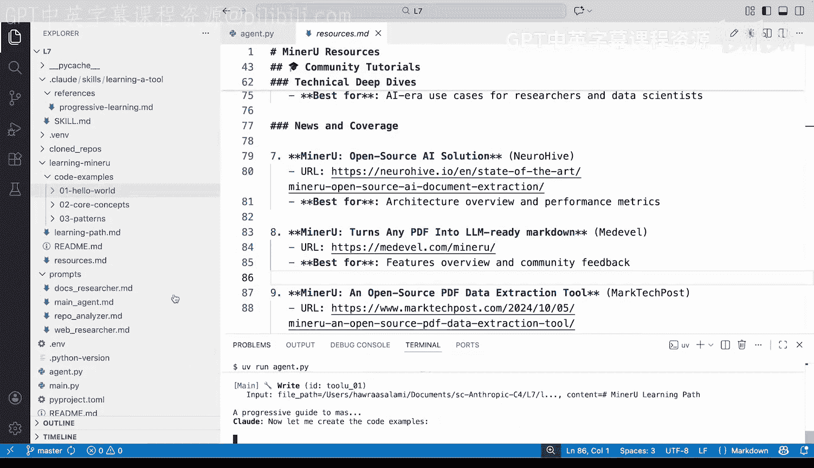

And it's time to create the code examples。Let's take a look at this learning path。

Starting with an overview and motivation， what problem does it solve？

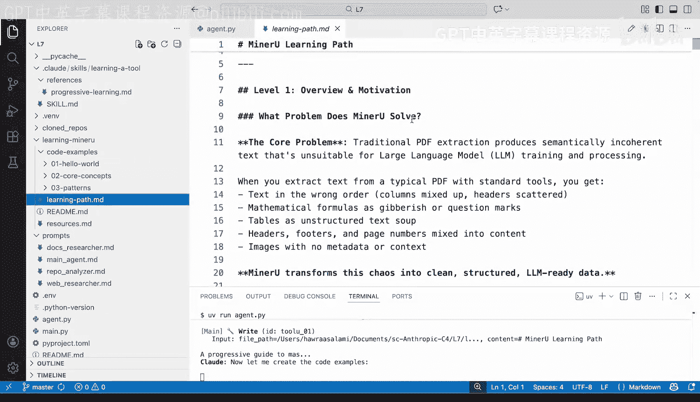

We describe the origin story of the library， what existed before and some of the problems with those libraries。

 We can see here this is quite an in depth guide and learning path。

 And you can imagine this is something that would last a long time as you start to get up to speed。

 knowing very little to becoming an expert in working with this library。

We move into some of the distinct features of the back end of this library all the way to code examples and many different characteristics for how to use this as efficiently as possible。

 We can start to see that our code files are being written for Ho world examples。

 concepts and patterns。

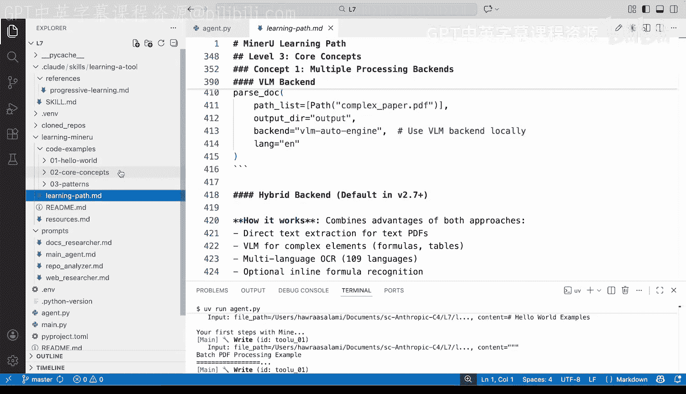

For our Hello world example， we've got a nice readme to get started with some first steps。

 simple extraction to see how to start using this library， as well as installation steps。😊。

If there were particular libraries we wanted to use for installing or patterns here。

 we could always add that to our skill， but right now this is going to give us a great start to get up and running with this library。

As we look at some of the core concepts， those are being created currently。

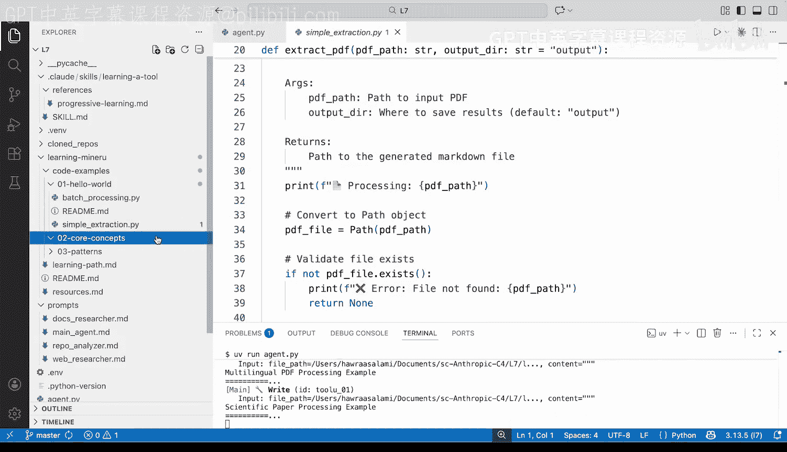

Now that those are done， we can see in the Readme where we go next。

 Once we've gotten up and running with the library。

 we can start to look at some of the fundamental concepts that the library possesses。

 as well as comparing different speeds across back ends。😊，Finally。

 we're going to create practical patterns and examples with this third folder。

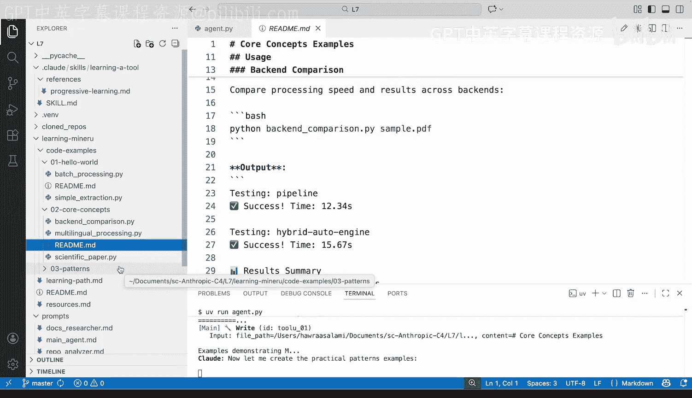

We can take a look at this folder， and we can see here that we have real world processing pipelines and production use cases。

This includes examples for certain patterns， as well as quite in depth code examples using this library with doc strings。

 comments， and everything necessary to use this library to its fullest extent。

We'll wrap up by validating and creating a summary document。

 making sure everything has been done correctly。We can take a look at the output。

 which gives us a complete learning guide， the directory structure as specified in our skill。

 the learning path with the levels that we requested， and then key features。

 and a quick start to get up and running。The final thing we're going to do here is write this particular file。

 the resources MD to a resources subp in Not， this page already exists。

 so let's take a look at what that looks like and then we'll prompt to go ahead and use our MCP server to do the writing necessary。

😊。

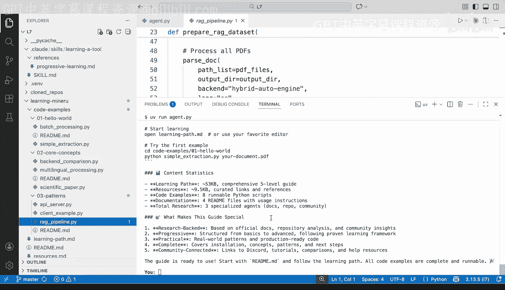

We can see here in notion under this learning section， I have a subage called Resources。

 the goal here is to use the MCP server to populate what we had in our resources MD to this right here。

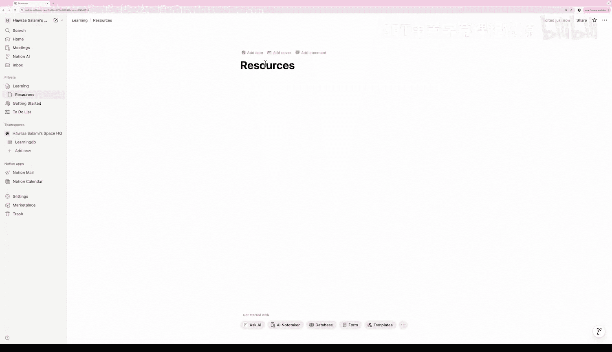

So let's go ahead and ask our agent to write that file to that subage in Not。

We're going to be explicit with the tools that we use in Notion and allow it to use what we have available。

😊，We found the resources page， we're going to read the Re MD and convert it to the correct format in Not using rich notion blocks。

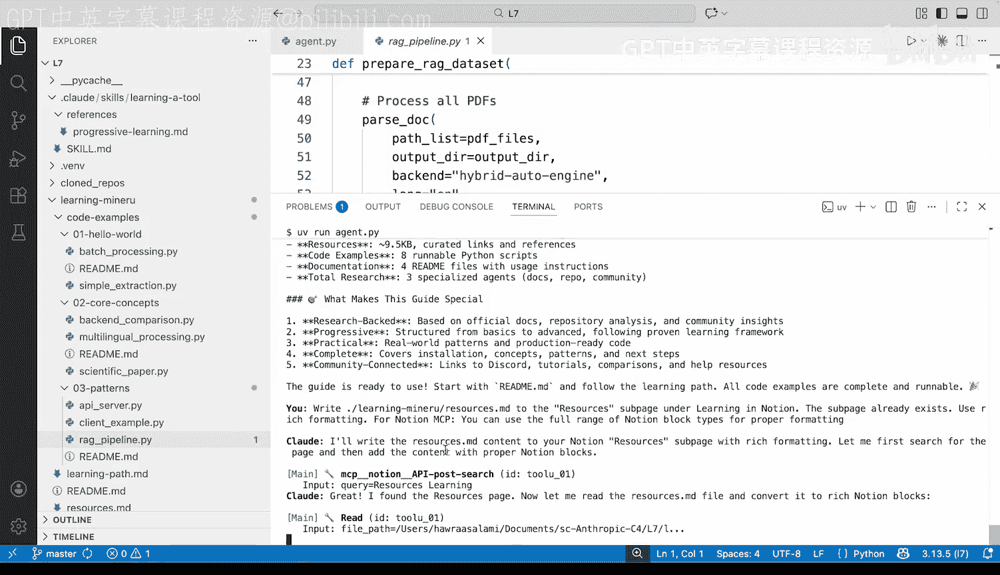

You can see here we're using multiple tools from Notion， doing this in batches。

 adding the QuickSart Guides API documentation， and the rest of the information inside of our resources empty。

We can see here in the resources file， it's dynamically updating based on the documentation and our resources empty。

And as this finishes up， we're going to see all the content from that file appear on our Not page。😊。

Now that it's finished， let's go take a look at what our Not page looks like。

You can see here we've got our official documentation， our tutorials， video resources。

 community channels， all the data that came from that markdown file we've now written to notion。

 we've made use of skills， MCP servers， agents and subagents all using the agent SDK。

 you can imagine layering on additional skills for more complex workflow or additional subagents to perform a variety of tasks。

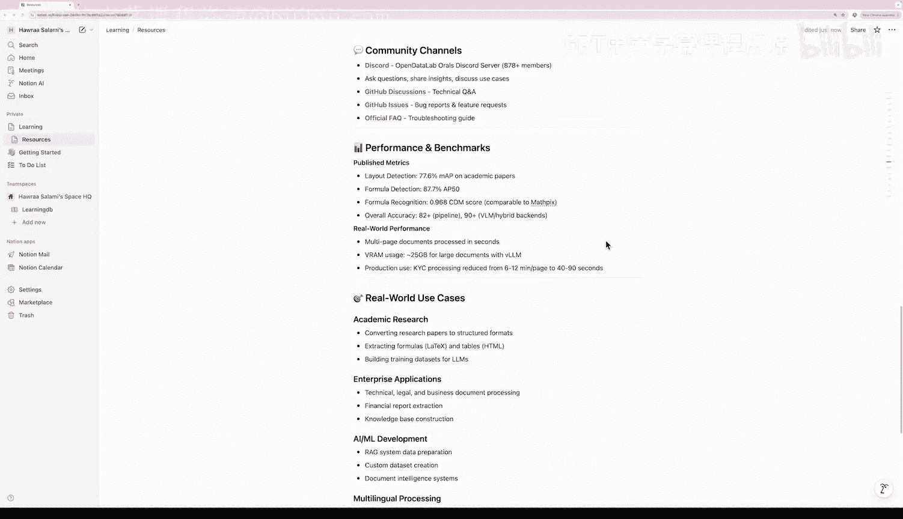

We've just started to scratch the surface with functionality。

 and theres still some security concerns that we should be mindful of for starters。

 We're allowing commands like right and bash to be executed without requiring permission from the user。

 The next step here is to build an interface just like cloud code that ensures that we allow the user to confirm that they want to use those particular tools for a certain action。

 We've also just started to scratch the surface with the ability to even add things like interrupts for our agents and subagent similar to cloud code。

 So we've given you the foundation to continue to build powerful agent applications。

 and we can't wait to see what you build next。😊。

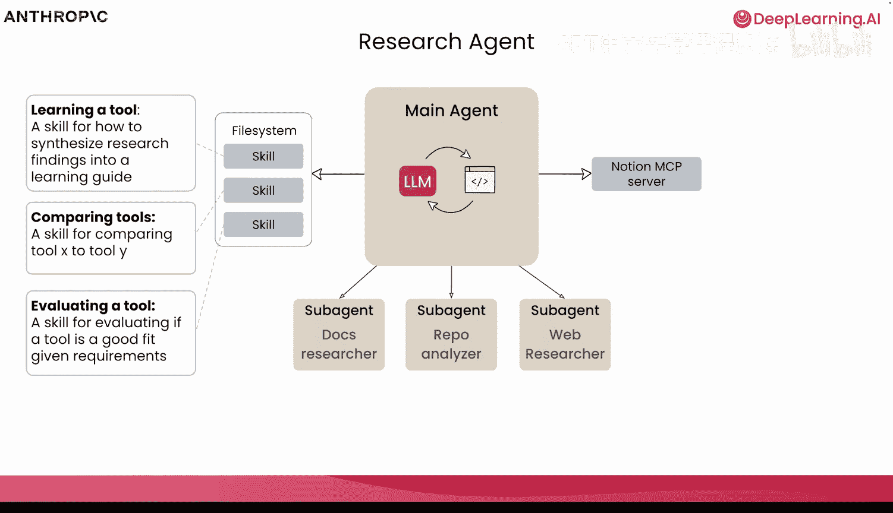