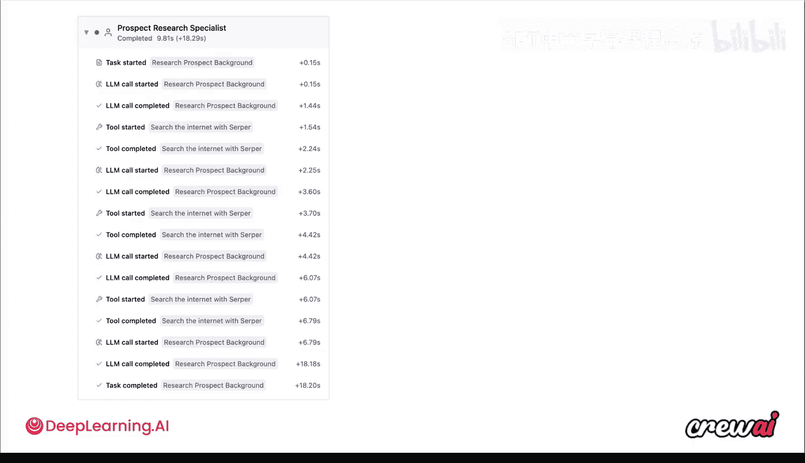
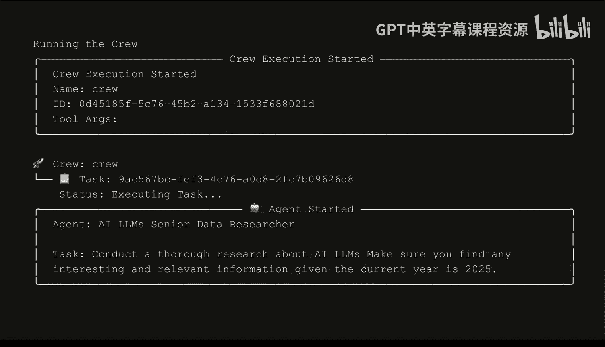
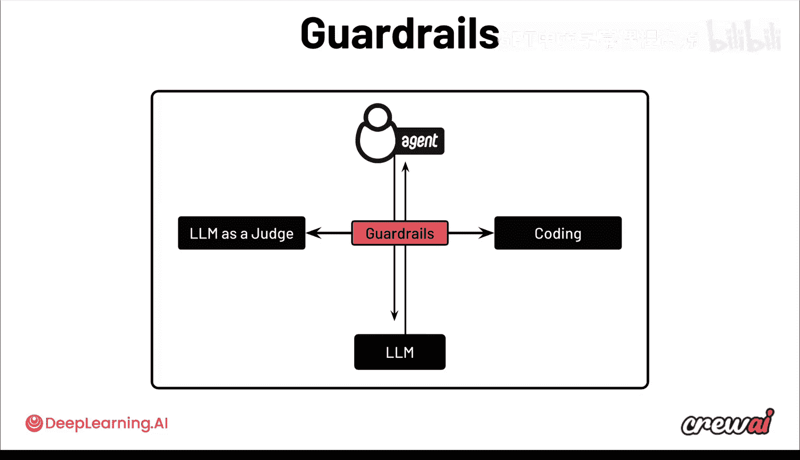

# 吴恩达《使用 CrewAI 设计、开发与部署多智能体系统｜Design, Develop, and Deploy Multi-Agent Systems》 - P10：10.tactics-for-debugging-observing-optimizing.zh_en - GPT中英字幕课程资源 - BV12eCQBAECM

So being these agents are very fun。 And by now， you've got a good hang of it。

 But as you start to debug these agents， you're going realize that a lot goes into observing and optimizing to fully understand what it's going on and making sure that you have a strategy around that so you can keep getting the system better over time and you can fully understand what it's happening。

 even when things go south。 So let's look into that next。

 we talk about the idea of running a human time in machine time。

 And the idea here is just that executions are piling up。 And the more executions you get。

 more you need to trust the system。 But in the end of the day is not only about the speed to value but also how much you trust those output so that you can actually turn it on to 11。

😊，And we talk about the different ways that you can actually implement to steer your agent in a certain way。

 For example， a lot of the context engineering techniques around the system prompt。

 the clear instructions， the role playing the memory and the tools And the good news is that a lot of that is already embedded into Ci。

 But as you deploy this agent still going to find yourself having many questions especially as you're debugging。

 You're going ask， well， why did my agent do acts。 Where does this data actually come from。

 and what tools did my agent use， those can be hard to track when you're in the early stages of thebugging and testing and rolling things out。

 And now these questions， you need an answer to understand exactly how the system behaves and why it makes the choice it does。

 Now， they're going to be a few things they're going make your life way， way。

 way easier And the first thing that I want to point out is traces。 For example。

 when query I whenever。😊，You run the screws locally you will be pro to look into your traces and these traces are going to open in a browser on C AMP and in there you're gonna to be able to see every single action your agent took from the initial task to the all the LM calls to the tools being used and everything thing in between so you can not only see how long did it take but you can expend on those and see what exactly was the tool used what was the input that was provided to that tool and you can keep going。

 you can even look at all the individual messages when youre run crew in your own computer locally。

 you're gonna to get some traces in your terminal directly and that helps you understand what it's going on but at the end of the execution you always get that link for making sure that you can see in an actual UI what is happening with your agent and you can actually monitor that we have been talking a lot about this idea of context engineering and prompting being part of that context engineering。

So we know that every agent， for example， has role goes on backstory。

 and we know that every task has a description and expected output through updating those。

 you actually have a lot of control in what gets sent into the model。

 but that's not the only thing that you do because prompting is only the tip of the iceberg。

 you actually can do through task and testing is one of the ways that you get to understand what is happening to your agents and what model works the best for you。

 It will get that one single agent definition and that one single task definition that you have。

 is in a play that against many different LLMs。And through these different Lms。

 it will have an LLm as a judge on every request。 Basically judging the result that is coming out from the LLM。

 you're going to be able to compare what LLms did the best at that work。

 in one Lms got closer to finishing that task in a way that is reliable and that you like。

 Now you get to choose the LM based on factual data instead of just vibing your way into that。

 But testing only allows it to select a model。 After you already have selected a model。

 how you get your agent to enforce a specific format or behavior。

 And that's where a new feature comes in trainingin， It's a very powerful technique。

 Training here is not training a large language model or fine tu a model which you can absolutely do。

 but it's a technique where your agent does many executions of the task。

 gets your feedback and tries it again。 and it updates its own internal memory on how to improve。

 So it gets。😊，Over time。 So in this case， the agent itself is basically doing the task back and forth。

 But every time that it finishes it， it asks you as the human a feedback in whatever feedback you provide is translate into learnings that go into that agent memory。

 So as this agent goes through and do future executions that feedback gets injected back into the agent prompting。

 So here you can see another way for you to also have an impact on the context without necessarily only changing the task descriptions or the agent definition。

 And there is one extra way。 and those are guardrails。

 many production systems can benefit from guardrails。

 And the idea of a guardrail is enforcing a particular behavior。

 So if you look through all the different things that we talking about from task to training to know guardrails。

 you can see there is a common team around making sure that you get your agent to behave in a certain way in guardrails。

You can think about this as something like a gate that sits between the agent and completing the task。

 So before the agent actually wrap up the work and pass along the result。

 the agent will actually go through the guard rail and this guard rail can either be an LLM as a judge or it can actually be a coding guard rail where you actually write code to check the output。

 the guard rail will then decide if the final output is successful if it is。

 it will let the response go through and give you its final answer。 but if it finds it lacking。

 it will then report back to the agent with that piece of feedback so the agent can go take another stab at making that write So let me give you a couple examples here。

 let's say that at the end of an execution you just want to make sure that the final output is less than 200 characters。

 Well， you can literally write a code guard rail for that where you can use regular python code。

Count the number of characters。 And if it's not less than 200。

 then send it back to the agent to write it again for the LLM as a judge。

 you can do other sorts of checks that you won't be able to do with coding alone Let's say。

 for example， that on top of being less than 200 characters。

 you also want to make sure that it's positive。 So you can use LLM as a judge to p another LLM to fact check if that is a positive output or not beyond testing。

 training， guard radios and context engineering， there is a lot of other options to improve your systems performance。

 Several of which we're going to be seeing on the coming modules for now。

 following the next video to see what kinds of production use cases of the most successful and most common。

 and we will see you there in just a second。

