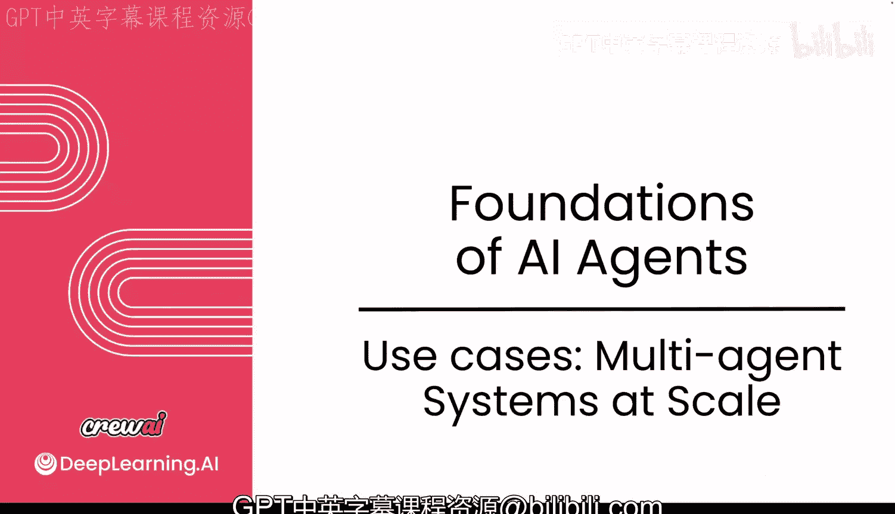
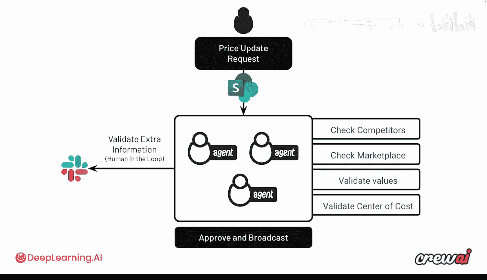
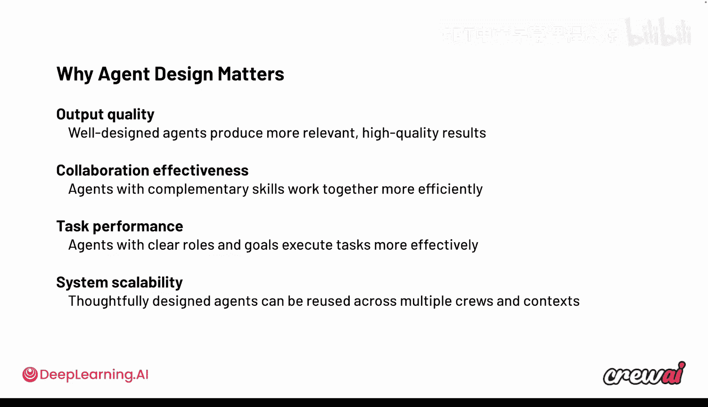

# 吴恩达《使用 CrewAI 设计、开发与部署多智能体系统｜Design, Develop, and Deploy Multi-Agent Systems》 - P11：11.use-cases-multi-agent-systems-at-scale.zh_en - GPT中英字幕课程资源 - BV12eCQBAECM

By now， you already understands a lot about these systems。 But how you ruin the systems at scale。

 and more important than that， What are the actual use cases that are working out in the wild。

 What are the use cases that the business are actually getting results from。 So let's dive into that。

 Now， let's talk about the production use cases。 In some of these use cases out there。

 we are seeing 80 to 97% efficient gains。 What if you ask me is insane in efficiency here can be measured in so many ways。

 So companies were measured by comparing how much time they used to spend on this task before and how much time they are spending now after implementing agents。

 So let me talk about one specific real world use case。 So this is a natural real Forune 500 company。

 That is a consumer packed goods company。 So think of a company that sell chips， vitamins。

 instant noodles or beer。 something you can buy from the supermarket。

 And the really show use cases very interesting。 is what people。

Call revv ops。 So basically operationals on the revenue side。 In that case。

 the problem that they are trying to solve is how they can approve price changes faster than what they have historically done。

 And this is a process that require a lot of manual approval。

 like people need to check prices of the competitors， people need to check marketplaces。

 So in this use case， everything start with an update request that would then go into a SharePo database and the agents will be able to retrieve that information in order to decide whether they approve this change or not to do it。

 these agents will do a series of checks， checking the competitors prices， the marketplaces， prices。

 they're going to validate the values and a few ground rules。

 including what is the center of cost who is paying for this discount。 And if everything looks right。

 they're going to prove and broadcast this value。 what is actually going to impact the end value。

Of the product Now if at any point something falls short。

 maybe the price that is gonna to be updated doesn't check against the competitors。

 Well now these agents can reach out for extra validation from humans so they pingned the person's luck with extra questions so that they can get out the validation and information that they need before approving this request It's an extremely dangerous use case and you can see how something like this if automated properly can save hundreds of hours in a week for a company that is operating at a global level。

 This was a great initial use case for this company they reached out to us and they had this use case and we got that use case live within weeks after some optimizations these use case alone got them 94% efficient gangs and 97% accuracy accuracy here was measured by comparing what humans were doing before and the decisions that the agents took during the same period。

Time so that we could have a one to one comparison。

 And the reason why you'm bringing this up is in here you can have a little bit of a blueprint on how you can do this yourself on your own company or your own team。

 If you exp beyond this company， you're going to find out there is many top verticals。

 We're seeing companies on high tech or consuming telecon， finance， customer service。

 insurance a lot across the board， there are benefiting of these use cases。

 And I'm going to talk about not only some of these top verticals， but within these verticals。

 what are the specific functional areas。 you're going to see a lot of sales and marketing automation。

 a lot of developer automation， a lot of cyber security， supply chain， pricing and people management。

 in the end of the day， after everything that we talk about。

 you can see that giving it some thinking prior around the output quality that you want to get around what is the。

Best way for these agents to collaborate with each other around how you're going to measure the performance and how you're going to make sure that you're testing that against different models。

 and then how you're scalingathing this， how you're putting the right guardrails and how you're adding the an observability and tracing to make sure that you get the best outputs that you can have。

 So what I really want to drive across is that spending time on thinking about the design will really help you achieve better results at the end。

 And that's very important。 So now that you have seen the major considerations and taking a multiagent system into production。

 I will invite you to follow me to the next video where we talk about the AI agent revolution and why it's happening now and how you can help build it。

 You don't want to miss that one。 I see you in there in a second。😊。

