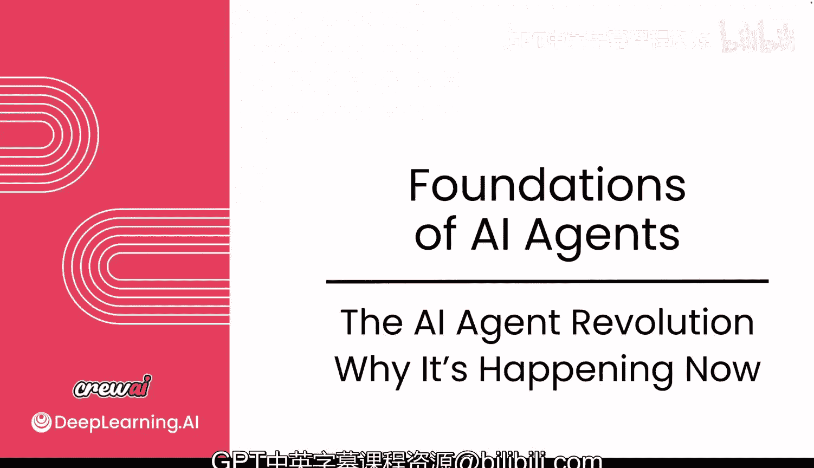
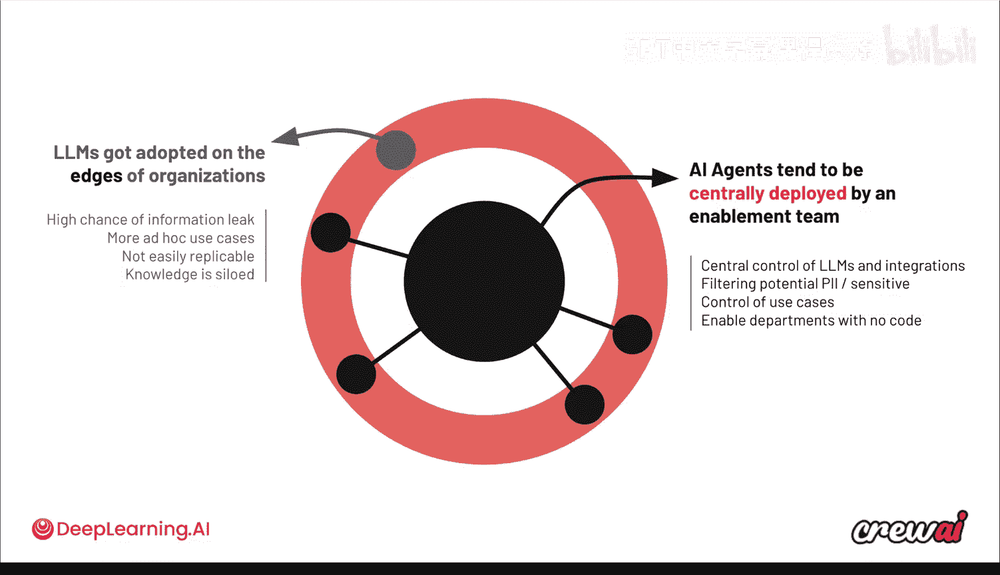
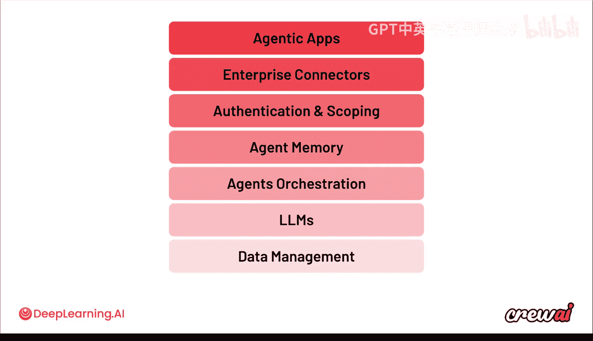
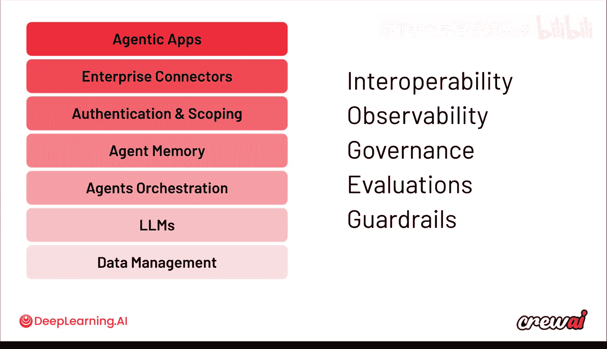

# 吴恩达《使用 CrewAI 设计、开发与部署多智能体系统｜Design, Develop, and Deploy Multi-Agent Systems》 - P12：12.the-ai-agent-revolution-why-its-happening-now.zh_en - GPT中英字幕课程资源 - BV12eCQBAECM

We learn so much about AI agents up to this point。 We learned about how they work。

 what make them intelligent， the different components that goes into them。

 and we even built use cases together。 I now spend some time going over all these concepts in talking about what the future looks like for AI agents。

 and how this might actually impact you and your company in your team in the technical decisions that you are making。

 Let's go into the slides。 So there's one thing that is very clear。

 And that is AI agents are not going back。 If anything were're already seeing huge changes on the way that companies are adopting these agents。

 You go back a year ago。 Their adoption patterns for LLms was very different。

 It was an adoption that started from the edges。 meaningan someone in the department is start to use LMs to do something for them and they really like it。

 But they didn't tell anyone about it。 And that created a lot of problems。

 One of those problems is that a high chance of information。😊。

Lak that was not supposed to be sent to the LLM also a lot more ad hoc use cases。

 so it's not a very easily replicable so that other people can do the same thing and because of that the knowledge end up to be very siloed So this shaped the adoption of LMs to be a little more deorganized and what it could be and you saw many companies finding that back and trying to establish a specific teams and specific centers of excellence。

 Now with AI agents， the adoption pattern is actually different。

 we're seeing a central adoption where agents are being centrally deployed by an enablement team that then goes into allowing other teams to do agents themselves and this guarantees theres a central control of what are the LLMs。

 what are the integrations。 if there is any PII fuing or personal information needs to be removed。

 they can also implement that in a central place they also get a control of what are their use cases and how they're going to be。

and then they can start to go into the other departments， either technical or nontechn。

 depending if they want to code or no code solutions and start enabling them on using Qi。

 either by crew studio or by just using the careeri open source library to view these use cases。

 So it's a very interesting change of pattern on how these companies are adopting agents。

 and this idea of building reliable agents and this concept basically floats around three main things。

 One being very easy to use very easy to build either using code or no code， these needs to be fast。

 So you go from zero to one in record speed。 Then second is that you want to get a repeatable outcomes。

 Again， if anything we learn about how this are nondeterministic systems So you know that you won't have the same answer twice but you want to make sure that all answers are good。

😊。

The final thing is this idea of of scalable solutions。

 What is not even only about running a million agents， even though that is also included in there。

 but also how you do it， how you make sure that your company or your team is not building the same agents twice or the same tool twice and they are reusing this building blocks across the entire company Now it's interesting that on top of this idea of building these agents thereies a stack that is forming arounding and we can see this stack talking out the way on the data management level and work its way to LMs agent orchestration agent memory authenticcation and scoping enterprise connectors in agent apps and there's so much going on in there We're not even talking about observability and through other new categories like payments that are popping up here and there but the idea here is that companies understand that the agents will need to touch data。

Whether that is data breaks is no flake redshift or Bquery。

 there's gonna to be an element of agents touching that。 And on the LMs。

 they also understand there are many LMs in each model it's going to have its own flavor and its on capability。

 So you might want to use G for minii for certain use cases or quotes on it for for other use cases on the orchestration where basically or the zone of genius and queryi。

 you want to make sure that you have things that can runreliably and you got to see and observe and monitor in a proper way。

 but you also have authentications and the connectors and there's just a lot going on in there Now。

 independently of what a company chooses for each and every single piece of the stack。

 there' is always five things that every company thinks about。 and those things are interoperability。

 the ability to use different providers and not get a vendor locked observability。

 the ability to clearly understand what your agent。

HasDon and what it has done that in that way。 So you can trace it out back。 Then you have governance。

 ability to track the access to data and what kind of authentication and authorization systems you have in place to make sure that you' are still compliant with everything that you have internally。

 Then you have evaluations。 how you make sure that these things are performing up to speed and up to the quality that you want。

 So you guarantee that your agents are working and you're not breaking them over time。

 And then you have guardraos to help you get those more reliable， repeatable outcomes。

 Those five things are things that every company out there are asking is about independently of what their stack looks like。

 So in the end of the day， even on crewi itself， we make sure that whatever you but on or platform。

 you can also download as open source and run it anywhere。 Well。

 hopefully you're coming out of this lesson with so much that we have impact having built potential your。

First mo agent systems， understanding how to scale these systems to production and what use cases are proving to be the most valuable for businesses。

 And now that you know all this， you're ready to go into our graded labs and graded quiz in the graded lab you will implement a moy agent automatic code review system and it's gonna be awesome。

 So once you're done I see right away in your next module where we're gonna gather our hands dirty on how to implement tools。

 guardrails， execution hoops and MCP servers for your crew you're gonna to be super exciting。

 So I you see you in there。😊。

