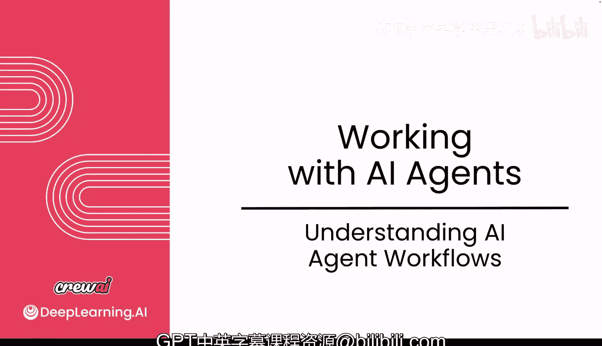
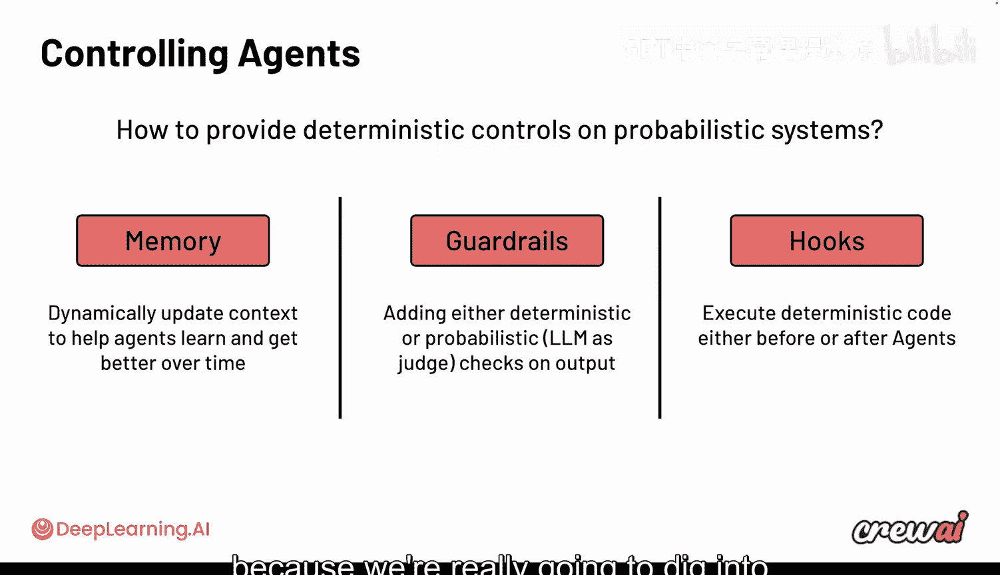
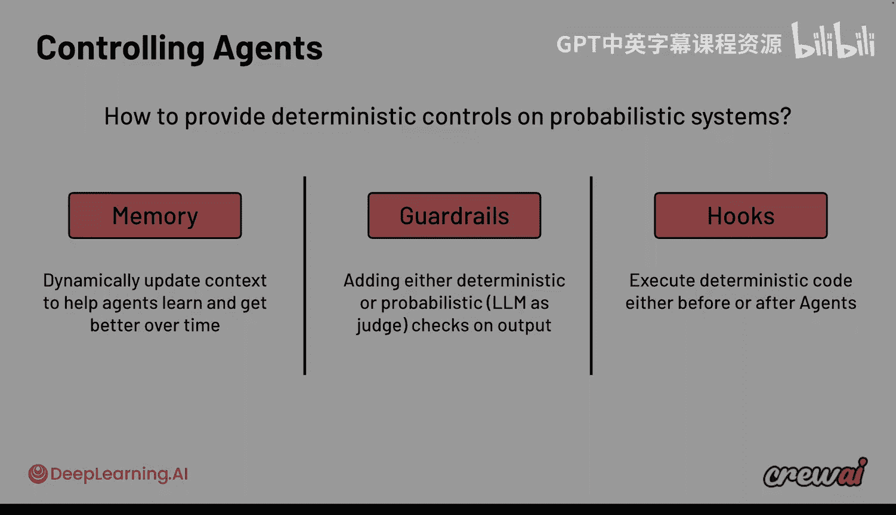

# 吴恩达《使用 CrewAI 设计、开发与部署多智能体系统｜Design, Develop, and Deploy Multi-Agent Systems》 - P13：1.understanding-ai-agent-workflows.zh_en - GPT中英字幕课程资源 - BV12eCQBAECM

Welcome to module 2， Very excited to have you in here。 In this module。

 we're gonna start to get a deeper understanding on everything that we learned so far。

 So we're going to start by looking into how these agents actually work。

 What is the agent loop that is happening behind the scenes。

 How they make plans and they execute task and how they reflect on the outputs that they get。

 This is going to be very exciting because now you're gonna to start to understanding how they tick in a way that we haven't done before。

 So let's dive into these slide。 So we already have this crews and how mo agents works and how you can get some of them to work together to accomplish a task。

 And this agents can collaborating so many different ways for accomplish all sorts of activities。

 We talk about research， content creation， analysis， writing reports。

 There's many different ways that you can actually do it。 But for just one second。

 I want to zoom in into one specific agent。 And I want to talk about the react。😊。

Loop and that is basically what drive these agents。

 the ability to reason to act and to go to this over and over again up to the point that they get to a conclusion or a final output。

 So the Lms will reason about an next steps， they're going to have some thought about what to do next then potentially take an action and observe what is the output of that action and then either give it an answer or go back into the thought process to decide what it's going to do next。

 So as it goes through the process of， for example。

 creating something or researching something it's going to decide， well， in order to go ahead。

 I will need to use a tool and once they get that information。

 it might understand that needs even more。 So it goes back into the process of choosing another tool to use。

 So this is the more standard run of the mu react loop。

 Now there is many different steps that you can add in this loop as well。

 Many people and agents now actually。Require a plan phase where you might want your agents to do some reasoning prior to start executing and that plan will then impact the things that's going to do next。

 this is known for allowing agents to perform sometimes more complex work or more complex tasks as well。

 So it could be a very interesting tactics。 you can actually enable those on K eye by just citing a flag reasoning to the true as you're going to see future examples。

 Now， not only that， we talk a lot about memory in guardrails。 So they play a role in here too。

 basically， the memory will be fitting information in and out of every single step。

 So every time that the agent has some to or some action that will basically create memories that will be injected back into the agent memory。

 but the same way， the agent will po on its memory when it decides what needs to do next。

 and guardrails will then join a later stage to prevent or ga。

Answers from getting out before they are actually complete and up to the standards of your use case。

 So this is a very interesting example。 And there's so many different things that you can do in here and so many different variations off this loop that you can add。

 But let's just stick with the reactor loop for simplicity。

 So we can understand a little bit more what happens on this workflows。

 So you can have not only one agent do in this flow， but multiple agents。

 So whenever we have our crew and each agent performing different tasks that are actually multiple react loops that are running on the background。

 and you can have that react loop from one agent then trigger three other new agents。 So basically。

 it's more of a manager agent that is delegating work to multiple others and not only deciding what to delegate in how to delegating。

 but then reviewing those resultss that are coming back。

 and expecting that this agents are going to perform this actions in parallel。😊，And eventually。

 for example， consolidating to one final agent。 So in this example。

 you can have the initial agent is delegating a series of tasks to the other agents and then a final agent is going to do a reporting on that。

 So it's bringing up all the information from those agents and the task that they accomplish into their report。

 you might have noticed that we added a concept off before and after hooks。

 And we will discuss those in the following lessons。

 but sometimes you need these hooks to execute code either before or after the crew does its work。

 And this is going to play a role on how you pull data from places or push data into places as well。

 in the end of the day， we're spending a lot of time talking about controlling agents and how to provide the termministic controls on these probabilistic systems that AI agents are。

 in the end of the day， we're covering a few different things you can use and right now。

 I'd love to dive more into three of them。Memory that gets dynamically updated context to help your agents to learn better over time。

 guardrails that add either deterministic or probabilistic controls and checks on your output。

 depending on whether you're using LLM as a judge or code guardrails and hooks that allows you to execute the deterministic code either before or after agents。

 There's one topic that we're saving for the next module that are flows that are basically the ultimate lever for control。

 But for now， I want to talk about discrete deterministic controls that you have。

 So you can use them to provide your use cases with a high degree of reliability than what you would have without them。

 So in your next lesson and， we're going to talk about memory specifically。

 And it is a very exciting topic， because we're really going to dig into all the different kinds of memory and how that works。

 So this is very exciting。 And I hope to see you in there right now。😊。

