# 吴恩达《使用 CrewAI 设计、开发与部署多智能体系统｜Design, Develop, and Deploy Multi-Agent Systems》 - P14：2.incorporating-memory-and-knowledge.zh_en - GPT中英字幕课程资源 - BV12eCQBAECM

There are so many things that make these AI agents a truly incredible technology。

 But one of those is the ability for them to self heal and to get better over time。

 What means that these agents need to have memory。 They need to learn what they're doing right。

 what they're doing wrong。 what they should do different in the future。 So in this lesson。

 we're going to talk about every related to memory。 how they share knowledge with each other。

 What are the different places that memory can come from。

 It's gonna be a very exciting lesson is gonna to lock a lot of potential for your own use cases。

 So let's dive right in。 In queryi and most agent commentations。

 youll find a few different types of memory。 But in queryi， there's three specific types of memory。

 they are super important。 Short term memory， longter memory and anti memory。

 Shortter memory meant to help agents exchange information beyond the added context。

 And what that means is that agents as they go to their tasks and actions。

 they will write in that memory and allow other agents to read off that。😊。

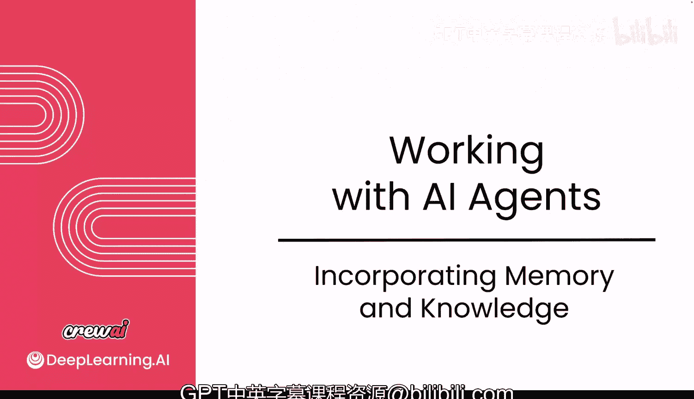

ter memory on the other side is meant to help this agents self reflect to understand the ways for improving over time。

 So as these agents get done with their tasks， they will compare the actual output with the expected output Ex learnings and store that for later usage。

 So when they run the same tasks again， they can understand what are the things that they did well。

 and they could do more of， or things that they should do less off。

 And you also have entity memory that helps these agents remember things。 recognizable companies。

 products， processes and etc ceter， along with their descriptions。

 An example of what an entity memory might be encompassed of， is this idea of persons。

 organizations and locations。 So it starts to learn all these different things。

 and you store them so it doesn't need to infer or learn what they are later down the road。

 If you enable memory for your agents， All you got to do is turn one flag on。

 And that is the memory flag to。😊。

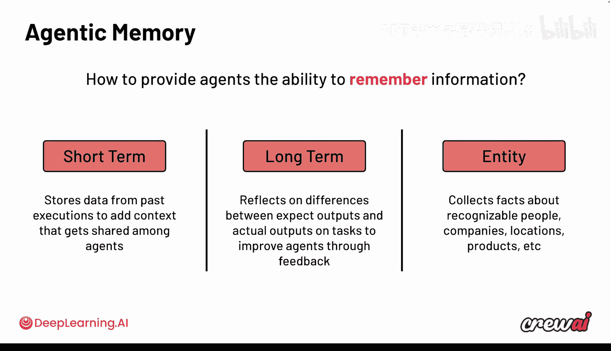

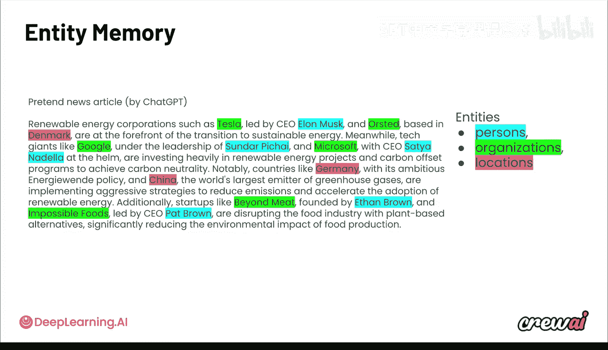

True under your crew instance。 and that'll allow all your agents to start to use these memories。

 And the way that it works is that if we go back into a react loop。

 you can actually see that now all those three different databases for long。

 short and entity memory are going to be feeding information into the thought process so that the agents know more about not only what can do better but the things that it's talking about and things that other agents might be doing。

 And then once the agents done with the answer， a new steps at it at the end that are basically add the reflections that can inject memory back into those databases。

 they're going to be used later。 not only data， but you also have a way to generate memories for the agents yourself and the way that you can do it is by using C eye training and C training is something that you run our terminal that we at the end of the execution prompt you to give the agents。

😊。

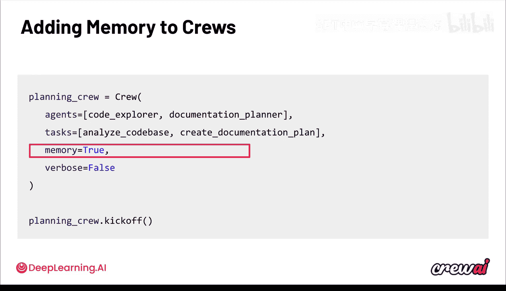

Feedback and that feedback will use them to generate memories。

 They are going to be injected back into those databases。

 And now that we will again be injected back into the thought process as these agents runs in the future。

 So in the end of the day， The cool thing about memories is that there's two types or two ways of you generating them。

 One is by just going to the motions of executions and that getting injected into those memory databases。

 And the other one is straining with the human feedback where you are providing clear guidance and what are the things that the agents are doing right。

 and what are the things that the agents are doing wrong。 And that is then generating memories。

 At some point， especially as you play around with memories。

 you might find yourself trying to understand how you reset those memories。 Well。

 the good thing is how you got to do is run this one single command called query I reset memories。

 and that will automatically clear them up for you。 and you can start recreating them from the ga go。

 Either by executing this agents or providing them with。😊。

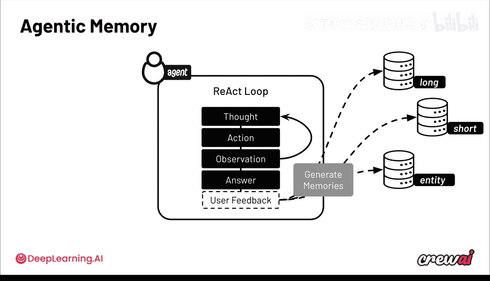

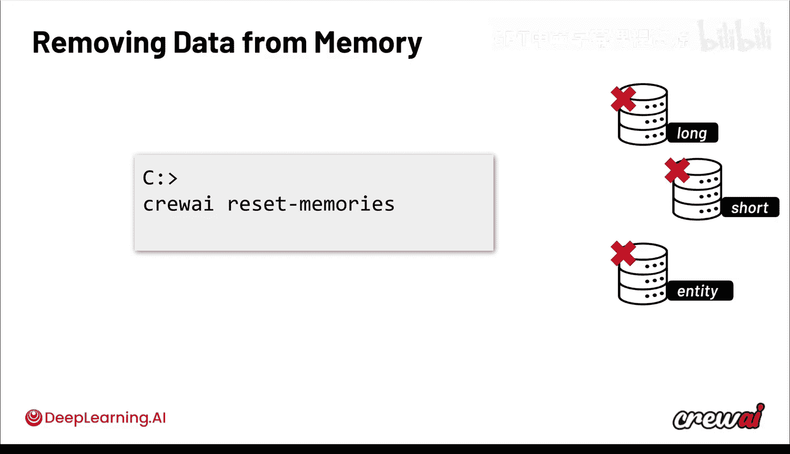

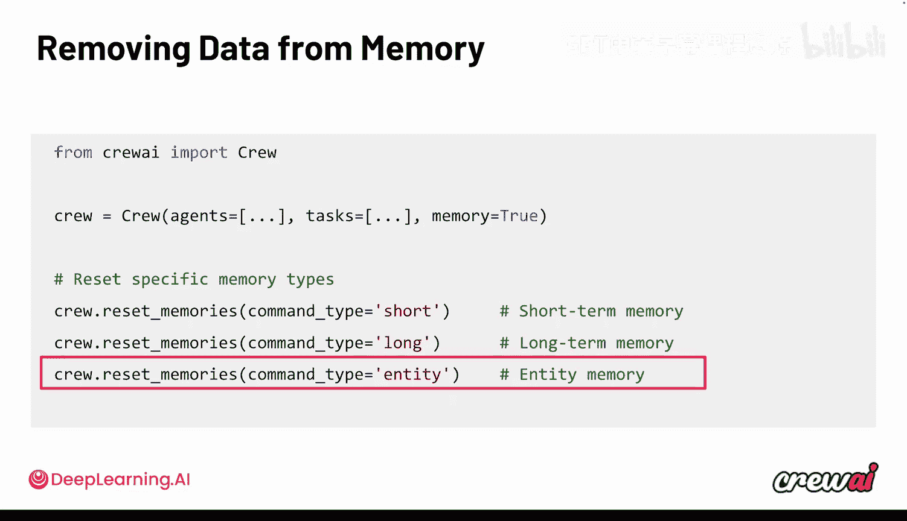

Now， whether you're generating memories or training with feedback。

 the additional context can have measurable impact into the agent performance because it's gonna to help controlling things like behavior or form or style。

 So if during a feedback session， you tell your agents that you want the answers to always be marked now。

 it's actually going to create a memory about that。

 And now that instruction is going to be automatically added to every agent execution。 in that way。

 forcing a specific format。 Or if you want it to be super funny about it that will create a memory that will then be injected forcing a specific style。

 So you can see here how memory can actually be a very strong and important way for you to control more about how your agents work and how they get work done。

 Now， memory is not the only way for you controlling your agents。 if memory。

 you understand that the data gets selectively and to the context during the。

Time and it gets updated by either human feedback or by having internal LLM as a judge。

 And then you have knowledge and knowledge is data that also gets selective added。

 but it's pre addeded to your agent。 What it means that that is not dynamically generated。

 So if you have a specific source of data， something that you want your agent to be aware of as it goes about running these tasks。

 you can preload that knowledge into the agent， and that will be selectively used as the agent goes through the execution。

 So these sources of knowledge can be， for example， text files either raw text or Pdf documents。

 or might also be structured data like Cv files or Excel spreadsheets or even Json documents。

 in the end of the day， feeding this data into your agent extremely easy。

 are you going to do is low discounting。 And then depending on the sort of knowledge， this sort of。

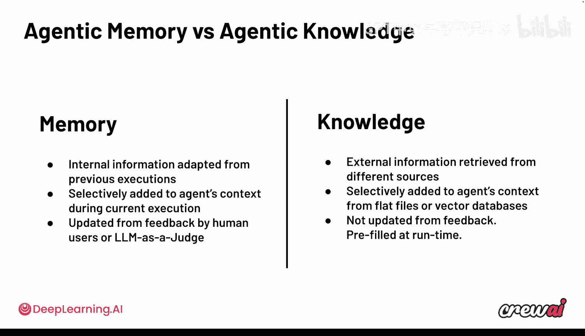

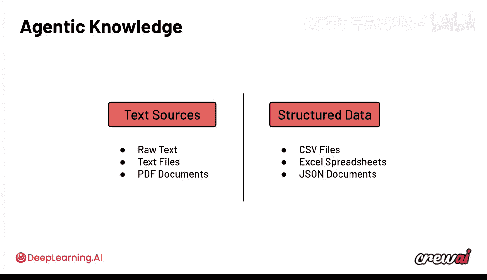

You have for knowledge， you will use different classes to embed that into your agent。

And from that point on， you can now make sure that your agent has those sources within it。

 meaning that during the react loop， the agent now will be able to grab the length of pieces of information out of that knowledge in order to give you a proper answer。

 And that is an extremely helpful way for you to include extra information into your agent that you want to make sure that is persisted throughout any execution that it does in the future。

 So again， knowledge is a different kind of memory can like a special kind of memory that it's basically being fed directly by you。

 the user。 And the idea is that between memory and knowledge。

 it gives you a way to control these agents to enforce certain patterns。

 and you can do this either by having them improve themselves over time or by you giving feedback to them or providing and prefiing them with this knowledge prior executions。

 all those options works。 Now， memory is extremely interesting。

 but I'm very interesting what are we going to talk。😊。

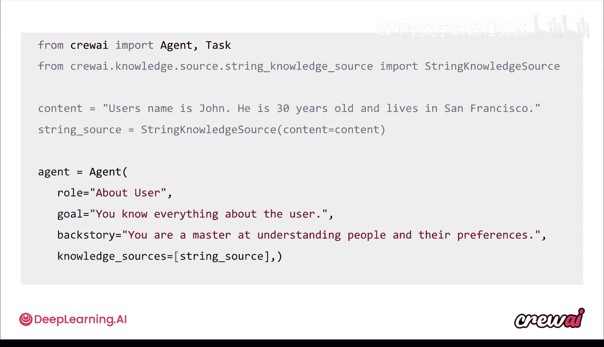

About in the next lesson。 And that is guardraos。 guardraos give you the possibility to do more deterministic controls than memory and knowledge。

 So I'm very excited about this。 We're going to dive into guardrails how they work and how they can help you。

 So I'm going to see you in there in a second。😊。

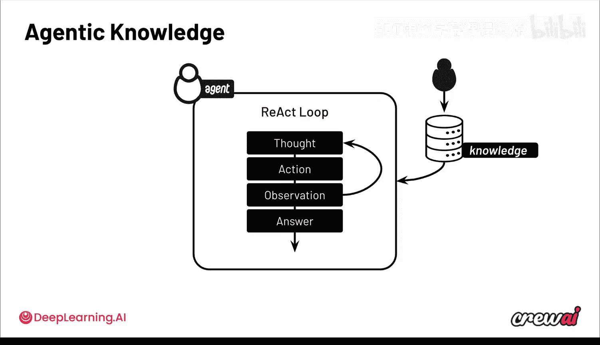