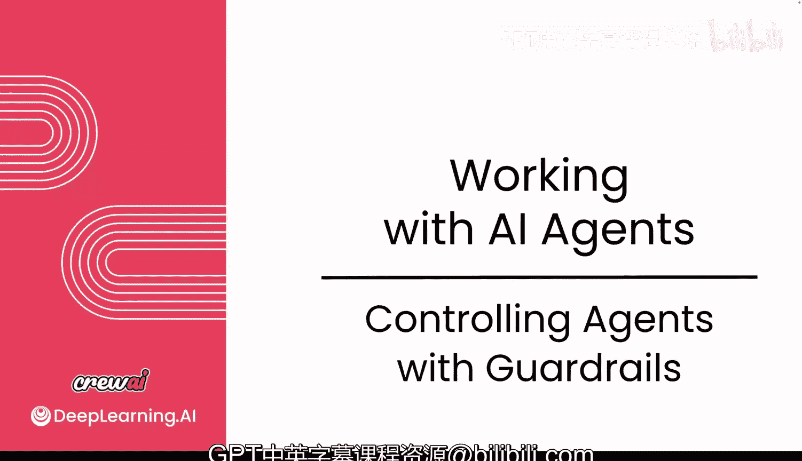
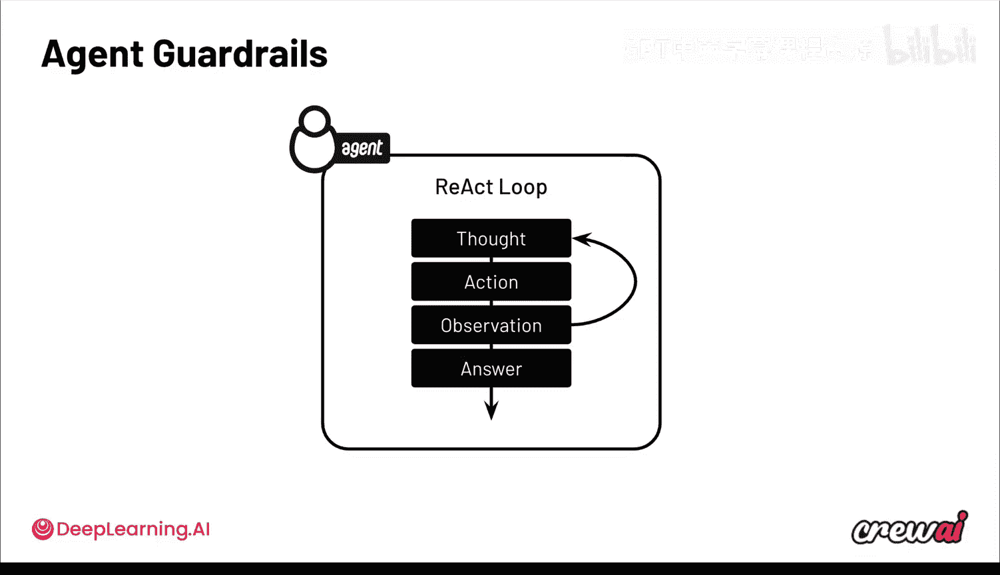
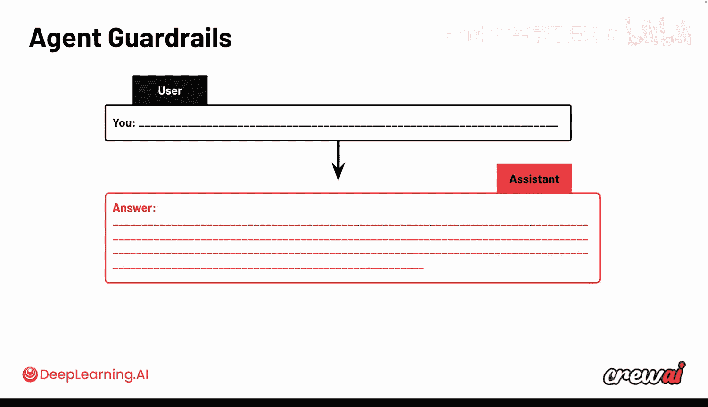
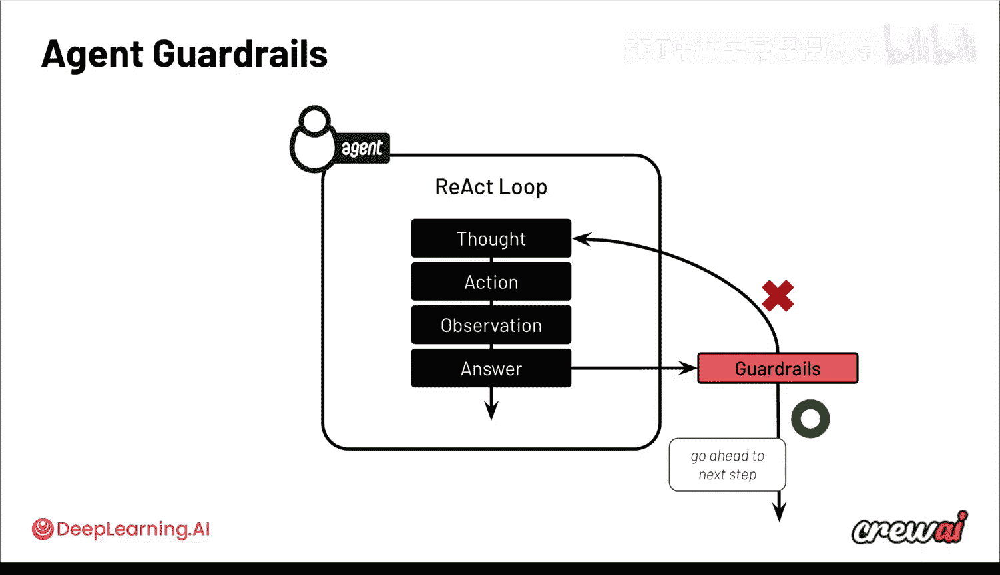
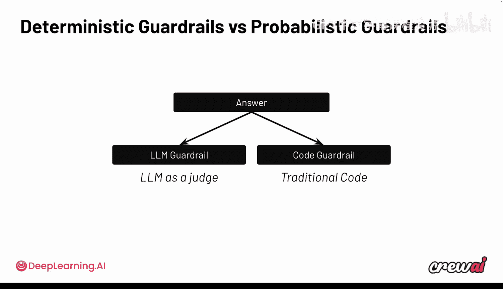
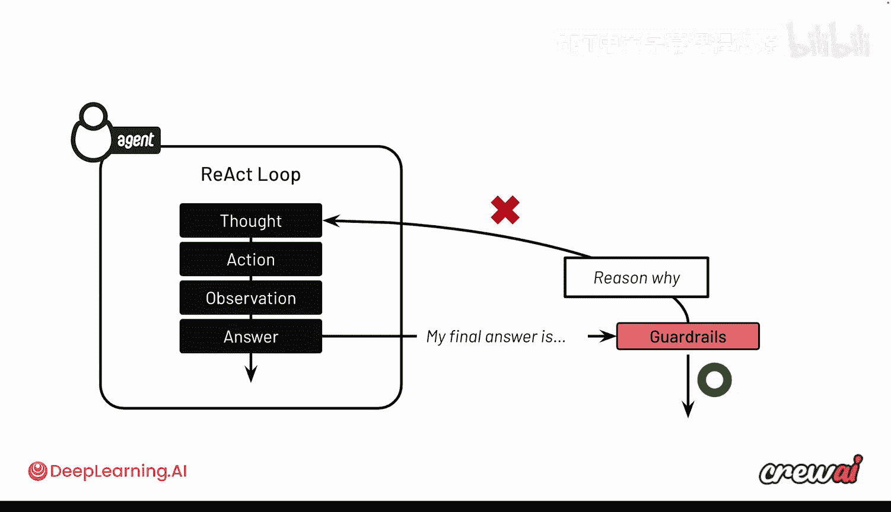
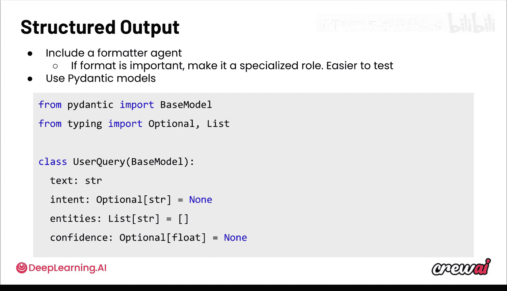

# 吴恩达《使用 CrewAI 设计、开发与部署多智能体系统｜Design, Develop, and Deploy Multi-Agent Systems》 - P15：3.controlling-agents-with-guardrails.zh_en - GPT中英字幕课程资源 - BV12eCQBAECM

By now， you already know a lot about agents。 You understand the agent loop and how to make the antique and how to build something that is useful。

 But making something easy to build is just part of that。

 The other part is building something that you trust。

 something that give you reliable and repeatable outputs。 So in this video。

 we're going to talk about guardraos。 guardrailos are a cornerstone and how you can make this agents behave in a way that is more predictable。

 Remember， building agenttic systems is so different than w engineering。 because in one。

 you're talking about very strong type of software。 And in the other。

 you're talking about a nondeterministic software。 So guardraos play a huge role in here on how you can enforce this agents to behave in different ways。

 This is gonna be very exciting。 Let's go into it。😊。

Gardrails will allow you to add more deterministic control in your agents。

 and it's going allow you to do in two ways。 You're going to be used otherms as a judge。

 or you're going to use the termministic code。 And we're going to talk about both。

 and how they play a role in a react loop。 the next module we' are also going to talk about career flows was basically the utmost control if you want to go out the way into that。

 but guardrails might just be able to solve most of our problems when you are trying to enforce specific output guidelines。

 We already have talked about this react loop， which starts with the tasks and eventually produce a series of actions and observations that lead to an answer。

 And there is nothing deterministic about this process。 And that is the problem for most use cases。

 they need very specific answers。 It is not necessarily that you want the same answer every time。

 but rather that you want a reliable repeatable outcomes。 So the answer can be different。

 but it needs to be satisfactory every time you。

Now， we're ready talking about this idea of a conversation and how your features and prompting impact assistance。

 And if you really think about these models are all about the masses and the prompts that you're sending into them。

 and isn't this mix of like this agency' inner thought process that looseations might happen。

 and the models might come up with answers they're not necessarily correct。

 or they start deviating a little bit from what you actually want。

 not only in terms of the content but in terms of the format in terms of the style。

 And that's where guardraos can fit right in as a safe check as a final guard to make sure that the answer is satisfactory。

 And later in module 3， we're also going to talk about career flows that I'm very excited because flows is the utmost way for you to build this control layers into your automations。

 But guardraos are amazing because they allow you to work with a lot of agency and。😊。

You enforce a specific output。 The idea here is that you can use a guardrail to validate the actual answer。

 and then one of two things can happen。 First， it doesn't pass that guardra。

 So the answer doesn't meet whatever criteria you define it should to and it then goes back into the loop but the guardra can actually provide extra feedback on why the answer is wrong as it's injecting it back into the react loop so the agent can do better。

 and then if the agent try another step at that， but now it passes then the guardra allows to go a hand in the next step and give you the actual answer。

 So the cool thing about guardrail is that they allow you to validate information midway through a process because they operate at the task level and not only that。

 they also let you inject feedback back into the loop。

 you can think this is a more deterministic human in the loop where you also can have not only your agent talk to a human in the loop。

For real， but now programmatically check that output。

 there are two kinds of guard radios that you can use。

1 is an LLM guard rail。 What is basically using another LLM as a judge where you have this LLM fact check or do something with that message in order to say if it's good or not。

 and the other one is a code guard railil。 where you can basically write actual code that will validate to see if the answer is right or wrong。

 And you can do both of those on cr of the box。 the LM guard rail is a little more loose because depends on another LLM。

 but it's extremely easy to build。 while the traditional code guard railil requiress you to do some extra coding。

 but allows you to be as specific as you want。 So if you think about the LM guard rail。

 what happens here is as the agent gets the final answer， it goes into this LLM guard rail。

 and then the guardra calls a separate LLM。 checking if this answer is reasonable。

 given some certain criteria。 And if it's not。

Then goes back into the thought process。 And if it's good， it can move on。

 an example here for the code guard rail would actually be something a little more deterministic。

 like checking， for example， the answer length， So you can check what is the answer and count the characters And if the characters are less than 200 because you have a hard requirement that needs to be a short answer。

 then the code is good to go and the task is done。 But if it's not。

 it then send it back through the react loop。 So in here you can see that with the code guard rails。

 you can be very specific and use regular python to implement this checks。 and with FMs。

 you can just tell another LM to fact check something or to do any sort of other checks that the LM might be able to。

 the cool thing about this doesn't matter if you're using a code guard rail。

 or if you're using an alarm guard rail。 there is always some feedback on the reason why it didn't pass that guard rail that you can send back。

😊，To the react loop in the case of anM guard rail， that will be automatically generated and sent back。

 But in the case of a code guard rail， you can dynamically set what is the reason Tell maybe this answer is too long。

 It needs to be only 200 characters long and that will send that information back into react loop and allow your agent to take in that information and try to rewrite that final answer or maybe take more actions in order to achieve something that is acceptable by the guard rail。

 Let me show you some real quick code to show you how this works。 for a code guard rail。

 the way that you would do is just define a simple function in Python。

 in that function will take an output as a string that will be basically its argument。

 It's gonna be what the agent is sending to this function to be validated inside that function。

 you can do anything that you want。 In this case， where keeping it simple and just checking if the word count is less than 200。

😊。

That is true that it will allow your agent to progress on and give its final answer and move on with the next one。

 But if that is false， you can also include a reason in here on why it's not good。

 And that information is going to be injected back into the agent to try it once more。

 And in order for you to actually add that guard radio to the agent itself。

 all you got to do is add this new attribute to your task， but is guard rail。

 And you can add multiple as well， so that it takes an array as a value。

 meaning that you can add many different guardraos。 Not only a code guard radio。

 but an Lm guard radio as well， or however many you want to be there。

 another way that you also want to think about getting better outcomes。

 is by enforcing structured outputs。 And that just allows you to make sure that whatever you're getting out of your agents and crew。

 it's following a specific format that you expect。 And this can be super helpful。

 especially if you're planning to do so。Something with that data。

 So if you're sending these data somewhere like an external application。

 or if you're trying to take an action based on this output。

 it might be better for you to understand what exactly is the format that you're getting。

 and you can use penttic here to actually enforce this format in making sure that the output of the crew always map to what you need。

 So one of the option that you have to enforce the particular format is use a dedicated format matter agent。

 And this is strategies easier to task because it makes the formatting a specialized role。

 The Umate formatting enforcement is using penttic models though。

 where you can actually use a separate Lm if you want to just to do that structured function calling output。

 So you can create your onclass， for example， this user query class that uses panttic base model to define a series of attributes for that class。

 And now you can actually pass that class。AsThe example of the output that you want to get from this agent and the agent will actually enforce in checking against that。

 And the cool thing here is that you may choose to get either a pantic object instance at the end of this or the Json structure for this object。

 and you can specify that by setting either output pentic or output Json。 And in that way。

 you make sure that you always get the same form output that you care about。

 And then you can do whatever you want with that structured output。 So， for example。

 in this user query example， you might want to push the text into a database。

 but only if the confidence score is above5 or 7 or whatever it might be。

 So you can see that by defining not only the object。

 but the types of the attributes that you're getting allows you now to use this attributes to do conditional logic or many other things。

😊，For now， I'm very excited about the next topic， and that is execution hooks。

 We very high level mentioning a few lessons ago， but now we're going to go deep into why they exist and how you can use them。

 especially now that we're bringing out those things together。 What is the reason why you have hooks。

 And what are some of the interesting things that will allow you to do for your use cases。

 So I you see out there in a second。😊。

