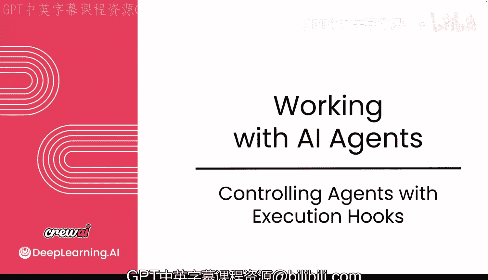
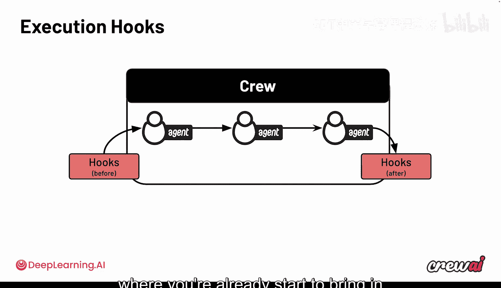
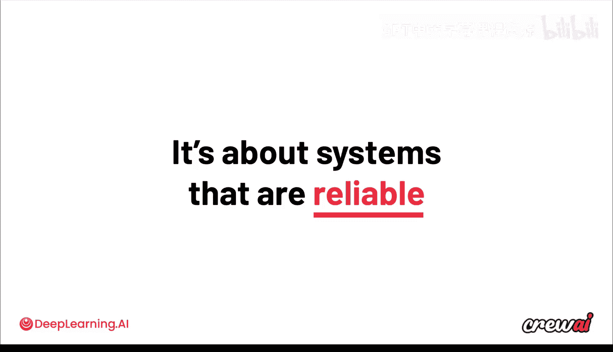
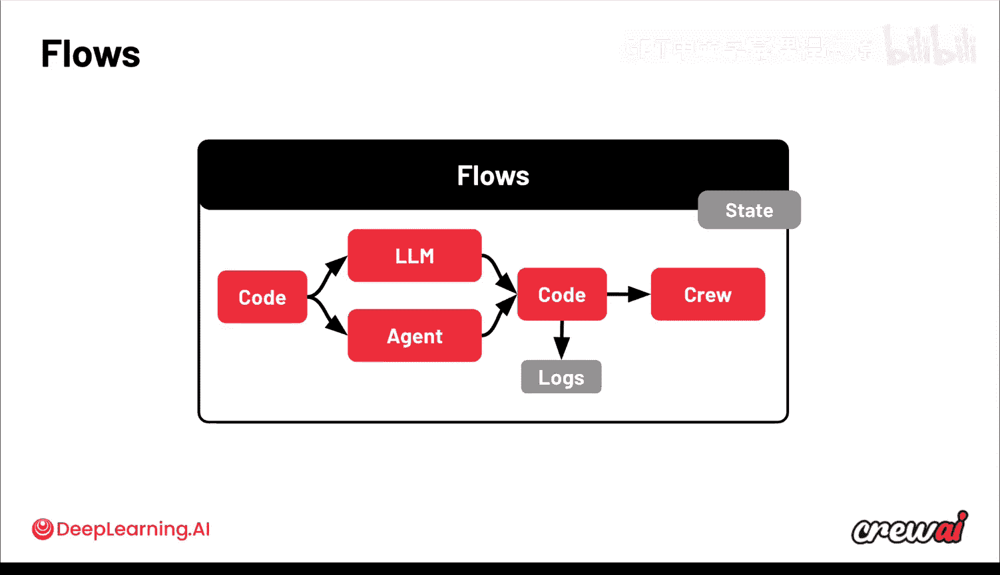

# 吴恩达《使用 CrewAI 设计、开发与部署多智能体系统｜Design, Develop, and Deploy Multi-Agent Systems》 - P16：4.controlling-agents-with-execution-hooks.zh_en - GPT中英字幕课程资源 - BV12eCQBAECM

By now， you're already ga that these agents are very powerful。

 And they're good at making the decisions on the fly and reacting to anything that you throw at them。

 But sometimes you want more control。 Sometimes you want to make sure that you execute actual code either prior or after this agents are executed。

 And this is where execution hooks come in。 It allows you to write code that is going to run right before your agents start doing work or right after and use that information either to input data into the agents are to take data out of this agents and send them somewhere else。

 This is a very interesting technique and can play a huge role depending on your use case。

 So let me show you how it's done。 So by now， you're getting very proficient with crews。

 And you probably are ready identify that whenever you have a crew。

 You might want to have something to happen right before it starts doing its work。

 or right after it's done with its work。 And that can be so many different things。

 a lot of times it is loading data from somewhere。😊。

Or loading data off to somewhere。 and you might want to use that data to change some of the information。

 So in most cases， you might want to have this something happen that modifies the inputs that goes into the agent or modifies the outputs they're going out of your crew。

 So you might want to change this information in certain ways or combine with something else before you start your workflow And by the end of the workflow。

 you might want to push that final resume such as into Salesforce or another system or even your email。

 and that's where hooks comes in because either before or after hooks will allow you to write code that you want to be executed right in there。

 It's almost like an easiest step before you go out the way into a flow where you already start to bringing some actual coding into your agent So before hook。

 for example， might be fetching input data or cleaning input data checking for Pi or personal information and make sure that it scrap those out while after hooks will be valid。

Dating some of these outputs will be moderating content might be also doing things like removing PI or even just logging output somewhere so that you can inspect them later。

 A good example of a prehook function would be something like this。

 Let's say that part of the inputs is a phone number。

 and you want to make sure that your formatting it right。

 So what you're doing here is you extract this information and you use regular python to basically break it down in a very specific format and then reintroduce that into the inputs。

 So that's something that you can do to make sure that the data going into the crew and into your agents is properly formatted。

 And this is an example of what it would be a good post hook function。

 where now you're getting the outputs。 And let's say that the output now also includes the phone number。

 but you want to hide that away。 So you might basically implement something that hides the few numbers and only show the final four numbers。

 So an obfuscating part。😊，OfThat output。 And then you're returning that output forward。 Now。

 if you want to add those pre hookooks and dispose hooks into your tasks。

 all you got to do in the code is add these two new attributes。 a prehook and post hook。

 and you can see that both of them take a raise as values。

 meaning that you can add many different hooks， either to be run before or after the execution。

 allowing you to have a lot of control into that。 So in the end of the day， you can see how hooks。

 either before or after hooks can actually play a huge role on helping you build reliable systems。

 If there' is one thing that you are gonna to hear me referencing over and over。

 I that in order for the systems to get into production， they need to be reliable。

 You can definitely build them extremely easily with crew， both with no code and procode。

 But when you got to ship them， you want to make sure that they are giving outputs that are consistent in their future。

out any information that is going in or out。 So in the end of the day。

 a lot of the focus on hooks is around this idea of building reliable systems。 Now。

 the outtmost control that you can gather if you query eyes when you go to C eye flows。

 and we're going to talk a lot about that in module tree。

 And the idea here is that flows you allow you to merge actual code with either one singleM calls one single agent or an entire crew together。

 That is the ultimate backbone that can bring everything together。

 And we're gonna dive deep into flows in the few lessons ahead。

 And I'm already start to putting some of this context in some of these concepts together for you。

 flows can be extremely powerful because they allow you to create very simple automations with no Lms at all。

 or build things that are much more complex like what we have seen here。

 I hope you then enjoy this so far， because。😊。

Next lesson， we're going to talk about how AI agents use external tools and tools are the corner piece on how your agents get a work done because they allow your agents to do so much。

 They're going to be able to tap into external sources。

 They're going be able to push external data and take actions in different systems so I'm sure that you're going to have a great time with that。

 You don't want to miss that one out。 so let's jump right into that。

