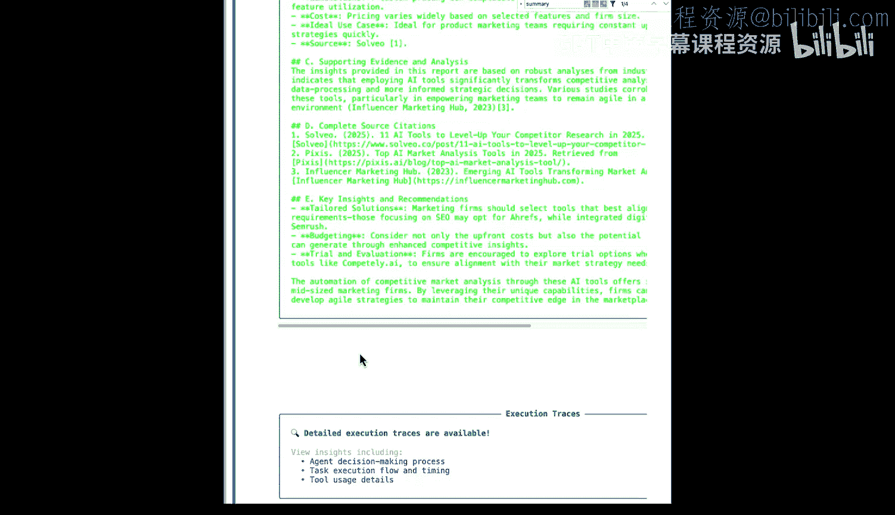

# 吴恩达《使用 CrewAI 设计、开发与部署多智能体系统｜Design, Develop, and Deploy Multi-Agent Systems》 - P17：5.improving-a-deep-research-crew.zh_en - GPT中英字幕课程资源 - BV12eCQBAECM

Now， let's get everything that we learn and put that into use。

 Let's get our deep research crew that we built earlier。 And now we're gonna to make it better。

 We're going to make sure that we include memory and execution hooks into that。

 So we can do even more than what it was doing before。 Let's dive into that。 Allright。

 So now we're going take our deep research crew into the next level。 I'm so excited about this one。

 because we're not only going to get the things that we built before and make them better。

 but we're going to use some of the new things that we just learned in the pred lessonsescence。

 So this was kind of like the last state that we had of your crew。

 where we basically had the research plan， the gather research。

 the verifying information and the writer and the report writing our working sequentially one after the other。

 Now， we're going start to apply a guardway of strategy into this to make sure that we get a better report。

 And we're also going to make sure that were saving the report as a callback so that we can see it later。

😊。

We can then make sure that we're enabling memory so that these agents get better overall。

 but not only sharing information with each otherr， but storing learnings across multiple runs。

 So let's jump into the Gter notebook so that we can start to get our hands dirty。Alright。

 so the first thing that we would do is our usual loading of modules and classes。 Again。

 same thing that we have done before loading the agent， the task and the crew。

 We're loading the A search2 and the scrape website search tool and we're also loading all of our keys whereas in Gty for me and we're also getting our A and open AI key out of this one and we can just run this cell and get things going Now。

 next， we're gonna make sure that we're creating instances off our tools basically the same way that we had the last time that we are working on this crew where we're going basically load the A tool and the scrape website tool and we can execute them just to make sure that we get that done。

 Now， because we're moving away from declaring our agents and tasks all the way into here and mixing prompts with the code to actually have this agents and tasks as Yal files we can just load that accounting straight from the Yal file so that we can create our agents spaced off。

😊，ThatAnd then when I show that emmo file for you in a second。 But in here。

 you can see how easy it is to load it。 now we can reference that when creating all of our agents。

 So creating our agents now， it's way more straightforward because we can all reference that agent config in those specific agent configurations and prompts that are in that emO file。

 The other thing that you will see is that both the Internet researcher and the fact checker are both still with their access search to when their scrape website tool。

 Allright， so before we jump into the Yal files， let's go over why were using Yal files in the first place。

 And the reason here is that you don't necessarily one your agents and tasks definitions and a bunch of that prompting to just leave in the middle of your code that makes it harder for you to parse and read and also don't incentivize other people to contribute on those by moving that tax content into a Yal file。

 you actually get。To have some separation of concerns so that you make sure that if you ever want to change those definitions。

 you can do that as straight the Yal files and that is separate from your code。

 And that is as simple as just having this config folder with both agents and a task Yal file。

 And if you open this Yal files， why don dot you find is a regular yal that describes the agent name in the top。

 And inside that the same attributes that you would see over the code。 So the row。

 the go and the backstory and for the tasks， the description and expected output。

 The cool thing about this is that again， now this completely separate from your actual code and you can version this so much easily。

 And if there is nontechnical people that I want to take a stat updating this。

 they can do it in a very easy manner in your entire code looks on a clean as a byproduct of doing that。

 So moving forward on your other examples and as we work。😊，This crew。

 we're gonna stick with the agency Ml and tasks the Ml file just to make sure that we keep that separation of concern and make our lives a little easier。

 Now， you might notice that we're also having this verbos equals true。 And just to be vocal。

 what this is doing is just plotting out those outputs that we have been tagging along across the entire notebook。

 So as we run this agents and we're able to tag along their execution straight in here that a verbos equals true is what is actually enable us to do that。

 Now， let's move on and start to creating our tasks。 But before we do that。

 I want to make sure that we create our first guard rail。

 It's a cold guard rail and this cold guard rail is extremely interesting。

 So let me actually bring this on so that you can see it。 If I paste it in here。

 you can see that this guard rail， it's extremely straight。 What it's doing is， first of all。

 is getting the entire output and make it lower。😊，So we can now use regas to search the entire output。

 and the main thing that you're checking for is to make sure that this report includes a summaries mentioned and insights or recommendations mentioned and also citations or reference mentions。

 So it's basically making sure that our final report in fact。

 include the things that we care about and the sections that we care about so that are referencing not only a summary but insights and citations as well。

 and this is just one way to enforce data behavior into our agents。

 and you're going to see as we run the crew that if it fails into any of these checks it sends this information back into the agent so the agent can actually get the work done so you can see that if at any point in time it fails any of these checks it actually returns false indicating that this output is not ready and the test should not be done and gives a。

And on why that's the case。 And the reasoning here is important because， again。

 this is injected back into the agent when we ask it to do better and to redo the work。 Now。

 if doesn't fail in any of this checks， then return true and the new output back so we don't need to worry about that。

 Now let's make sure that we create this guard rail and we move on to creating our tasks。

 which will also be loading from the Yal file。 So let me just copy that and paste in here in our cell。

 If you see here， the tasks are extremely straightforward to create in the same way we're loading the Yal file and then we're creating all the tasks reference their main keys in that Yal file as we just saw earlier。

 But now there is a major difference in here。 you can see that we are defining a guard rail and this is a coding guard rail is the function that we set up earlier that is basically making sure that the final output of this report passes that。

before it goes on。Now that we have created our guard radio and our tasks and have properly assigned our guard radio to our task。

 I want to make sure that we're creating our first hook。

 is's going to be your post or after execution hook。

 So this hook is going to be extremely simple is just to showcase how it actually works and how this could be useful for you。

 It's going to be a simple save file hook so that we can get the final output。

 as you can see in here， We're taking the final task output in here。

 and just saving that into a markdown file。 So just opening the file and writing the content in there。

 You can do this by the full with cr as well by using the output file function。

 But this is just to highlight how easy it is for you to create this functions and set them up as hooks either prior the execution or after the execution。

 So let's create this function and then jumping into defining our crew。😊，So for a crew definition。

 this is very straightforward。 We're bringing all our agents in here， all our tasks。

 and we are enabling memory for the first time。 Remember， we didn't have memory before。

 but now we're enabling memory for this crew And we are also adding the after kickoff callback to basically execute that hook for saving the file that we had。

 So let's create our crew And I'm very excited to set the input and then run it。 Now。

 let's create the inputs that we're going be using for this。

 And the input is gonna to be the same one that we used last time。

 where we're basically researching the top five emerging AI tools for automating competitive market analysis。

 We can just paste it in here。 And now we have the input properly defined。 And with this input。

 we're ready to just to execute our crew and tag along the process to see the results。

 So let me just kick off our crew with the user query that we just define and see what we get in the end。

 And don't forget to play around with this。 change the file save。😊，Hook。

 change some of the guard rails。 Make sure that you feel comfortable playing around with these concepts。

 changing the LLM in the user query to see what kind of outputs you're going to get from this。

 This is a very exciting moment for us。 So let's kick this off。😊，All right。

 so now let's tag along the execution of our agents。 The research planner。

 kick things off and finds out what should be the plan for us to get the best result from our report。

 So decides to identify what are those tools。 look at their features。 look at their limitations。

 do some cost analysis in check the ideal use cases for this marketing firms。

 So it has all the plan laid down。 as we keep scrolling。

 we're gonna see the different agents the researcher to figure out how to find this information and put this report together。

 So now in our next agent， you can see that it's again。

 using the access search tool and searching again for the top emerging AI tools and finding all the different tools that are available in there。

 and it's going to then scrape some of those websites to understand what is the best tool around。

 So let's keep tagging along the execution。So we found out five tools for us to focus on and that is now going to the fact checker agent that well also use the access search tool。

 but to simplyly check all the data that we have about the tools and make sure that that's factually correct。

 so let's go into that。Alright， so now we get to our final report agent with its final answer。

 and you can see that it's given an entire active summary All details findings about all these tools。

 It's actually mentioned the citations and even mention insights and a conclusion。

 So in matter of fact， this passes all the checks from the guardrails from the first try。

 So our guardrail never even mention that our agent should retry running this because it got the whole thing from the ga go。

 but you can actually play around with this。 you can update our tasks definitions or our agent' definitions So it doesn't mention a conclusion or it doesn't mention recommendations or doesn't include a summary and you can see how that works。

 In matter of fact， why don't we do that real quick right now。

 So I'm going to go here in our final task and I'm going say that I don't care about this implementing a summary So just say that it needs a detailed findings that it needs a support evidence and that it needs to。

😊，have complete citations with key insights。 So I'm not mentioning a summary anymore。 Alright。

 so now that we have changed our task， you can see that this time。

 the final the Win does not mentioning a summary。 What is a hard requirement on our guardra。

 So if we scroll this down a little bit。 We can actually see that the guardrail blocked and it's retrying due to the fact that the report must include a summary section with a heater。

 And now it takes that message back into the reporter agent saying like， hey， do this again。

 but this time， you need to make sure that we include that summary in there。 And what it does。

 it actually include an exact summary on item a here that didn't head before。

 And this actually allows the agent to call the task done and keep moving。 Now。

 make sure that you play around with this。 change the prompts a little more。

 change the models a little more。 There's a lot of room for you to play around with。

This concept and see how they work in the real world， but is definitely very exciting。

 And I hope that you stick around because the next lesson。

 we're going to talk about some even more interesting aspects that will then fit back into how we improve this agent。

 and this is going to get insane down the road and you don't want to miss that out。

 So you see the in the next lesson in a second。😊。

