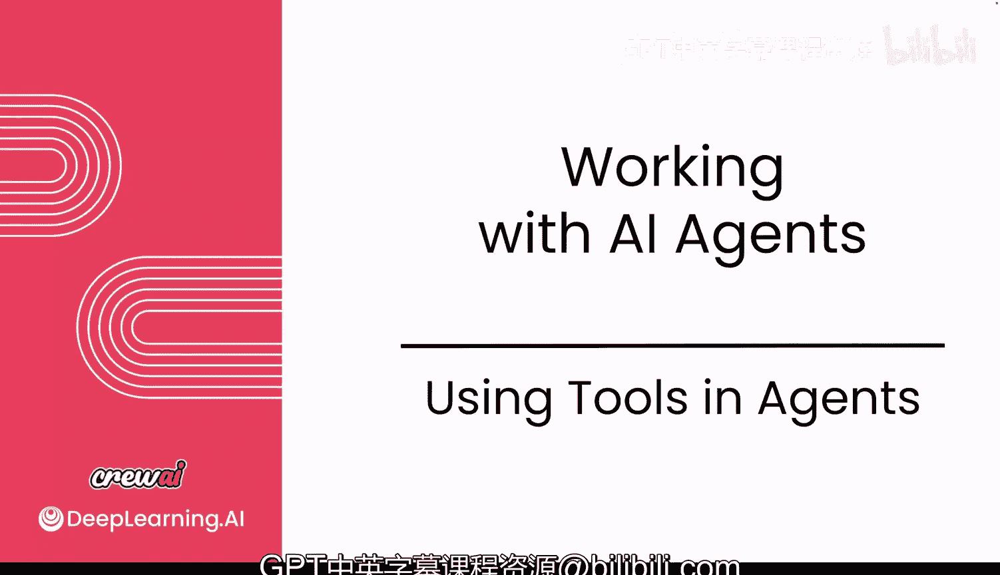
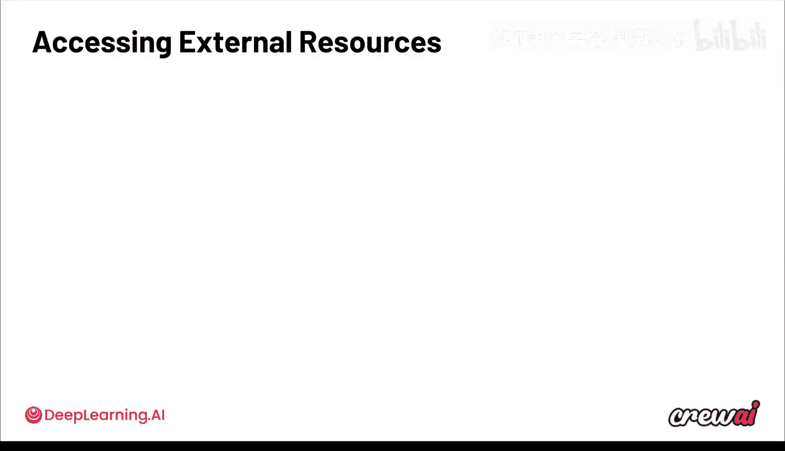
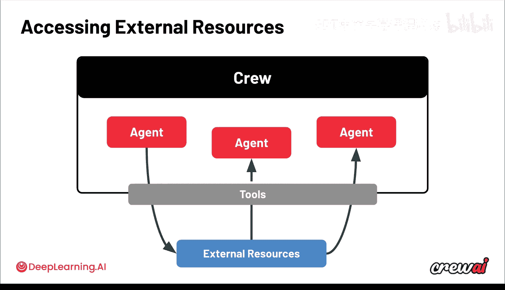
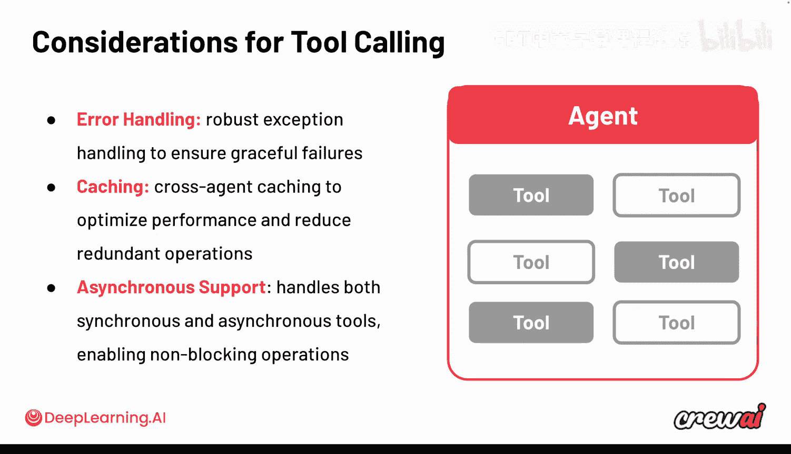
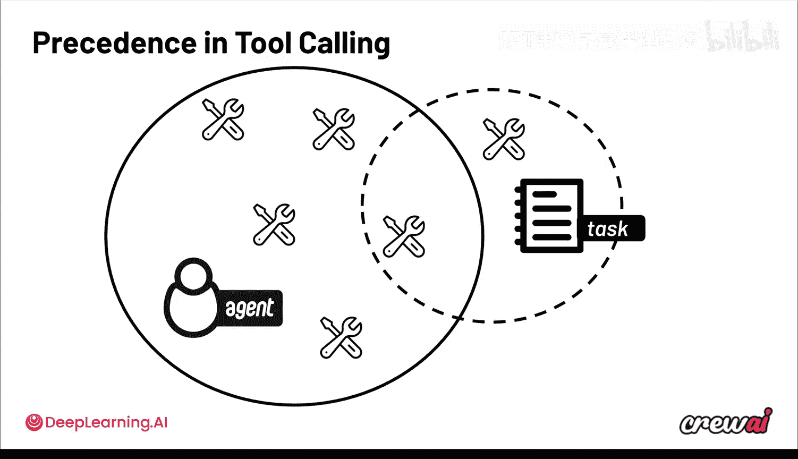
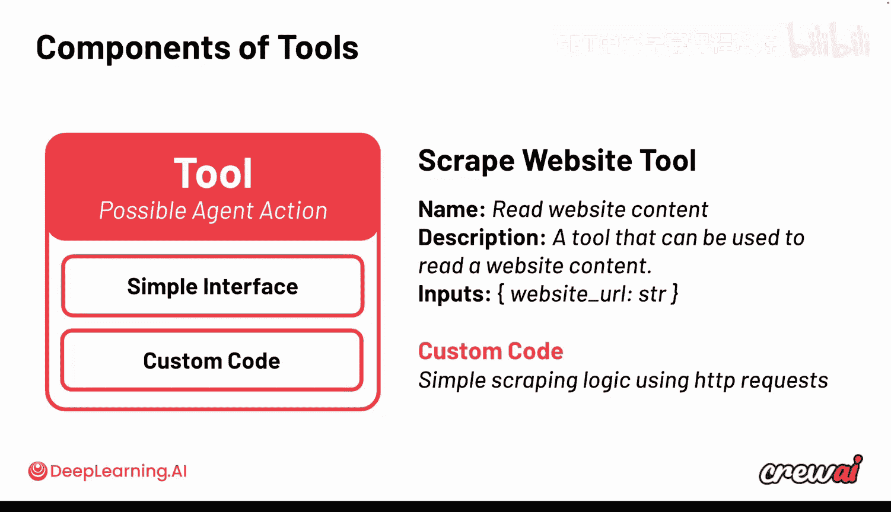
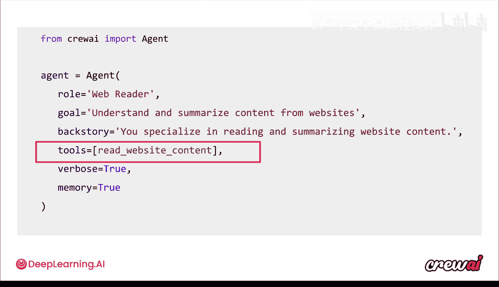
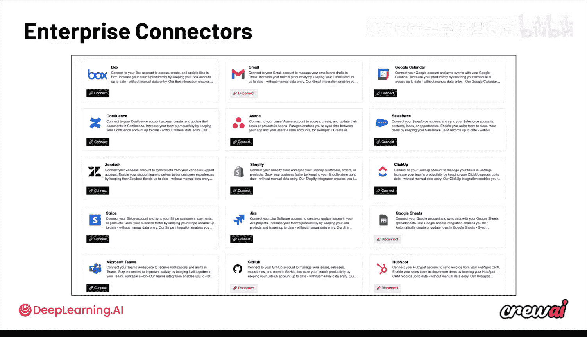
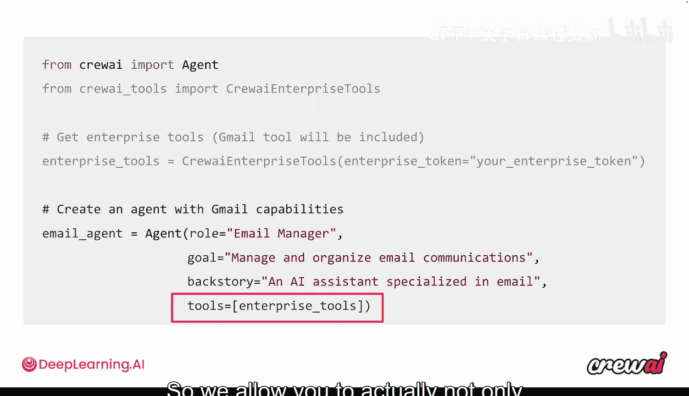
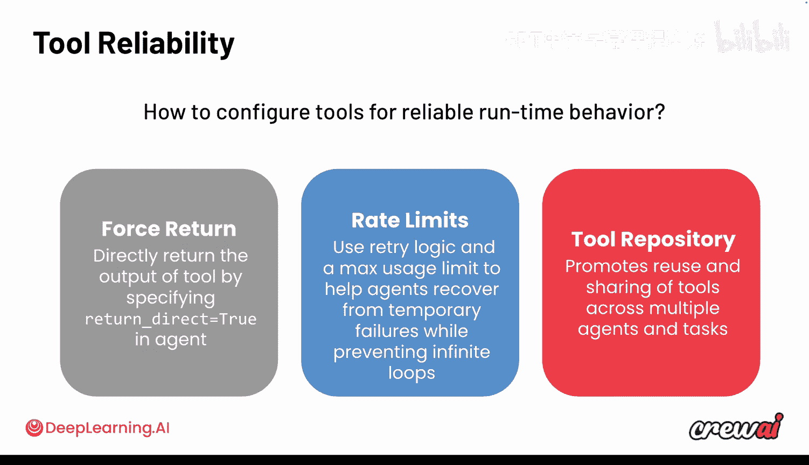

# 吴恩达《使用 CrewAI 设计、开发与部署多智能体系统｜Design, Develop, and Deploy Multi-Agent Systems》 - P18：6.using-tools-in-agents-.zh_en - GPT中英字幕课程资源 - BV12eCQBAECM

A big thing about agents is tools， and we haven't talked much about it。

Tools allow your agents to interact with the external award。

 either by sending data out or pulling data in or even taking actions。

 There' are so many different things that agents can do when they have tools at their disposal。

 It's one of the coolest parts about working with agents and they are very important all because they allow these interaction with the external word and they can make a huge difference on the kind of use cases that you can actually build。

 So let's dive into the word of tools now and understand how we can use them。

 I'm super excited about these one， because tools allows your agents to do so much more complex work and allows you to interact with the reward and other systems out there。

 So very excited about this one。 We already know that you can organize your agents in the crew。

 and that this crew can have many agents But now these agents will be able to tap into this external resources。

 and tapping into these resources might take a few different shapes For example。

 one agent might be sending data out for。😊。

le writing into a database or writing into their CRM or writing into your ERRP。

 Other agents might be pulling data from there， so they' are trying to gather information about someone。

 they might be scraping the Internet， they might be doing some sort of Google search。

 or some other agents might be actually running code or even taking an action。

 doing something on this external system。 across many use cases。

 there is always an element of tapping into data。 either pulling it in or updating or something in between And the way that this gets done is through tools and tools is what allows their agents to tap into these resources。

 Let's look into one agent。 One agent can have many tools。 if you zoom in into that。

 you can see that you can provide them with as many tools as you want。

 But there is a problem number of tools that you give to an agent can backfire。

 especially if you're giving them too many and they don't know what tools to use。 So。

Many tools， depending on the model size and how complex are the tasks or even how complex are the tools might lead them to get lost and not understanding when to use the right tool for the job。

 And that goes back into breaking some of the work into multiple agents with multiple tasks and multiple tools。

 you want to make sure that you're giving agents enough tools。

 but also the right ones not only allowing the agents to do this callings but again。

 keeping in mind that too many tools might the great performance some of the most common tools that we have seen out there is tools involving files。

 folders looking into your current file system or doing scraping and browsing or database connections or even code execution。

 So those are just some of the examples that we see out there。

 but theres so much more Even you can do your own custom tooling as well to integrate with internal systems where you might want to connect to something else that you have running in your company。

 There's a few things that。To understand about two calling in general one is the utility。

 It extends this agent' capabilities by integrating them with these external systems and also give them flexibility because you can make a custom ones that allows you to connect with homegrown systems that you might have。

 All right， So there's a few cons are about two calling and theres string specifically that want to pinpoint。

 The first one is error handling that basically a lot of this is already building into crew and handles these robust exceptions that might happen to make sure that you have more gracefully failures so the agents can selfre。

 The other one is caching and caching allow that throughout the execution off the crew as the agents use the tools。

 they cache the results for the specific arguments that use for that tool calling。

 So as this agents use the same two over and over that will not hit the same API again。😊。

What actually not only saves you time and money and tokens。

 but can also help with these external systemsvaabilities。

 And then you also have this idea of a synchronous support that handles both synchronous and asynchronous tools。

 meaning that your tools only to answer right away。

 it can have an asynchronous point to that that will allow a nonblock operation so that agents waiting for that to return。

 what other agents are keeping going on。 Now， when giving your agents tools。

 I want to make sure to point something out because in crew AI。

 both agents and tasks can have tools assigned to them And what that means is that your agents are going to be tools that are part of their arsenal。

 So when they go into performing a task， they will be able to tap into those tools。

 But if or task you set a separate set of tools the agent will be limited the choices of those tools instead of all the tools that it has available for itself。

Meaning that even though an agent might be able to write into your CRM， if for a given task。

 you want to make sure that it' not an option， you can give this task another set of tools。

 and that will take precedents over the agent tools themselves。

 So you have many different levels through which you can control。

 What are the actual capabilities of your agents， either by giving them tools directly or by giving your tasks a pool of tools that should be used to accomplish them。

 Now， I know this can sound a little complex， but it's actually extremely helpful as you reuse one agent to do a series of different tasks。

 and you might want to have a subset of tools for each task that it does。 Now。

 let's look into tools real quick to understand what are the components。 One is the tool made off。

 tools are basically split up in two main pieces。 One is a very simple interface。

 And that interface describes the agent how they can。

Use it so it's gonna to have a name。 it's gonna to have a description and it's gonna have a series of inputs on how it can be used。

 and the second piece is custom code。 And this is where you can do anything with your two。

 you might want to have it authenticated with an external service。

 You might want to have it to do some API calling or you might want to do a service connection with some other sort of protocol。

 The idea here is through the combination of these two things。

 you have a very neat package that you can pass your agents that teach them not only how to use it。

 but also what to do ones that is using it。 If you look at an example， for example。

 a scrape website to， the name might be read website content。

 So you can see that the name can be very descriptive and a description itself describes when these two should be used。

 In this case， it enables the agent to read a website content。 The input here is the website URL。

Whenever your agents trying to scrape the website is gonna pass that website URL argument。

 And then there is some custom code that is a simple scraping logic basically using A Tp request。

 So in here you can see not only this example， but you can build your custom tools as well。

 And remember the custom code can be anything。 In matter of fact。

 there are many preview tools out there that we have already built for you， not only for scraping。

 but for many other things。 And if you're thinking about external tools there are more complex that require all for proper authentications such as email or calendar assessing documents。

 we offer many of those prebute for you on query AM and you can check those online。 Now。

 let me show you what a custom tool looks like。 This is a sample code for building a custom tool。

 You can see that it's all based off annotations。 all you got to do is create this one single function。

 you annotate that with at two annotation that gives you。😊。

The toolss name。 then the description that you put inside the function definition is used for describing that tool for the agent and the codingding there can be anything that you want。

 We kept this example very simple。 Now you can give those tools to your agent by setting an attribute called tools that actually takes an array as a value because again。

 you can provide many tools for your agents。 And if you want more enterprise connectors。

 things like the calendar and email or salesforce or Stripe or Jra and many of the other ones that I mentioned early you can actually find those on create AM。

 So for action taking tools such as writing to a database， updating a CRM generating a report。

 the custom code might involve many different things like an API call connecting to a database directly maybe tapping into a ragg system or an external API So this sky is the limit here in terms of what you want to do from using the preview tools that we have on open source to write your。

cusousom tools that connect to existing systems to use this O off connectors that we provide with C I MP。

 you don't like any options。 If you do and use these integrations。

 though using them locally is extremely simple， all you got to do is import the CI enterprise tools module where you're going to provide a token and you can give it as many tools as you want。

 for example， integrating with Gmail with3 want to or whatever you have authenticated within your application。

Now we also provide you with what we call a two repository。

 A big part for building this agent in a scalable way is the ability to do it using building blocks。

 Think about this as Lago blocks that you can reuse across many different use cases。 For example。

 you want to reuse the same agent to perform many different tasks and across many different use cases and the same thing goes for tools you might have viewed a tool that is extremely important for you and can play a role across many different use cases。

 So we allow you to actually not only build this tools by using our Ci with the Qi2 create common but you can then publish these tools so they are available for other people in your organization by doing queryi2 publish and your coers and other people can download those tools doing queryi to install and this is very important because as you build these custom tools as。

Actually when they touch internal systems， you definitely want a way to distribute them with ease so many people can use and build other use cases You can see that toolss are extremely powerful and I want to talk about reliability on the context of tools as well and there's three points that I think it's worth driving across one is force return what that means is that you allow your agents to automatically return the output of two as the final output of the task and that can be relevant when you don't want the agent to mess around with whatever the tool is returning you just want to make sure that the agent takes a series of steps and by the time that it gets to execute that two the output is the final result of the task the other thing that also is important is idea of rate limits some of these tools they come with harder requirements in terms of how many requests you can do and how many requests you can do in a certain period of time。

So you can actually set up retrylog and max usage limits to make sure that your agents are not using the same tool over and over again。

 preventing failures that you might have。 And the final thing is this idea of the two repository that it promotes this idea of you being able to reuse and sharing these tools across multiple agents and tasks while it can be extremely helpful。

 especially for companies as they are scaling into multiple use cases and trying to figure out a way to standardize adoption of those tools。

 So by now， you probably already grasp how important and powerful tools are。

 And theres so much you can do with that。 But on the next lesson thing。

 we're going to talk about something that will take that to the next level and that is MCP MCP is changing the word of integrations because it allows agents to tap into many other integrations out there。

 theyre being made available by their own companies。 So you're going jump straight。

to that and understand MCPs in practice and how you can use that with your crews and agents to build even more complex integrations。

 I'm very excited about this one。 you don't want to miss it。 So I seeing there in a second。😊。

