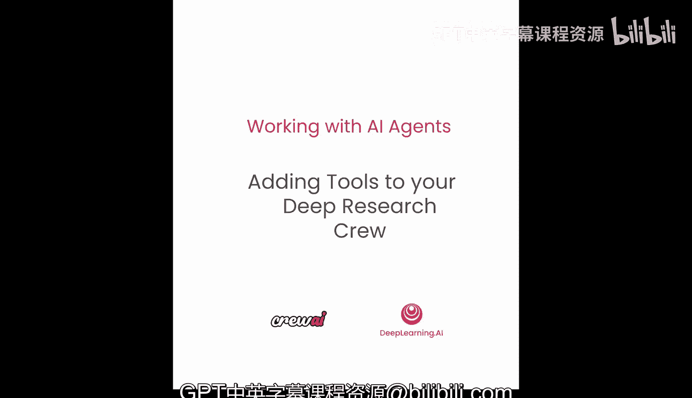
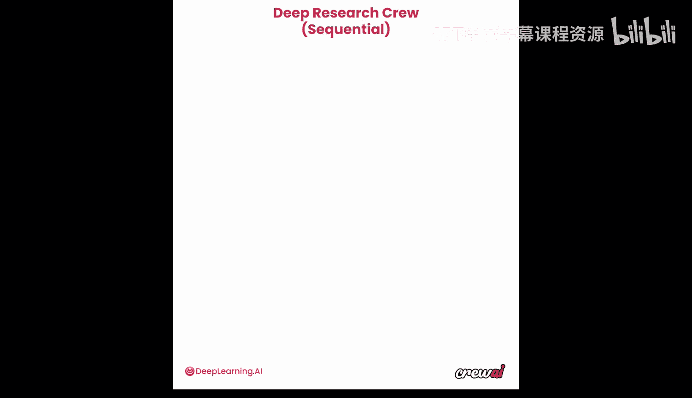
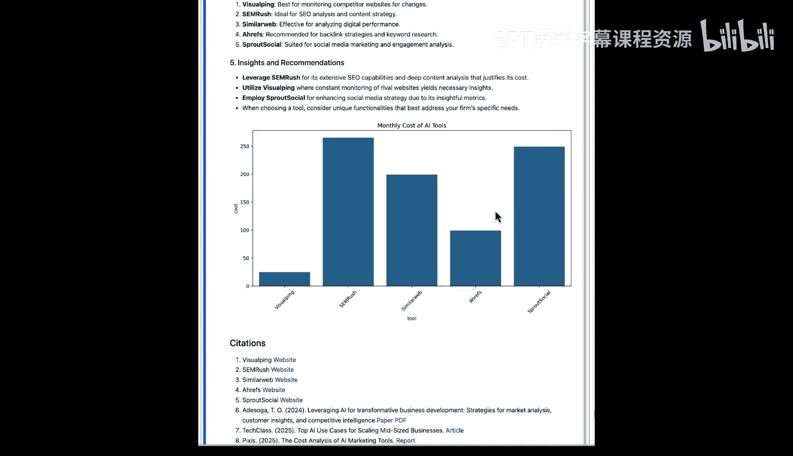
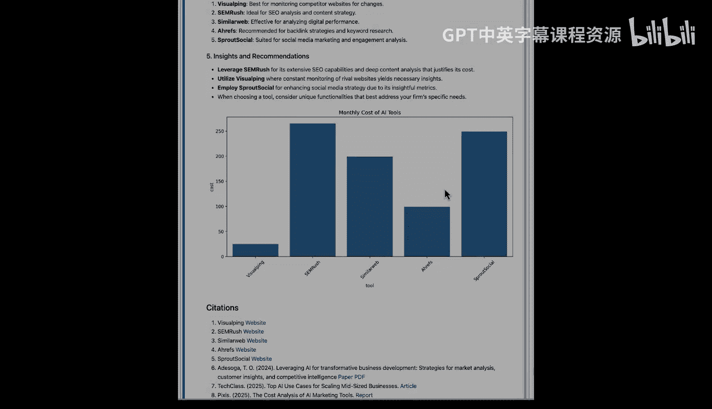

# 吴恩达《使用 CrewAI 设计、开发与部署多智能体系统｜Design, Develop, and Deploy Multi-Agent Systems》 - P19：7.adding-tools-to-your-deep-research-crew.zh_en - GPT中英字幕课程资源 - BV12eCQBAECM

We learn so much about tools。 Now， let's make sure that we get that and apply to our deep research crew。

 and you will see how much powerful that will get it。 We're gonna be able to do way more。

 And this is very exciting。 So let's jump right in Allright， so for thister notebook。

 we're gonna use a custom tool for the first time。 This is gonna be very exciting because we're gonna start to understand how you can add any capabilities to your agents through custom tools。

 you can literally use custom tools to connect to external systems。

 internal systems called databases or any sorts of as that you might have。

 So there's a lot that you can do on that one。 For this one。

 what we will do is actually create a custom tool that allows your final agent to plot a chart。

 That means that it's going to use the information that it gather for the report to actually plot some sort of visual that it can embed into the markdown that is going to be the final report。

 So this idea of this custom tool is to allow your report to be a little more reacher。😊。

Have more information and do that by leveraging the regular Python library like seaborn and math plot leap。

 So you see on this lesson how we're going to enable the reporter。

 right agent to use custom tools to actually build those charts and then embed them into the final report。

 This is gonna be a very exciting one。 So let's jump right into that。😊，Allright。

 so now we're gonna improve our deep research crew， but we're gonna add custom tools to that。

 I'm very excited about this one because we're gonna start to see how custom tools can allow your agent to do so much more stuff。

 and kick things off， we're going start as simple as we have done so far where we just copying and importing all the different classes。

 So the agent， the task and the crew class we're also importing the access search to again and the scrap website to and then just loading all the API keys in there。

 So this should be enough to get us started。 and the next thing that I want to do is actually create or custom2。

 But before we create， let's suggest revisit what exactly a custom tool looks like。

 So a custom tool is created by using the base2 class。 So we want to make sure that we import that。

 And then after we do your custom tool can look as simple as just this where you have your class name and you have your name and the。

😊，And some of the schema。 So if we take a look at this。

 we can see that is extremely simple and straight to the point and you cannot all your logic under this run function where you can do anything you want in here。

 you can connect an API。 you can connect with an external system and just make sure that you return a string at the end that will be the final tool result Allright so now that we understand what is the structure for or custom2 let's make sure that we create or on and this custom2 is gonna be about plotting custom Cborn charts。

 So let make sure that I paste it in here。 if you are familiar with Python。

 you probably know about this libraries already。 both cborn and mathplot leave are well known libraries for creating custom charts in Python and this is basically a custom plot2 that allows the agent to create custom plots It has some instructions on how to use it。

 and if you go into a run definition， you can see what exactly does it uses a single alarm called to。

informationform from the arguments that it's getting and then use data to actually plot an entire seaborn chart and provides that image back into our agent so that it can incorporate that into the final result。

 So we want to make sure that we provide these two to our agents so we get more reach visuals on our report as well。

 Very excited about this one。 So let's create this tool and move on into setting up Aa。 All right。

 so now we're gonna create the instances for our a in our scrape website。

 Just making sure that we have those two tools ready to go and we can assign them to our agents。 Now。

 let's create the instances of our access search tool and our scrape website。 And by now。

 you're more familiar with this idea and the concepts of tools themselves as a way to allow your agents to interact with external or internal systems。

 And remember， these tools can take a lot of different shapes and forms。

 We're using here a couple tools are previewed byi and you can basically deploy them into。😊。

Agents and they good to go。 But you are also creating our own custom tool。

 We also will talk about how you can use MCps as tools eventually。

 and I'm very excited about that in one of the future lessons。

 But the idea here is that a true tools you're allowing your agents to actually tap into the external word either by pulling information out of that or pushing information into that or even taking actions in other systems。

 So what we're doing here is tap into the Aa API to do searching on the internet and using the scrape website tool to actually access some of this websites and information out of them。

 And the reason why we're doing this setup where we're setting a specific Aab URL is just due to the internal environment in the learning AI that we're using for most of the use cases if you're using this on your own computer。

 for example in your own terminal you won't necessarily need to do that other than setting up your environment variable for your Aa API key。

 you should be good to go。 Allright so now that we're doing this lets。

Lo our agent Ml file and make sure that we create all our agents。

 So this is the same thing that be the last time there's nothing fancy happening in here。

 the idea is basically loading all those prompts from the Yal files and using them to instantiate all of our agents again super straightforward the whole idea here is again to have some separation of concerns where you have your prompts or agent' definition is your test definitions in a separate file then your agents and tasks themselves。

 Keep in mind that we're still keeping the same features that we have used up to this point。

 including the guard radio that we implemented in the last notebook。

 So you want to make sure that we bring that guard radio in here to check that the final output and the final report includes a summary section or recommendation sections and a citation sections。

 One thing that I also want to pinpoint is the fact that on our report writer agent we're assigning our custom tube to that agent And here you can see how we're actually doing it。

Basically creating an instance of that tool that we just created a couple cells above。

 and this is as simple as that。 All you're got to do onces that you create your custom tool is to assign that to an agent and your agent good to go。

 we're going talk eventually in future lessons how you make sure that you can distribute your tools across many different crews and many different agents in a way that's easier for you to maintain and you can get other people in your teams to use it But for now all you got to worry about is just that you need to create one instance and give that to your agent and it's good to go。

 Now what we're going do next is actually creating our tasks and it's very similar to the way that we set up our agents where we're now loading this tasks from a Yal file and using data to instantiate all the different versions of the tasks again。

 keep in mind that we're still keeping the same structure that we had on our previous notebook where we still have that right report guard ray or writing here to make sure that we're checking the final report before we actually call it done。

 So let's just create this The other thing that we're still bringing from the。

Last notebook is the ability to save the final report as a file。

 and its gonna to be an after hook as well。 So we're keeping that unchanged。

 Let's just make sure that we create that function so that we can use it。

 And now it's as simple as bringing that entire group of agents and tasks together in one single crew。

 And you can see that we're still using the memory and we're still setting up that after kickoff callback as well。

 And now that this is created out that is left for us to do is to actually kick off the crew and tag along the results。

 And now that we have our inputs， all we got to do is actually kick off the crew and see how good of a result we actually get from this。

 So let's go into that。😊，Right， so now if we tag along the execution。

 we can see that the same flow still works。 And again。

 we're trying to keep things simple in here just to make sure that we get to show you how you can implement some of this concept that we're learning as we learn them into our crew。

 But at the end of this， we're going see that throughout all the lessons we're going to be able to build something very powerful For now。

' suggests secret of adding this custom to and see how things work。

 And you can see that the research planner is still doing its main work。

 It's trying to find an angle on how to find out these tools and what to research about them from that point on。

 you can see that the Internet researcher kicks off。

 It's using the access search to again to find out the information and based on that data in the websites that it's finding。

 then moves into scraping those websites to make sure it gets all the information that it needs。😊。

Now， at the end of this， it puts together an early draft of what the report could be with information about all these companies that then moves into ourn the fact checker agent。

Now we can skip that for now and just dip as straight it into our final report。

 just to look at how that looks。So if you actually look at the report right in here。

 it's interesting because it gets all the information from the fact checker。

 but it now uses our custom2， they create custom plots and you can see that it's sharing some information and that is then plotting one specific PG file and that will be injected into the final report。

 Then the same report writer agent builds the entire report and actually embeds that image in there you can see here in visual data representation。

😊，But then the guardrao kicks in and notice there's missing an insights block。

 And then the agent needs to go back to edit。 From that point on。

 the agent decides to plot a different chart and edit ramp its report again。

 the guardrao picks up that's missing a citations block。 So the agent goes back into add there。

 So here you can see all the different pieces that we're talking about coming together from the custom tools to the actual guardrailos and everything in between coming together and build this final report。

 Now， if we keep scrolling down， we actually do get this final report and we can actually plot it out because remember。

 we are saving that as a markdown file using an NAF hook。

 So I can actually go into a new cell and just plot out that research report。

 And we get to see the entire thing。 So you can tag along all the report。

 You can see the emerging tools that it found out about it。 You can see the features and limitations。

 and then even the chart that it was able to plot。😊。

With basically the monthly AI cost for these tools。

 And this is so exciting that the fact that you can have this agent do any sort of research for you。

 Remember， when we add the input here that we want to research about this AI tools。

 But we could have this crew do research on anything。 If anything。

 I encourage you to go back and change the input query in this notebook so that you can get this crew to run again and to build all sorts of different reports from different topics。

 Feel free to start moving things around， changing the models。

 changing the tools and just try your hand into this so that you grasp this concept。

 The one thing that I do on a call out though， is you can see the progressive improvement that this crew is getting over time。

 So far， we have starting with a very simple setup and we're loadlling at these new features and as we go through the next lessons。

 we're gonna add more and more features to make sure this report is actually grounded on the truth and that it follows a specific format and。

😊，Exactly what I want to get out of this。 So this is going to be very exciting。

 You don't want to miss this out， especially given some of the things that we're going to learn on our next lesson。

 So I want to see you in there right there in a second。😊。

