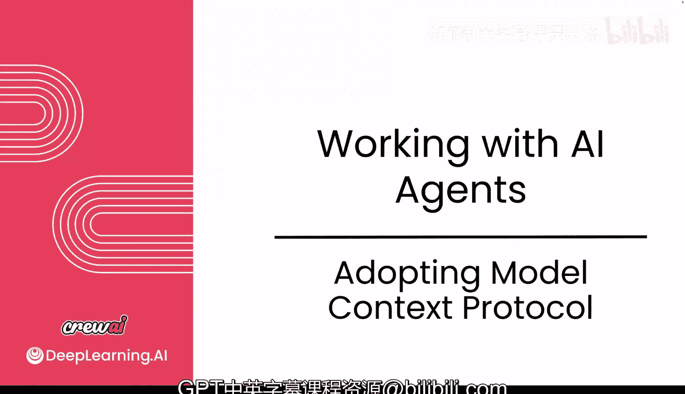
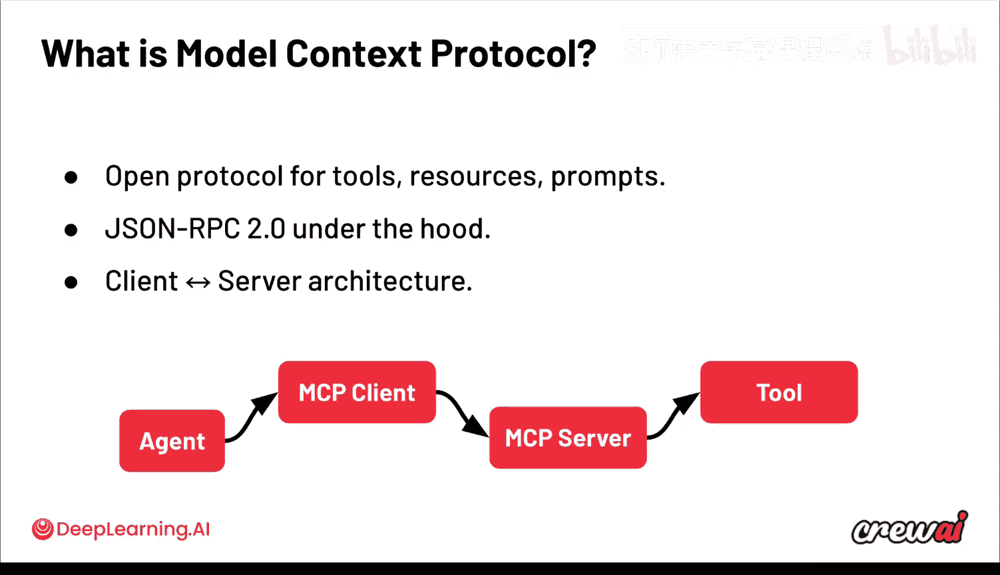
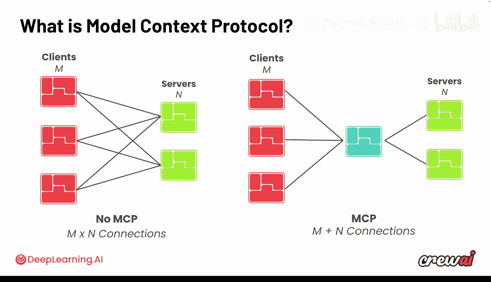
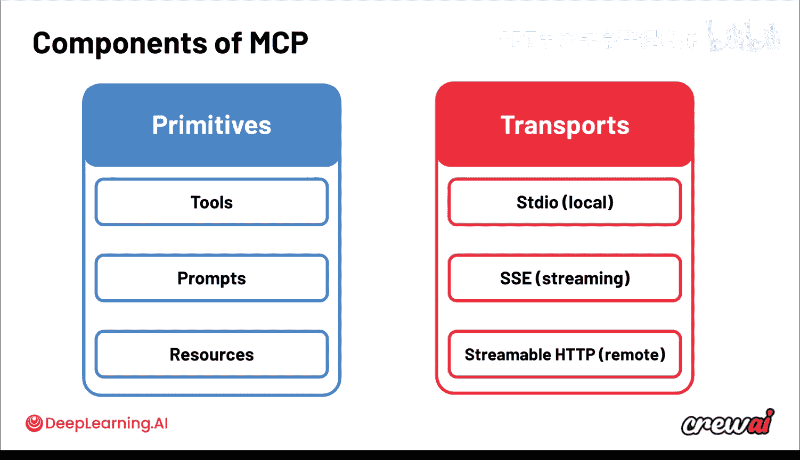
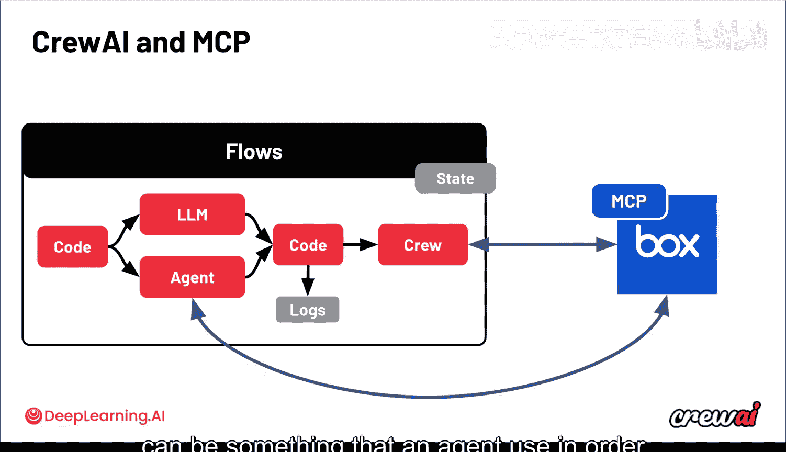
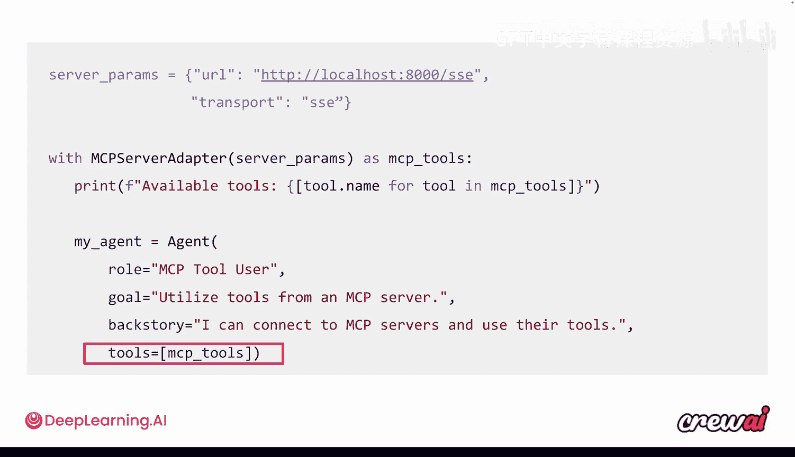
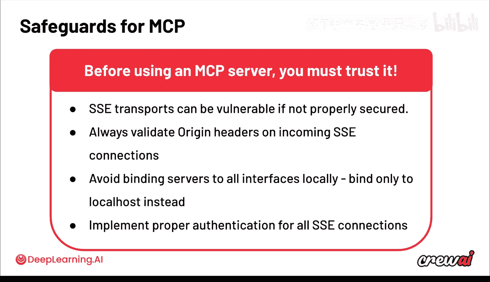
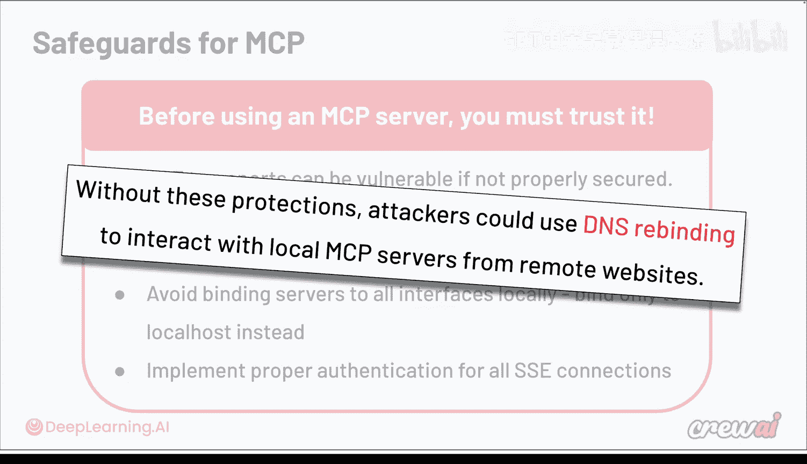
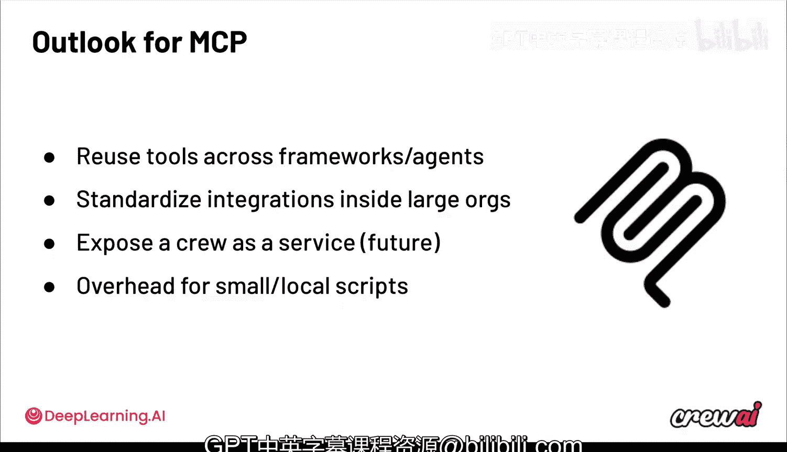

# 吴恩达《使用 CrewAI 设计、开发与部署多智能体系统｜Design, Develop, and Deploy Multi-Agent Systems》 - P20：8.adopting-model-context-protocol.zh_en - GPT中英字幕课程资源 - BV12eCQBAECM

In this video， we're going to talk about a really hot topic right now。 and that is MCP。

 You probably have heard about MCP already。 is a new protocol that is meant to help companies expose tools to agents in the Internet。

 And that's great because allow you to use these tools to build all sort of use cases。

 So in this video， we're going to learn everything about how you can actually use MCP servers so that your agents can talk with the external word and use this tools to build many different use cases。

 Let's dive into that and see everything that is going on with MCP and AI agents。 In this video。

 we're going to talk about the model context protocol。 Also known as mP。

 And we're going to over what it is and how it works and some of the considerations you should think about before adopting it。

P can be extremely powerful。 and it's an important cu when your agents stack。

 but it's important that you understand what is actually happening behind the scenes when you think。

😊。

Protocols for AI。 There's a reason why we're seeing so many people thinking about these things and specifically adopting MCP as a tool。

 and some of the things in here is a lot of these tools and a lot of these preexisting systems have different ways to be exposed。

 If you think about it， some of these apps who expose their applications as o off integrations。

 Other will use regular APIs Other might use sockets。

 there are so many different ways and patterns that might end up getting in way。

 a you actually getting the systems up and running because you can get stuck into integration land just building these integrations without actually accomplishing something meaningful。

 These integrations also end up requiring a lot of bespoke adapters so that you make sure that you're using the right ones in the right ways。

 and it becomes very difficult to share tools among agents， especially。

When you move from one agent to the other， from one to to the other。

 the way that you get to use them become extremely different。 And even if you think about it。

 historically， there has been entire companies that were built from the ground up around fixing these problems like Zaper。

 if this than that and make where the main business strategy is managing and building that glue layer between all this integrations for you。

 So this fragmentation actually makes it harder for people building integrations and even harder for customers that rely on those And that's the main reason why MCP and protocols as a whole has been such a topic for AI with MCP。

 and I want to spend some time here diving into this。

 you get the opportunity to give your agents access to an entire new array of tools。 But what is MCP。

 MCP is an open protocol developed by the community and started by entroic and the whole idea is again。

😊，A common layer and a common agreement on how agents get access to tools and resources and prompts and MCP is getting fairly well known。

 especially because it's built on top of things that were already very successful。

 So when using MCps， you can have your agent actually calling an MCP client that will then route it to an MCP server that will get you access to a tool on the other side。

 So the thing about MCP and crew AI is that you don't need to worry about setting up the client or the server。

 it's extremely easy to do。 all you got to do is you get up your agent and you point up to a specific MCP server and based off that。

 the agent can now get exposed to all the different resources that that server has to offer。

 So all you got to do is know the specific server configuration and what a protocol to use and set that up on your crew or on your agent and the agent will now be able to tap into all those things and use them。

During their execution and the idea here is that all happens behind an open protocol for tools that everyone knows about everything using Json RRPC 2。

0 under the hood and this idea of a client and server architecture allows you to build one single layer to connect all these things together and you might be wondering。

 well， why should they care about if maybe the integrations that I have don't require that level of complexity just yet。

 and that is because as you expand your use cases， building all sorts of connections to different servers and different applications can actually be very taxing and getting in the way Now if we all agree as a community on one single pattern is standardized on that pattern will give you access to more integrations in allowing you to moving faster so you can think about a word without MCP as an m to n kind of like complexity and notation where to integrate a solution with the tools you have。

r every single custom connectors if they don't exist just yet。 Now， a word with MCP。

 you can connect to any tools that follows the protocol。 So that's a more M plus an abstraction。

 and that allows you to move way faster， especially as you add more tools into your back pocket。 Now。

 what are some of those components of MCps。 Well， there's three primitives。 There's tools。

 prompts and resources。 And then there is ways that you expose or that you transport this data。

 And the three ways that you have to do it is standard Io SE and streamable HtP。

 in the end of the day， there are just different ways that you can access those servers and call those tools。

 What really matters is the format that you're using when doing so。

 So query AI actually support MCps natively。 So agents both inside and outside of crews can use MCP。

Allow them to basically future and aggregate these tools when they are running。 Now。

 crews themselves can also become MCP servers when you deploy a crew on Cr Aimp。

 you can automatically export that as a server。 allowing them to be used by other agents themselves as if there are tools themselves。

 Now， a good example to talk about this would be the box MCP Box has developed an MCP server making some of its features available for agents。

 So if you're running an agent using Cri， you can actually connect to box easily by declaring how you want your agent to do it。

 And what protocols you want to use and you can do this on the agent level or inside the crew with the agents。

 It's extremely simple to use and requires you to install just a specific extension for AI tools with certain dependencies to set up your servers。

 and you can set that up into the agent level or inside the crew that has。

As is extremely simple to use and the one that you have everything set up is as simple as wrapping your agent's definitions with an MCP server adapter or giving your agent access to the MCP2s and this means that your agents can now automatically tap into those integrations and automatically tap into those actions and features that box is exposing during their execution So for example what to around extracting the specific fu from a file what is one of the features that a box exposed can be something that an agent use in order to extract information to build a final report and that can be extremely simple So here's an example and how you can use the MCP servers are you got to do is import the MCP server adapter you set up your server attributes。

 So what is the URL what is the transport layer that you want to use and you wrap your agent on that block or your crew on that block and you can actually pass those tubes into the agent。

And as if you're using regular tools。 So by doing that。

 you are automatically exposing your agents to everything that is available in their server。

 And as you can tell in here， within that block， you can filter out some MCP tools if you really want to go that route and thatll allow you to be even more specific about exactly what you want to happen。

 Now， I do want to preface some of this MCP features with some safeguards。

 because before using any MCP server， you want to make sure that you trust it。

 and this is a good disclaimer because this is an entire new protocol that is not battleted for many years。

 What means that there's many people that are now trying to break it。

 and there are a few things that have proving to be concerned for people who are not familiar with protocols in general。

 Now all of these issues are being addressed very quickly。

 but I do want to make sure that you trust the server before you use it。 remember that。

are returning information that goes to your agents and LMs。

 which creates the ability for them to inject prompts so they can return information to try to do prompt injection into your agents in the transports itself can be vulnerable。

 So you to make sure that theyre properly secured。 So make sure that the Se transports are very properly secured。

 always validate the origin headers on any incoming SSc connections and avoiding binding servers to all interfaces locally binding only to local host if necessary。

 And remember to implement proper authentication for all SSc connections without these protections。

 attackers could use DN rebinding to interact with the local MCP servers from remote websites。

 So just be the watch for that as you' adopting some of the cutting edge technology。 Now。

 the outlook on MCP is remarkable when it's interesting。 It allows you to use tools across。

Works and agents。 It gives you a standard in terms of integrations for large organizations and allows you to even expose your own crews as a service。

 There is， of course， an overhead on small and low scripts right now that this helps you to address。

 So there is a lot that MCP has going on its favor。 So despite of these concerns。

 MCP really shines in specific conditions。 and it's great for reusing these tools。 Now。

 we have talked about so many things in this module。 We talk about tools repositors。

 We talk about MCpss。 So I think is the right time to talk about how we can build these agents in a way that have not been able to do before。

 And I want to do that by beauty agents with no code Ui。

 And that's something that benefits not only people that don't know how to code。

 but also benefits people that are engineers， but wants to move faster。 So they get their。😊，First。

 build out of crew out of the ground extremely quickly， and then they can enter it on that very fast。

 I'm very excited about what I'm going to show you on the next lesson is literally insane how easy it is to build some of these agents with absolutely no code at all and how complex they can be。

 They can even write custom tools themselves or integrate with extremely complex apps。

 So make sure that you stay tuned for the next video。

 because it's gonna go very deep into building agents with no code， and I'm very excited about that。

 I see right there in a second。😊。

