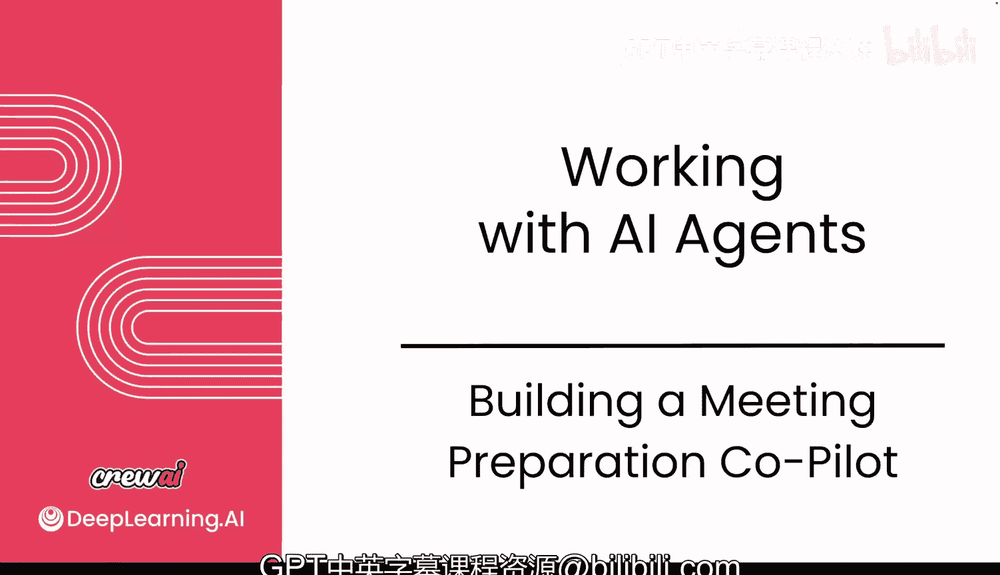
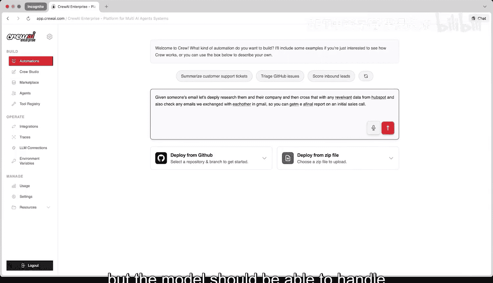
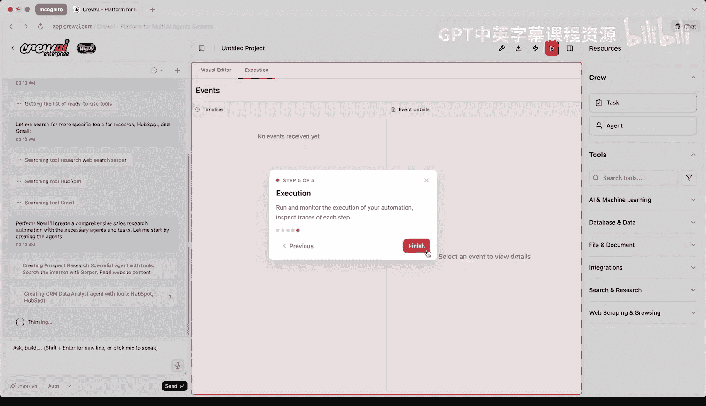
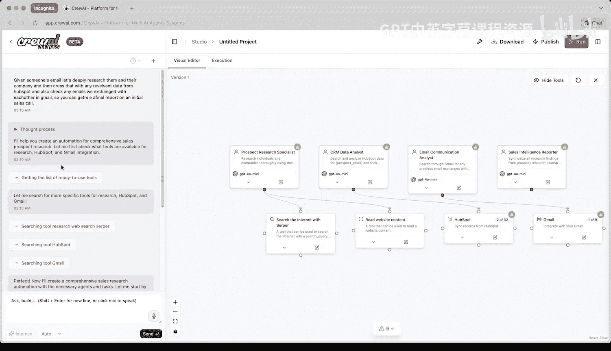
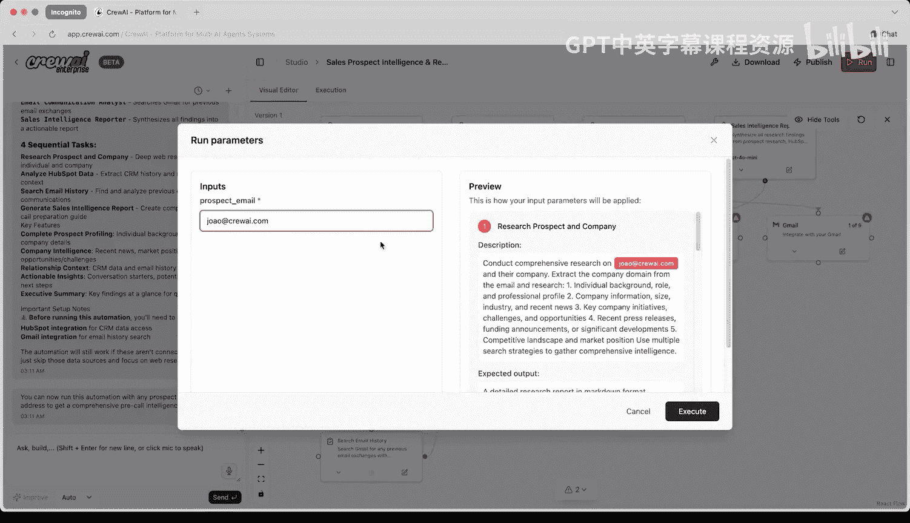
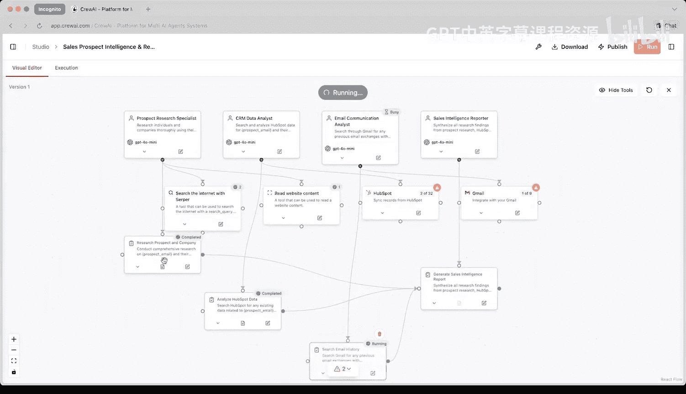
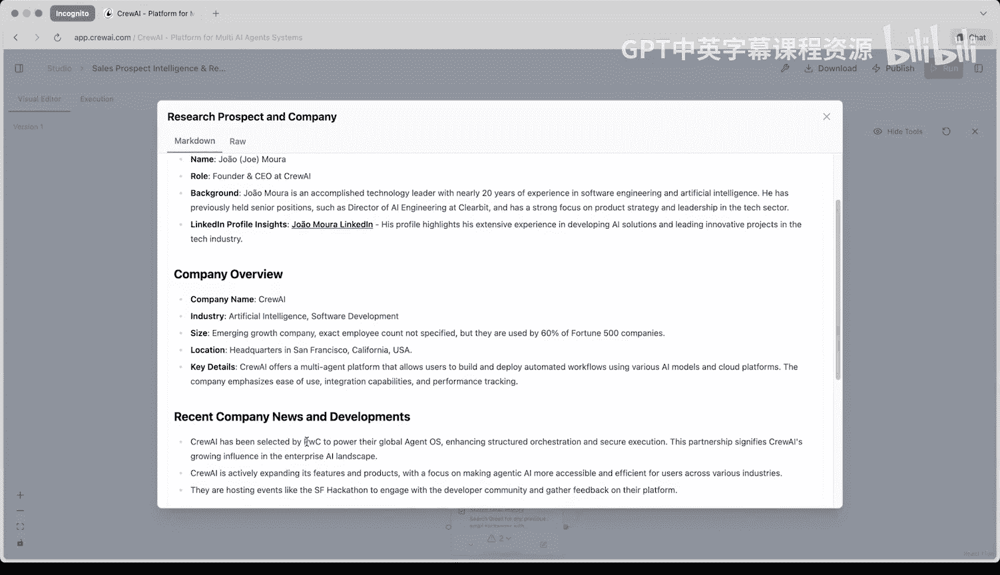
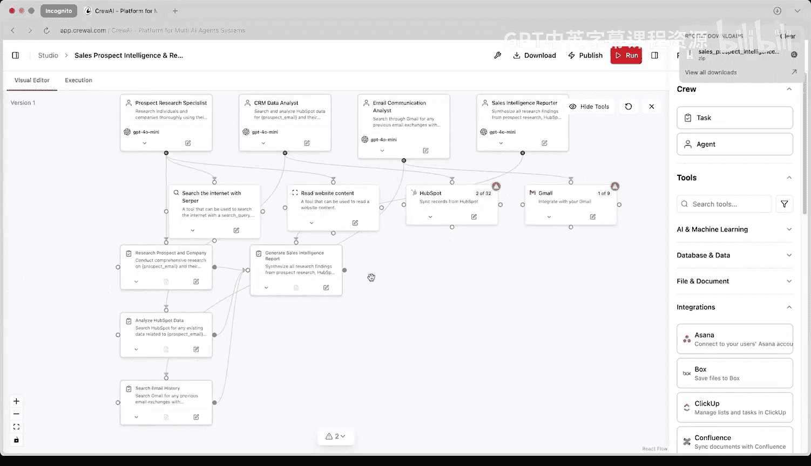

# 吴恩达《使用 CrewAI 设计、开发与部署多智能体系统｜Design, Develop, and Deploy Multi-Agent Systems》 - P21：9.building-a-no-code-agent.zh_en - GPT中英字幕课程资源 - BV12eCQBAECM

I'm so excited about this video because in this video， we're going take a huge leap。

 We're going to go from code to no code。 We're going to be able to build agents by just prompting our weight into that。

 And that's going to be very exciting because one thing that you're going to learn is that it doesn't need to be one or the other。

 You can do both。 You can start by using no code and prompting your way into a use case。

 and eventually you can export that as code and keep changing it in Python。😊。

So this is very exciting because allow you to use the same open source library in two different new ways。

 Let's jump in straight into our platform to build this live。 And at the end。

 we're gonna to download our code so that we can learn how we can keep modifying it even further to make it even more complete。

 But it is gonna make a huge difference on how fast you can move and how easy you can get from0 to one and to the value that you're trying to get。

 So let's go into that right now。 let me cut straight to the chase and we can jump into our platform to boot it live。

 And this is completely free。 And I hope you have a blast with that。 And at the end。

 we're gonna make sure that we download the code so that you can also keep modifying it via code if you want as well。

 So let's start building it live。😊，Alright， so all you got to do is going to app query do com。

 And this is exactly the first screen that you w to see。

 And you can click on sign up here to create a new account where you can put your name in your email as well。

 instead you have query your account。 This is the first thing that you're gonna see。 And in here。

 you can already start building or use case But just literally chatting with it。

 So let's try to do a simple one just so we understand how capablepo is the system。

 I'm going do something that it's very useful for many sales teams out there。

 And that any company could benefit from。 It's kind of like preparing for sales or a premeeting use case。

 It's not the most complex use case out there。 But I think it's easy enough that we understand it and helps to showcase how powerful this can be。

 So let me just type it out。 And the prompt that I'm gonna be using here is given someone's email。😊。

Let's deeply research them in their company and then cross that with any relevant data from Hbspot and also check any emails。

 we exchange it with each other in Gmail so you can get me a final report on an initial sales call。

 again， there's quite a few typos in there。 but the model should be able to handle it。

 So I'm just going press enter Now you get into a studio and we can follow the tutorial a little bit so that you can understand more what we're seeing here。

 There is a chat on the left that allows you to chat your way into an automation on the right。

 you can drag and drop some of these components as well。 So if youre want to build yourself。

 you can always do that And on the top you get the ability to run this automations or even watching some of the logs。

Now， if you look what is happening in here and we can close the tab just to make it easier。

 you can see that the agent has already started to work and is already creating all the different agents for us with all the different tools。

 So this first agent can search the Internet and read website content。

 the second one can research hubbspot。 This third one can look at Gmailo。

 Then you can see that all that is already build out for me。 This is a brand new account。

 I didn't have to do any custom setup。 Now， yes， Hubpot and Gmail。

 we require me to authenticate with them。 So I can just click in here and take care of that。

 But that's roughly how easy it is to build some of these automations nowadays。

And now it's basically going over and making sure that everything works validating for you。

 creating a proper name and making sure that this is good to go。

 We do see that we are missing some of the integrations right here。

 but we have a suggestion stamp to run the automation itself and we can click on this one It's gonna to basically ask who is this email for the sake of like just entertaining。

 even though I haven't connected my Gmail or hububpot， I will tap my email。

 So like I was supposed to be meeting with myself and we can see the first agent and collect the work that it's doing on that way。

Now， if you want to， you can just sit in here and see some of these tasks progress。

 and you can see that in a second。 this is going to show that this first task and agents now busy and running。

 But a more interesting sitting in here is you can go into executions。

 and now you can have all the individual traces of everything that is going on for every single one call。

 you can see all the inner prompts of what is happening in there。

 you can see the raw data behind those。 you can see the tools usage and you can see all the results that are coming from that。

 and even the websites that it's scraping all the way to its final answer and just keep moving on。

If you go back to the visual editor， you can also click in here to see a final task output where you can see that a research at me it found that I'm the founder and CEO or crewi found a bunch of information around my background LinkedIn profile and many information about the company as well including recent development including a partnership that we have with Pwc and many more。

 So this is fairly interesting。 And now you can see how easy it was for us to put something like this together and you can do so much more。

 This is just scratching the surface of the kind of automation that you can do。

 keep in mind that again， you're not limited to chatting alone。

 you can always drag and drop your own custom agents tasks and also tools yourself and connect them in any way that you would like So I would definitely recommend you to check this out because this can be extremely easy to set things up in another coofing。

😊。

About it is assuming that you have everything set up just right， you can always download this back。

 So if I basically remove some of those things that are not supposed to be here， for example。

 this agent that is not connected to anything and also the tool that is not connected to anything in here I now can just download this entire thing as a code so by clicking the download button in here。

 I get a zip fly with the entire code so I can keep modifying so this is actually a super powerful to not only because it allows nontechnical people and engineers to build automations。

 but because it helps engineers to build faster and get to value faster because now you don't need to do other bother plating and you can basically fast track into any MVP that you can then improve further Allright I leave at that because I want to make sure that we keep going there's so much more that we want to cover。

If you want to try studio， you can go into app。que。

com and I see you in the next lesson in just a second。

