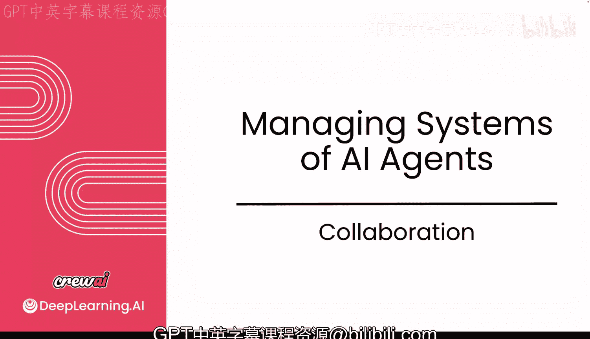
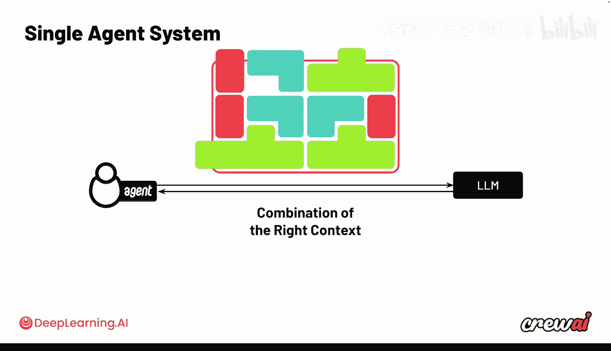
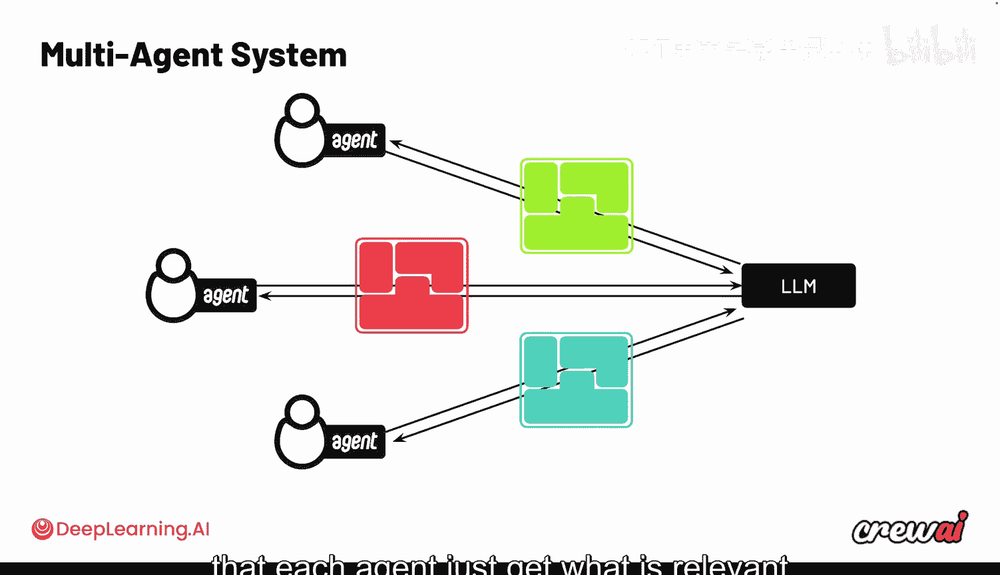
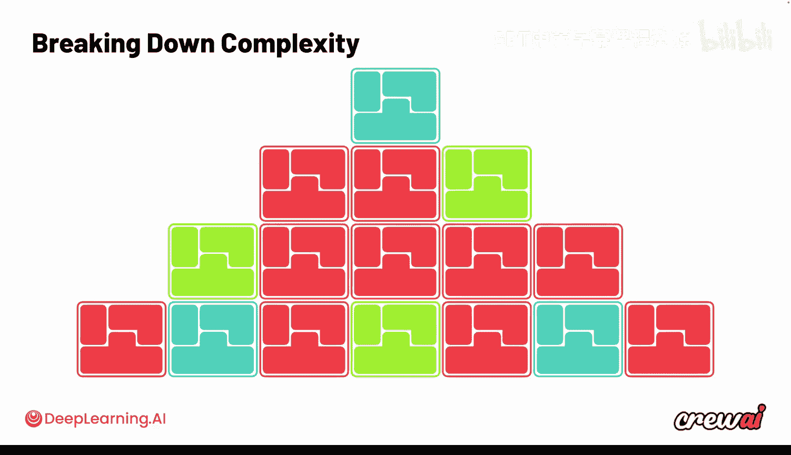
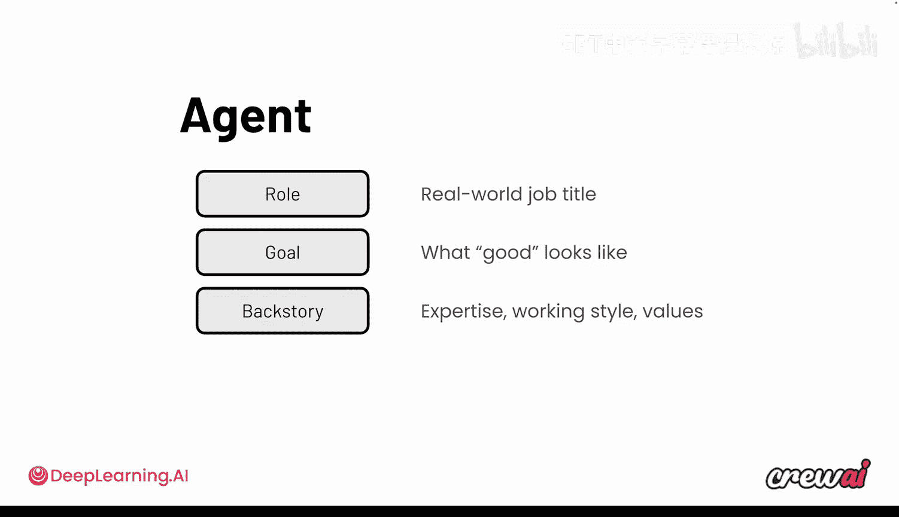
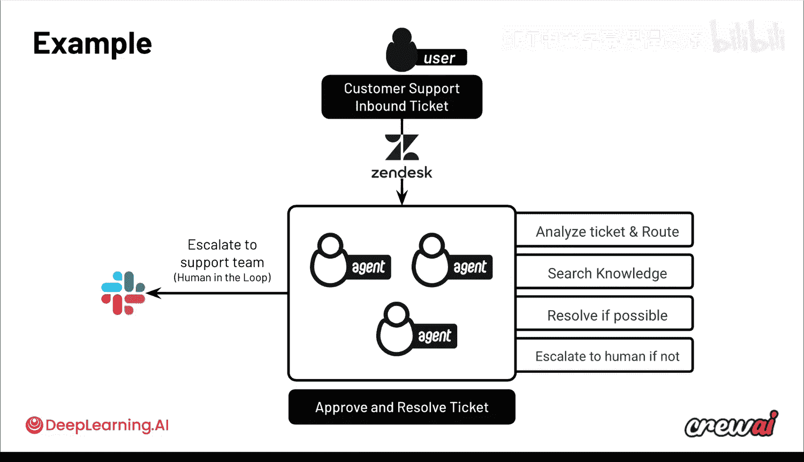
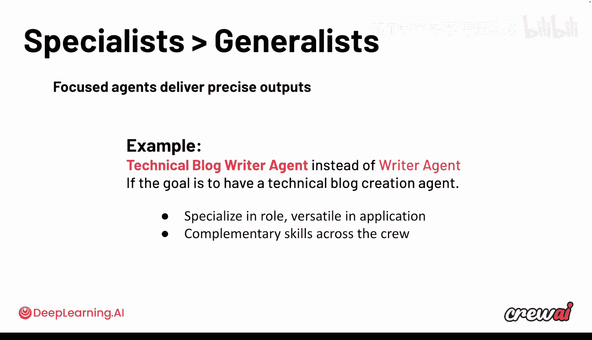
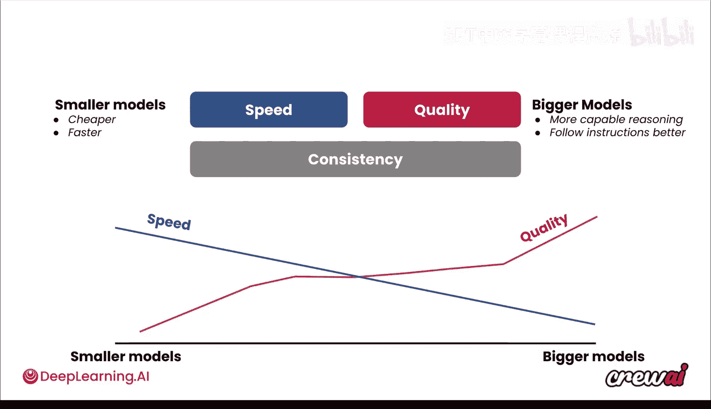

# 吴恩达《使用 CrewAI 设计、开发与部署多智能体系统｜Design, Develop, and Deploy Multi-Agent Systems》 - P22：1.collaboration.zh_en - GPT中英字幕课程资源 - BV12eCQBAECM

Welcome to Mo3。 Congratulations on making this far。

 There is so much that you probably learned after this point。 Now we're gonna to go even deeper。

 You already have noticed how you can break things into different agents and different tasks。

 But there's different ways that you get to control on how they collaborate and how they work together。

 let's look into that。 We already have talked about this idea that each agent basically talking with its own LLM or using an LM behind the scenes。

 So all the different pieces， for example， the system prompts。 the row definitions， the chat history。

 All the data， every LM requests is being optimized for the right mix of context that fits both the agent and the module itself。

 Everything would fit into a nice little package that basically makes a request。 Now。

 as the agent keeps working on things。 the context starts to grow。 So the scope starts to grow。

 And you want to do more things。 So you might start adding more tools and give it more complex。😊。

Tasks and that starts to increase the amount of options and ideas and past conversations that the LLms has access to。

 And all that at some point will break the barrier of the context of the LLM。

 but not only the context itself， but it's going to start to result on the graded performance Some of the nester information might not fit into the LM context。

 Meanwhile， more and more irrelevant information is being included。

 the agents start to grow out of scope and that looseination start to happen。

 So it becomes hard for the agent to decide water toolss to use when So the big picture here is that as you expand an agent's role。

 you might end up reducing the output quality due to just less precise context control。

 So there's a right combination instead of having one agent do so many things。

 so many different tasks， you actually have each agent do its own task with its own context。

 its own system prompt and its own row plain。😊。

By having mopo specialized agents instead of a one out purposepose agent。

 you end up breaking down the context so that each agent just get what is relevant for its purpose and for its go。

 sum of that results we gonna to be way better than having one single agent that does it all。

 So if you put all of those outputs together。 you will get a super high quality output that haven't been possible before。

 I do want to make sure that a drive a point here， though， that the backhand of your gen system。

 and the fact that this is broken down on moy agents doesn't necessarily mean that the user experience needs to be the same。

 the user experience might still be a conversation of Ui where it's talking with only one single agent。

 But behind the scenes， there is gonna to be many agents there are going be actually getting the work done。

 So if you remember the way that we create agents in grayi will always have these three pieces。

 And the idea here is that you are helping these agent。

Doff this persona by providing them very high quality input。

 So if we look back at our example of the classical customer support use case。

 those agents will be specialize into analyzing the tickets and serving knowledge and trying to resolve the tickets themselves if possible。

 So， for example， one of these agents could be an engineer agent that tries to write code to fix the issue if it's a bug。

 you can actually achieve some amazing results by just making sure that you clearly define the agents in what are their single purpose。

 If I had to summarize this in one single sentence。 I would say favor specialists over generalists。

 Focus agents deliver more precise output。 The good example here is that you should name your agent a technical blog writer agent instead of a writer agent。

 for example， if they go is to have a technical blog creation agent。

 So you can see that yourre specialize here in the role but you' are keeping versatile。😊。

The application across the crew， you have component excuse that will overall create a very high quality output on all dimensions。

 And it's not only that there is another moving piece that you can choose that will customize your agent。

 And this idea of an L M， the model that your agents using。 And in here。

 you not only get the ability to choose the role， the go and the backstory。

 but you will also get the ability to choose what model each agent will use。 So if you find。

 for example， that claw does a better job writing technical blogs than G40。

 you can actually specify that that agent specifically will use that model。

 So depending on what kind of role and go each agent has。

 you might also want to choose the best LM for that agent。

 you're trying to balance the speed and quality。 like is smaller models are going to be cheaper and faster。

 So they will excel when you need speed， but a bigger models will have more。😊。

Capable reasoning and they will follow instructions better。

 Usually we will also have bigger context windows。 So when quality matters to you。

 you might want to choose that in your crews might have a mix of agents that use the different models and that's really one of the advantages of using crew Ai。

 you will see this coming up on how to experimenting with these different Lms。

 But in the end of the day， you're always trying to make sure that regardless you want to get consistency。

 you want to make sure that you get a reliable repeatable results。 and you order to do that。

 you will need to plot it out and understanding what is the right balance between quality speed that it gives you the right results that you want。

 So if you're working with customer reviews and you want to write a response to your customers after you routed the issue to the right place you might choose a bigger model to get a really good response right。

 Or if you're working on stock analysis and might choose a smaller model to research and that web pages and pull out the right figures but a bigger。

To work on the trading strategy。 So we have talked about so much in this lesson。

 we talked about this idea of breaking down the work into multiple agents and multiple tasks。

 And now that can leads you to even better results than having one single agent。

 We talk about how you can optimize not only the role that go in the backstory。

 but even the other limb that you're going be using and that by using multiple providers。

 you can get a better result。 So in the next video。

 you will see the many different communication patterns that you can set up for your agents。

 This is going to be a very interesting one。 it's going to probably unlock even more use cases for you。

 So I assume there right now。

