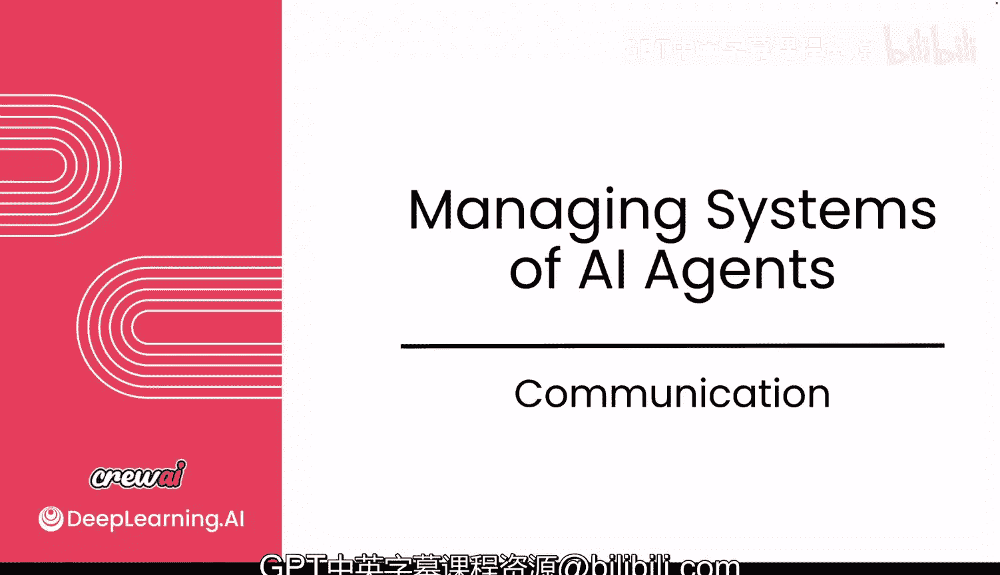
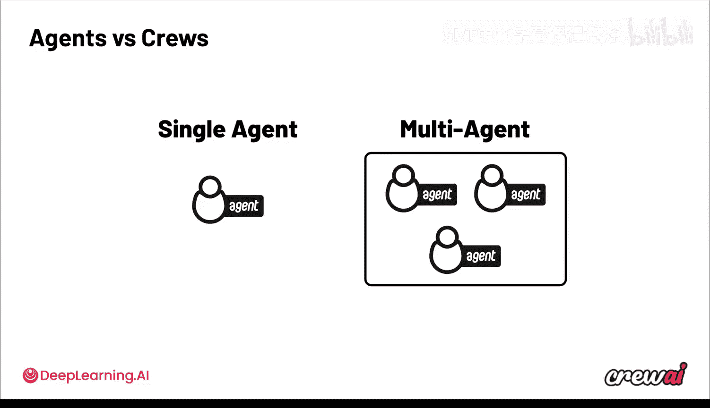
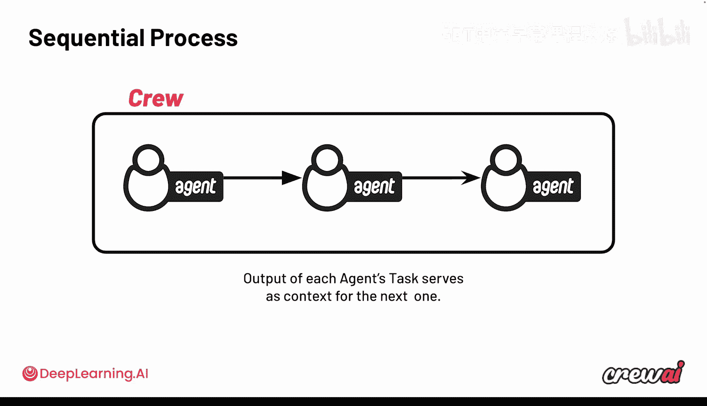
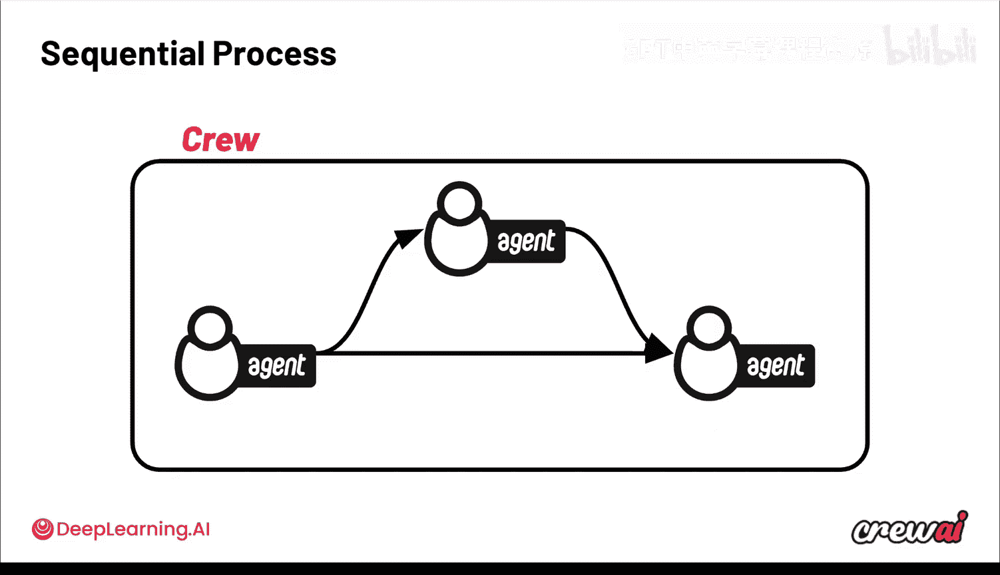
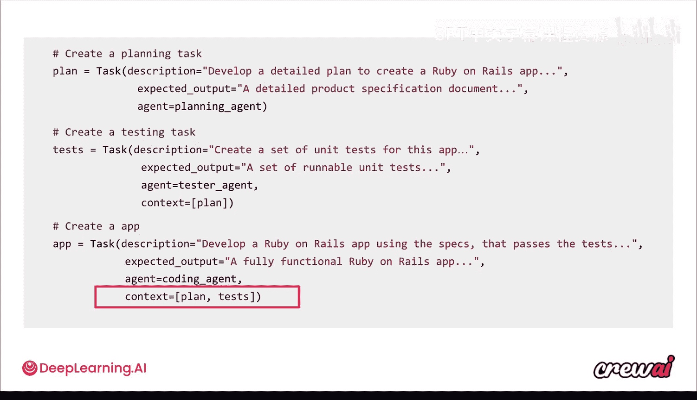
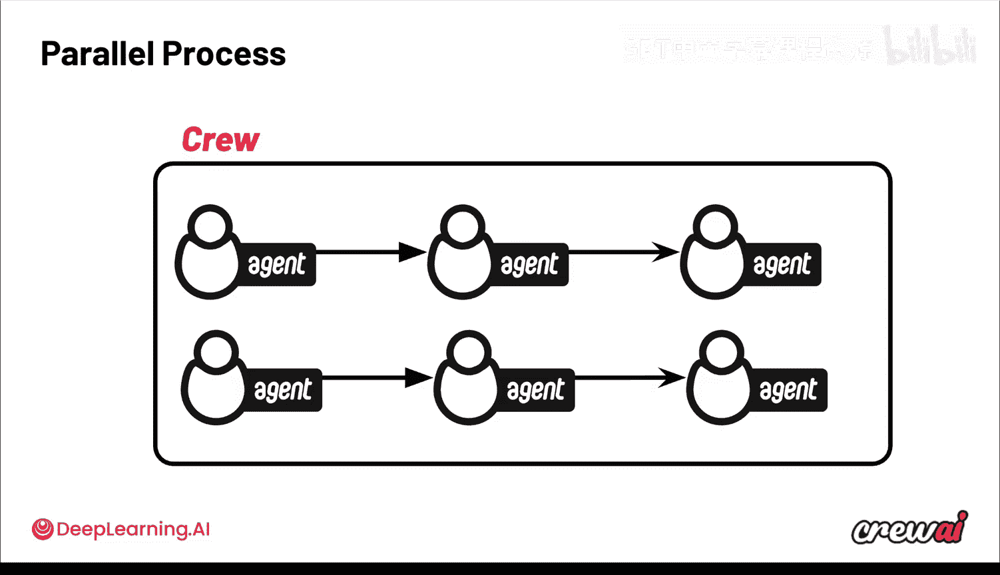
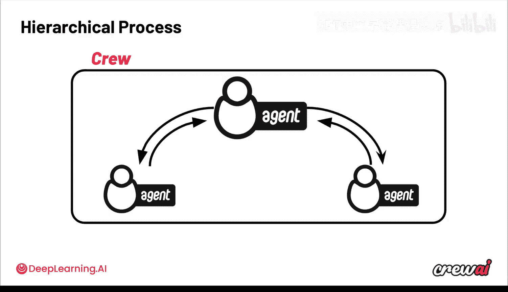
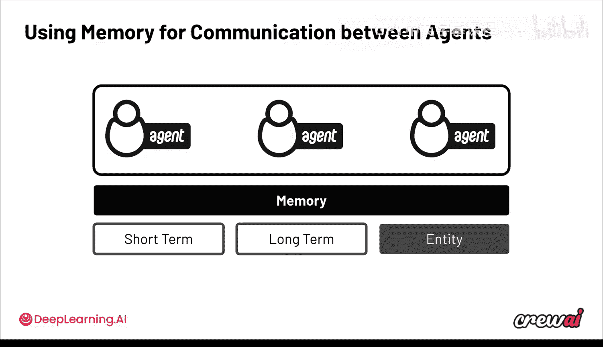
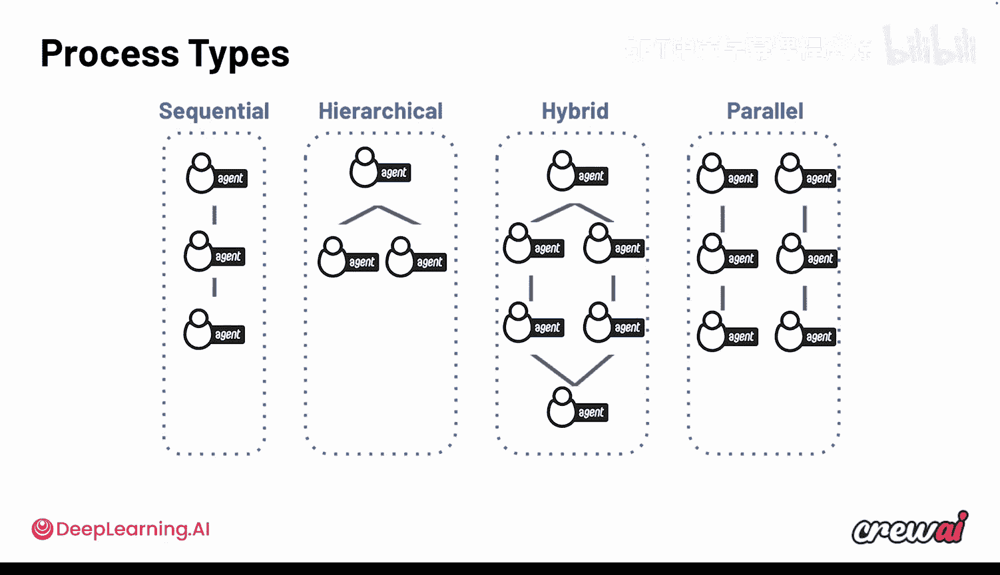

# 吴恩达《使用 CrewAI 设计、开发与部署多智能体系统｜Design, Develop, and Deploy Multi-Agent Systems》 - P23：2.communication.zh_en - GPT中英字幕课程资源 - BV12eCQBAECM

Now that we learned about collaboration， let's talk about communication。

 And what I mean by that is there is no one size fits all for moy agent systems as any technical ecosystem out there。

 It takes you to really think about the architecture。 This is going to be very exciting。

 So let's jump right into that。 So you already have seen how much you can be single agent or even with moy agents and we talk about how much control you have when you're trying to set all the different aspects of these agents and even one of the limbs they're going to be using。

 But one challenge with the moyag systems is that you have to define on how they will collaborate with each other。

 and that can really get interesting。 Now， if you look what are the full behavior and pre is that the agents will work in a sequentially manner。

 And that means that you define your agents and the task will define what orders things are going to be processed。

 a good example here might be stock trading analysis where you have an initial agent picking up a stock。

 A second agent that is then given that a pick is doing a deep research。😊。

Extracting a bunch of information and then a final agent that is putting a report together。

 So in this case， one task's output feeds into the next task that is going on。

 So in addition to the sequential flow， you can also enable this agent to delegate work among themselves and ask questions to each other。

 So if at any point in time， for example， the last reporting agent has a question about why was the sticker actually picked it can ask back to the initial agent。

 why there was the reason around that。 Now， the idea here is that through all this execution。

 Each agent's task service context for the next one。

 So it means that it's going be injected into the pro that goes into the next agent。 Now。

 sometimes you want to have a little more control than that and you want to make sure that you're feeding one task and one agent with the outputs off many different tasks and here it would be a good example for that the coding crew。

 So these are agents that are meant to be creating software。 So you might have an initial。

Plener agent and a tasker agent and then a coder agent So the planner will think about the spec and how it can actually achieve that final goal and the tasker agent will then takes that plan and use that to write some series of unit tasks but the codeder is the agent that is actually getting a lot of this work done。

 but it needs access to both the plan itself and the tasks and the cool thing about this is that this is extremely easy to do in careeri as you can see if you have a plan task and you have a task task that also has its own description and expected output。

 you can see that for the task task， we're being a little more verbose than necessary and just indicating that the context for this task is the output of the plan task and that is that the full behavior in careeri。

 But then you can also get this final task that is creating the app and this final task is now bringing together there is。

Results of both of those tasks， both the plan and the testing。 and you can pinpoint that。

 But the final context argument in there。 Now， sequential is just the tip of the iceberg。

 There's so many more other processes。 Para processing is another option in here。 Of course。

 you don't need to stick with sequential for other use cases。 So in parallel。

 you might have many agents that are working at the same time doing their own task。

 So they might pass task results among themselves as they progress through。

 but the idea here is that they have the ability to get work done in parallel。

 So reduces the latency drastically and how fast you can get your final output。

 You can also use a hierarchical process where you have one single agent that is delegating work to others。

 and you have this kind of manage agent that will not only delegate work。

 but we will also review the work once it's done。 So this first agent is basically the boss off this other agents and deciding who does one。

And check the output to make sure that it's up to par and ask them to do better in case it's not。

 This strategy can increase the processing time somewhat because you have extra L calls。

 But despite of the back and forth communication by design， it's very useful。

 And if you're trying to get something a little more tricky done。 in the end of the day。

 independently of the process that you choose。 either sequential or parallel or hierarchical。

 there is always a memory layer， there is present in every crew。

 And this memory layer is composed of the three memory types that we already talk on the previous module。

 Short term， long term and the entity memory。 And I want spend some time talking about how they impact the agent communication themselves。

 The short term memory is very ephemeral。 meaning that it's cleared after every crew execution。

 The idea here is that all agents in the crew contribute to and share the same short memory storage。

 So the agents automatically。😊。

As this short memory is part of Kayis context management。

 So they know what other agents have been working on。

 And if there is any relevant information that they could use from there。

 Just keep in mind that during parallel execution， any given agent might not be done with their tasks at any given time。

 So its output might not be on the shared short term memory yet。 Now。

 think about the long term memory， this is also shared， but this is more persistent。

 agents who use memory across many different executions。

 So these agents will self critique as they go in as they finish their tasks and learn from each other mistakes。

 So if one agents makes a mistake， the other agents can also use and learn from by tapping into this long term memory。

 An empty memory work similarly where crews don't have to learn about the same objects people or places over and over again because as they do。

 they ride into that antime that they can all tap into。

So if when agent learns about a particular person that it has done research on， for example。

 other agents can see that and won't ask it to research that person again if they can just retrieve it from the entity memory。

 I do want to highlight that among the communication patterns。

 there are some common coordination issues that you should be watching for when building our own use cases。

 And there is basically a couple that we see quite a lot。 One is doing redundant work。

 where agents overlap and perform the same tasks or very similar tasks using the same tools and running the same searchings。

 leading to a lot of inefficciience。 So if the agents are staping each other to。

 you should tie the scope of each task so they don't overlap。

 And you can also try starting with a parallel process and then moving into complexity to a hierarchicalical when needed。

 but I definitely have seen the sequential process get most of the work done。

 Another issue arises when you。

Have a very low series of chains of these high latency step by step decision makings。

 This often happens when you add more agents and tasks without distinguishing what can run concurrently versus what can run sequentially。

 which slows down the whole automation process。 and that's because theyre making our agents depend on tasks they're happening earlier when they might not even necessarily need the results of those tasks to do their jobs。

 So to avoid this make sure that you identify the tasks that can run asynchronously and mark them with the sync execution equals true。

 and that will make sure that all those executions are done in parallel。

 And if you want to refer back to those tasks outputs you can then use the context argument as we saw early to basically bring that context into the different tasks。

 Now， let's zoom out for it second。 you really have so many options。 We talking about sequential。

 We' talking about hierarchical。 you talking about more of a hybrid poetry。

one agent sending tasks to many agents。 And then the context is bringing that back into one single agent。

 we talking about a synchronous execution by doing these things in parallel。

 There's just a lot of things going on in there。 So there are really so many different ways you can piece together the systems and allows you to define not only how your agents work together。

 but how much information they exchange with each other So they have a really graler control over the context that each agent has for completing its own task。

 in the next one， to have something very exciting to share because we're going implement some of these new coordination patterns using the cri。

 What is one of my favorite tools， by the way。 So I'm extremely excited about that one。

 And Im a assuminging there right now。😊。

