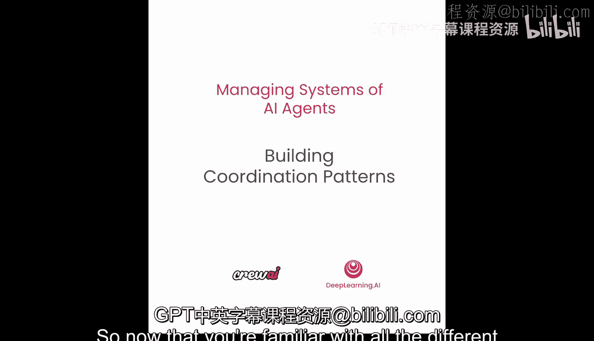
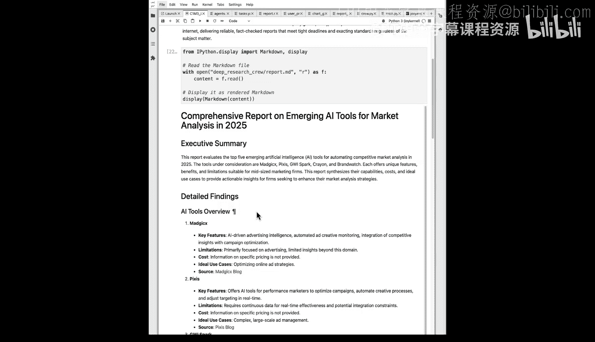

# 吴恩达《使用 CrewAI 设计、开发与部署多智能体系统｜Design, Develop, and Deploy Multi-Agent Systems》 - P24：3.building-coordination-patterns.zh_en - GPT中英字幕课程资源 - BV12eCQBAECM

So now that you're familiar with all the different ways to collaborate and communicate and all the different ways that these agents get to work together。

 let's put that to the test， let's make sure that we add that into an actual use case that is applying what we learned in the real world so let's dive into the code for this one。

Alright， so for this Juter notebook， things are going to take a big step First thing is we're going be moving from a sequential process into a more of a hybrid process。

 The idea here is that we're going to change some of the way that the crew and the agents and the tasks get done。

 And then we're going to move into the actual research where we have the same agent doing two different tasks asynchronously。

 One task is researching the main topic and the other task is researching the secondary topic。

 And this is very interesting because it highlights how you can use one single agent to do many tasks。

 and also how that one single agent can do those tasks in parallel。 From that point on。

 Then we go into this fact checker where we're going to do the same thing。

 One single agent are going to be fact checking both research at the same point and all that eventually will be funneled in into one final agent that we will do the final report writing。

 We're going to keep most of the things that we have learned up to this point， including。😊。

the guard ray on the custom to。 we are gonna drop our callback though to use a proper file output setting that basically allow us to just save this file。

 We felt necessarily having a callback for that。 Now， for this notebook。

 we're gonna try something different。 We're gonna move into this new CI approach to make sure that we're creating the entire structure for us from the gago。

 So you don't need to run this right now on your Jupyter notebook because that folder is already set up for you。

 But in this case， I'm just gonna create from the scratch。

 And all that I got to do is create I create。😊，Creew in the name of our crew。 In our case。

 gonna be deep research crew。 And if you run this， you can see how crew。

 I will guide you to a series of options to make sure that it sets up the entire scaffold for you。

 So it's gonna ask you things， for example， what are the models that you want to use and you can pick and choose So in this case。

 I'm going to say open AI to keep things simple。 and it's gonna to ask you what models you want to use。

 I'm gonna say GP or O。 and it might ask you for the API key right away。 or in this case。

 I'm just gonna skip。 and you can see that it creates all the structure for you。 matter of fact。

 if I go into this folder。 I can actually just see that entire fold structure right there。

 So you can see that we have a knowledge folder that we have a source folder that we have a task folder that we have a pi project file to control all of our dependencies And even if I plot the content off or SRC folder you can see that we have our deep research crew writing there。

 inside of it， we're gonna have our crew file and also a couple。😊。

Folders a config folder in a tools folder。 So in here you can see that entire thing was set up for you。

 So in config， you can actually set up all your emls for tasks and agents in tools。

 you can actually set up any custom tools that you might want to have and we're gonna bring or chart generator tool into this。

 and in the actual crew file is where we're gonna see our crew code basically importing those different Yal files。

 creating the agents， the tasks， the crew。 Now， let's go into the Jupyter notebook。

 So now if I go into the folder here on the left， you can actually see that entire structure that we're looking into first thing that we want to do is make sure that we're creating our agents and tasks。

 So we can go into the config folder and open up our agencyl you will see that query I create some preliminary agents but we can actually come in here and update this to be the actual agents and tasks that we want。

 So let's bring that back for more previous agents and tasks。 So I just paste or。😊。

Yal in here and you can see that we have a research planner。 we have our top researcher。

 We have our fact checker and we have a report writer。

 Now let's make sure to do the same thing for the tasks。

 if I hope our task Yal file you will see some bother play tasks that got a creative for us as well。

 Now I just paste our tasks in here and our tasks change a little bit。

 if you look into this we still have the creative research plan but the prompts change a little bit。

 So it now has two topics， a main topic and a secondary topics。

 Then that goes into two different tasks。 One task about researching these main topics and another one about researching the secondary topics。

 but if you look into this you can the same agent the top researcher is doing both of those another interesting thing to point out is how we are using the new context attribute。

 and now both tasks， the research main topics and the research secondary topics are working off the same creative research plan。

 So those two。Tasks will be processed synchronously and you will see how to set that up later on our crew Pfi。

 Now that we have our agents and tasks， let's go into using some of the knowledge to pre feed information for this agents around some of our preferences so that they know this from the gaiggo。

So if we go back into a deep research crew folder， you now see there is a knowledge folder。

 And in there you're gonna to find user preferences。 you can throw any sort of information in here。

 your internal policies， things that it should be aware about across any executions that they do。

 So for our use case， we're mentioning a name being Joe Do that the user is an AI engineer that the user is interested in our agents and the user is based in San Francisco。

 California。 This will actually be used for your agents across the entire execution of our tasks。

 Let's go back into our tools because we want to make sure that we convert our custom to file into our previous charge generating custom2。

 Now， if we go back into our main folder， we can actually go back into SRC and deep research crew。

 and we're gonna find that tools folder where we have a custom2 file that was created for us。 Now。

 let me make sure that we copy our previous charge generation2 into this。

So that we have that ready to go for a specific agents。And there you have it。

 We can rename this file as well to charge generator tool or pi。

 And now we have our tool ready to go and we can actually use that into our agents as well。

 But then we come ahead and just create a new guardrails folder right in here and we use that to restore our guardraos code。

 So I'm just going to create this guardrailos folder。 And inside this。

 I're going to create a new report guardra file for now。😊，So that I create a report guardra file。

 We can throw a guard radio code right here。 The same guardrail that we had before that is checking all those different topics are actually crzen on the final report。

 And we can just save this file。 We should be good to jump into our crew。

 You can see on how we're moving from just having everything throwing one single jter notebook to have more of a structure。

 So let's go into that crew dot pi file to make sure that everything is set up for you。

 So now that we copy and paste or version of the crew in here。

 you probably can tell that we're using decorators uses this decorators to make your life easier。

 So you can see that crew base actually annotate our entire crew class。

 And as you define your agents， you can annotate them with this ad agent annotation。

 And because of that， you don't need to worry about loading those Yal files。

 You can just reference them by doing self agents config your agents get all the settings that they need。

 Theyre also setting up a lot of his model。😊，FindDe in here so that you can play with that later。

 For example， you can see that all our agents are using G40 and you can update this to use other open AI models if you wanted for now。

 or if you're ready these on their own computer， you can actually updated to use any other models from any other providers。

 In matter of fact， why don't we do that。 Why don't we make sure that our researcher planner use G40 mini So it's execute faster and the actual researcher and fact checker can use G40 the same way that they report writer we are importing or charge generator to here on top and making sure that we assign data to our report writer agent right here。

 If you keep going down the script， you're going see that we're also creating our tasks in a very similar way。

 decorating them with this task annotation。 And this allows us again to tap into that task Ya content without even worry about how we load this。

 I do want to point out that we're using a synchronous execution here on the main and second。

Tpics research。 So the first two research are going to execute at the same time。

 And then as they are done， the both validations are going to execute because they got the previous tasks done in our final task as we define the tasks Ymo file。

 we reach for the two validations to be done before it actually gets to write the final report。

 It is still going to be using our same report guard rail。

 Theyre actually loading all the way in the top in here。

All that is leftrs do is bring it all together in one single crew。

 And you can see that the crews annotated with this crew decorator because we use the decorator。

 all we' going to do is use self dot agents and self dot tasks。 We're still using memory。

 In this case， we' are doing a sequential process。 But because we have that a sync execution。

 It's going be more of an hybrid approach。 We are dis tracing for now。

 Don't worry that we're going to talk about tracing future lessons。 So we're going get into that。

 And you're probably notice that we drop that after hook in favor of this output file attribute。

 Every task can optionally have this output file and our entire configurations around the hundred lines of code by basically leveraging all the different files that we have and everything is super organized in their own spot。

 Let's also make sure that we're using our knowledge。 and you are to do that。

 We can actually import this knowledge tax file knowledge source here。😊。

So we can just add knowledge slash user preference to make sure that loading that data that we care about into the agent。

 it automatically looks into that knowledge folder。 So all we' going to do is just the file name。

And the input is going to be the same one that we used at last time。

 where we're basically researching the top five emerging AI tools for automating competitive market analysis。

 So now we can just jump into the terminal and run this crew so that you can check the actual result。

All we going to do is query AI run and that will automatically trigger the whole thing for us。

 So let's take along。So you can see how our creative researcher plan is actually going on and doing the entire thing。

 From this point on， we should have two tasks being kicked off。

 when there' is going to be researching the main topic。

 another one' is going to be researching the secondary topic And now we have two tasks running in parallel。

 the research main topics and research secondary topics， both being executed as synchronously。

 So they get that job done。 and that will take us them into the validation piece and eventually the reporting。

 or research secondary topics got done first， that task is completed。

 And now the research main topics， the one that is missing。 So once that is done。

 then the validation starts and eventually we got for final report。Alright， as you can tell。

 as this editor are being executed， you can see here for our research plan。

 it already looks into that knowledge that we provided。 Now。

 let's dig along through the entire execution and just make sure that we get an amazing result。😊。

Let's actually go into a Jupyter notebook to render this markeddown so that we can actually see what that looks like。

 So now that we're back in the Jupyter notebook。 we can just plot that report for us to see what that actually will look like。

 and there we have it， we have our entire report in here for us going over the detailed findings talking about everything linking to the actual sources where it found that information and even another plot that we have in here。

 again， as we keep adding more things， especially now that become aware of this structure。

 we can start do more things around the knowledge and the preference。

 we can start to do training and testing and we can start to move into more complex use cases and also a more complex structure and how we get this report done。

 I would invite you to come in here and maybe do some cri testing or cri training on your own terminal to see if you can get this report better or in a different way。

 So make sure to go for it and don't be afraid。 I're not gonna to break anything。 if anything。

 you might。😊，got a few interesting results。 So we covered a lot of the different processes types and how you can connect and this string as agents together。

 But I want to talk about the patterns for agents to talk with external agents。

 And there's one particular protocol that has come up recently that is gaining a lot of traction。

 And that is a2 a。 you don't want to be some that。 So let's go into that one next。😊。

