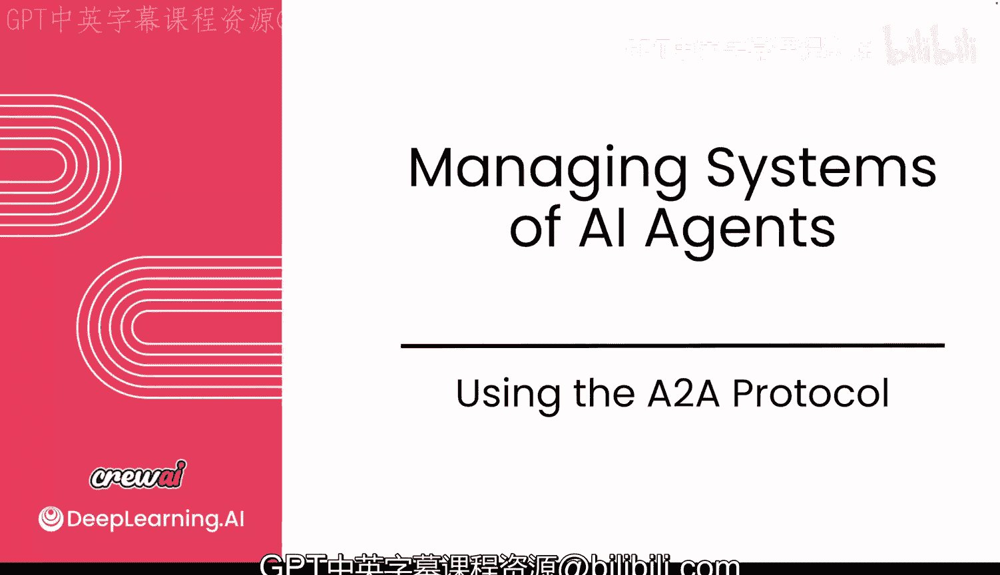
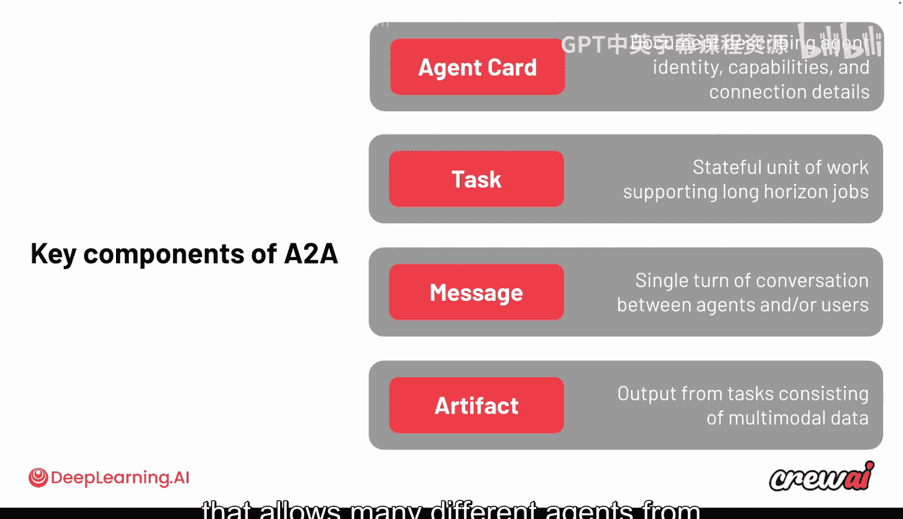
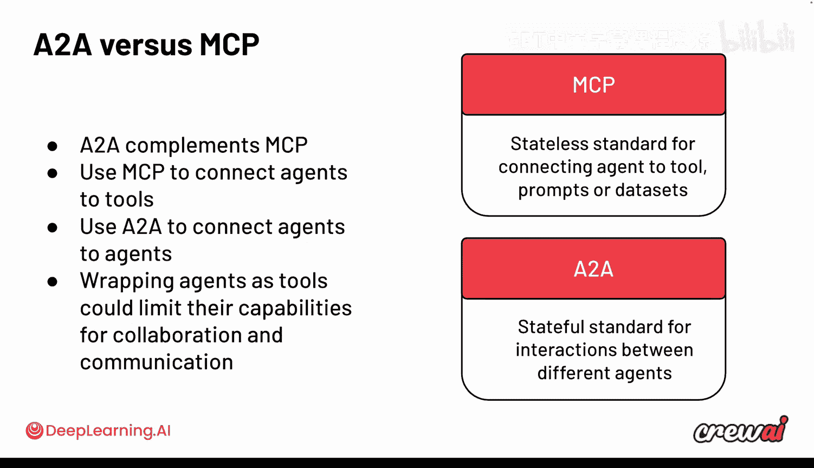
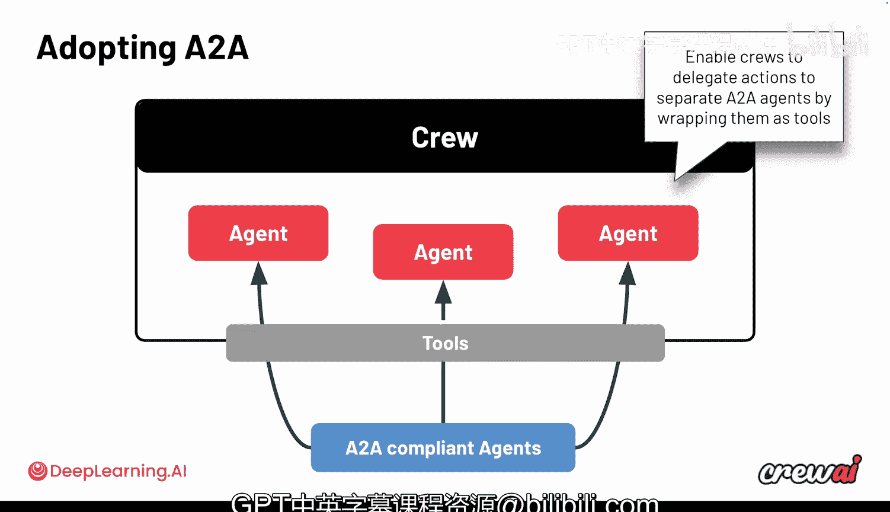

# 吴恩达《使用 CrewAI 设计、开发与部署多智能体系统｜Design, Develop, and Deploy Multi-Agent Systems》 - P25：4.using-the-a2a-protocol.zh_en - GPT中英字幕课程资源 - BV12eCQBAECM

Now， there's a lot of agents being viewed across the world。 A lot of them are already online。

 and sometimes you need your agents to collaborate with other agents in the web。

 and H2 A is a protocol that has been getting a lot of traction and many people are starting using it。

 So let's take a look into that。 So as we talk about protocols before。 When we discuss MCps。

 There is a new protocol that is coming up to allow agents to talk to other agents。

 And that's important because we're talking about agents communication。 with MCP。

 you give your agents the ability to call external tools。 And with H2 A。

 you're giving your agents the ability to call external agents。

 This is a brand new protocol that has not been around for long。

 but is starting to get some traction。 and it's already supported by crew I and many other frameworks and vendors as well。

 is an open standard the same way that MCps And it tries to anchor itself around a few different key principles。

 Basically， the idea of making things extremely simple using。

Same idea of G RRPC and SSE as MCP did。 And it tries to make sure that it follows strict guidelines for off security and monitoring。

 The idea here is that you can have this executions happen and have this agent exchanged messages with each other。

 but not only giving them tasks， but also messages and artifacts。

 So if you look at individual components of a to a。

 you're gonna to find that it's all about this main pieces。 an agent card。

 And the idea here is basically identify the agent its capabilities。

 what it's able to do Any requirements that it might have。

 for the task side is very similar to the way that we have tasks in crew。

 It's a stateful unit of work where you're delegating something that you expect this agent to do。

 The message is the interaction between this agents as they talk with each other in the artifact is the actual tangible output that was generated as a by product of the task。

You can already see how it maps toward lot of the things that we talk the inquiry AI up to this point。

 and that justifies a lot of the traction that this H2A protocol has been getting。

 The ability that creates this common layer that allows many different agents from different technologies to talk to each other。

 So I do want to make sure that I drive the difference here between MCP and H28 with MCP。

 you're allowing your LLms or agents to connect to this external tools and stateless data sets。

 for example， prompts and such。 And with H2A， what you're getting more is actually having one agent to trigger another agent so they can not only talk to each other。

 but they can get the work done and eventually report back。

 So the key distinction here is that wrapping agents as tools fundamentally changes their capabilities。

 If you try to wrap an agent alone on MCP that doesn't necessarily explore the full extent。

To which you can actually use that agent， an H2A is more thinking from the ground up to support agents natively instead of making them as tools。

 both works， but H2s are definitely getting more traction nowadays。 Now。

 the relationship of H2A complements MCP。 So it's not like one or the other。

 you probably will find yourself using both in a few use cases depending on what kind of external integrations you have。

 So there are two integration approaches to use H2A with Ci。

 The first one is by exposing Ci agents as H2 A servers。

 So you make our crew discoverable and callllable by external agents。

 And the other ways by consuming these external H2A agents as tools。

 enabling your crew agents that tasks to this other H2A compliant agents。

 The first pattern is extremely simple。 You're basically wrapping up your crew behind an HTP interface that speaks to H2 A protocol。

 So basically having an HTP protocol。

And the architecture components are extremely straightforward is using the same ATP and Json RRPC structure that we talked about during MCP。

 The second pattern is actually allowing our agents to call remote A2A agents from your cri workflow and that allows you to do it to a custom to where you can basically call an A2 a remote server and that is extremely straightforward。

 Now， the point that I want to drive across here with A2a is that as you can see。

 the industry trying to gather together and figure it out what are the standardsers that we as an industry wantss to follow and there are many options right now It's an entire new industry and many companies and many developers and many teams are trying to figure out the most responsible and efficient way to get this agents to talk to each other and get this agents to use tools across the wire。

 What you can find an a2A is a very per protocol that has been scaling and getting adoption in order to allow agents to talk with other。

On the Internet。 It's still unclear whether there's gonna be one single protocol that's going to rule all the agents out there。

 But A2 a is definitely one example of one that is getting a lot of traction and that already integrates and works with Ci。

 And I want to make sure to highlight that。 Now， we talk a lot about a2 a in this video。

 when we learned so much about it。 And how it already works with Ci。

 You're probably already starting to think about what agents you can actually connect this into。

 And this is very exciting。 Now， I'm want to make sure that you keep engaged because in our next lesson。

 we're gonna to go even deeper into a lot of these concepts that are looking。

 I'm very excited about this。 So I want to make sure that you don't miss the next one。

 I see in there in a second。😊。

