# 吴恩达《使用 CrewAI 设计、开发与部署多智能体系统｜Design, Develop, and Deploy Multi-Agent Systems》 - P26：5.orchestrating-agents-with-flows.zh_en - GPT中英字幕课程资源 - BV12eCQBAECM

Very exciting topic now。 we're going to talk about queryI flows and agents。

 And this is important because when you go into the wild， the actual use cases。

 usually they live in the spectrum， and we're going to talk about that in a second。

 but the spectrum goes from less agency， where you want to more control into more agency where you want the agents to figure out as they go。

 But the important thing about flows here， is that it's a very thin。

 low level layer that gives you all the control that you need to decide what happens in what order。

 and then you can opt in how much agency want。 This is a very exciting topic。

 and it's going to be a huge unlock for many use cases。

 especially the use case that require more precision。 So let's look into that right now。

 So up to this point， we have been talking a lot about agents themselves。

 But there are other mental models for agenda systems General。

 AI agents are understood through three main mental models。😊。

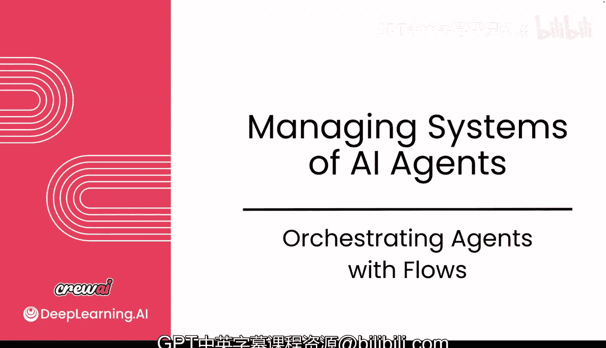

events and agents。 And up to this point， agents have been very exciting for us。

 And we have seen how powerful they can be。 Another mental model forens systems that has been picking up is the idea of graphs where they work with more traditional graph architectures like nodes and edges。

 But the adoption has been a little slower and friction has been a little higher since there are many concepts and graphs that are harder to grasp and not many people get exposed to those on a day to day basis。

 And then there is the advanced mental model that is gaining a lot of popularity。

 because it resembles more familiar pubs of patterns common on the web like most people have been developing web apps up to this point。

 So it makes a little easier for most people to grasp these concepts and get up and running and productive with that。

 independently of why the mental model that they are using。

 they all share some patterns and they all share some common ground around using the Lms and deciding when to use Lms and trying to be very marked about。

😊，Of context adding into them。 given the trends， most people in Ci in particular are focusing on the events and the agents model when implementing attic systems。

 And we have talked a lot about agents and how you can view them and crews now。

 So that has been very exciting。 I wanted to move into focusing a little more on the events based structure and how that mental model applies and how you can use that not only stand alone but with agents and with crews and how powerful that can be。

 We're seeing now millions of executions of flows a day by using this combinations of Ci flows with agents。

 So let's dive into that。😊。

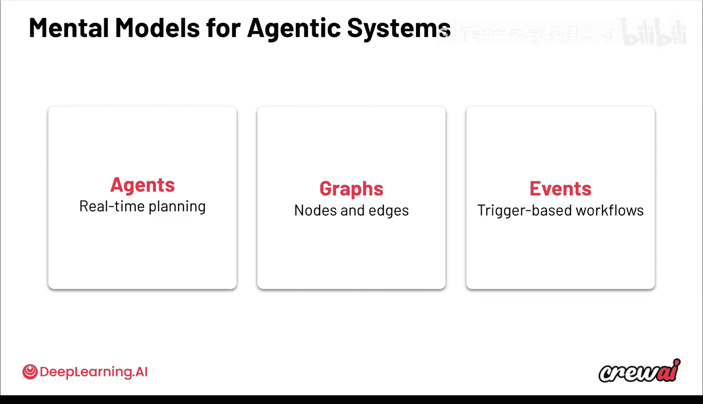

Flows are a very modelular orchestration layer。 You can think about as a backbone of what you want your agents or crews to be。

 And what that means is that allows you to define on a very low level。

 everything that you want to happen in what order。 in there is a few different pieces that you can bring into your flows。

 You can bring LMs。 you can bring regular python code。

 you can bring one single agent using memory and guardras， for example。

 or you can bring an entire crew。 So in the end of the day。

 you can bring the entire set of things that we learned up to this point inside the flow。

 and the flow will provide you with the backbone and the structure to define what is going to be executed in what order。

 you can see how powerful that can be， especially when you want to control a lot of this flows as they get more complex。

 So a good example of a flow could be something like this。

 you might have an initial code that is being executed in this code might pull data from somewhere or check a specific。

😊。

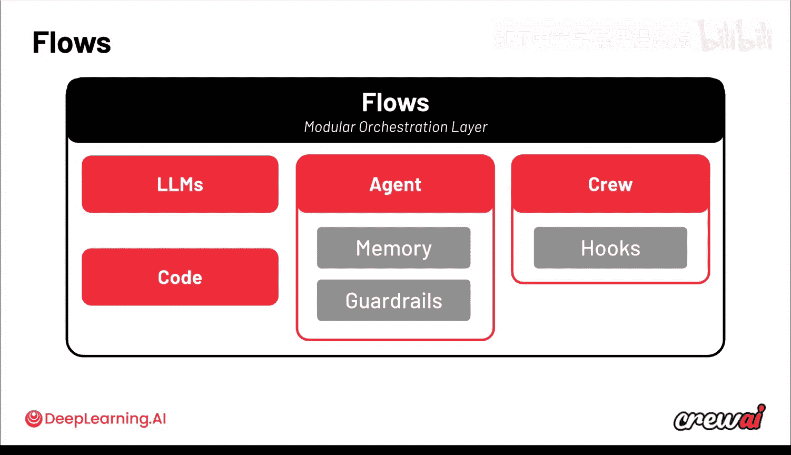

Behavior this is just regular python。 But then from that code。

 you're going to have it to do two things in parallel。

 You might want to have that information to flow into a single LLM call and this LM can be doing anything。

 it can be filtering out information or extracting context or making decision whether it has all the information it needs or not。

 And meanwhile， you can also have an agent working alone。

 and this single agent will do something with that information， they might have a memory。

 they might have guardrails。 they might be producing some sort of output that you want。

 but from that parallel execution， you can then go back into one single function。

 and that's where you're gonna have more code happening。

 and this code will do something with that information and then it might trigger two different things Maybe it logs something into a specific database so that you can monitor that later and kicks off an entire crew as a next app。

 So you can see here how through code and LLM and。And crews。 it gives you a lot of control。

 In this example， you can see how flows become this automated control layer in the backbone that is defining what it' happening throughout the execution。

 Again， it's a very lowle orchestration framework that gives you the complete control of what is going to happen and allows decide how much agency you want to bring into automation throughout this execution。

 you not only control the order， but you also have a state that is shared among the entire flow。

 And that means that throughout the different code blocks and throughout all the different functions and LM calls。

 you can actually put things into that state that you're going to be reusing later on。

 So as this event happening， you can choose to use the state appropriate to make sure that you get all the information that you need where it needs to be。

 So in the end of the day， if we take one step back。 what we are seeing is that are two different。😊。

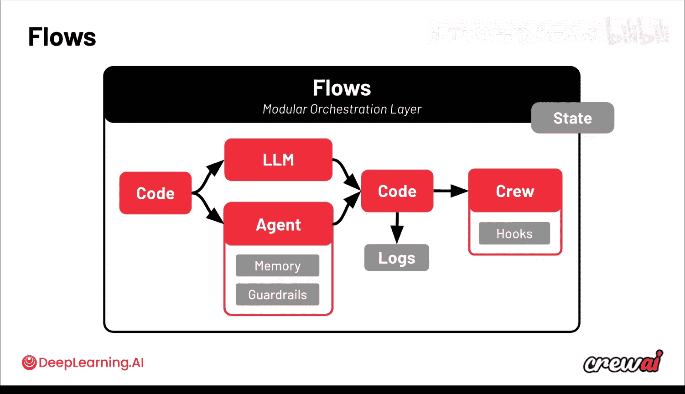

ways to build agent systems， one that is more optimized for agency， where you have agents。

 tools and tasks and memory and everything that we have seen up to this point。

 And you're optimizing for these agents to just figure it out as they go。 It on the other one。

 you're seeing flow that provides you this backbone of structure where you can still bring agents LMs in entire cruise into。

 But now you get away more control on how you set it up。

So they each have their situations where they shine crewews who have a lot more collaborative agents。

 So they are more autonoous and dynamic。 They're better for exploratoryial less deterministic tasks。

 So if you want to write a screenplay or create a marketing strategy or idea8 for a landing page。

 Cews are great at that。 On the other hand， flows are more low level even driven control layer。

 And they are really ideal for structure repeatable steps with a tight control。

 So you might have at of respond to an email， for example。

 or triggering receiving a that you might want to run some code blocks or even a crew to respond that email depending on what is on it or not。

 or it might be great as a meeting assistant where the meeting assistant might be triggered when you save a meeting notes doc。

 And then from there， generate tasks for the transcript using a crew。

 And those tasks then going to travel or being sending through slack。 just using traditional code。

 So again， this sky is the limit when you' are talking about how you can tangle this two together。😊。

To create very complex use cases， a growing pattern among both enterprise and individual engineers that we have been seeing is this idea of opt in agency model。

 Also， what I like to call the minimum that I can get away with approach。

 It follows the longstanding engineering principle of keep things simple。

 This idea is to start with a structure backbone such as create Iflows。

 And then add agency only where and when it's needed at each steps。

 So if a code serves a particular problem on its done。

 you don't need to introduce the cost and a latency and even the potential complications of an LM or even an agent。

 So you should reserve agents and crews for the complex task that they are meant for where they can actually add value。

 And only then if you do need an LM， you can start with just one single LM call and eventually get into an agent or an entire crew。

😊。

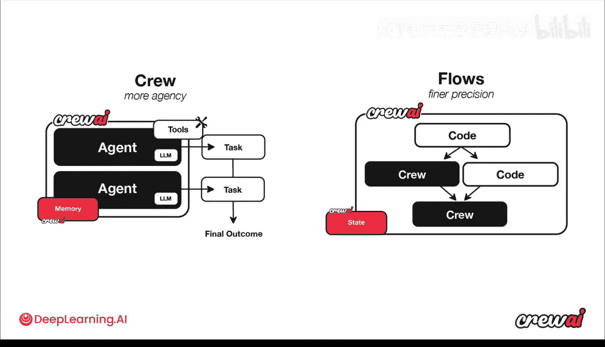

So here's a lot of different ways where you can choose how much agency you bring into your flow。

 and that allows you to make sure that you're being very effective and efficient on what you're building。

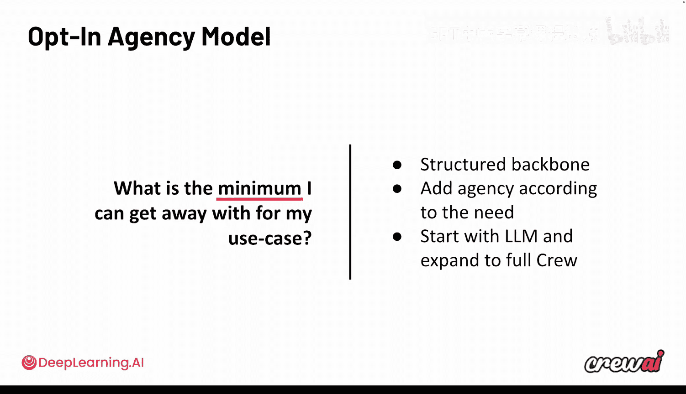

So let's take a look at how we structure a real life flow。 In this flow。

 you have a start conversation function。 And once that conversation start。

 it will trigger a router function and that a router function is basically doing one single LM request to decide whether it does a deep research or not。

 Let's say that this conversation has been going on for a while And due to that。

 the agent and the LLM has already a lot of context。

 So there's a lot of messages in the state of this flow。

 meaning that it doesn't necessarily needs to trigger a new research because it already has all the answers in its context。

 So it can just go straight into an answer function that we do another LM call and get back to you with an answer。

 Now， what if you have to trigger an entire deep research Well。

 then that goes into a research function that we have an entire crew into that。

 And that crew basically behave the same way that we have seen up to this point。

 where it's going to go out and actually do the research and scrape pages and。😊。

Together a final a report that will later be used to give you back your answer。

 So if you really look into flows， it has a set of building blocks that allows you to build this very complex use case。

 but there are very simple building blocks because this is just a very thin layer。

 And we're going to talk about the three major building blocks here。

 They start the listen and the router。 And all of those are just decorators that you can annotate your functions with。

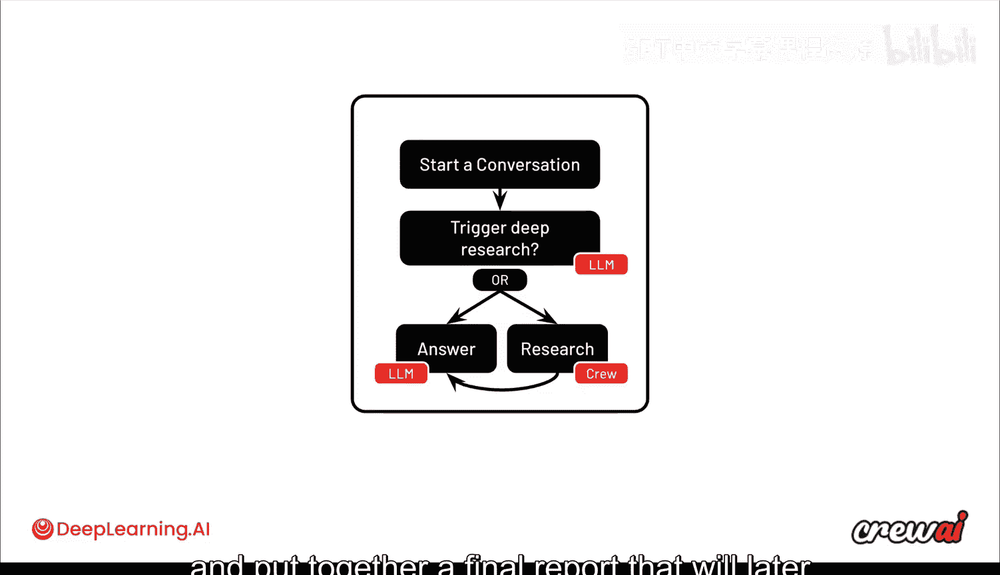

So the first one is the stark decorator， and that just marks what is going to be the first function that is going to be executed。

The other one is the listen decorator。 and that basically marks a function that is going to be executed once another function is done。

 And then you also have the router decorator that defines this is going to be a conditional function where it's going to route request on different ways。

 depending on what happens inside the function itself。

 with this three very simple building blocks alone， there is so much you can do。

 And as we can put more blocks together and are're going to talk about them in a second。

 you will see how you can do so much more。 So here is an example of a very simple flow that leverages all these building blocks。

😊。

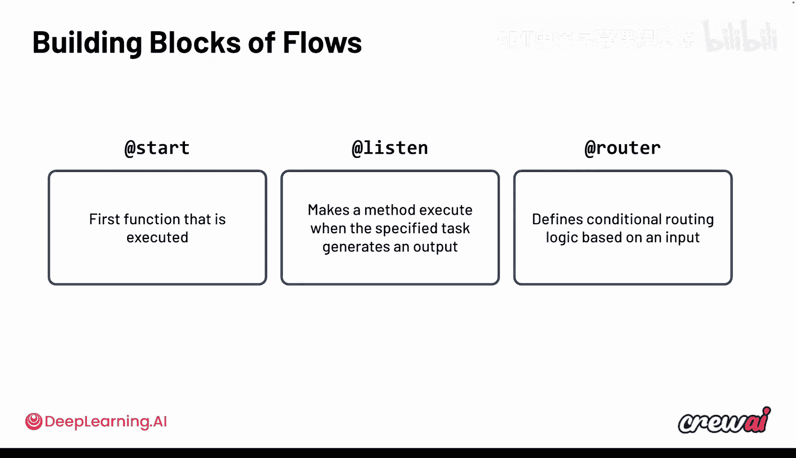

All you got to do is import those decorators from early on。 So in this case。

 we're just importing list and start。 And you can see that this is regularular Python。

 So it's a very pyonic way to do things where you're just writinguttting down your functions and you're using this decorators to annotator functions。

 Sore using the star decorator here to flag the first function as being the starting point of the flow。

And then you also have the list and decorator that is basically listening to the start conversation function。

 And once that function is done， then it will call the trigger research function that we're annotating with the list and decorator。

 So you can see here how simple it is for you to just use start and list to actually set up all the set of chain of events that you want to happen。

 And there is so much more than you can do beyond this basic flow。😊。

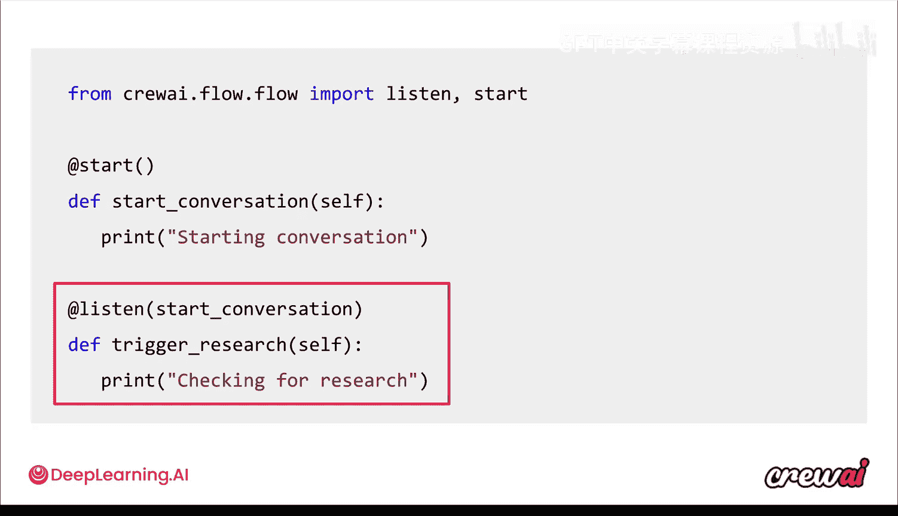

So if you look at some examples here real quick， you can see how the combination of these patterns can build something truly interesting。

 So you can have a first function that is using the start decorator that then triggers two other function。

 They're listening to the same first function。 So in that way。

 you can have the second and the third function run in parallel by just using this decorators。

 And then the rest of your flow just keeps going on。

 but there's a lot of more patterns in there as well。 For example。

 you could make sure that you then't have a four function that only gets executed when the second and the third function finishes。

 So when both are done， then that for function will be executed。 So in here。

 we're using a combination of the least decorator with and annotation as well。

 And you will see how we can do that encode， it's extremely simple。 But you don't need to end there。

 you can actually have the same four function now set up to be executed。😊。

Either when the second or the third function is done。

 So it's another layer in how you can actually set it up。 And there's even more ways。 for example。

 if we start to use the router decorator now we can have this second function to trigger either a third one or a fourth one。

 So looking at all these different combinations and all these abstractions。

 I know they can be a little hard to visualize but when they reply them into a real use case they add so much clarity and they allow you to do so much more。

 So let's go back into that example that we talked about before of the conversation with a crew。

 the deep research use case for flows。 and I want to go over this real quick。

 So the starting conversation function would be using the start decorator in this case。

 indicating that it's where the whole flow starts。 The trigger deep research would be the router decorator that is deciding on whether it's going to send a request。

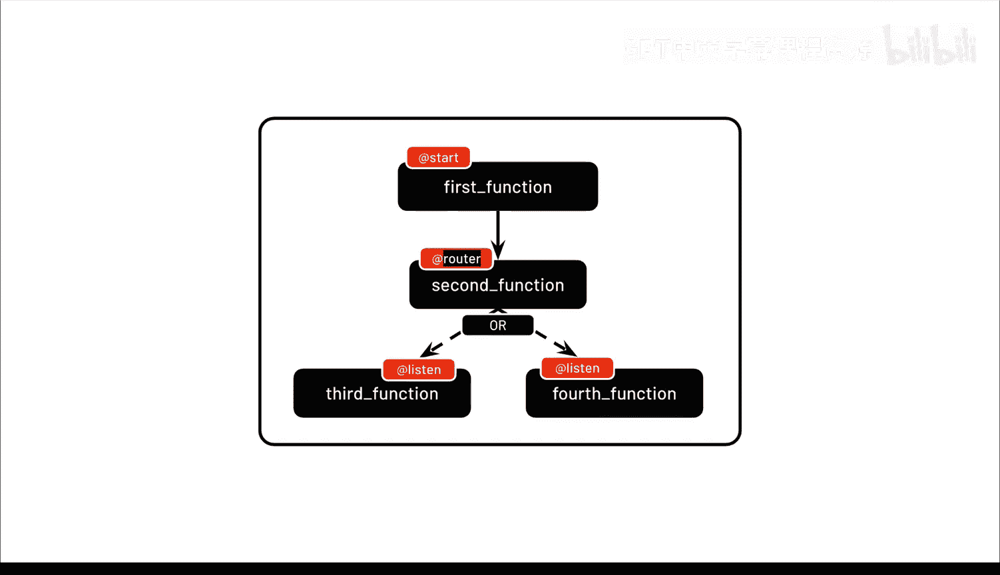

In one way or another， depending on what happens inside that function。

 And here we're doing an LM call。 we could be using a function call， for example。

 from the LLM to decide whether we go one route or the other。 Now， if we go one route for the answer。

 while that's going to be listening to a specific one side of the router or if we go into the research that is going to be listening to another side of the router and we're going to see how to do that in a second。

 But the cool thing is that as you build these things and as you build this entire workflow。

 queryi allows you to automatically plot this out so you can actually have a visual queue。

 you can have the entire visual system mapped out for you based on your code So that makes documentation so much easier and allows you to understand everything that is happening inside your flow。

 All you got to do is go into the query Ci and type queryi flow plot。

 And what that will do is that it will automatically look at all your functions and。😊。

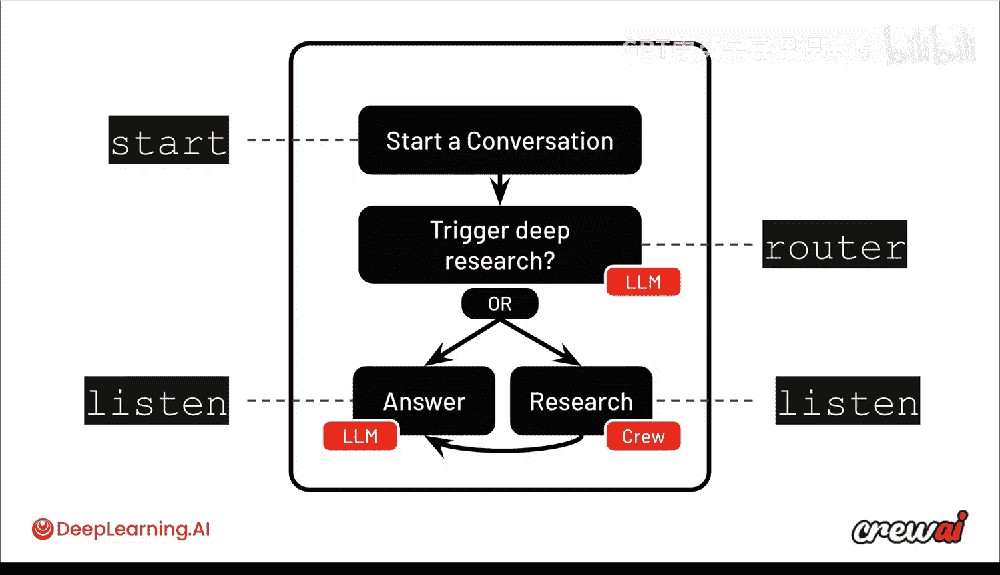

Decorators and annotations。 and it's going plot that out for you。

 And that allows you again to automatically generate these diagrams to help you not understanding what is happening。

 but also make sure that you can document this C and flows can get a very complex。

 especially when you're just staring a the all day。

 So this really help you see what is going on and spotting issues with your process。

 So here is an example of for deep research check， but actually mapped out by the Ciflow。

 You can see here the get user message as the issue is starting function then going into a router function that will either go into answering or clarifying in clarifying here is asking extra questions to the user in order to understand how deep it should research and how it should focus its deep research。

 And then after that is done， it goes into a crew function that actually does the entire research for you using the regular crew pattern that we have seen。

😊，4 that then goes into a generate report function at the end that triggers back into the answer。

 So in here you have a very easy to parse visual model of your entire code so that you understand what is happening and what each function is responsible for。

 And this is something that I'm so excited about because as an engineer myself。

 make my life so much easier。 So if you want to start with a flow when you're on。

 and create an entire folder structure， you actually have one simple command that you can use。

 And that is create I create flow。 all you got to do is type out into your terminal and give your flow and name and that will automatically create the entire project for you。

 And let's go over that folder structure just for one second。

 you can see in here that this is just a regular Python project using P project to define its versions and dependencies。

 and you can see that it' structured the whole first directorry to support your flow。

 So you're gonna have。😊，One folder is specific for crews where in this case。

 we have a research crew in there and you have a specific folder for tools that can be reused across the entire crew and your actually flow will leave in that main or pi file where you can actually encode all your functions in there and again。

 you can split this into different files if you want to in the end of the day。

 flow is such a thin layer that it's all regular python so you can break things apart in any way that pleases you to make sure that this is something that is easily maintainable for you and for your team。

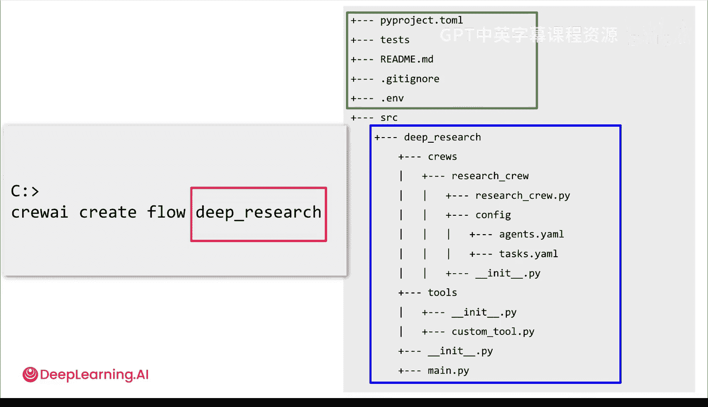

Another very interesting thing about flows is that every flow has its own state and state management logic。

 And for the sake of comparison here， you can just think about this as being like a database。

 where you can store anything during the flow execution in there。

 So let's say that from the start from the first function。

 you produce some sort of data either by doing the LM calls or by executing codes。

 or maybe the final output your fair crew or an agent。

 and you want to store that somewhere to be used later。

 you can just write that into your flowux state and eventually in other functions。

 you can read that out。 So that allows you to have this one shared pocket of data that during a flow execution。

 you can write things in and read things from。 And that gives you so much flexibility on how you share all these data among the different functions as they get executed。

😊，But not only that， you can also persist that estate。 So that is is stored on an actual database。

 So if you ever run that flow again， that estate gets automatically preloaded from where it was saved and you can kick things off from where you started。

 And in order to do that， you can do something as simple as annotating the entire flow with a persist decorator and that we automatically make sure that isoring that into a local database for you when you're running this on your own computer。

 So you can think about how important this is， because in our early example about the deep research conversation as we send new messages。

 you want to make sure that we are persisting the entire messages in the outputs into this one single state that we can reuse as the conversation goes through。

 So theres an actual conversational history as the flow gets executed。

 So every time that we run the flow from the top， and automatically preloads。😊。

Convers is up to this point and allows you to just keep chatting with that。 And again。

 that information can not only be used through all the functions。

 but it's also being used now across as many flows executions because it's actually being persisted and preloaded And a very cool thing is that as checkpoint。

 you cannot not only persist the entire state of the flow of the end of every single function。

 but you can be as granular as you want by going per function and defining on each function。

 what are the functions that should actually persist the state。

 All you going to do is actually use this persist decorator to annotate every function that you want that by the end of that function to persist that state in the database as it is。

 and whatever is the final version of that state。 and is going to be automatically reloaded on your new execution of our flow。

 and you can see overwrite some of that if you want to when we're going to see an example of that in a second was that we actually get our hands dirty。

 So I know about you。😊，But flows feels so incredibly useful。 And frankly。

 I'm seeing a lot of people using them on the day to day。

 and that has been their choosing way to move some of these use cases into a production environment。

 because it allows you to really sense as a structure and have as many in control as you want。

 And by applying this opt in agency model。 Dec how much agency and how much intelligent when to add into your automation。

 That is said， they need to be designed well to work properly and they need to be built reliably。

 So in the next video， we're actually going get our hands  dirty0 and build this entire flow ourselves。

 I'm very excited about this。 It' going to look awesome and you're gonna love it。

 So let's jump right in there。😊。

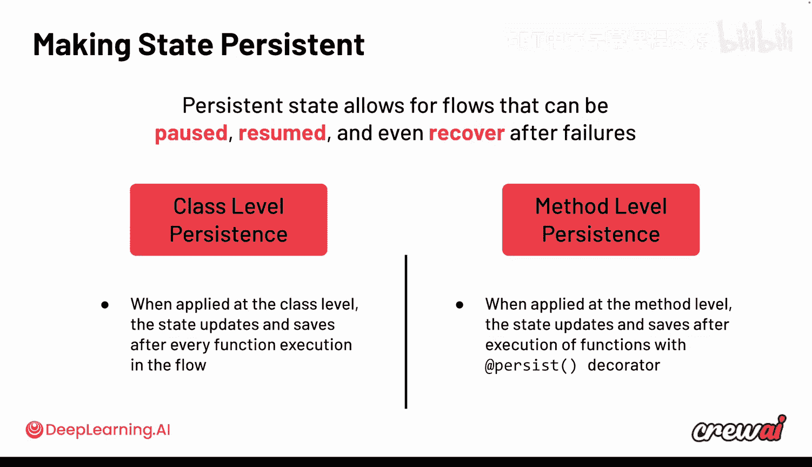