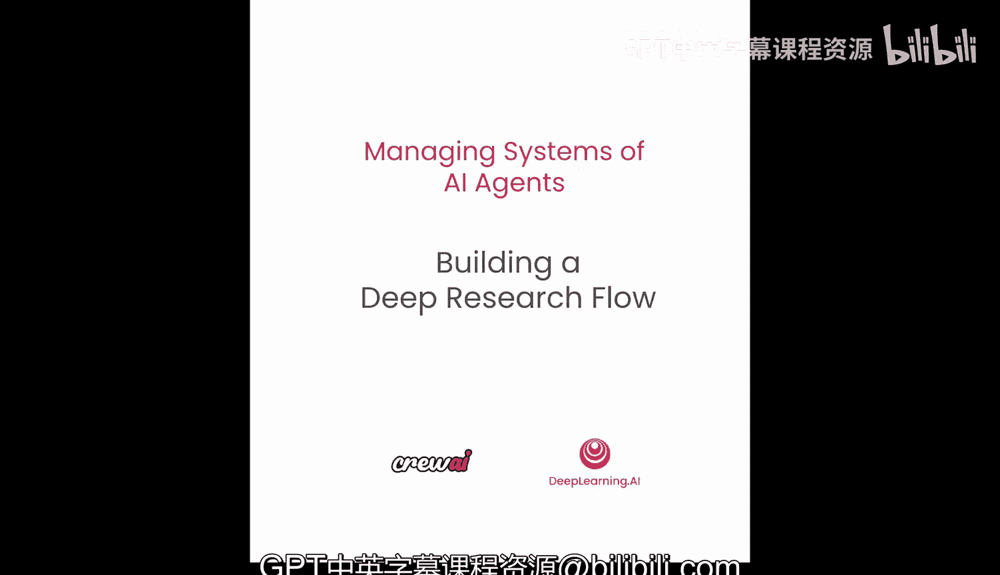
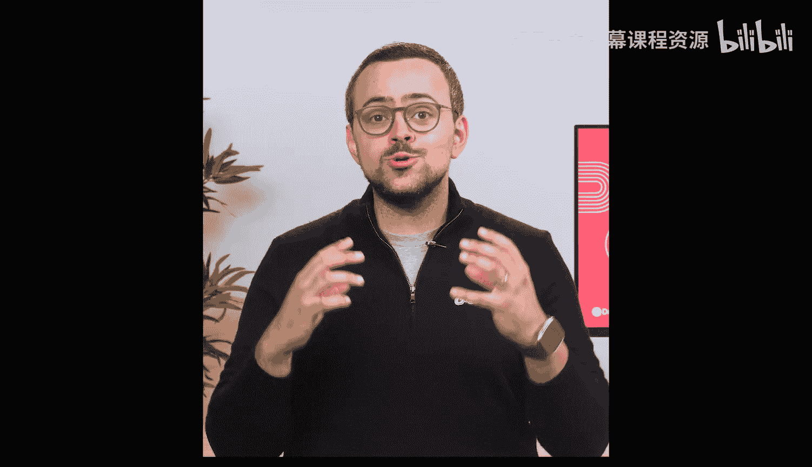
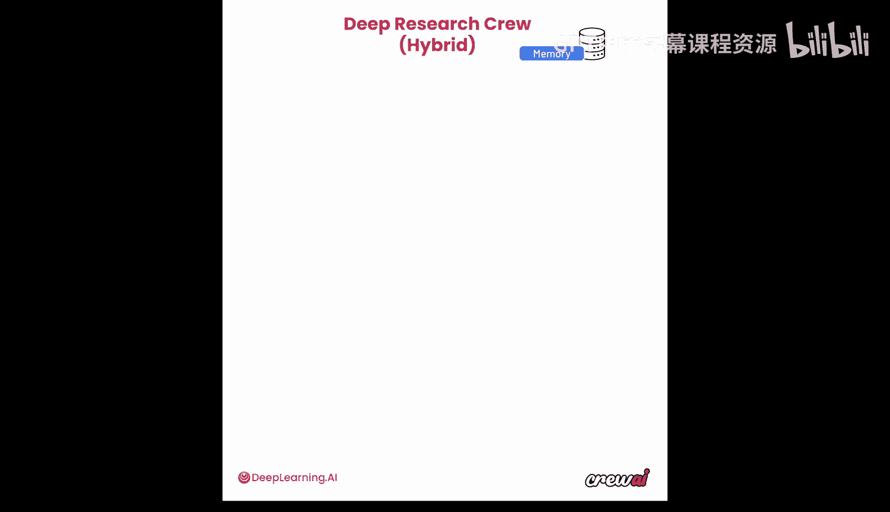
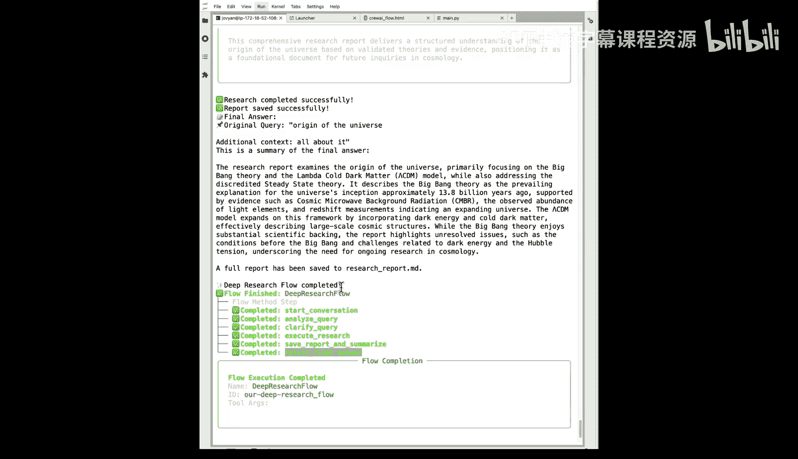
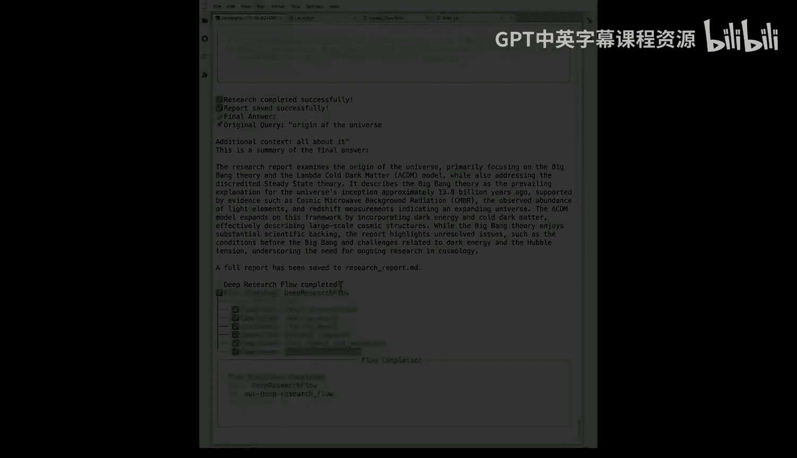

# 吴恩达《使用 CrewAI 设计、开发与部署多智能体系统｜Design, Develop, and Deploy Multi-Agent Systems》 - P27：6.building-a-deep-research-flow.zh_en - GPT中英字幕课程资源 - BV12eCQBAECM

By now， you probably already understand how important and how powerful flows can be。

 So I want to make sure that you get to put this into use。

 Let's update our deep research crew to make into a deep research flow so we can actually put all the learnings and make this use case so much more powerful You're going to understand how that unlocks all use cases as well。

 So let's dive into that。 I'm very excited about this notebook。 One， it is our final notebook。

 So this is the Umerch version of our deep research crew。

 meaning that we're going apply everything that we have learned so far up to this point into this one single use case to see how complex we can get it to be and the other thing that makes me super excited about this as well。

 is the fact that we're bringing flows into the mix。

 So we're going transform what used to be our crew into an entire crew AI flow now and just that remember where we laughed off we end up with our research crew being a hybrid。

😊。

ach where you had a research plan that would do entire hypothesis on how he would break up our questions and what are the things that we should research。

 that would trigger two different tasks when to research a main topic another one to research a secondary topic。

 but only one agent would be doing those same tasks。

 and then that would go into fact checking or the same thing would happen。

 one agent would be doing the two fact checking as well for us。 And then from that point。

 everything would collapse back into writing a final report with our final report agents。

 So this is where we laughed when we last talking about this。 And were using the guardrails。

 the custom tools and the memories， everything that we have learned into this。

 But now we're taking it to the next level by using queryi flows。

 So the idea of our crew which still exists in there。

 And that still runs the same way that it used to。 We're not changing anything about it up to this point。

We are changing the way that we get to that process。

 So now the user will be able to start the conversation being vocal about what it wants to learn about。

 And this can be literally anything， the user can just say hello or it can say anything else。

 Maybe he wants to learn about the origin of the universe or whatever it might be。

 And from this point on， we're going do one single ad hoc LM call that we try to make a decision on whether we need to trigger a research or not。

 And if we don't need to trigger a research， we're just going to generate an answer to the LM and return that answer right away。

 Now， if we do want to do the research that it will execute and trigger our entire crew that will then ask for qualifying questions and give a final summary that it will return that answer back to us。

 So you can see how this now is a little more complex。

 but also allow us to have way more control over what is happening and when it's happening。

 and what I'm very。Scited about this is that this is extremely easy to build because flows is just a very thin layer。

 It just gives you the bare minimum to make sure that you get everything that you need to build this automations by using a series of decorators that make your life super easy。

 So I'm very excited to get our hands dirty and see what that looks like。

 So let's jump into that right away。 The first thing that I want to call out here is that for you to create a initial flow。

 if you want to start a new project after this。 Or if you want to start to get the initial structure done for you。

 all you got to do is using the Ci Ci and type Ci create flow。 and you can give your flow a name。

 So in this case， I would do just a task flow here to showcase。 one that you create this。

 it will create an entire scaffold and folder structure for you setting up everything that you need。

 And if you go into data folder as we can do right now， you can actually see what that looks like。😊。

So it will have not only a regular pi project and readme file and do ends。

 but will have an Src in a task folder。 And if you go into that Src folder。

 or you're gonna to find or flow。 And that flow you're going have a maingo pi file that holds the code for your flow。

 and you also have a cruise folder and a tools folder。

 the cruise folder will have any crew that you might want to use with this。

 and your tools folder the same way， will have all the tools that you might want to use across many crews that are part of this flow。

 or example， we just gonna to have one crew in the flow。

 but you can give this flow to be as complex as you want。 remember， the idea here is opt in agency。

 meaning that the flow just give you that backbone structure and you decide when and how much agency when to bring from one single LM call all the way to an entire crew。

 And the idea here is just to give you a structure for you to have this。😊。

able components that you can use while you're building or flow。 Now， if you look at the main file。

 I want to highlight a little bit on what this actually looks like。

 So if you open the main file for this task crew that we just created with this task flow。

 you can see that it comes with an example， just to showcase a little bit on how this works by having a poem flow and a poem state。

 The poem flow uses a decorator that we just talked about in the lesson。

 It has a niche start decorator that indicates that this is the first function that will be executed in this crew。

 and it's just generating a number between one and 5。

 then you can see that there is a generate poem function that has a least any decorator。

 and that is actually listening for our last function。

 So that means that as soon as the generate sentence count function is done。

 it will meet an event that it will be picked up by the generate poem in a generate。😊。

Pome would then execute its code and actually cause an entire crew that gets the number of sentences for creating a poem that is that long。

 And then again， you can see the least and decorator here being used again。 But this time。

 listening to the end of the generate poem function that will be the ending of the crew and then execution the save poem function that will save that into a file。

 Again， this is more of a simple use case。 But it helps to highlight how you can view a flow in how simple it is to get this that is going。

 Now， I want us to go into a regular setting for a deep research flow。

 you're already have that entire folder and Fis is structured for you。

 So let's go into that so that we can actually see what that looks like in practice。 All right。

 So if we go into our folder structure as you can see in here。

 you're going to find the same setting that we just looked at and the new flow that we created。

 And if we go into the S R C and。😊，Research flow folder。 you're gonna to find the main file。

 the crews and the tools folder。 We ready move the entire project into the structure。

 So if you look into the tools folder， you will see our chart generator tool right in there。

 And if you go into our cruise folder， you will see our deep research crew right there。

 the way that we used to have it with its guard railils。

 agents and tasks every think is configured for us。 Now。

 let's look at the main file that actually holds the flow that is inside or SRC deep research flow folder。

 So if you open that main file， you will see that we create the flow state。

 This is the state that is going to be shared across the entire flow。

 So as all the functions are being executed， we're going to be populating this data so we can exchange data between the functions。

 So we can read and write into the state at any point during the flow execution。 Another interesting。

😊，That I want to pinpoint is that we're importing this persist decorator。

 and that's a new decorator that I want to highlight into this code real quick。

 What it does is it persists the state and every function stat after flow。

 So every function that gets executed by the end of that。

 it saves that state into your local database， so it can reuse that state later if you trigger the same flow with that same I once again。

 meaning that you can use that state to persist data across many different executions。

 So let's now go into actual flow where we have the persist decorator and where we're not only in hurting from the flow class but we're being very clear that it's using the research state。

 or first function is exactly the one that we showed on the slides just a second ago。

 where we have this S conversation function that is annotated with this spark decor。

And here you can see that we do some prints just that we can see that in the terminal。

 and we execute that in a second。 We check if there was a query before this。

 And this just means that if we executed this flow before。

 because we are persisting the state and you're gonna see that ones that we actually run it in the terminal。

 And if there was a state before， meaning that we executed this flow before。

 It's going to tell us what was the last thing that we researched about。

 because that will be stored in the state。 I want to stop here real quick to explain how useful this can be。

 Let's say that you're creating a flow that we handle many turns of conversations where whenever you run the flow。

 you want that same conversation to keep going and that same data to be in there。

 Maybe you want to make sure that this flow remembers every single research that it has ever made as you go talk with it。

 Well， if you want to do that， you could actually create a variable in the state。

will hold all that data And as long as you're persisting that data。

 you will always be able to load it back up when you run the flow again。

 as long as you're passing the same flow I we're gonna see that in practice in a second。

 So don't be scared away， we're gonna show you how that actually works。

 after this N show function where we ask the customer what is that it wants to know about。

 we then go into the analyze query function。 and this is using the router annotator the same way that we saw in the slides just in the previous lesson So this indicates the flow that in here。

 there's gonna to be a fork on the road， meaning that depending on the output off this function。

 the flow we send to either one or another function。

 in this analyze query function will be executed as soon as the start conversation function is done。

 So in here you can see that the analyze query does one simple thing it basically calls Dpt。

O mini to decide whether it should just give a simple answer or if it will be required to do a deep research into a topic And depending on whether it the research or not。

 it will either emit a research event or it will emit a simple event and you can see on our next function。

 the simple answer that if a simple event is emit， then there is at least decorator for that and the simple function will be executed and this function then just do one single alarm call and pushes that answer back into the state if it emits a research event。

 then we have this clarify query function that will actually ask the user for a clarifying question。

 whether it wants to know something more specific about what it's asking about So if it does needs a clarifying question。

 then the user get the opportunity to add what is the additional context in there that it。

To about after the research is done， we can see that the execute search is now listening to the clarifying query。

And this we're getting towards the end of the flow。

 So bear with me for just one extra second in here。

 but this is getting interesting because is in here that we're going to load our crew and you can see that were loading the same crew that we build on the last notebook。

 the parallel deep research crew but now the user query is dynamic。

 we're loading that from the state from what the user input it early on the other functions that we executed And then after this query is done。

 you can see that the research report is saved into the state as well。

 and then we go into our final function that is the save report and summarize where basically we're going to make sure that we are saving the report on this research report markdown file。

 We're doing one final LM call to summarize the content of the report。

 and then we go into the save and report and summarize function where we have another listening decorator that is basically waiting for the research to be done。

😊，You're going to save the result into this research report markdown file and do one single LLM call asking for it to summarize the final report that will be thrown into the state as well as a final answer。

And after this， you can see that our final function is the return final answer。

 And this function is listening for multiple events。

 So it will listen for either the simple answer event or the save report and summarize event。

 So going back all the way to the beginning of her flow。

 if the initial item call deem that it was not required to do a deep research。

 This would automatically kick off this function。😊。

If it deemed that it was necessary to do a deep research。

 that would go through all the different steps that we went over up to this point and eventually get into this final answer function in this final answer function。

 basically print out what is the final answer， whether it's a sample or it's the result of our summary and then the entire flow is done。

So you can see that this is just 14 lines of code。 We're just using back crators to control the entire order of the execution。

 and we choose for one specific area of this flow to overindex on agency but have entire crew in there that is going to be doing the research。

 plotting the chart， bringing everything that we need into this one single final report。

 So this is a great example of how you can actually use flows and intertwine them with crews agents or LLms in order to get better answers。

 If keep scrolling back in here， you will find this kickoff and this plot functions and those are boilerplate functions that are going to be injected into your flow as soon as you create them。

 whens responsible for actually running the flow where we actually are forcing one I If you don't for one these to automatically be generated for you。

 But in this case， we're forcing so that every run uses。😊。

The same I so that we can always load that persistented estate。

 and the other function is that a plot function that is basically plotting a visual off the flow for us。

 and we're gonna to run that in a second。 So this is a very interesting file。

 I would recommend you spend some time on this Again， I know it's a lot to cover。

 but I would definitely recommend that you go through this flow。

 you try to understand how these decorators are being used。

 Feel free to add new steps or remove steps and you're gonna be able to visualize this was that we plot it。

 and that will allow you to also run even more different scenarios and cover for more different edge cases and could be very interesting to see how complex you can get this to be or how simpler you can make this。

 You have all the building blocks that you need to build the flows that you want。

 It's just a matter of how you're gonna use these functions together in these decorators together。

 Well， let's do something to running this create plot command。😊。

That we can actually visualize what we're working with。For you to plot the actual flow。

 you can go back into a terminal， go into the root folder of your project。

 and all you're got to do is screw AI flow plot and that will automatically create an HTML file for you with the entire visual off your flow So you can visualize this at any point in time。

 and this can be extremely useful， especially for automatic generating docs or as you change your flow to visualize how that actually impacts the behavior off the thing。

 So if you go into a main folder， you can actually open that file now。

 and that will basically load the flow visual for you and we can see how this works is the same way that we talked before。

 there's a start conversation function that would trigger an analyze query function that is a router that will either send to clarifying question or simple answer。

 if it's ready to give a simple answer。😊，It's going return the answer right away。 Otherwise。

 it will trigger entire crew that will execute a research。

 It will then save that as a report and summarize it for you and then return the summary as a final answer。

 So again， as you go into this main file。 And as you change our flow try to go into the terminal and plot it again so that you can see visually what that's looking like and how your code changess are actually impacting the behavior。

 This can be extremely fun to watch Now， why don't we run this flow for the first time with just a simple query to see how it goes to run our flow。

 All you got to do is just run crew Ai run that will automatically run the flow for you And the first thing that it will do is actually ask you for that query and you can tag along the logs in here。

😊，So it's going to ask you what you'd like to know in that case， we're just going to say hello。

 we're gonna to keep things simple。 So if I type hello and we tag along the logs。

 you can see everything that is happening。 It's analyzing the query complexity it detected that this is a very simple query because we're just saying hello。

 So decide to generate a direct answer。 So the final answer in here is if our query as hello。

 it just answered as a regularLM would Hello， how can I assist you today if you have any questions or information specific topic。

 feel free to ask。 And then the entire flow is done。

 We can see here all the different steps that it took from starting the conversation to analyze the query to triggering a simple answering and then returning it for us。

 Now， if we run this flow again， one thing that you will notice is that it will automatically have on its state or final user query。

 and it's going to print that over for us。 So you can see in here that it says I remember last。😊。

You want to talk to know about hello， because that's the thing that we send it。

 So here is just to showcase the example of how you can use that persist feature to persist the state。

 and how that allows you through over many executions being able to reload that state and reuse it over and over again。

 So if you want this to be， for example， deployed as a long termm conversational flow。

 you can actually achieve that by using the state。 But this time， let's ask something more complex。

 Let's ask about the origin of the universe。 So you can tag along the execution here。

 and you can see that as it analyzes the complexity of the query。

 it actually the text this is a very complex question。

 So it decides that it will need to trigger a research process。

 So first thing that it does is trying to understand if it needs to ask any clarifying questions or not。

 And in this case， it does find that it's needing some clarification and asks me back a question。

 What a specific。SpsOf the origin of the universe are interested。 For example。

 are you looking for scientific terrorist or historical perspectives， and I'm going to say。

All about it。Now， you can see that we said all about it here and that get marked as additional context。

 and now that is going into the next function that is executing research。

 and that is triggering our crew again， The same crew that we had up to this point。

 And you can see that this crew is using the memory， the long term， the short term。

 the entity memory and going over the entire thing to get it done for us in the same way or researcher planner is researching all the options of what we have。

 What are the main topics that it want to cover What are the secondary topics that it want to cover and that will go to entire process that we had with the crew before。

 So let's pass forward and tag along the execution。😊，As you can see in here。

 the same way that we had in our crew before， both tasks are being performed in parallel。

 both the main and the secondary topics research， so nothing changed in terms of how our crew used to work to how it's working now。

 we just added that in a more complex scenario of an entire flow controlling how this automation will work。

Now， if you check this out， we still get the final report the same way that we were getting it before with this active summary。

 the detailed findings。 again， everything that we learned to this point and that we build across all the notebooks are still being applied here。

 If anything we're getting it to the next level。 But now you can see that that is just one step of the flow。

 And the end of the day， completes the research successfully save the report and then give us a final answer。

 given our original query， it automatically summarizes the entire report。

 It highlights that the full report has been saved to research report markeddown file so we can always go back and actually see that。

 and there we go our entire flow is done。 So in that way。

 we're able to actually run the entire flow end to end from starting a conversation。

 analyzing a query， qualifying the query， Ex the research。

 saving the report and then returning the final answer。

 So we task both paths off our flow and everything is running great。😊。

See a big pattern here between people merging flows with crews in order to get better results and flows are so easy to build because they're just a thin layer to give you that control that you want that provides you just enough to build powerful automations and decide when you want to bring just one single LM to an entire crew。

 And I would say there is a lot more that we can do， Even given the things that we learned。

 So I would challenge you news training and use testing and try to get this crew to behave in a different way or try to add extra steps on your flow。

 I just want to make sure that you get the hangoff。

 trying these things out and familiarize yourself with this concept before you get to build your own use cases。

 So make sure to have some fun and let's jump in the next lesson right away。😊。

