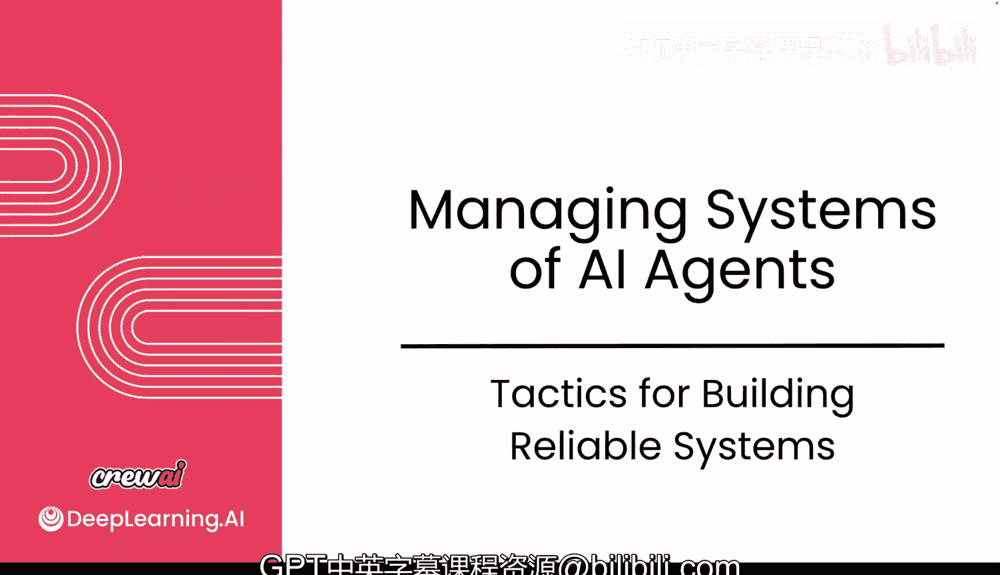
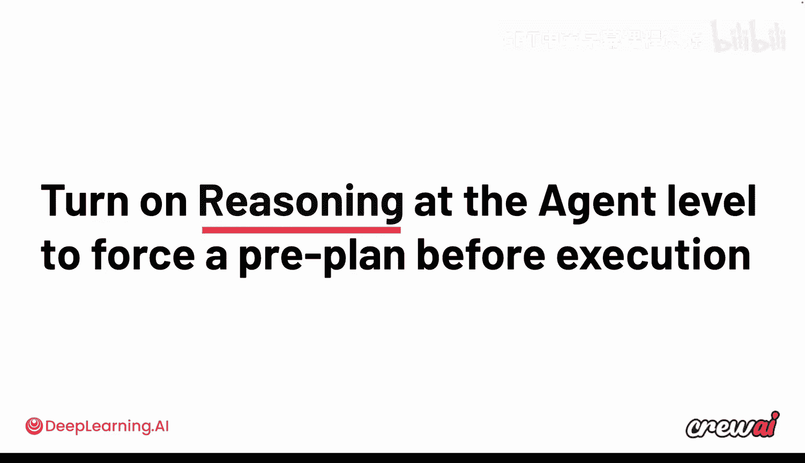
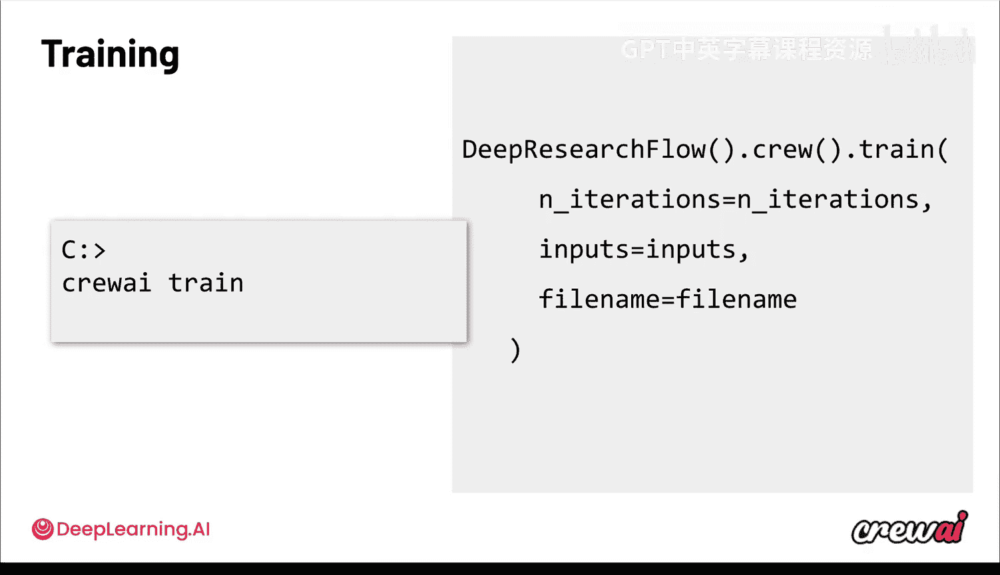
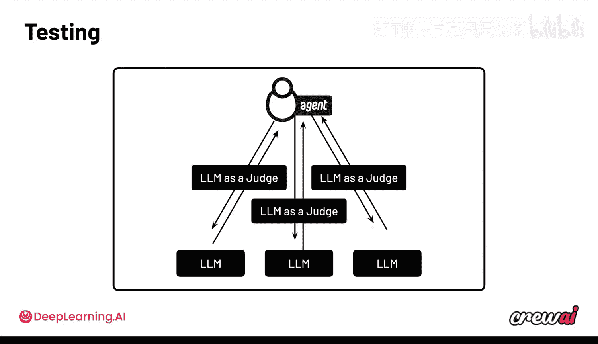
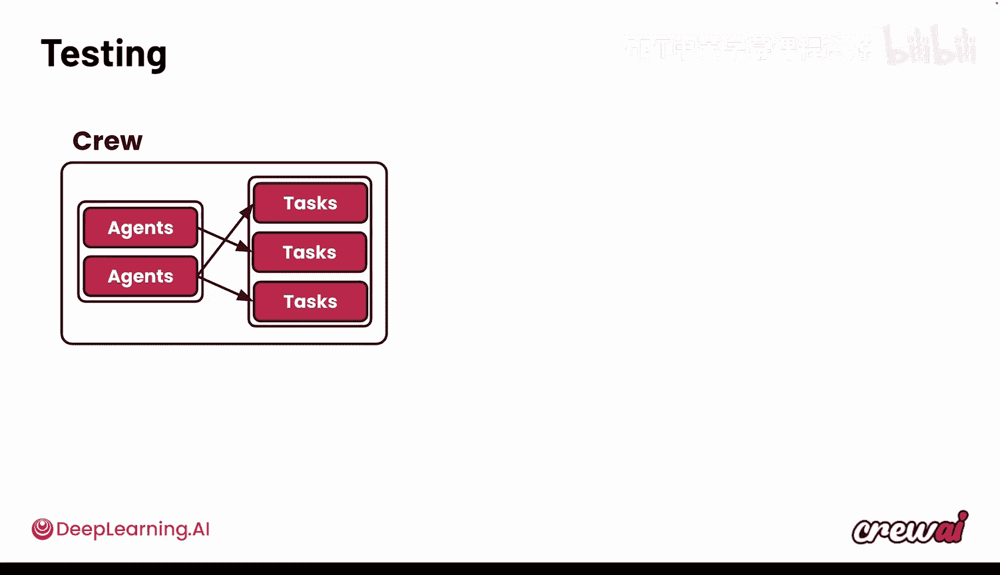
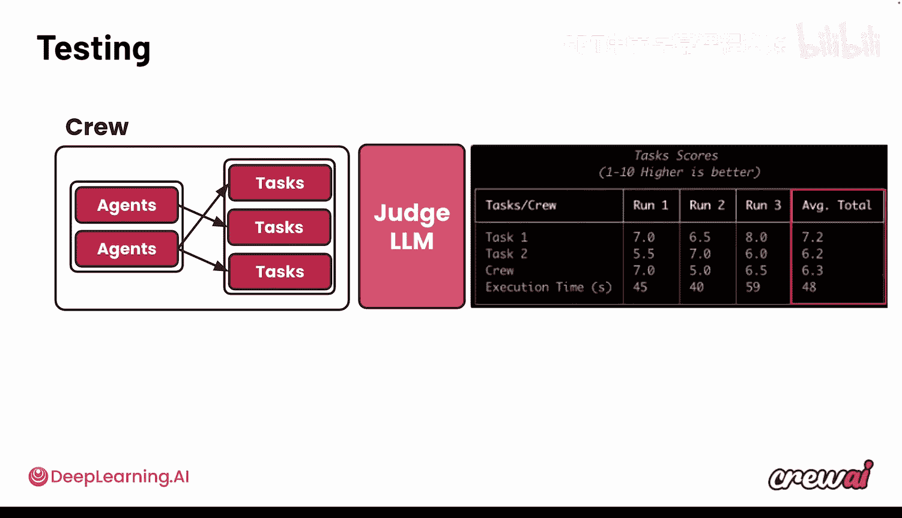
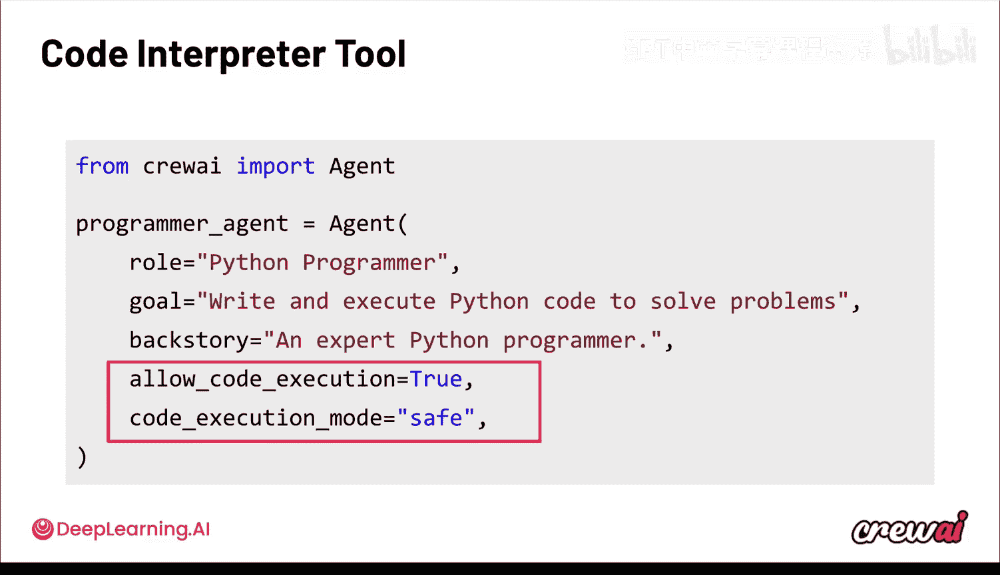
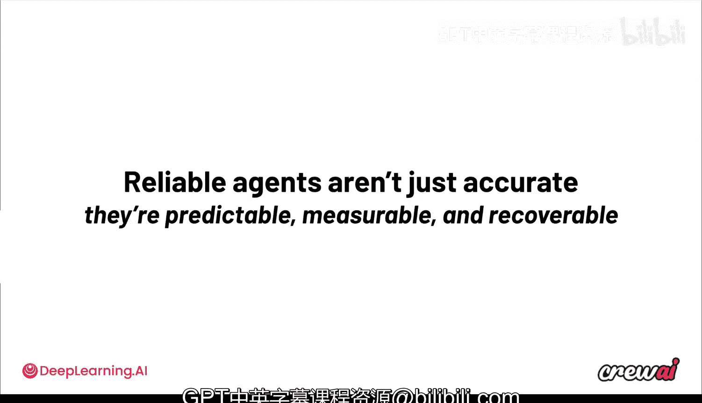

# 吴恩达《使用 CrewAI 设计、开发与部署多智能体系统｜Design, Develop, and Deploy Multi-Agent Systems》 - P28：7.tactics-for-building-reliable-systems.zh_en - GPT中英字幕课程资源 - BV12eCQBAECM

You have learned so much through this course。 I bet youre probably exciting to get all these systems into production。

 But now I want to focus on all the things that goes into making sure that this system is running reliable way。

 So this video is gonna to be packed with tips and tricks and actually nailing down that reliability to make sure that your crew is running in the best possible quality from testing to training to code execution through reasoning agents in so much more。

 And here is where we started talking about reliability and repeatability。

 And this is everything in production。 So let's talk about tactics for getting your agents into production。

 So by now， if you have followed the lessons in the Jupyter notebooks。

 you should be super comfortable building agents。 And you can create them in Jupyter notebooks through a Ci in your computer or even using the crew AI platform with cruise studio。

 But the question here is whether you can run them reliably。

 how consistently they produce good results。😊。

Of 100 runs。 And more important。 in the end， it's all about trust。 Can you trust these agents。

 Can you confidently build and deploy these agents into production。

 knowing that they're going to work。 And if you don't。 well， then you have a problem。

 but we want to make sure that we fix that。 So how you build agents that you trust。

 If you really want to get into a position where you can trust and where you can stand by its results。

 that's where a lot of the things that we talked early on come together at one。

 that believe for you to bring some deterministic controls to the agent systems is what is going to allow you to give them reliable。

 repeatable outcomes and therefore， agents that you can trust as well。

 Some of these controls you're already familiar with。 For example。

 flows that we just talk about a few lessons ago， that you can use to add an entire backbone and structure for your agents or guardrails that we also talk about a few lessons ago。

 so you can check specific outputs。And those two already have talked about very deeply。

 So there are still a few others that we can use that we didn't touch。

 and that might be worth flagging。 For example， reasoning agents。

 where you force your agents to do a reasoning step where they think about the plan that they will follow once they actually start doing the tasks or human the loop oversight where you can ask your agents to check back with you before they call the work done。

 So you can provide extra feedback to them in case they need to do anything more。

 you also have testing where you can compare many different LLms to decide what is the best LLm for you in terms of quality and speed and everything in between。

 and also training where you want to make sure that you're trying to enforce a specific format into your agents's behavior。

 So you train them to behave in a certain way by forcing memories into them。

 And we're going to talk about that in a second。 I also want to flag structured output as a way to enforce a specific。

Outcome and safe code execution。 Now， again， there's a lot of things in here that we haven't talked about yet。

 And I want to make sure that we spend some time with them。

 So let's kick things off with reasoning agents。 how do you add reasoning for your agents。

 basically requiring them to do some pre planning。 All you got to do is turn one single flag into agent。

 And what the agents gonna do now is before it takes an action before it tries to complete any task。

 It will actually think true the steps that it should take to get that work done。 So by doing that。

 it will draft and self check a plan and you can limit the number of its in there out the way to getting something satisfactory so that it then proceeds into actually performing the work and following the plan that initially draft。

 So enabling this， as you can see in here is extremely easy。

 All you got to do is turning one flag called reasoning to true and that will automatically turn it on the reasoning step for your agent。

😊。

But then you also can set the max reasoning attempts that define how many times your agents can try to create this plan before it actually kick things off。

 So this is a very easy way for you to guarantee that your agent are doing some extra thinking before it actually gets the work done and can lead to better outputs depending on their use case。

 Now， let's talk about human。 We are ready talking about guardrails in the previous module。

 but I want to talk about the ultimate guardrail， the ability to have a human。

 you to basically verify and check and validate if that outputs is actually good or bad and give feedback to the agent in the process of doing so。

 So the way that this works is like as soon as an agent finishes task before it actually calls the work done。

 it will ask you for an input， whether it's doing good or bad and whether you like the work that it has done。

 and you can provide this extra feedback and based on this feedback， it will。😊。

go back into doing the work again。 So an example of not this will look like is that the end of the execution。

 you're gonna to have a prompt like this in your terminal， asking you to provide feedback。

 whether you can type something out， asking you to do more or less。

 or you can just not type anything and the agent will assume that everything is good to go。

 But in this example， we can say， well， maybe it's returning a list of 10 things。

 but you actually went 15 instead。 you can literally type it out， let's do 15 items instead。

 And that will send that information back to the agent that is going redo its work to make sure that's fulfilling your feedback and asking you again to sendly check it before it's done。

 So you can see how human delobe can be extremely helpful especially if you're in a guarantee a certain oversight of this agent。

 And when you deploy this agent， especially if they're using query。

 this human delo logic actually becomes an API and this API allows。

YouTo integrate this with external systems that you might have。

 so you won't need to have people plugged into terminals。

 They can actually be adding this feedback to slacklack or teams or any other communication patterns that you might be using。

 Now， we also want to talk about how you train your crew。

 and training here means that true and interactive process of giving them feedback。

 they're creating memories of the things they' are doing right and the things they' are doing wrong。

 They're going to be reused later throughout all the executions to make sure that they follow that standard。

 These extremely interesting。 So in training just to recap what you saw in the first module of this course。

 this agents will run as normal。 But they will stop after its initial output to ask you for feedback。

 And when they do， they will try to use that feedback to improve its answer。

 And then generating learnings based of them that will go in its memory。 So on each。😊。

The system records for every agent in the crew。 What was the initial output of the agent。

 What was the actual human feedback that you gave it and what was the improved output and what are the things that it did along the way。

 So you can see that in the conclusion of the training and how this feedback is consolidated per agent。

 it now becomes a source of interesting suggestions。 There are clear。

 actionable instructions distilled from your feedback and the difference between the initial and improved outputs together with a quality score for every single memory generated。

 So then during a normal execution。 Each agent will load its consolidated suggestions as part of its context to make sure that it is taking that into account。

 So you're going have a physical file in your file system now is storing the suggestions。

 the quality and the final summary for you。 So you got to do to kickoff training is basically either running C I train on your。

😊，Terminome by using the create Ii， or you can also use the train function in Python that will automatically kick off that training process for you。

 And when you do that， you're going to see that execution happening and the feedback prompt team coming up。

 And at the end， you're going realize how much of a better agent you have but just let me do the few runs based off your feedback。

 Now I also want to make sure that you have the right tools to help you choose the right LLM for each agent。

 So in addition to training， you may also want to test orccs and flows to see how theyre performing to get some metrics around if they're doing well or not and even compare a few different LLM。

 So in testing your AI agent we run the same task but many times for a number of the execution。

 and you can also specify a specific LLM that you might want to use as a judge。

 that LM can be the same one that you're using for the。

task or it might be a different LM that you want to actually judge this request in the end of the day。

 what that will create is a series of plots around quality for each one of those tasks and you can trigger this off by either using the CLI where all you got to do is write createI task on your terminal or you can also use Python for that using the task function。

And what is going to happen there behind the scenes is that the crew and the agents who perform all their tasks。

 Then the output of those tasks and the expected output of those tasks will go to a judge LLM and the judge LLM will we score those tasks on a0 to 10 value。

 telling you how good that is and how well the actual task output maps to the expected output that you define on the task itself。

 So in here you can see that it's broken down across two different tasks and what was the actual score based off the result for each task for tree runs with an average at the end。

 that includes not only how good it was， but also how long it took to run those tasks。

 and this can be extremely powerful， especially because as you change your agents as you change your tasks。

 And as you change the LLMs that you' are using， you want to have a way to compare。😊。

Hair a little bit of apples to apples to understand if you're moving the needle and drive things forward as you do these changes。

 So in this case， you can see that the crew entry three times。

 and you can see that each execution time varied between 40 to 59 seconds。

 And you also get an average outputs from there。 So now you can judge yourself whether that score is good enough for your use case。

 or if you need a different strategy to improve。 And you can choose among the many strategies that you have learned so far in the course。

 including training and reasoning agent and improving your context are even choosing different processes to see how that impacts the actual output off your crew。

😊。

Now， we have covered a lot of ground in terms of how you can get a better outputs。

 but there's one thing that we didn't talk about。 And that is safe code execution。

 And the reason why I want to talk about this now is because code execution can be so powerful for agents。

 It the ultimate， too， because allows them to do anything。

 They can write code to do anything that they want。 they can write code， for example。

 to generate charts。 They can write code to generate markdown files。

 There's a lot of different things that it can do once these agents go into coding mode and agents are especially good。

 and that the limbs are especially good at coding。😊。

So there is a few ways that you can enable safe coding execution for your agent。

 and there is many tools out there that also allow your agents to do coding if you want to。

 The one thing that you've gotta be mindful， though is that ones that these agents are getting into code。

 disguise the limit。 There's a lot that they can do。

 So you want to make sure that you're doing things in a way that it feels safe and you're only going into coding if you actually need to。

 Most of these agents can actually use custom tools that you have but before and we have learned about to get a lot of this work done。

 So they might not necessarily need to tap into code。 But if you do want to。

 we have a code interpreter tool that is automatically embedded into your agents。

 So C offers you a few options to set that up， including a safe execution mode。

 And you can enable and disable this code execution。

 so you don't need to worry about your agents automatically writing code unless you enable them And if you're doing a safe way out。

😊，Coode' is gonna run into a container using a Docker image。

 So you have a bunch of options in here as well。 If you look at the code。

 you can see that enabling the code execution is extremely easy。

 How you got to do to enable these for your agents is basically set that allow code execution attribute to true and now your agents are able to code if they are required to do so。

 And then you can also set the code execution mode where you can set that up to safe to make sure that it's running that code in a containerized manner So it's all happening in a way that's isolated from your computer and therefore more safe。

😊。

Now， reliable agents are just aron。 They need to be predictable， measurable and recoverable。

 And that was a lot of information that we just covered。

 So I'm glad that you stuck with me between guard rails， LMs， code based， reasoning。

 human in the loop， pre and post hooks and flows， you have many toolss to control your agents now to ensure desirable outcomes。

 in reliable agents， again， they don't need to just be accuratekron。

 They do need to be recoverable and measurable as well。 So as you develop agents。

 Fo on using these features to consistently achieve good outputs。

 Even in parameters change or unexpected inputs My your core。 Now。

 after you have viewed your agents and you got into a place where your confident about the way that they are working and theyre working is move way and you're ready to move into production。

 The first thing that you start to think about is how you actually track and monitor your crew。

 How to make。😊，that its performances stay high and latencies stay low。

 How do you make sure that you're tracking hallucination， And therefore。

 by the combination of all these things， make sure that the users of this actually having a good experience。

 in the next video， we're going to talk all about monitoring and observability for a gen system。

 So you need to follow me there because we're going to talk so much about these things。

 and that can make a huge difference once they're actually bring these things in production。

 I will see right there in a second。😊。

