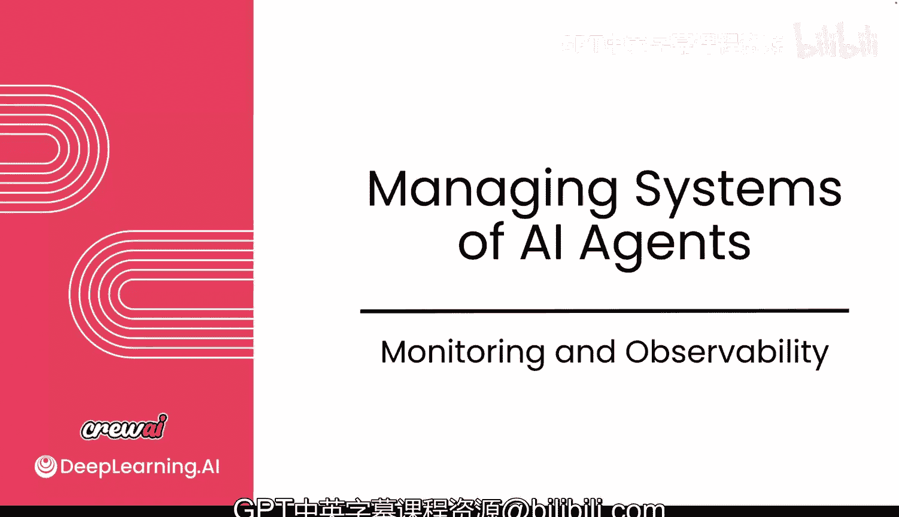
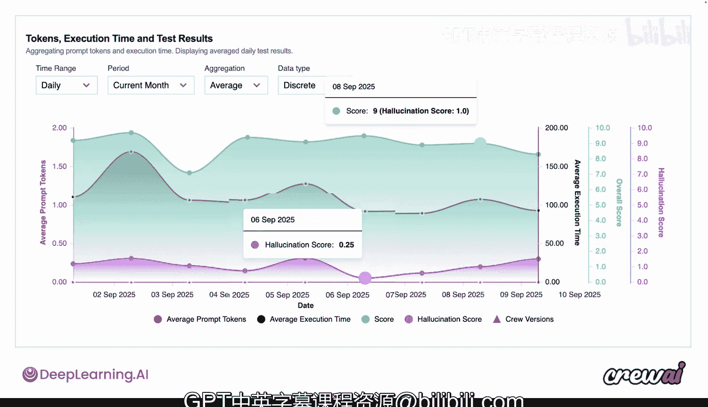

# 吴恩达《使用 CrewAI 设计、开发与部署多智能体系统｜Design, Develop, and Deploy Multi-Agent Systems》 - P29：8.monitoring-and-observability.zh_en - GPT中英字幕课程资源 - BV12eCQBAECM

Now， you're feeling pretty confident about your use cases。 you build your agents， you add hooks。

 you added guard rails， you applied a lot of the things that we learn in this course。

 Once that they actually go into production， the work doesn't stop。

 You need to make sure that you are monitoring them。

 especially because once agents are running into a high scale environment。

 They're running at machine speed。 So you want to make sure that you have all the monitoring in place to observe how well they are doing。

 And we're going to talk about how you expose those metrics and how you can really see what is going on in the system so that you can use those metrics to actually drive improvements。

 CI gives you a lot of tools in order to do that。 So let's start talking about those。

So we have been talking all about all these different features and all these different ways that you can try to enforce behaviors and just make sure that you are getting reliable outputs from your agents。

 But in the end of the day， what reliable output means。

 is that you're trying to build agents that you trust。

 And they touch into this briefly on the last lesson。

 And building trust or if agents requires several elements， It requires the bugability， for example。

 because you need to understand from the prototyping stage。

 what the agentss doing and how it reaches its conclusions and how it's making its choices。

 So you get to understand better and have a more informed opinion on how you will change it。

 So it performs a little better。 Now you also need to make sure that yourre monitoring quality ensuring that the outputs are consistent。

 repeatable and free from hallucinations and aligned with whatever desire format you have。

 that governance is also a big thing， because it's essential for many of these companies to be thinking and looking。

Out to prevent PI or personal data from leaking and basically filterting that out。

 not only to protect that information from being exposed externally。

 but a lot of times to make sure they're not being exposed internally as well。

 then governance in PI protection or even personal information protection has grown to be a major concern globally。

 not only in Europe， but in the US and many other countries。

 So you want to make sure that as you build these use cases， you' are also thinking about that。

 especially as you start to getting ready to move into production。

 to make sure that you're not exposing information that you don't want to。

 prompting is one of the techniques that have been the most exploited up to this point on agents in LLms。

 the idea that someone can inject something into your prompts that will actually compromise your use case or might result in security risks must be addressed as agents。

 especially those that are generating code can open up new attack。

If they're not properly sent boxes or validated and ultimately you want to make sure that our agents are winning a scale that you can trust them。

 so not only on terms of the work that they' are doing and the data that they have access。

 but also that the entire infrastructure can take on the load of whatever it's necessary to perform at a part of your use case needs。

These topics usually split into three boxes， though。

 If you think about all these different things that we have been talking up to this point， though。

 they always go back into three main boxes。 observability， security and compliance。

 A lot of the applicability and quality monitoring falls unders observability。

 So when you think about the bugging， when you think about monitoring quality。

 when you think about monitoring hallucinations， all falls under that。

 security with cover areas like cogeneration， checking for prompting jacks。

 checking for data governance， there's a lot going on in that realm。

 especially now with the introduction of MCP servers。

 and compliance will focus more on monitoring issues related to P or personal information。

 there are other compliance guidelines that a company might have。 But across all of those。

 the most important thing is being able to see and identify problems。 That is the underlying common。

Among all of them， doesn't matter if you're doing that to protecting P or if for're doing that to monitor quality。

 And as many engineers know， if you don't have visibility， like not having unit tasks。

 you will quickly lose confidence in what youre building。

 which is low down your ability to move fast。 So you cant fix what you can see。 And that's why at Ci。

 we spend a lot of time making it easy for every to understand what are the agents doing。

 and you already have seen some of these in your terminal up to this point in your logs。

 And there is an even better way to dive even deeper。 you can do every finger your agents are doing。

 whether crews or flows and even two calls， you can see what is happening behind the scenes。

 And that is a feature that we call tracing。 There is a few different ways that you can tap into the data to understand what your agents are doing。

 One， we already have been using across the entire examples that we have built。

 and that is basically setting that verbal。modeode to true on your agents。

 What that will do is that will plot in your terminal。

 the entire chain of To and the entire series of actions that your agents are taking。

 But if after creating your agents， you set up tracing to true into your crew。

 they're going to get a next level view and that by basically enabling that one single flag to true。

 we now give you a final URL at the end of your execution that you can immediately loading your browser and go deep into observing every single step of your agents。

 you're going to be able to see things broken down not only by the agents and the individual tasks that they are taking。

 but you can expand on that LM call to see the actual response that you got back and you can even go into the tools that are being used and see what and how these tools are being used out the way to the raw data that is being exchanged。

The scenes between your agents and the LLMs。This is such an immense value for someone on the prototyping stage。

 So they fully understand what is happening。 And it's also great for debuging in case you end up having an edge case where something breaks or goes south and you need to trace it back to understand how you got into that weird stage。

 Now， I want to make sure that we are taking one step back and also talking about Once that you're running thousands off agents at time。

 How do you keep track of that。 Product agents operate at a machine speed。

 What I mean by that is that it's not something that a human speed can observe necessarily at the same time。

 So observability becomes more reactive and proactive alerting becomes away larger priority。

 And in order to do that， we also give you some features like crew quality sampling。

 where you can set how much sampling you want to do what percentage of your total executions。😊。

Be used to create a quality score and an automatically hallucination score for your crew。

 And once that we have set this up， you're going to have an entire chart plot up for you。

 And know there's a lot going on in here。 So let's dive into this for a second on the x axis。

 you have time So across many different executions across many different days。

 you can see how your agents are doing。 And on the y axis you have a few different options。

 you can see not only the average prompt tokens that they are using。

 but also what is the average score that they are getting。

 and what is the hallucination score that they are getting。 So in the end of the day。

 we're using the collective data out of your agent executions between the actual output and the expected output and all the different actions that your agents take to give you an overall10000 foot level view of everything that is happening with your agent system。

 by looking at the chart， you should be able to quickly grasp it any。

In terms of inequality or hallucination。 And if that traces back to any specific changes that you might have done。

 And this is very exciting， but it's also just the tip of the iceberg。

 There are many other tools out there that allows you to take this so much further into observability。

 So you might want to look， for example， at a cutting edge tools like a rise or Galileo or many other observability tools that it can actually check deep on your agents to see how they are doing and how they are performing。

 and they have way more specific alerts around your specific use cases。

 We definitely vouch for many different tools that is out there and those two come top of mind。 Now。

 in the next video， we're going to start talking a little bit about how you go even further in that direction。

 was that you' are actually getting into shipping， As that you trust these agents。

 How do you make sure that you keep trusting them over time。

 How do you make sure that they are not breaking as you keep adding new features to them。

 That's gonna be a very exciting topic。 So I hope to see you in there。 I hope。😊。

You have really enjoyed the course up this point where going the tell your end is going to be very exciting。

 I will catch you in the next lesson in a second。

