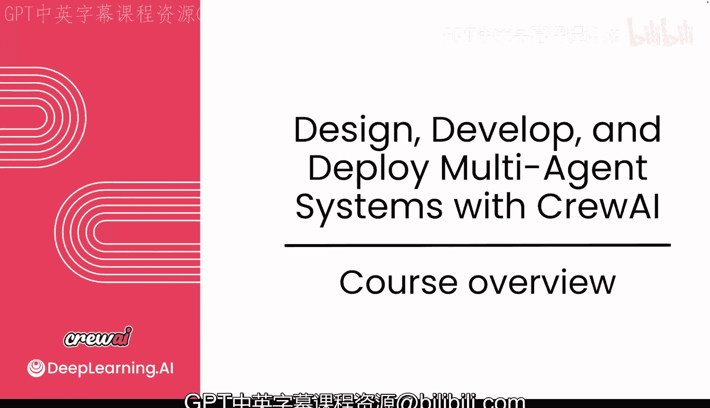
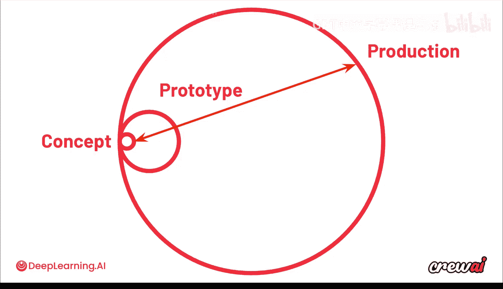
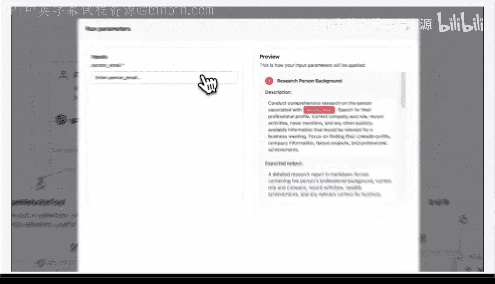
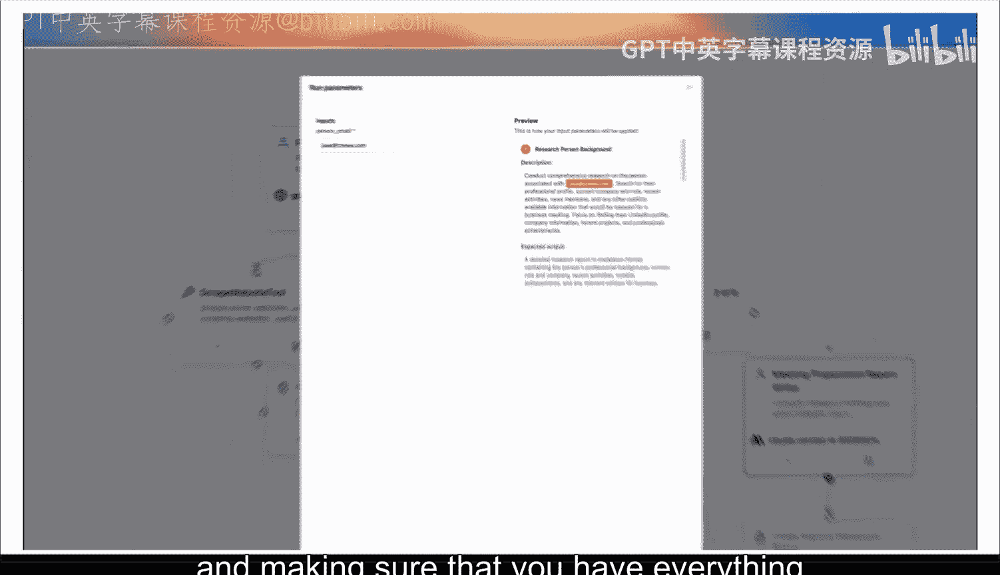
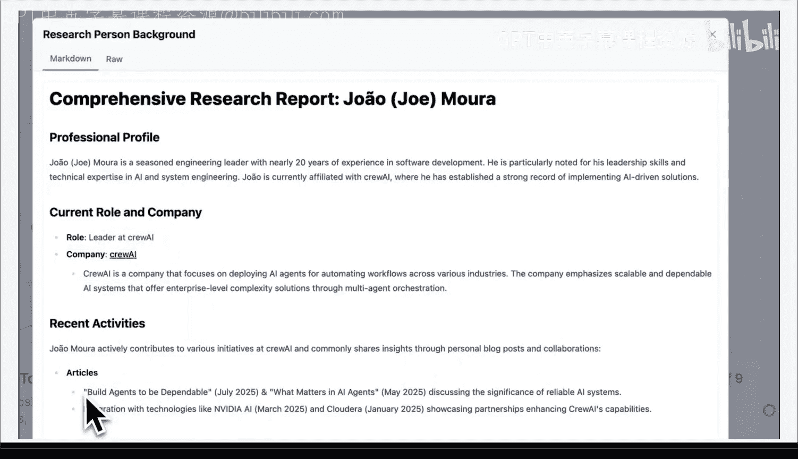
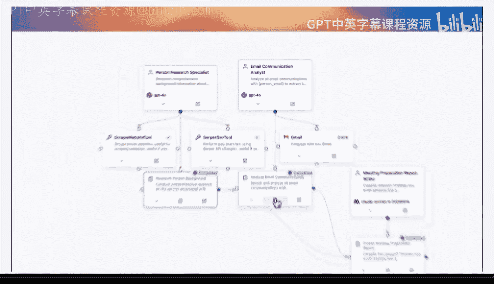
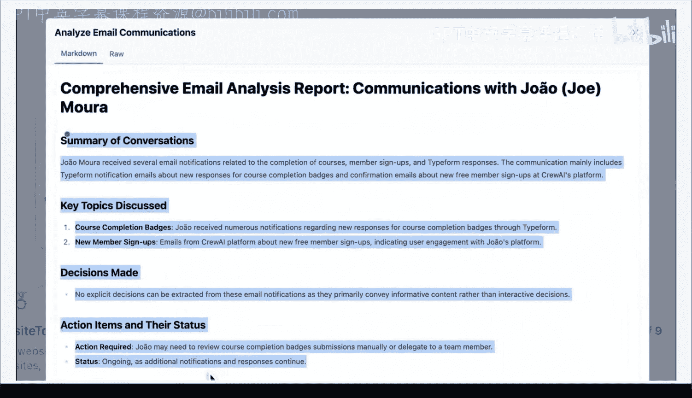
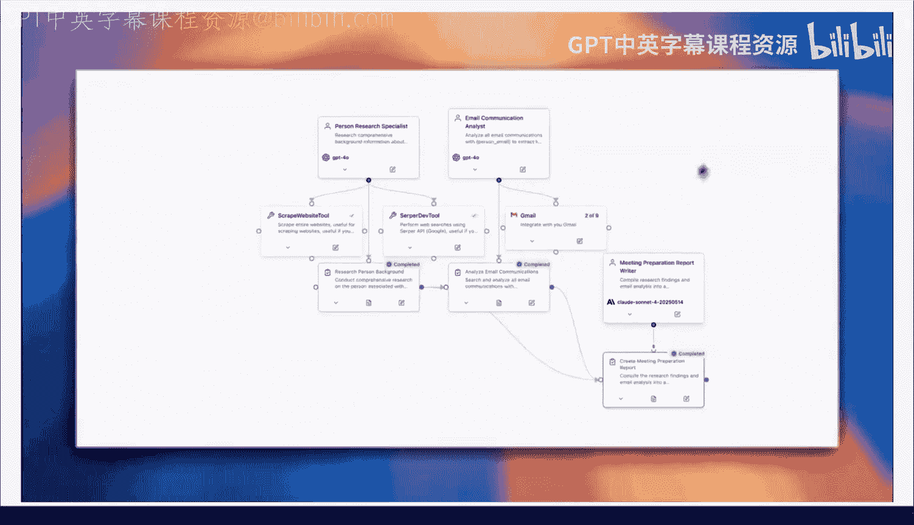
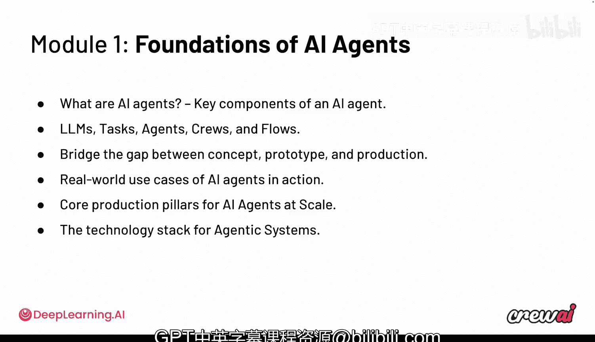

# 吴恩达《使用 CrewAI 设计、开发与部署多智能体系统｜Design, Develop, and Deploy Multi-Agent Systems》 - P2：2.course-overview.zh_en - GPT中英字幕课程资源 - BV12eCQBAECM

Welcome to the first module of this course。 I'm so excited to have you。

 We're going to talk about everything about AI agents。

 We're going learn how to build them from prototypes and all the way to production。

 It's going to be super exciting and you're gonna learn everything that you need。

 So let's jump right into it so we can start learning about it。

 So here's what you can expect from this course。 We have a lot to cover。

 You're gonna to learn how to build your first mo agent system and improve it。 but not only build it。

 you're gonna to learn how to manage AI agents at different scales from starting it small to expand it and getting into a production stage。

 We're also going to talk about evaluation and how you measure an agent systems performance。

 but we don't stop there。 We want to talk about exploring this idea of a new technology stack that is forming around this agents。

 While I want to focus on some of the bigger， more impactful use cases。

 And what is working on the real world。 What are the things that companies are actually doing and how that is fine。

 And then in the end， we're going wrap it up。😊。

P this principles in your career， how everything that you're gonna learn in this course goes back into use cases that you can build yourself。

 So I'm very excited about this。 So a lot of the focus on this course is going be around how you think about these agents conceptually。

 But then how you prototype them in a way that allows you to get into production。

 And when you create an idea of a use case the concept of that idea is also extremely simple。

 But the distance between that and the prototype is so wild。

 And then when you get into the production that is even wider。 now。

 for you to gather from that initial concept and to implement not only the use case itself。

 but all the balances and checks and the monitoring in the observability。

 if you don't really think to do this from the gago。

 you might end up having issues later down the road。 Now， before we keep going。

 let's take a look at what a fully flged production crew looks like。 More important。

 one that you would be able。😊。

To build yourself at the end of this course and that it could help you on their day to day。

Let's think about this use case as you getting prepared for a meeting。

 You're going to meet with someone might be a sales meeting might be a partnership meeting。

 but you're going to have to prepare yourself。 Why not use agents for that。

 Let's say that you're meeting with me and you want to learn more about myself and making sure that you have everything together and ready to go for when we meet。

 Well， you can basically put my emailing here and kick off your group of agents and they you get all the research done for you。

On the research side， you can see that it found all the information about me。

 the fact that I have a lot of years in experience in engineering， some of the company。

 some of the articles that I have contributed for。😊。

On the email side， it saw any emails I exchanged with myself in this case and information that might be in there。

And then it puts together this final meeting report。

 getting me ready to go into this meeting with the confidence that I'm fully prepared for whatever happens。

Now， this is more of a simple use case， but there is way more complex use cases that we're going to be talking and building together in this course。

 And in this first module， I want to just frame a little bit on what you can expect。

 The first thing is talking about what actually are AI agents。

 What are the key components of an AI agents。 We're going to talk about Lms tasks， agents。

 Crus and flows。 how you think about agency and how you think about control and bridging the gap between the concept。

 prototype and production。 out that while focusing on real world use cases for AI agents and action。

 in the core production pillars for AI agents at scale。 And in the end。

 we want to make sure that we are putting this through the lens and the context of this new idea of a technology stack that is coming together for agent systems。

 I'm very excited to go over module1 with you。 So let's not lose any time and jump right into that。

 I see in there in a second。😊。

