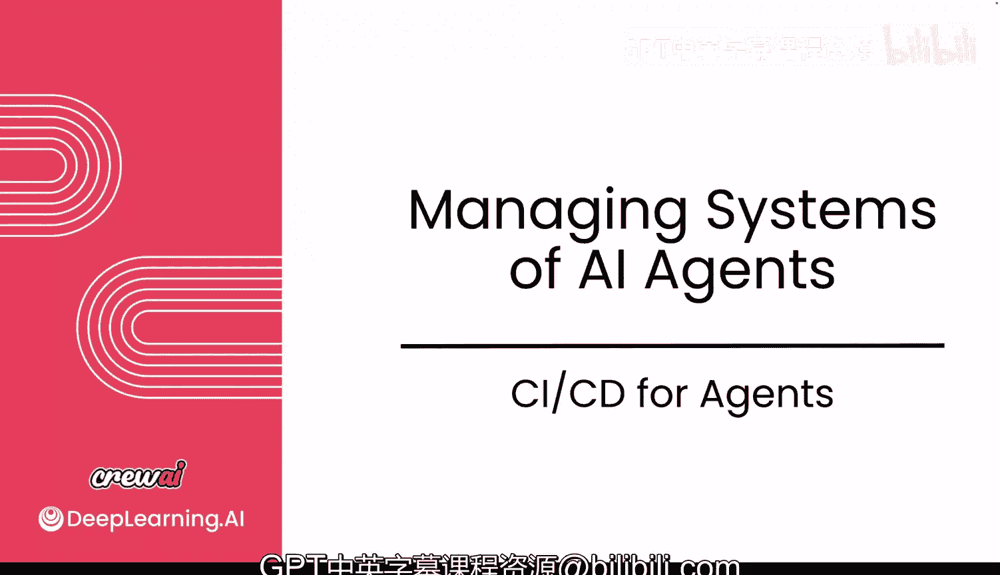
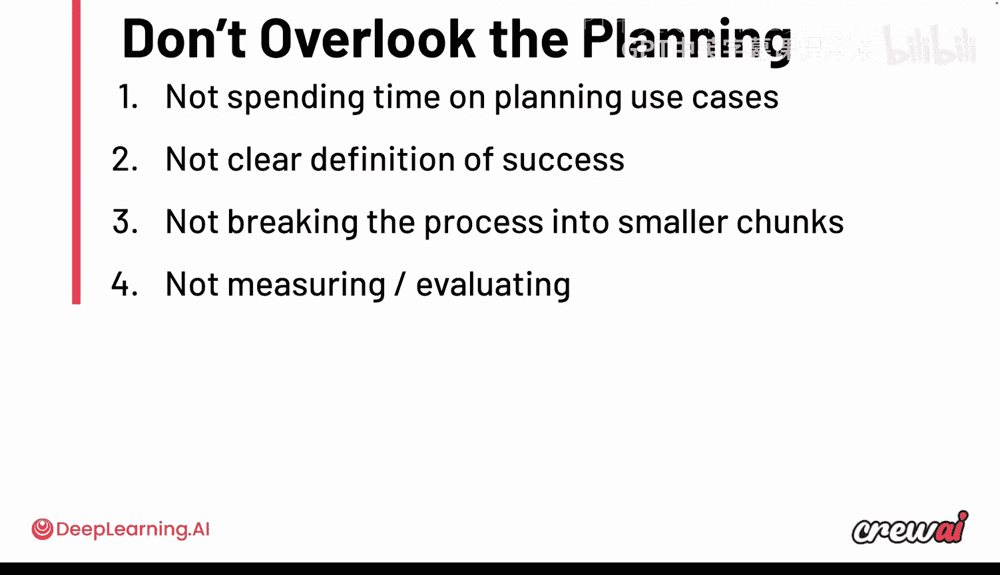
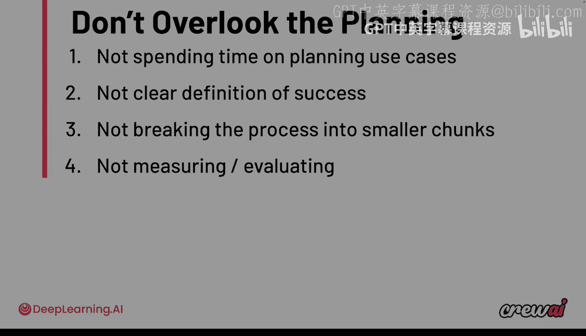

# 吴恩达《使用 CrewAI 设计、开发与部署多智能体系统｜Design, Develop, and Deploy Multi-Agent Systems》 - P30：9.ci-cd-for-agents.zh_en - GPT中英字幕课程资源 - BV12eCQBAECM

Wster agents are in production。 You w to make sure that they keep running and they don't break and that you don't break them。

 If you're an engineer， you probably are very familiar with C and Cd。

 So now we're going to talk about what that looks like for AI agents。

 how you make sure that your agents as you're improving them are not breaking and they' are running reliably after they go live。

 It's helpful to think about this the same way that we think about CicD flows in more traditional like development applications。

 let's go into that and see how C ID works for AI agents。

 We're going to talk about shipping AI agents at scale next， Even though deployments important。

 It's not the main challenge。 the real hurdle is keeping these A agents running reliably after they go live。

 So it's helpful to think about this the same way that engineers approach CicCD flows。 for example。

 So some of the questions that you have going into this。

 It's things like how can I support new models。 And this is important because。

So many models are being launched weekly and so many new developments on the model strategies and variations and fine tunes。

 so the ability to truly experiment with these different models and try them out is something that can have a huge impact on how you build the systems but not only that you also will be thinking about how the systems are evolving over time to make sure that they're getting better and not worse and to make sure they're still working and don't start just breaking So once the systems are live。

 you will constantly have these questions about them。

 you wonder whether you're using the new or the cheaper and the fastest model you're wonder if these are working as expected and when you start to thinking about this challenges。

 things become more complex and it's important to approach the production agents with deeper planning and consideration。

 So if you really think about the process from going to actually figuring out a process that you want to automate out the way to have this agents monitor and deploy initially you want to start with just。

😊，Understanding the problem。 And I know this sounds like not a big aha moment。

 but let me tell you what。 Most of the companies out there， they're not failing because of the tech。

 The tech is there。 and the tech is quite impressive。

 They're failing because they're not really thinking about their use cases。

 they're not really mapping their use cases。 They're not thinking about measuring them。

 And what is the definition of success for their use cases。 And then from mapping the process。

 you then want to implement a first version and the idea here is moving extremely fast。

 You want again， the0 to one win as fast as you can。 And then you want establish a valid set。

 The idea from the first version to establishing the valid set is that you just don't want to be an MVP。

 you want something that things moving。 Don't worry about perfection。 You are gonna refine it later。

 But ones that you have that first version， you can start establishing what is good and what is bad。

 What good looks like for that automation。 and that will be your。Validation set。

 So these will give you a clear baseline to measure whether your updates are improving or degrading in performance。

 And when I talk about a valid sack here， what I'm trying to do is to establish a baseline that you can measure against。

 you need at some point doing your implementation， have a set of use cases or a set of runs that you have done that establish what good looks like。

 And the reason why that's important is that as you implement either guardrails or changing the LLMs or training or testing。

 you need to have something that you can suddenly check against you need to know if you're moving the ni。

 if you're actually driving improvements or not。 and the only way that you can do that is by establishing a baseline。

 So establishing a valid set early on is important。 and then updating that as you go。

 it's even more important so that you make sure that as you change these things。

 they not only keep working， but they keep getting better。 And after setting up that validation。😊。

Then you can start implementing guardraos to ensure that your agents are actingroply when some of these events occur。

 And that's where a lot of the things that we saw come into play， not only the gardenraos。

 but the task the training and everything in between。

 But the key here is to establish this validation set early and implement the guardres and triggers after things are working and just maintain ongoing monitoring。

 this cycle will help you build better versions faster grounded in measurable progress against your actual baseline and when building this validation set。

 just make sure that you don't just store prompts。 you also record the actual metrics like the quality assessment the runtime。

 the cost So collecting and analyzing this data over time can help you make informed decisions about model selection。

 trades and performance improvements。 And that's why important for you to think about that。Now。

 I do want to make sure that we are thinking about these things right。

 You already notice that there are two vectors of the improvements that we can drive in here through the process of building these agents。

 you do want to make sure that everythings properly version。

 and you clearly understand what is changing on every single version。 So at query eye。

 we focus heavily on separating the prompts where you have the roles， the goals。

 the backstories and descriptions and the expected outputs from the actual agent logic itself。

 that way， by keeping the prompt separate， allows you to whip it independently from the code And since prompts are stored as the M files。

 they are very easy to added and maintained even by nontechnical team members。

 and you can also create repositors for these prompts to being reused across different agents or projects or even use or agent reposory to restore that agents are going to talk about that in a second。

 Now， for the agent logic on the other hand， is more custom in reading more traditional code。

 especially when you。Tos and hooks and guard rails， Even so much of it can still be reused。

 So this separation of concerns make possible to reuse well design agents。

 especially those with strong prompts and Tat across many tasks and use cases with minimum modification。

 Now， let's say that you want to create your crew。 where kind have seen this a little bit。

 But you can actually use your CI to create an entire structure for you。

 All you got to do is write query I create crew and give a name to your crew。

 and then you can go into that folder。 And you're gonna find this entire C structure for you。

 And you will see that your agents and tasks are all mapped out to the Ymo files that have the agents rolls。

 that goes the backstor and the task descriptions and expected outputs。

 Let's say that you put a lot of effort into an agent Think the right tools。 the right prompts。

 And it just works to the point that you can reuse to do many tasks on many different uses。😊，aseWell。

 the good news is that we actually offer you the ability to not only have this agent M files that you're gonna to be using on your project。

 but also actually using them on your agent repository so that you can reuse them across many use cases So you can now go into then create this agents in your repository online and reuse them locally and you can do this for free。

 all you' got to do is go through this and create your agents and it's the entire Ui dedicated for that and once that you want to use it personally on your local computer。

 you can load from that repository itself directly。

 So this is they're important because allows you to have this agents and reuse them over time and the same thing is true for tools with tools you can have this one single repository where you throw all of your tools in there public or private and you can reuse them across many use cases if you want to create a tool you。

😊，is again， use that same Ci and type the command queryi to create and give your to an name from that point on。

 you're gonna have a structure of what a custom tool looks like and you can modify it to do whatever you want It can connect to a specific system。

 It can connect to an external system。 it can actually build a video。

 anything that you can think of you can make into this tool。 it's all regular python code。

 The moment that you run the publish command。 now that tool is available。

 not only for other people on your team to actually do Ci to install and have access to that tool。

 and youre using that across many different use cases。

 but even on that no code Ui buter that we saw all the way in the beginning of the course。

 you also have those tools available to you。 So you can use this two postic to publish and share tools across your organization。

 given everyone access to a centralized internal library。

 and these tools can include custom code MCP servers or anything in between。 and this approach。😊。

Because it not only improves observability and metrics at the crew and the use case level。

 but also creates reusable Lago pieces that can be applied across many different projects and works。

😊，Now， I do want to make sure that we're taking one step back。

 and we are talking about these use cases。 and it's important for us to not overlook the planning stage。

 I briefly touched into that on the beginning of this lesson。

 but I want to go back and close into this。 Many people who skip and going straight into writing code。

 which can be exciting and produce very quick results。

 but carefully planning links so much better outcomes。

 A common pitatfall is failing to define success clearly and not a breaking this process into smaller manageable chunks that can become individual tasks。

 Some teams also forget to measure or evaluate the results because they never establish those metrics in the first place。

 And as you move towards production， taking the time to playing thoughtfulfully。

 So your system as well is structured， measurable and but to evove effectively over time。

 So the four things you've got to keep in mind is spend time on planning。

 have a clear definition of success。 Make sure that youre breaking your。😊。

ss into smaller chunks and make sure that you have a way to measure and evaluate。

 We have learned so much in this module all the way from collaboration to agents coordination。

 different patterns building flows， implementing reasoning agents， training， testing。

 structure output and so much more in there is so much more things that we can build now that we have all these tools on our back pocket。

 Com up， we will complete the graded quiz and graded lab for this module where you are gonna create a code review flow using all the skills that you have learned in this module。

 It's going to be exciting because the very handson use case that you as an engineer。

 I'm sure that can appreciate。 And youre almost coming up at the end of this course。

 So once that you are done， you see that in the next module， things are gonna go into the next level。

 because we're going to talk about not only AI agents in the context of how you build them。

 but on the actual business value。 It's a very special module。

 because I'm going to try something different and bringing。😊。

In a group of companies that are building AI agents in production。

 real practitioners that have hands on experience。 and they're leading some of their teams into this。

 And I wanted you to hear from them as I talk with them。 What are the challenges。

 What are the things that are working for them。 And what are the things they're having problems with。

 And that's gonna be very exciting。 So I hope to see you in there right after your great course。

 Please stick with me。 It is going to be very interesting。 I catch you there in a second。😊。

