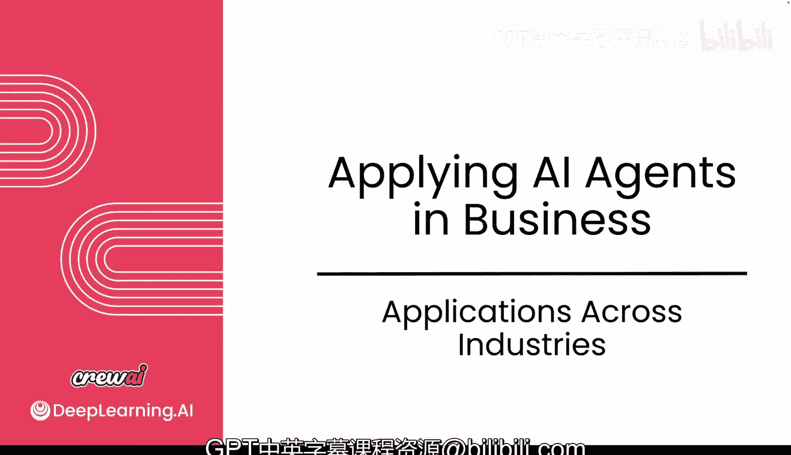
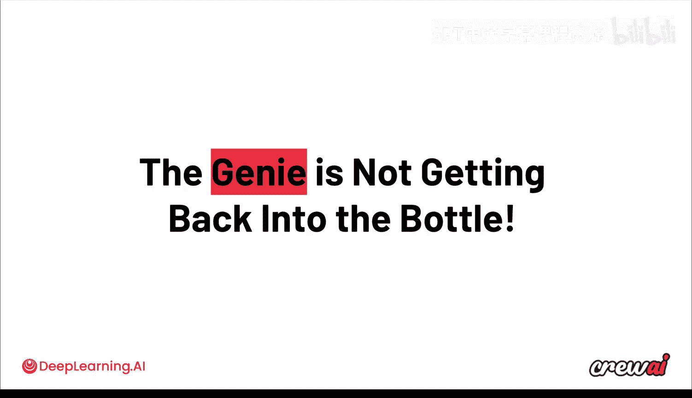
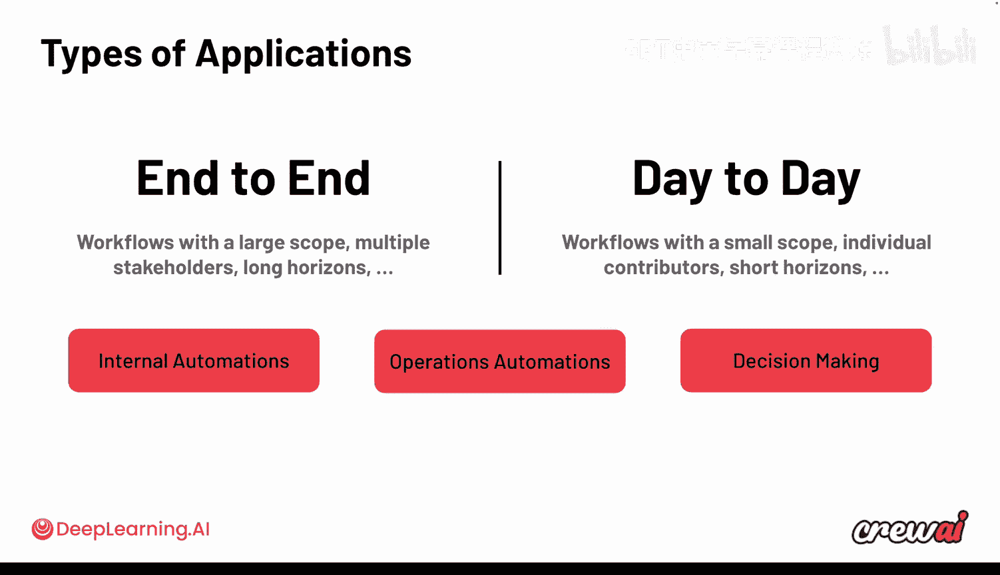
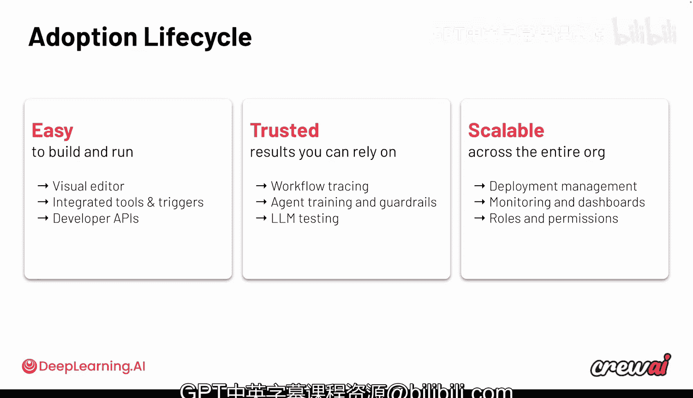

# 吴恩达《使用 CrewAI 设计、开发与部署多智能体系统｜Design, Develop, and Deploy Multi-Agent Systems》 - P31：1.-applications-across-industries.zh_en - GPT中英字幕课程资源 - BV12eCQBAECM

Welcome to the last module of this course。 And it is super exciting because up to this point。

 we talk about so many things about AI agents and you learned a lot about it。

 But now we're going to talk about the future。 And what is ahead for AI agents together。

 we start some Prat career word applications。 and what expect the coming ears。

 But before we speak with some of these people in these companies there are actually building AI agents in production。

 Let's explore how teams and organizations are actually using AI agents in their domains。

 This is gonna to be a very exciting module。 So make sure that you stick around and let's dive right in。

 in this video we explore how organizations are actually using AI agents across many applications domain。

 But let me kick off with one thing。 and that is the genie is not getting back into the bottle。

 And what I mean by that is there is no world where these agents are not going to be used more and more into the future。

😊。

If you think about it， this is just the beginning of what the new workforce will look like。

 AI agents will only improve from this point forward。

 and there is no scenario where organizations who stop using AI agents in the future。

 So the idea of automating and automations， leveraging AI， we continue to evolve improve。

 Once that you accept this reality， you see opportunities for AI agents across many areas and AI agents themselves have tremendous potential to impact how we work and how effectively we operate in how we conduct our business。

 If they really think about these sorts of use cases that we talk about in this course。

 they range from end to end processes like transformational processes that go across different business units there's large scope。

 there's multiple post stakeholders and long horizons。

 And then there is also a lot of the day to day automations like we' meeting prep example。

Something that helps me get my work done faster。 And I want to discuss the different types of automations and use cases that we can see the market。

 So these two clusters are very important because whether they are going to take shape or forms of internal automations or operation of automations or even decision making。

 whether really matter is that this involves complex workflows that can drive real value。

 So when you think about the end to end sort of applications and automations。

 we're talking about task that used to take many weeks， and now only takes a few days。

 hours or sometimestime even minutes。 Exles might include back office work or some front office operations。

 these automations start with agents and end with agents。 They often spin multiple business units。

 they might have humans in loop in the middle， they are more complex to build。

 and they require a certain level of precision， but they do bring a lot of value with them。

The day to day is more of the individual optimizations that we talking about， right。

 It makes you more productive， but they're easier to view it。

 So you get a lot faster value from them。 Exles， including not only are preparing for meeting。

 but also things like generating report or automating specific job tasks。 Why individual in scope。

 this day to day automations do pile up and pile up into an amazing and sizable impact once adopted across an organization So this automations can be extremely helpful in improve efficiency at the end of the day。

 If you look across the board， you're going to find a few brand new cutting edge use cases。

 like what people are calling APA， basically replacing robotic process automation with agent process automation。

 You're also going to see agents being used for a new agent E TL pipelines。

 whereas you're ingesting data， you have agents inferring new data based on that or modifying that。😊。

On the fly。 and you also have some agent native features。

 basically new features into this product that allows your product to do things that were not possible before。

 Now， if you look at the top verticals， you're going to see there is many different businesses that can actually benefit from this agents from financial services to health and life sciences to insurances or high tech companies。

 media and entertainment or customer services， Cpgs， cons and teles。

 those are just the top 9 that we're seeing using the agents the most nowadays。

 and there's a lot going on among all of them。 But within these companies。

 you're going to find the many functional areas or horizontals within these companies on what use cases they are doing and what they're trying to do with agents。

 We are seeing a trend on sales and marketing use cases， but also developer automation。

 cybersecurity， supply chain， pricing use cases and people management。

 So when you look across the board， what you see is。

immensemenense landscape of opportunities for building these sorts of use cases across different companies and across different horizontals within those companies。

 and this will help you understand what resources to pull as you're thinking about your own use cases。

 whether you're built end to end automations or day to day use cases。

 you can see how those maps to some of the ones that are being used the most out there。

 This brings us back into our use case matrix that we talk on the beginning of the course where you think about the complexity and the precision crrants of your use cases。

 a few lessons ago， we talk about this framework。 And given how important it is I decided to bring it back as you think about your use case and how AI agents are performing actions in business today。

 you need to understand where your use case falls in this framework。 remember。

 you can have high complexity and high precision all the way to low complexity。

 low precision and everything in between。😊，There is no rather or wrong position on this framework。

 It just helps you understand what is the effort and how much you're going to put into this in order to get the value that you need。

 So low complexity low precision use cases can save significant time and have a huge impactling organization。

 And the key is understanding where your specific use case false。 doesn't matter if it's low or high。

 Now， I want to walk you through several specific real use cases from companies that are working with querygi。

 And through these examples， we will see different levels of complexity。

Different distributions and examples of both end to end and day to day automations。

 And that will make extremely tangible for you。 what is the value of some of these use cases。

 Ones that we are talking about running them for real businesses。

 And this might inform some of your decisions。 So you want to make sure that you say tunening to this。

 I want to kick us off with a financial institution。This is a global 500 institution， a large bank。

 and they decided to focus on their QyC process。 QyC stands for Know your customer。

 This is a process that involves collecting information about a customer in prospective customer。

 It requires an intensive research and categorization to understand each and specific individual。

 and a bank needs to do that in order to make sure that it's provided this individual with the right products and services。

 So this foundation institution use Qi to automate their process。

 and they got a few very interesting surprises。 The first one is that the initial report that they had the agents produce was actually more accurate than the first draft from humans。

 And parts of the process that used to take one week of work。

 now are taking 15 to 30 minutes in total。There was a fourax reduction in the time to perform the overall onboarding of the Know your customer due diligence。

 where all these agents are now doing their research， They are pulling the tax returns。

 They are validating that data against Apis and all their financial institutions before approving or not approving。

 and this has a huge impact on the bottom line for large organizations like this。

 This is an end to end automation processes， as you can tell。

 It's focused on reducing the time in increasing efficiency。 So it's all about efficiency gains。

 It demonstrates that highly regulated business can benefit from automations like this。

 As long as they are being built from the ground up to make sure that they support governance。

 and their focus on use cases where they can move fast to get early wins before start scaling things up。

Now， I want to change gears for a second because our next use case is a global Fortune 500 CPG and CPG stands for consumer packed goods。

 We talked about that in the past as well， This is one of the industries are refing a lot of potential for agents。

 This are companies that make products that you can buy supermarkets and stores。

 such as Baard's snacks or consumer items。 These companies set out to improve their refund process。

 So whenever a customer found something missing or something wrong with their products and they want to ask for their money back。

 as you can think this is a very frustrating place for the customer to be。 And if anything。

 they want to again that are resolved as quick as possible。 But due to legislation。

 these companies needs to do a bunch of checks。 They want to make sure theyre not falling for a trick。

 that the products is actually wrong。 So there's an entire process that goes into validate not only that person's credential。

In that person's history， but a lot of the internal process around that product as well。

 So in order to do that， they decided to automate the entire refund process to use AI agents with careerI。

 and they're able to reduce the time to process refund requests quite abruptly。

 replacing highly manual processes involving multiple teams。

 taking the whole thing down from three days to just under 10 minutes。

This creates a very interesting return on investment for a company like this。

 and you can see that this is another example of an antuate automation。

 but more scope down for a specific process。 And again， another back office automation use case。

 as were're seeing many of those。😊，Now， I do want to bring a third use case。

 And this one is different because this is not about efficient gangs。

 This is about a revenue generation。 And I'm very excited about this one。

 This is a global 1000 company。 meaning it's one of the thousand biggest companies in the worldd at its a telecommunication company。

 and they decided to take a completely different approach into that。

 As I told you we have a focus on efficient gangs， they start to wonder what kind of lines of businesses。

 they could explore where before there would require a huge investment to make sure that they can explore this as an actual idea。

 But now by leveraging agents they can actually test these concepts on a more controlled environment and eventually put more money into that。

 So they decided to use agents to analyze their customer behavior and data。

 If the customer is a prepaid phone or postpaid phone and all the data that they have on that specific customer。

 and by using agents to analyze。😊，That behavior。 Find what patterns this customer had and use that to give them a certain credit score。

 And by having this credit score， they could start a new line of business， offering money lending。

 And because all this is using agents， they can have the money on the customer' bank account within two days from the request because everything is as automated as it can be。

 And the way that they did this is that by analyzing the customer spending patterns。 For example。

 their phone usage and used agents to process that at scale。

 they learned there's a high correlation between the patterns that they found and what they believed their credit worthiness would be。

 And they achieved remarkable success into that is spending not as much money as they would if they actually wanted to kick off this as an entire line of business with no agents at all。

 So here you can see this is a completely different use case。

 It's more of a revenue generating use case instead of like up efficient display。 And this is very。

Inesting now， beyond this， there is more things that we want to talk about。

 And that is how the adoption life cycle of these agents has changed it throughout the last couple years。

 If you go back， it's almost like we had a few different phases。

 And the market has been transitioning and evolving contingly。

 So organizations are becoming better educated， more sophisticated and understanding how the agents can help their business and they have several distinct phases place out。

 So at first， you go back two years ago， you saw companies doing a lot of chatbots。

 in this chat bots were very much a general purpose bot。

 They had what you would call a single agent behind them。 just using common knowledge。

 somewhat interactive， but very much focus on just chatting use cases。

 either internally or externally。 These are not something that emerged right after chat TP。

 This chat bots have been around for over a decade。 Then we saw a second phase。

 and the second phase was。Copis。 so more recently， we're seeing more of this idea of AI assistance or AI copilos。

 where you might have one agent or maybe it might feel like many agents。

 there's some delegation happening， there is more specific domain knowledge。

 either true integrating rag or it's more interactive but the idea here is that many companies are now adopting this pattern to help on different things from coding to writing documents and a few other things in between。

 And now we're getting into this third phase where you actually start to see agent work take on the main stage。

 And this is the newest and the most cutting edge phase where you see multiple agents working together collaboratively。

 And this include process specifics or task specific agents。

 but also include more broader agents as well and integrating with many tools。

 including MCP as we mentioned and memory systems as well。 So this can be trigger automatically。😊。

Individually， and there's a stronger focus of not only efficiency， but as we just saw。

 also revenue generating use cases opening up for so many more opportunities。 Now。

 independently of how youre choosing to build the agent workflows。

 If there is one thing that you gotta take from this。 is that whatever you do。

 it needs to be extremely easy to build and run。 So you can either use code or no code to do it。

 but you do it in a way that will help you build fast so gets it to value。 and it's to be trusted。

 So you can actually rely on the outputs。 So the traces needs to be there。

 The training needs to be there。 The guardras needs to be there choosing the right models needs to be there。

 and not only that it also needs to be scalable and the scalable here doesn't mean necessarily running a million agents in the month。

 What we have a few customers that are doing。 but it also means build them in a way that is reusable。

This idea of Lago blocks， Lago pieces that you can reuse。

 either through agents or to toolss or anything in between。 If you take this stept back。

 these are basically the three pillars that need to be top of mind as you go to build these use cases and this is the foundational of what we build career Ai as well。

 I'm very excited that we got to cover so many stuff up to this point。

 and hopefully on this final module as they're getting into the nuts and boats of this AI agents we start to when stand better how they can not only serve you。

 But how you actually should be thinking about these use cases and what are the main things that if you make sure that you' get right from the gago。

 they're going to help you across your entire journey。

 I'm very excited for the next lesson we examine the patterns between successful implementations。

 we explore adoption patterns within these companies and what they look like when they' are adopting these technologies and I'm very excited about that because you。

😊，I find an opportunity to see how that it can apply to your own company。

 your own team or your own use cases， so you don't want to miss that out and you see them there in a second。

