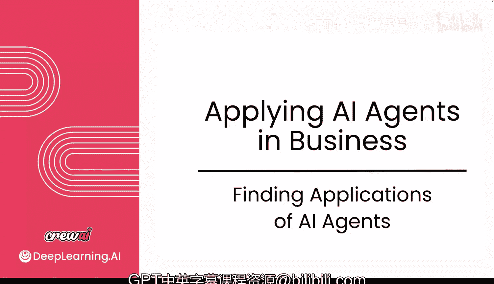
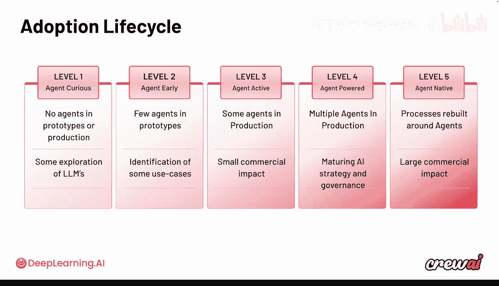
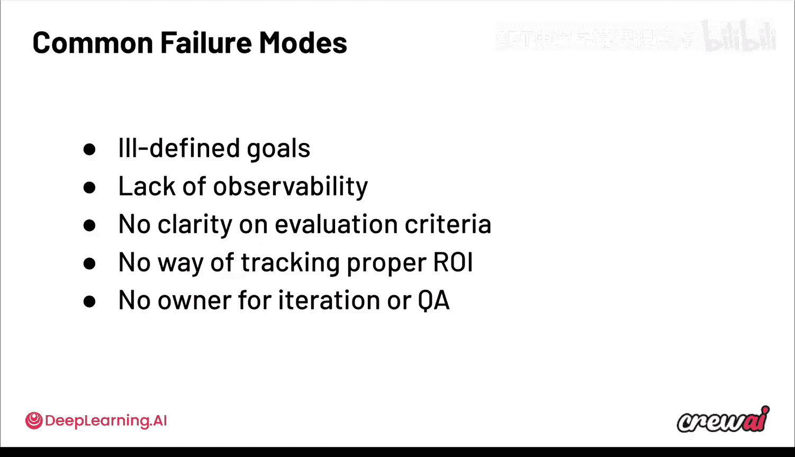

# 吴恩达《使用 CrewAI 设计、开发与部署多智能体系统｜Design, Develop, and Deploy Multi-Agent Systems》 - P32：2.prioritizing-use-cases-for-ai-agents.zh_en - GPT中英字幕课程资源 - BV12eCQBAECM

Given everything that we learned so far， you are probably very excited about all the use cases and how you can apply AI agents to your day to day。

 And even within your company and teams， you might be talking about some of these use cases。

 but how you prioritize these use cases。 How other companies have done this。

 and what are the commonalities in successful implementations， even across different domains。

 So let's explore these drivers of success， so that we understand how you can apply that to your own use cases。

 You learn how AI builders progress from 0 to one in agents adoption。 and not only do that。

 but they do in a way that's scalable。 So let's dive right in。

 So these module is all about what happens when companies are adopting AI agents。

 So let's explore the drivers of successful multiag systems。

 What are the companies that are doing successfully use cases and deploying for AI successfully have in common。

 You learn how teams progress from 0 to1。 and we're going to talk not only about that， but how。😊。

AI agent adoption quickly spread within these teams across their organizations。

 So there's a few common success patterns that we have identified。

 The first one is highfrequ use cases typically make for very successful implementations when agents run many times per week or per month that generate compounding returns or investment at scale that makes it easier for companies to decide to invest on these sorts of use cases So you want to make sure that you're looking for highfr use cases at least again。

 some of these early wins。 The other common success pattern is this idea of a clear success criteria that you can measure And it's essential for you to understand when it is and having this metrics defined early on in the project really helps。

 So defining a consensus and having a consensus around how it's going be or what it's going to be the evaluation criteria can really impact your use cases。

 The other thing is this idea of a reasonable fallback paths。😊。

Meaning that if it's necessary either to go through a human in the loop or having guard rails or LM guard rails or use queryi flows to add more structure to your automation。

 which allows you to be more intentional about the fallbacks can have a huge impact。

 and it's also a pattern that we have notice。 And the final thing that I want to make sure that I mention is this idea of the measuring outcomes。

 you do need traces observability and monitoring place to track performance。

 And when this characteristics are present in your use case。

 youre likely looking at a strong candidate for an AI agent。

 assuming the use case actually benefits from agents in the first place。

 meaningan that you're to be searching for a high frequency use case where you can get a consensus on how you're going to evaluate you can map the reasonable fallback pass by using prei flows or one of the other features that we learn。

 and need to make sure that you're measuring the outcomes with some of the things that we show you throughout the course。

 Now， you do that。😊，You do get amazing results。 There are certain companies out there。

 They're getting to 80 to over 90% efficient gainss on some of these use cases。

 And these gains are possible。 You can actually achieve them。

 You must truly understand what you're optimizing。 though。

 Let's talk about how you understand what you're optimizing for。

 because we talk about a few use cases in our last lesson and some teams optimize for efficient gainss。

 while others optimized for generating revenue。 How you approach these different goals and what you measure in each case will be vastly different。

 Let me actually show you an example。 a real world example of how one of our customers adopted queryi。

 and how they did it。 what they learned across the process。

 how fast they moved and what that look like for them。

 So this is gonna reference something that we have seen before。

 This company that initially engage with us on that price ops use case。😊。

And they got their first use case live within weeks。

 You already know that this was basically a pricing operation for changing prices。

 looking at coupons and discounts。 And they got amazing accuracy and amazing efficiency gains from that。

 Now， from that point on， we actually expanded to three new use cases。

 And then we did a cojoin use case road map。 from that road map。

 we then expanded to five new use cases in one single month with other business units。

 And that ended up leading to an expansion across many different regions。

 And just so you keep in mind， this was not our unicorns and rainbows。

 When we first deployed their price ops use case， the accuracy was more around 60%。

 So there was a few weeks where we were basically improving on that baseline on that valid set that we have to make sure that we got to that 97% accuracy。

 So this was a very remarkable point for us because we got to one and see both。😊，Us and the customer。

 what that actually looks like when you're adopting as agents and then if you look how this played out in how many agents they are running。

 you can actually see from their first use case that they' are cast to the initial scale that they're adding into that to the point that the word starts to getting out in the company to the point that they actually start to expand on their usage。

 We then deploy those five use cases in one single month of them and eventually the implementation expanded globally across as many different regions to a master agreement service with them and then this host chart that is looking beautiful up to this point becomes a flat line because they go from zero to 100。

000 executions in around 15 days。So the adoption pattern in this company is very interesting to observe over time。

 If you see the number of pre executions the company， it starts very modestly。

 And as the word starts to spread and you deploy more use cases。

 and you can start to see value and you can start to see patterns and you can start to see people feeling invested into this。

 the expansion in the adoption really gets momentum and starts to expend appropriately from there。

 And this has been a very exciting use case to see and something that we're seeing across different companies in shapes and forms。

 If you actually look at the industry right now， I would say there is at least five different levels of the adoption lifecycl。

 And I do want to call it out， that level 5 in here is very aspirational for bigger companies。

 Some of the new start ups， they might start as a level 5 just because theyre being built from the ground up for AI agents。

 But many many companies are actually on level 1 or2。 And while we help them。😊。

Is bringing them from that out the way to level 4 and eventually getting them to level 5 as well。

 But the idea here is that you got to start testing this out。

 and you've got to start throwingow things like the wall。 you got to start beauty these use cases。

 And as you do， your growing conviction and understanding of how these use cases can help you and how you can actually but them。

 Now， I do want to make sure that I point out that again， not everything unorn and rainbows。

 And there is actually a few common failure patterns that happen as well。

 So let's talk about those next。 We have seen and learn where agents fails。

 And this usually happens when you have you define ghost。

The agents also can fail not only because you didn't find their ghost properly。

 but because it lacks the observability， meaning that you can understand how your agents are working or if they're working at all。

 Then it also has the problem that we already talk about。

 That is the no clear definition of success or no clarity on how you're going evaluate this。

 And sometimes as a result of the unclear ghost， there is no way to track or to proper monitor the return on the investment that you are doing on this one。

 And most importantly， there is no honor for the iterations。

 there is no key person to keep things improving。 there is no team that now owns these implementations going forward。

 You can see many companies trying to define centers of as or specific teams or having many teams pick and choose their own tools。

 And I'm not gonna say there is a right or wrong way of doing this。

 But you definitely want to make sure that there is an accountability on who is splashing this initiative。

Forward， who is driving， who is actually moving the needle on this one。

 So if you are on a team that is trying to figure out how to get your own use cases started and deployed。

 these are things that you should watch for。 make sure that you are not falling into these traps at the same time。

 understand that there is a process between rolling out agents and improving them over time that leads to greater results。

 And I'm very excited that we are getting the chance to talk about this。

 especially because if you do invest your time and perfecting these use cases。

 you can achieve amazing results， but that requires you to put some effort on that。 Now。

 I want to make sure that we going into a next lesson and I'm very excited about that what as well。

 because we spend time on some of these companies。 and we are going to actually bring these companies into the course。

 And I want to talk with them。 I want to chatant with them about what they are actually doing with Ai and how they're building the AI agents。

 They help us understand how they achieve successes。😊。

And what struggles they faced and what are the things that they are doing right I want to make sure you're not only hearing from me but you're hearing directlyly from people that are building this agents and using your technology so I want to see you in the next lesson this is going to be completely different from what we have done so far you don't want to miss this one out so you see you there right now。

