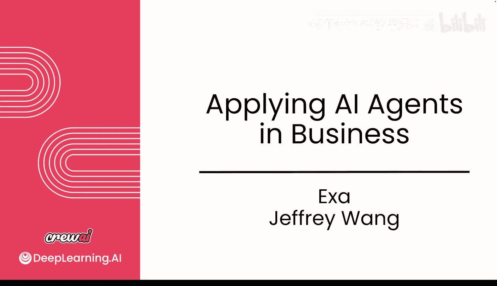
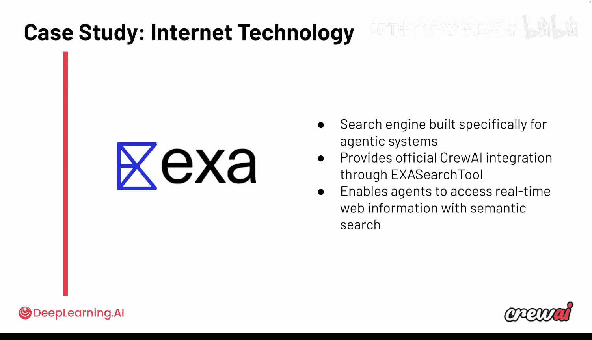

# 吴恩达《使用 CrewAI 设计、开发与部署多智能体系统｜Design, Develop, and Deploy Multi-Agent Systems》 - P33：3.conversation-with-exa.zh_en - GPT中英字幕课程资源 - BV12eCQBAECM

Now， I want to make sure that we talk with people that are building AI agents in the real world。

 I want to talk about how these people are using query AI to build these agents。

 What are the things they're finding exciting about。

 What are the things they're having challenges with in ever thing in between。 So in this lesson。

 we're going chat with these people。 They're leading these projects and making huge strides on the adoption of AI agents in their companies and actually getting amazing results。

 So let's make sure that we dive into this， So we get to know more about how they're expanding their usage。

 how they're finding new opportunities and what are some of the lessons that they learn that you might be able to apply to on use cases。

 So let's join that conversation。 Now you're going to hear from Aa。

 Axa is's a major partner for crew AI。 Aa is going into the search space building their own search engine。

 Opimize for AI and AI agents， making it easier for people building use cases to get the right。😊。

On the right time， exactly how they need it Aa integrates with C AI on an official integration that we have built and you have been using through the entirety of this course It processes millions of request among for AI developers many of those powered by careerI agents in the enables agents to access real time information true semantic search So let's hear from Jeffrey one of their cofounders on how they're thinking about AI agents and specifically how they're feeling about their role that Ci is playing into the space Jeff thank you so much for spare of time to be first today I know that it's very exciting to talk about AI agents。

 there's so much that is happening right now So as the agenda economic like space continues to evolve how important it is from your perspective and what you're seeing this broad ecosystem of tools and resources to keep expanding let's say I think that it's been really incredible it's happened last year basically。

At one point in the past， the LMs were only at one point they were really。

 really bad at using tools and then they got kind of okay at using tools and now they're really。

 really good at using tools right like cloud 45 solidnet and GBT5 codex like they're just amazing the LMs if they don't have any interesting data put into them or if they cannot engage with the external world it's like if you're a human and you're like in a room and you don't have a computer you don't have anything available to you're kind of sitting there and you're smart。

 you have a brain but you're just sitting there and so like fundamentally it's critical for LMs to be able to engage with the external world read information and also write information at least from my understanding of what the AI labs they're working on and what kinds of capabilities they want to be enabling in like the coming years it's like largely focused on tool use external data stuff 10% and it's fun that you put I was actually talking with Andrew about this as we were recording this course and he mentioned that you go back 2024 if you're like a decade ago in A archives these models。

Like they really they were not that good like there was so much scaffolding that you had to put just to make sure that they would behave in a certain way。

 you had to describe every single staff to have all the control but now that models are getting better and better and using the tools and now that like it's really causing people to remove a lot of that scaffolding and doubling down a little more in the agency side of things so how do you see specifically with Aa because you have this very interesting perspective on realtime web search and that unlocks so many different use cases these agents can do so much if they type in the real data and right data at the right time so how do you see these autonomous agents now evolving given that they're getting access and being paired to this realtime web search APIs So when GT3。

5 if you gave it a few thousand tokens and told it hey answer this question from this web page like。

30% of the time and hallucinate。 Like it would just tell you like the wrong answer from the web page right And then at a certain point。

 maybe this is like G4， it started to hallucinate a lot less。 But still。

 if you gave it like multiple options like hey give it like two tools to use or something。

 It's still not gonna perform well。 And then now you can build complex agents with access to say。

 a dozen tools and combine the use of the tools and all sorts of crazy ways。 for instance。

 that's what cloud code does right like cloud code has like 10000 tokens worth of tools。

 It's the file G tool and it has a web search tool has all these things and it's able to change these tools together and produce really useful outputs。

 Web search is just a fundamentally important part of that tool chain because the large language models。

 fundamentally they're not search engines they know a lot of stuff。

 but it's because it's just the stuff they memorize。 And sometimes they hallucinate。

 So they depend on tools， including web search。 Yeah。

 and I think you have a good point because it's not only the ability to web search right your point on theucination。

 is's almost like grounding。Answers right and the fact that you now can give this ability for this agent to like not only give you an answer。

 but fact check themselves or make sure they're working with the latest data and they're finding everything that they need to check all the boxes I think that that's something interesting these are any specific and like use cases that you have seen around this idea off like hey this could like this is where grounding in real data and updated from realtime web data really makes a huge difference And one of those use cases that are seeing out there。

 Okay so let's just think about like what Lms haven't memorized right so like one is recent things so so if if you're asking Lm like what happened today in the world it's not going anything unless it looks up information the second is longtail information So like for instance。

 say you're like AI go to market tool you're building like a sales prospecting tool or something like the LMs just haven't memorized like a list of 1000 biotech companies or like 1000 AI startups or something this is just information。

n't And so this long tail of information that's not super common that everybody just knows like it knows Stripe。

 but it doesn't know like the latest YC company that was working on payments。

 And so it needs to look things up in these cases and then finally I think one really interesting thing that we've been focusing on X a lot is actually coding like a huge limitation of the LMs right now is that they can code really well for things theyve memorize next J they can write perfect J they can write perfect express like whatever but say that like last week I released agents SDk and then also a few other SDks。

 well， these Lms even opening eyes own Lms don't know anything about these SDk and so fundamentally need to do web search to find out information about how to code and so we actually launched something called exa code a few weeks ago。

 which is for instance like coding agent specific search I love that it's funny that you mentioned that that's one of the major use cases we have with PwC one of our customers where they when this models to basically do aap and As So Sap and Salforce coding and。

All those I mean know some about it but not about the PwC way of doing so right or the conditions that they have viewed across many build outs from this application so yeah that's a great use case I mean coding is not the first thing that would come to mind for most people and thinking about this but you're right like if you're not using maxJS like what probability developers know a lot about you need to tap into like Rio grounded data that's great from attack andco perspective like what do you think is the biggest friction points and like people are really trying to like adding this embedding searches or doing crawlings or whatever needs to get into that data like do you think the tooling side of it figure it out or do you think like it's like the quality of the outputs or like what do you think is the main kind of like thing that is getting into way nowadays I think the one correct answer to what is limiting the agents from using like search tools and crawling tools and whatever is context window management like context engineering and so like today if you or you。

ing a lot of these like tools that are like sort of popular what happens is like for instance， today。

 if cloudcode uses this native fetch tool instead of using exa MCP for web search。

 it downloads like files that are like hundreds of kilobytes and just completely floods the context window and I think that people kind of have maybe forgotten how fragile the context windows are because the models feel smaller and then it's like when the model stops working your clients like okay it didn't work maybe I'll try again but like really the models just start not performing well with the latest models in the most powerful models even at like the tens of thousands of tokens level and so if you flood context window with like 1000 tokens of like raw HTML or something like it's not going to perform well and so I think it's really critical for these tools to kind of do some of the token efficiency steps on their own and so for example Exa code has a philosophy where we always try to return you just a few hundred tokens we actually try to just return code examples。

use code examples are the most dense representation tokenwise of what you need to know to do your coding task and if not then we pull documentation。

 but even then we try to keep it to load thousands of tokens and this goes for any tool that you're creating like if you're like ingesting like gigantic documents somewhere it's gonna to flood the context window so maybe you have to use subagents or something like for instance C code has subagents now which is like super cool that's a good point I think like it's funny you go back into like Google when Google was the de fact way that people are searching things and there was this metric of like oh we want to be the website where people spend the last time on where like while all the other websites to like optimizing engagement time。

 they just went to be that quick that you find everything that you went super fast and feels like what you were telling me is that on the new age where like X now is being like a huge provider for searches for agents or new version of that is I wouldn return the most amount of information to the last amount of tokens as I can so like really getting the most bang for your buck not only in terms of money。

But like in the context window because in the end of the day。

 the context engineering is actually something that you really gotta consider like these things are two AI models at the end of the day is like garbage garbage jar so the ability for you to do effective context can have a good impact Well I know that're closing a time I do have one final question any takes kind of like what you have seen with crew AI and X out there。

 any specific use case that you have heard about or things that you have found interesting or any takes on like the AI agent space as broad and like how things are going products and frameworks that are maximally flexible given the increasing capabilities of the large language models are increasingly important so I think that like where I've seen really cool use cases involving crew AI and X like I think both crew and XI have this philosophy it's like hey you have a really smart LLM you as much power to the LLM to be intelligent and do things try to leave it alone build nice things for it to use but don't like interfere and like try to try to control。

Veryry specific way And so all the coolest things I see built on Excel is just like hey like you know you could use some sort of product out there that kind of has some very like narrowly defined use case or something and maybe you're want to build something for yourself that's like that but like give power to the LLM and like let it breathe and like use things flexibly I love that give power to the LLM I'm gonna use more of that Jeff thank you so much I really appreciate you spend time with day this was extremely helpful and I'm sure that people are super excited about everything that they use X for this course I'm sure they're gonna be using it more after this for sure yeah thanks so much for having me this is nice nice。

😊。