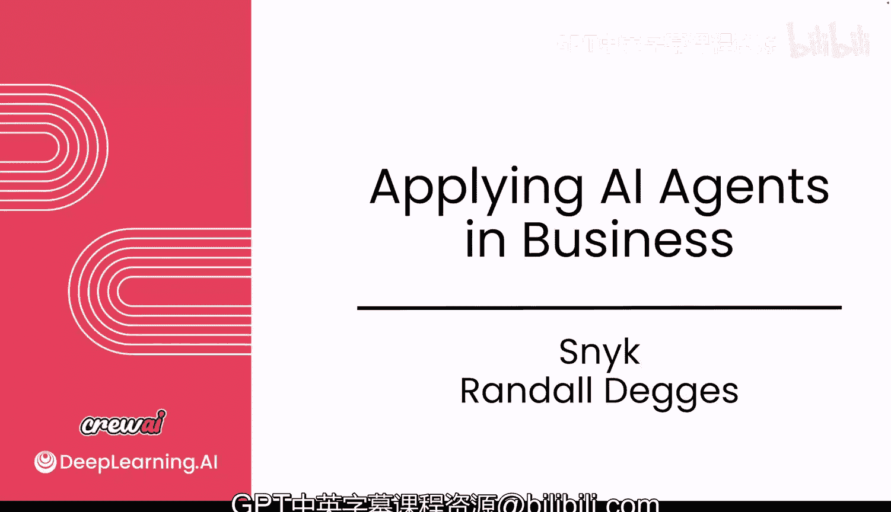
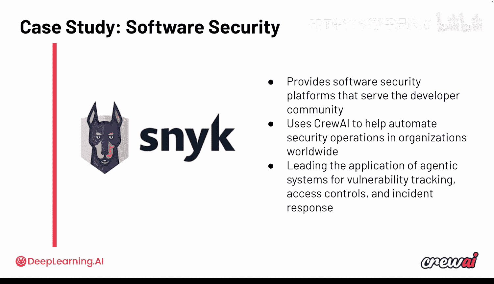

# 吴恩达《使用 CrewAI 设计、开发与部署多智能体系统｜Design, Develop, and Deploy Multi-Agent Systems》 - P34：4.conversation-with-snyk.zh_en - GPT中英字幕课程资源 - BV12eCQBAECM

Next， we're going to hear from this Nick。 I Nick is a software company， focuscus on security。

 A platform that is serving over two and a half million developers on making sure they are building secure code。

 and they are using Koreai to drive moy agents automations off security processes。

 And they are also integrating their own platform with Ki agents so that the people that are using crews can make sure that their code is secure and ready for production。

 They are making major strides and investments on moy agent systems and how to track vulnerabilities and security concerns on that new trend that is now powering the software industry。

 I'm very excited to hear from them。 So let's jump right into that。 Thank you so much for joining us。

 They excited about this。 We're trying to wrap things up and talk with experts in the industry like yourself about what are some of the things that you're seeing from more perspective。

 and I think you have a unique perspective。😊。

because you works with sneak basically thinking about security for years so I love to ask you a few questions and specifically as the agent space continues to evolve how important security is to the broader ecosystem in yourcade yeah first off things for having me excited to be here and yeah I mean that's sneak our entire business is really built around helping people build secure applications that's kind of what we do and I think it's more important than ever now that we have agent systems like those built with crew which we are a huge fan of and me personally use crew all the time it's great but as you can probably imagine for all of you students who are going through the course right now when you're building agent systems there's a lot of things you have to keep in mind right so you might use a framework like crew which is fantastic for organizing your agents and having them communicate with each other give them access to different tools and things like that which is fantastic but it does open up all new types of risks to consider so。

when you have an agent doing something and passing that information to another agent you have to think through things that before in the deterministic world were a little simpler like are there any things this agent could do when can with another agent that might cause problems in our space we actually call this toxic flows so one of the things we do at sneak is we have tools that will actually analyze your agents your MCP servers and all the tools that you have hooked up into your applications look at the tool definitions and figure out what each tool is doing and then use generative AI on the back end to actually apply a bunch of guardrails and filters to help better understand what type of risks could happen when certain tools are exposed to certain agents so that's just like one of the new types of security things to consider but obviously it's a very big field there's a lot of things that go into it No but that is so interesting because again I think that's where the experience comes up like I。

Like what your folks are seeing out there in order to even think about all these edge cases right what are some of the general like key challenges that you are to be seeing when it comes to rolling out this workflow securely like that there's a to so from our perspective as a security developer security company we basically the way that we kind of work if you will and I think this will help everyone really understand the field a little bit better we basically take a look at a few different things to build out a security framework so first of all we take a look at the actual code of your application so for years and years now we've had tools that do static code analysis so first of all we'll actually analyze custom code you're building and we'll look for really obvious security issues right like everybody is aware of things like SQL injection attacks or crossite scripting attacks those things can be easily detected using deterministic logic let's just say so you don't actually mean LM to detect that and they can be fixed in a very deterministic way because there's like100% crystal。

Clear way of how to fix sequence injections so those are like kind of solve problems So static analysis is like one part of the basic building blocks of modern application security But then on top of that when you're talking about building more complex systems things that work autonomously obviously there's still a lot of unknowns and so the way that we work internally is we do two things like first of all we stay on the lookout and we actually have like a threat intelligence feed where it keeps us up to date when other companies have interesting breaches and security incidents that involve agents So every time there's an incident like that becomes public our security research team basically gets a notification and it might link off to some Github article or some security researcher from a different company and we actually have a security researcher go through it and analyze it and say oh this is actually a very interesting novel type of attack like are there any things we can learn from this as a security company that we can then help apply in our product or in our own research to help customers build applications in。

More safeway that's actually how we've done this for quite a while。

 So a lot of our products that we have out today， like our MCT scanning tool。

 which looks for toxic flows and things like that those were initially inspired by novel breach that we came across we did a lot of research on them and then found out hey this is actually something new that hasn't really been talked about before let's build products around this like let's build safeguards and educational materials to make it easier for people to prevent this from happening in the future That's so interesting I think like one of those breach was that big like GiHub like breach that like one of your actually was able to detect itself right Yep exactly yeah one of our researchers published some very interesting research earlier in the year which essentially found that Github was using large language models and doing some autonomous stuff with Github issues and basically by doing some fancy prompt injection type stuff through a Github issue attackers were able to leak sensitive information about a repository and so you know。

like these kind of threat models in your mind as you're going through and building stuff is just super useful。

 So what I would tell students who are learning this stuff and building their first autonomous systems is as you're building these things in the back of your mind doesn't have to be something you're afraid of but like just keep in mind what are some of the things that could go wrong and then how would I address those things and as long as you're correctly thinking about those things that puts you like in the top 1% of development professionals because thinking about the risk and just keeping them in your mind and making sure you kind architect things in a nice way is really one of the best things you can do not only for your application but for your career right like having good security practices and a good security mindset is just a critical part of being like a great engineer in you know modern circles I like how you put it is like is a security mindset if like if your approach data from the ga to go just as you're beauty you're just asking yourself when every feature that you do what are the factors of attack that I might be exposing myself here and how I'm。

To safeguard dad that alone already like moves the needle like most people don't So the fact that you as an engineer can actually think that way。

 I think that could actually be a a huge differentiator So you brought up a few good points right like AI generated code mps another big one as well how are some of the challenges that you're seeing on people they're actually trying to plug this agents into existing or op pipelines is that something that people are struggling with or like our people are cracking that it's a very good question I feel split in terms of answering this because on one hand I feel like it's never been easier to add agent tools and functionality into your application So at sneak for example。

 I mean our companies have been around for quite a while and we have lots of older projects that maybe internal projects haven't been maintained in a while and sometimes I'll literally just go in and like rewrite them using AI or adding a bunch of new features into the pipeline and I mean with the tools we haven't available today you're able to do it at a speed。

That I wouldn't even have thought was possible like four years ago you know it's completely mindbing but at the same time it can also be really scary for people。

 which I think is the biggest concern right especially people in larger companies I think the biggest concern that people have when introducing these tools and these practices into their modern workplace is there's a little bit of fear and uncertainty you know people are like well hey if I put this agent here is it safe use will this exposed customer information somehow right and there's lots of components that people are worried about even take a very simple one so from the very outset of generative AI becoming popular one of the most common things you heard in articles and internet posts and everything was this fear of prompt injection and prompt injection is still a big issue and it's not necessarily solved like there's no 100% foolproof way to fully solve prompt injection because generative models non-deterministic and there's a lot of mystique in what happens behind the scenes。

And so for each model there might be different best practice ways to avoid it to remediate it so maybe that means having other gender AI review prompts and then try to see if there's anything suspicious in it maybe it means having some deterministic logic in a scanning tool or security application that looks through it or maybe it means having good runtime tooling and aability so that when your agents and tools are actually doing things you can then have a human or an agent look back through the runtime history of what these things are doing and look for suspicious patterns so there's lots of ways to address these things but fundamentally right like I think it goes back to just having a good security mindset and being proactive with your engineering work that's such a good point I agree with you yeah in prompt injection is it's great that you bring that back because a lot of people again it was a big thing like where everyone is talking about it and now people are not talking about as much but the problem is not so yes it's very much you out there。

You can find your LLms to kind like pick them up you can kind of like try to proactively prevent it。

 but in the end of the day like there's no 100% this is a guarantee enable this flag and ever fingers is taking care for you that makes me wonder that I'd love to hear your take on this how do you see the relationship between autonomous AI in security and though this is a hard one because the market moving so fast right but how you see that combination evolving over the next like three years I think a couple things are really interesting like first of all the pace of AI models is generally improving is like astoundingly good a lot of the software you get back from even a very basic prompt about a lot of structure and things like that can be very good so how does security play into it well I think we're getting close to a point where security can become a fully autonomous thing and what I mean by that is taking LMs and agents and nondeterministic applications and having them pair up with a deterministic security。

tool and something that can with 100% certainty， tell you if there is an issue here or if something bad has happened and using that as feedback for the agent to help it improve and guide it。

 I think that is quickly becoming the winning strategy in our space so if you've ever played around with any of sneaks tools which you can use for free you can just go go sign up and play around with it but one of the things you'll notice is that if you're let's say writing software using cursor or something right you can take sneaks tools you can plug them into your cursor rules and what will happen is as you are prompting cursor and asking it to build a new crew or build new crew flow or something right what will end up happening is each time cursor adds some code to the project it will use sneak behind the scenes to automatically scan and look for lots of common types of issues take the context of S provides and then cursor itself actually issue fixes。

retest to make sure these issues are fixed that creates this really interesting autonomous loop which we've seen really tremendous results from and so in my mind。

 the way the security space is kind of evolving in this autonomous future is it's becoming just an iterative part of using generative AI in general and my personal hope is that in the next three years we'll get to a point where your typical engineer we'll even need to think about security effort right like they'll just be able to say hey cursor or Claude or whatever fully usingBuild me this application security will kind of be handled behind the scenes with this iterative process and the end result is that us as users will have a way better software and we won't have to worry about things as much and that's kind of the dream I think I like that yeah get to yeah you're absolutely right if like Lms are getting better and better in writing code they should be getting better and better code to prevent and factche that code so that's an interesting date before we do I know that you mentioned that you use AI yourself and I have been like talking about career AIs entire。

ting people on how to use it what is your take on the role that C playing on this ecosystem how it's integrating and I know that we have some partnerships going on as well but is your take on that when you all first came out I think I discovered you through hacker news at the time and I was following along with your tutorials building some systems and doing some orchestration just in Python applications and really liked it I think one of the strengths you all have is a really crystal clear framework on the engineering side to make it very repeatable and reliable how to build the agents you know like having the nice like agent definitions in the AML files having the flows and the crews and the orchestration components are really something that I think we take for granted doubt which you all kind of mainstream so I'm a big fan of that like internally at sneak actually build and run a ton of projects literally using crews in production and they're fantastic we used it from everything for helping automate our employee social media to helping build product。

Frameworks and reference documentation for new products that we're launching there is truly a massive amount of automation that is powered by these tools internally and they feel rock solid which is I think mainly due to the crew framework so thanks for that。

Come on thank you， Thank you for using。 anything I'm excited about how things are gonna look like moving forward。

 I think there's so much going on with agents and hey， I guess we're tagging along for the ride。

 Thank you so much random I really appreciate the time very excited to have you folks here and hopefully all the learners as well I don't know if you have any parting thoughts for all the learnings but those are all the questions I had No the only thing I wantna say is for those of you taking the course you're amazing and keep building have fun you know that's what this is all about like usingI to make your life more enjoyable and it certainly does that for me so hopefully does for you as well I love that Thank you so much random I catch you later have a good one。

😊，Thank you。😊。