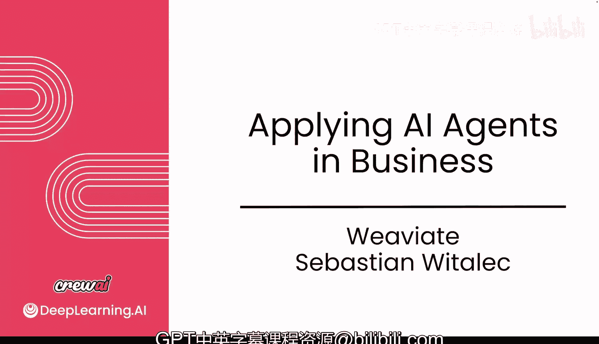
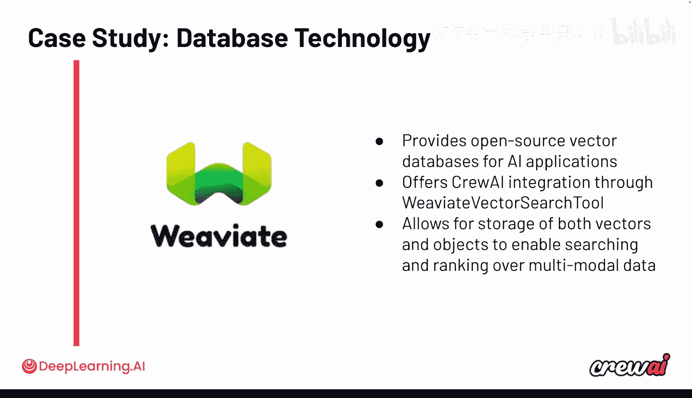

# 吴恩达《使用 CrewAI 设计、开发与部署多智能体系统｜Design, Develop, and Deploy Multi-Agent Systems》 - P35：5.conversation-with-weaviate.zh_en - GPT中英字幕课程资源 - BV12eCQBAECM

Next we're going to hear from WviA Wevi8 is an open source vector database。

 They allow you to not only store information， but allow your agents to tap this information themselves and some of their capabilities for searching can power amazing use cases when you need vector search I want to make sure that we hear from them when their perspective as one of the leading databases that are being adopted out there。

 so let's jump into that。 Sebastian thank you so much for being with us today I really appreciate it it's so cool that we get to get people from WviA joining us on this course So I have a few questions for you as the Gen space like continues to evolve how important it is like to have this broader ecosystem of tools and resources including vector databases like wevi Yeah I think this is absolutely critical because it's very much like you could have a10x developer that sort of knows about absolutely everything。

😊。

And you rely on this like single point of failure but also like how far can the 10x developer go right and then following the same analogies like if you have a better wellrounded team with maybe even sometimes overlapping skills etc right you can achieve a lot more and I think this translates really nicely into like the AI ecosystem right we can do so much more together right and then if we wanted to do absolutely everything by ourselves。

 we would fail right and this is the best thing because each of us can focus on like the thing that we do best was always also thinking like how can I integrate how can I connect how can I think with all these other tools together and how can we work as an ecosystem right and that's kind of like the thing we can work and play as a team because we all belong together right were not kind of like independent teams kind of like trying to win by ourselves I love that we all belong together I'm gonna use this one a little more often it's a good one so specifically on the back space right。

So much the people have been talking about everyone has been doing RAG nowadays how do you see the role of vector knowledge evolving。

 especially around the idea of AI agents now and they becoming more and more autonomous the vector databases and vector embeddings they play a pretty critical role in all of this right because if you have an agent that just relies on LLM then you basically rely on base of knowledge while if you work with vector database you kind of get access to a data that is dynamic that can change you know like within a minuteconcond and you always get information that is up to date the information is up to date but also very relevant so you get only the information that is relevant the information then is a lot smaller so you're not sending like you know100 page Pdf to your LLM but only the relevant parts right the other thing is that also like you get information that could be relevant to a specific user maybe your agent workflow is serving hundreds of。

Thousands of people each with their own data right you wouldn't have hundreds of thousandsMs per user because that would be absolutely crazy and it would take forever to update each of the oaths right The other things like you could use various fragmentations right where you could kind of like separate into different tenants the datas and then you never know I would never query your part of the data and you never query right so the databases can basically enhance the agents with more protections。

 more securities that you would expect of mature database right there's the data that you want your agent to tap into and then you want to make sure that that data is fresh data and there's a few options for that but I don't think there's anything like a factor database like Wviiate has that gives you all the controls because it's not only that you one the most recent data but you can control everything that is definitely exciting when you think about the new classes of applications that use cases that now possible by basically tightly unifying。

Agent orchestration with the vector retrieval like is that something that you hear a lot about like specific use cases around agents with the vector retrievals like close to each other and what would be some interesting ones I'm often thinking of like what is that we can stop from the database to give back to the LLM and an example being actually more than a year ago we rewrote some of our language clients we change completely the APIs in Python in types there in other languages and the struggle that we have today is that a lot of LLms they were trained with the old As and then when somebodys trying to vi code will weiate they're getting the old code we don't want people to use the old code because the old code wasn't great right the new one is got a great so by doing it through a database we could actually go say hey let's delete all the records that talk about the old API and only use the new examples so not only can we actually add more information but we can even restrict the information。

I'm going like hey never show this far because we can delete it or filter it out because to me agents are almost like people that are out there to help you with the most accurate information that is also relevant to your data right so you don't want something that is just like hey here's an example of like a query in Wigi but you're like all right you have these three collections here's how you query this specific collection with this specific properties and then that's kind of like really powerful right now you like people started understanding prompting and how data works and why that is important but now especially as people going to agents so you have many API calls going with the LLMs the complex engineering is become something that is super important we talk about that through the entire course this idea that you need to optimize as much as you can how should developers think about the role of a vector database and data complex engineering like honestly think of it like again like agents are like people to me and then if you every single time send that。

4our00 pages PDF to them and say like hey， I have this question and sometimes it could be something as simple as you know like hey how do I connect to the database which might be accessible in the first page but I think that the LLM will try to read the whole context right so what you end up with is just something that is super slow and not very efficient and then you're going for an absolute overkill right I think for me is always about like what is it that the agent meets what is it that LLM needs to deliver on the task that's a good point talk about the challenges like what are the common pitatfalls or un patterns for example when people are trying to bring vectors and vector search into this agent like what are the things that usually people do wrong and they should watch for I think one of the things is like classical data problem of garbage in garbage out quite often like yeah embedding models are really good with unstructured data but that doesn't mean that the unstructured data needs to be garbage。

Completely a mess right so quite often we don't think enough about this kind of stuff right How about I create my vector embeddings based on specific fields do you really need like the author's name or emails or all this other information probably not right so it's again like the problem of like less more the other thing that I notice quite often is well vector embeddings are huge right what about if you want to scale up and go into a billion objects and billion of those vectors right like I don't know if you can get that much run so easily or cheaply right that's gonna be expensive so that's kind of like one of the common pitfalls was like well you didn't assess the resources that you need for the kind of queries that you need to run right so there's few things that you can do around that so you could actually reduce the size of your vectors to either reduce the number of dimensions or maybe you could change each dimension to something that is of size of one byte or like a bit。

Even and then with that you could actually reduce the Ram needed you know to a quarter We actually have that built in into w it。

 it takes like two lines of code to enable quantization but it's actually super powerful recently you actually reduce released one called rotational quantization are Q for short and we kind of thought that quantization would actually slow down the queries et ce actually the opposites true so the queries are faster and recall when we measure it versus just uncompressed vectors the difference was around like 0。

01% so you could only notice the difference in kind of like lablike environment like why not do it by default this is incredible so these are probably like two common people so like you know sending too much again when gen vector embeddings because and then not being precise about the use because you're trying to serve and then the other one like not thinking about like how big of vector embeddings could be when you run the whole。

That's an interesting perspective and I think you folks as a vector database company like you're in the middle of all this revolution。

 you're watching all those different kind of like search。

 all those different companies you're seeing all the different frameworks you're seeing all the different agents what is your take on crew what are you're seeing out there how those crew works with Eva like share more with us with that So what I like about crew and this is kind of like we have that synergy between our teams you guys really think about developer experience right I'm super passionate about developer experience I'm up so for me this already shows like you care about those developers out there that are trying to build something and this is kind of like the same feedback we get as well like when we try to crew at some like workshops like this was always like right I could follow like the first few steps I already knew what to do and thenly you guys have very similar idea of like speed to value like okay I went through this like half an hour quick start I read through some examples like。

😊，But there's also a very clear part of like how do I go to production right and when something goes wrong like you get like an error message that you can do something about as well but there's some frameworks out there that like they change their syntax and As every three months or whatever and that kills me every time because I was like all right I want to show you with it with this or the framework and it's like oh my demo doesn't work was like what did you do like oh I shouldn't have updated my NPM packages or Python libraries and then like with crew I haven't had that issue yet likes like you guys kind of like pretty responsible about it like I love a good breaking change when thiss like a really good reason don't do a breaking change that destroys everything that I can't even connect right I think this is like incredible thing because you care about us developers using your framework your APIs and then the fact that I can read the code right I appreciate the nice words Thank you Sebastian is anything that you want to leave our audience with I know that we talk a lot about。

many things so I don't know if there's any kind of like part and thoughts that you want to leave the learners with for me。

 the biggest performance type that I care about is actually performance of the developer the performance of like hey you are the person like if I give you this set of tools how fast can you go and then deliver the solution I think this is absolutely super important and then in this AI ecosystem that we work in right so always think of like the speed of values like how fast you can get to the POC and how fast can you go to production and also how fast can you like grow and scale some solutions could be enterprise some could be like open source projects some could be just like something that you build for yourself it should be the same skill set that shouldn't be like a completely separate solution for enterprise and completely separate for your pet projects like your set of skills and the solutions you build should be kind of like gathered together like one thing and as a one skill set and that would make you super powerful。

And then yeah pick the right tools so you already have two of those like cr and wete you know pick the other ones and then take those that they won't lock you in you know like they should lock you in because you love them not because you have no other choice so yeah that's my I'm like that' that's an interesting advice Sebastian thank you so much for joining us for the course I really appreciate it I make sure I'm sure that all the students do as well perfect thanks for having me and yeah good luck everyone like build some crazy good stuff。

😊。

Love that， have a good one。Take care。