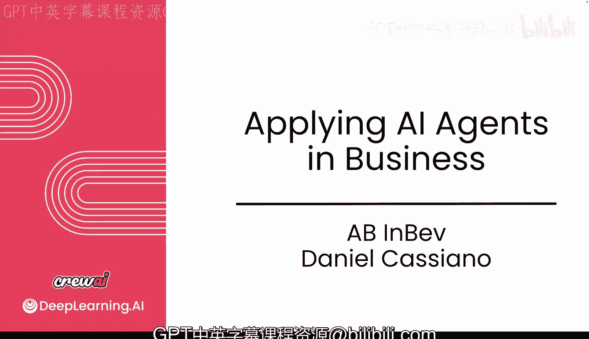
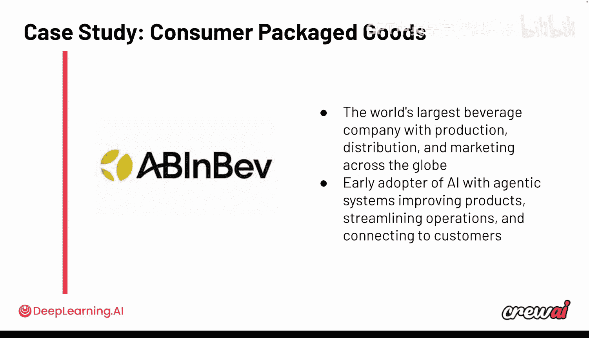

# 吴恩达《使用 CrewAI 设计、开发与部署多智能体系统｜Design, Develop, and Deploy Multi-Agent Systems》 - P36：6.conversation-with-ab-inbev.zh_en - GPT中英字幕课程资源 - BV12eCQBAECM

Next up， you're going to hear about A B in Ba。 They own over 500 iconic brands across the globe。

 They are the worldest largest beverage companies， and they're using Ci for moy agent systems across the entire business from their commercial digital platform out the way to automating back officeice use cases。

 They're a massive company with a lot of potential for using AI agents and a huge partner of us in this journey to reinvent the workforce by using AI agents。

 And you're going to hear from them next。 So let's jump into that one。😊。

Hey there Daniel， thank you so much for coming in today and I'm very excited。

 I mean people have been hearing me talking about agents and just learning all the things ins and outs and how to build them。

 how to test them and everything in between and the reason I'm so excited to have you specific beyond this is because you're on the other side you're one of the companies that are beauty your folks decided to explore AI agents what were some of the main challenges that kind of led to that what made you think about well maybe we should do AI agents super happy to be here with you today because you know we are big fans of crew AI and career AI has been our big partners in this journeys since the beginning I think just to start to also we started using crew AI first with the open source version and I think theres an important caveat here crew AI actually helped us on building our strategy for agents because at the beginning we were like more trying to understand and to learn I was gonna be now。

😊，Processes agent oriented I would say right and this concept of the crews and the flows was something that helped us a lot and actually create an internal framework that now is helping us on mapping the processes which brings me to the answer for your question I think the processes are the biggest challenge that we have on how can we actually get the process map it on a way that we can translate into first what are the actions that must be taken and then what are the agents that we need to create in what are the tools that those agents must use to take those actions so far I think this shift on translating our process into this view of crews flows workflows has been something that is been very helpful for us so far and I know that you folks already have some use cases live and have even bigger things planned for the future what are some of the early impacts that you're seeing on deploying this agent。

I think first the productivity on developing the agents at the beginning to be honest。

 I think we struggled but because of the lack of knowledge of our teams right so I think at the beginning we were struggling on how to build the agents what is the best way to build the architecture for the agents and also integrated into our systems because one thing that was super important for us was to not create new systems right so we really wanted to embed the agents into the exist once because then we can actually transform and get the efficiency into the processes so I think from the technical perspective we had a lot of productivity gains in terms of over time right because when we got proficiency on building the agents using QI then it's been fast man and after we got into the enterprise version and started to use the studio even the business folks had been using？

CI now and man to be honest from my life has been turned into a crew life here right because as everyone is using careerI not only the tech folks but also the business folks at the end of the day this is very good for us because we believe on creating this network right so if we can create an agent and then this agent can be replicated。

 we use it across the functions across internal teams and also between businesses and tech teams then we can achieve productivity right so this is something that has been very very powerful for us so what you're saying is like I want to embed this agents into existing systems so it's easy for me to distribute so people already are using and they don't even notice it just gets better and by doing that it makes easier for them to adopt and that's one part but the other part that you mention is this idea of like well we need to have those repositories right want to make sure they're not doing the same things twice when I do once and then roll it out globally make sure that we're using across all the different units。

That is a very interesting take and I'm glad to hear that we're helping with that now let's talk about the challenges What do you think you mentioned like getting the team educated was a challenge at first is there anything else that comes that point and how did you fix that Yes getting the team up to speed was a big challenge for us and I'd like to highlight here the way that we have been because it's already ongoing right the way that we have been doing the workshops and the training sessions across the globe and for us this is something that it's actually big because were talking more or less about 40 countries that we are expanding so for those who doesn't know Abe bad we have around six zones which is our compositions of countries out of the six zones I think now we have three to four already using Q AI and expanding we're gonna to reach all the six zones using QI by the mid next year but one of the biggest challenge were to scale right because then when we got careerI up and running then we need to train。

Tams I used to call this internally as our pres we need to run the press with the team first then we go to the tournament right so that's more or less the framework that we created partnering with you guys we created that internal training sessions training our teams in our internal platforms and tools right after that on crewI speaking about the technical challenge I think CA is the biggest challenge man especially for us because we are so fragmented across the globe but on the flip side the challenge they use cases are almost the same thing across the globe because if you talk about supply chain or even procurement or logistics the challenges are more or less the same thing because at the end of the day we have different systems across the globe so this is also another big challenge for us because if we think on ERPs internal systems even payroll right which is something that have been building agents。

To automate a lot of our tasks man we have at least more than 15 different payroll systems across the globe so this is a big challenge because we can replicate the template of the agent I would say internally we have been calling those agent templates but we can replicate the template but at the end of the day we have something that are specific per country right so this is a big challenge because when you talk about。

 for example MCP or connection with tools so we can just build one MCP server that's going to cover everything in the payroll domain right so we need to build some things that can be scaled across the globe this is a huge and massive engineering work but also if as we are leveraging crew and having the same agent framework being used by the whole company then it's much easier for us to scale the agents across the globe so this is something that has been very good。

us but it wasn't our first catch right so it came with the mistakes that we made at beginningkin so far now I think we found a path like a lot of these companies they are trying to get efficient gains and the way that you get efficiency gains is like how you manage to train your team at scale to start using and deploying and building this that is a very interesting take and you mentioned about CPG as an industry to talk more about that it seems that across the entire different sectors and business units there's a lot of commonalities going on what do you think are some of like the critical considerations for these companies on CPG that are trying to understand how to apply AI agents into their day to day one of our biggest learning Israel well go deep try not to go so wide and go deep I would say for example that we define a few priorities in terms of processes that we may want to transform because when you talk about CPGs companies。

Usually you are talking about big operations right so heavy operations， logistics。

 distribution centers， in our case brewies， a huge sales operations so we have people spread across the globe so it's very difficult when you think on how can we transform the processes so far of course we have business services centers which makes our lives much easier when we want for example to focus in a few streams so at the end of the day taking a decision on going deeper deep in one process it's been a big difference for us so in our case we try to tackle the ones that we have a certain level of knowledge and we can actually map the process and to end after that we evaluate for example the maturity level of the technology right so for example if you don't have digitalized systems in this stream people are using Excel I would say which is pretty common across。

all the companies in the globe then it's going to be slightly different from actually integrating the agentss into existing systems so different discussion。

 different tech approach， different way on mapping the process so we consider a few factors on evaluating on how to escape but at this moment we prioritize more things that we can control internally。

 I would say for example functions like legal finance。

 not so much sales but things that we can actually control end to end。

 different from sales distribution for example that we depend on our partners in the field which is it's going to be much more complex to implement things in there。

 but the functions that we have control end to end werere our decision to get started I would say that in terms of the challenge the technical challenge because now we are sharp on using CI I think the biggest challenge now。

more on mapping the processes and actually designing how is gonna be the agent flow for those processes and on the flip side to not actually try to create a lot of unnecessary complexity right because sometimes this happens you know right so the engineers got excited the technology and they try to create things that are not actually needed you go into any company as you said they have some similar pieces on the stack right there's always like a data management and then you also have ERP CRMs they need to integrate all those how you're thinking about that and navigating that because I know that's something that every company is thinking especially when they're considering other options yeah this is very challenge because in our case we for example parallel are running big programs for digitalizing some processes right so everything is different when you look across the globe so that's why I。

I think the agents can play a big role because I think if you compare to the past when I think almost 15 years ago when we got the API gateways right so all of the companies that have been trying to start their digital transformation journey the API gateways played a key role right because you have a big legacy here but in a way you must deal with this legacy but you need to actually to build the progress you need to build the future right so I can compare now the agents that we are building so this whole agentic strategy powered by in our case createI plus our internal tools but also with this new flow with the API gateways in the past right I think it's more or less this similar situation but right now we have GenI right so we have the LLM powering this process which men makes us 1012。

50 times more productive than in the past I love that。

 And yeah I think you got something right yeah that's absolutely correct because what I have heard from other companies right is they learn from their mistakes right they have seen what works in that work in the past and they got to burn on certain movements that they did they got to vendor their lots in certain places they're being very mindful about going into this knowing they want to move fast they need to get to results they see the potential and for the ones that are getting use cases like that like yourself you're seeing the results and you're doubling down right but they also want to make sure that they want to keep things as flexible as they can because the markets moving so fast a new model comes up you want to be able to use that on your use cases a new offering comes up you need to be able to integrate it so there's a lot going on I really appreciate you having the time to spare talking with us today I know that you're super busy like changing A from within and that's exciting I don't know if you have any parting thoughts or anything that you want to tell for the students that have been tagging along up to this point but I do want to thank you for making yourself available。

No man thank you for inviting me I think that's important to spend this time spreading the world right I think it's super important as a final thought and I think one of the biggest learnings for us was exactly and I think it connects to the course right so do a good precision right so it made a big difference for us that's why I believe in this course is going to be very helpful for everyone which is considering using creativeI and my last takeaway is right now with so many things coming up in the market the AI space in the market I think it's good for us people that are taking the technical decisions with the companies to double down with some technologies and actually to make sure that we can build some things that can scale and for that I think the way that you guys design the whole framework man it's very powerful right so first let's do。

Good pres and second let's double down at least in one good technology that connects into our ecosystem because of that we can make things scale so those were my takeaways for this conversation great advice You did a killer preea I love the games that are going on i'm excited for the Super Bowl that's it that's what I want to see Thank you so much Daniel I really appreciate the time this was amazing Thank you so much。

Thank you Sean。