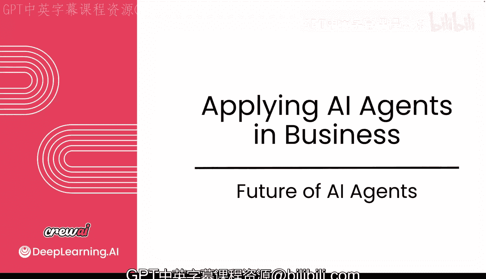
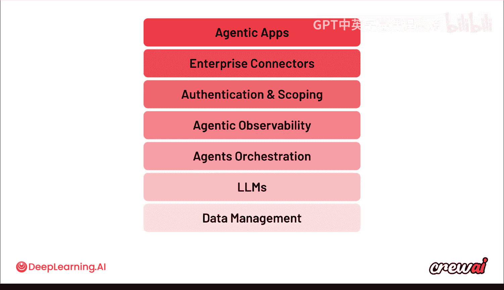
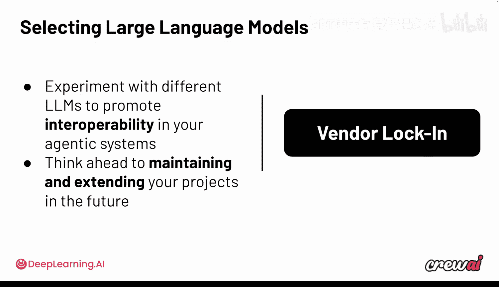
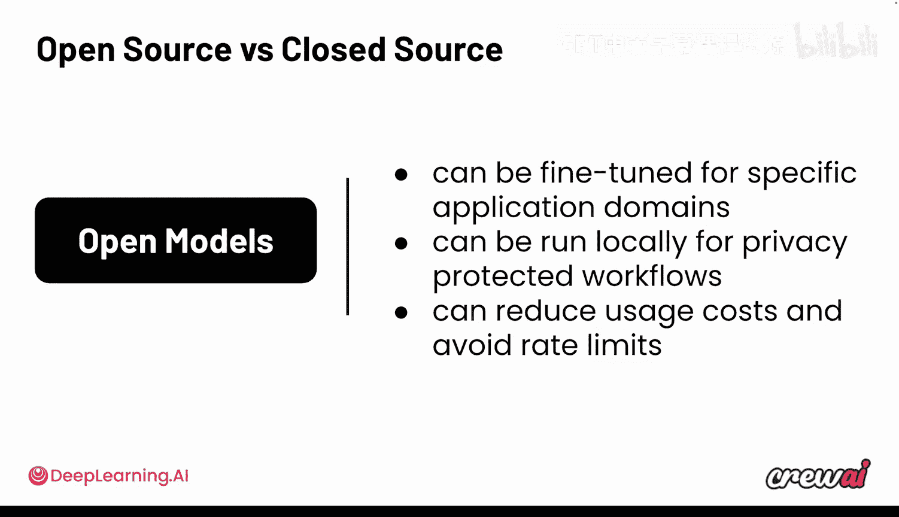
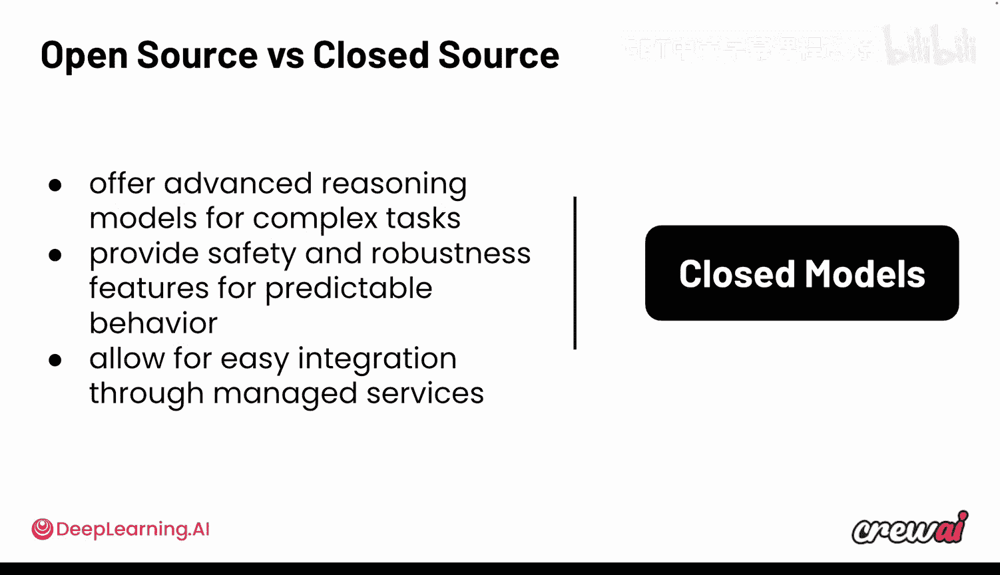
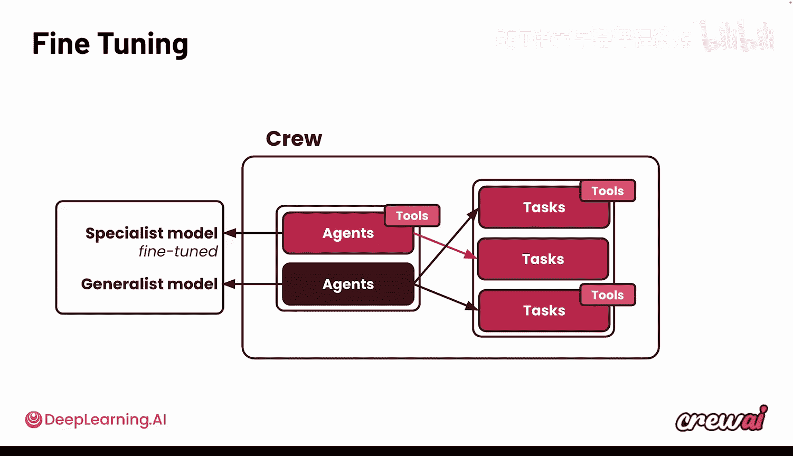
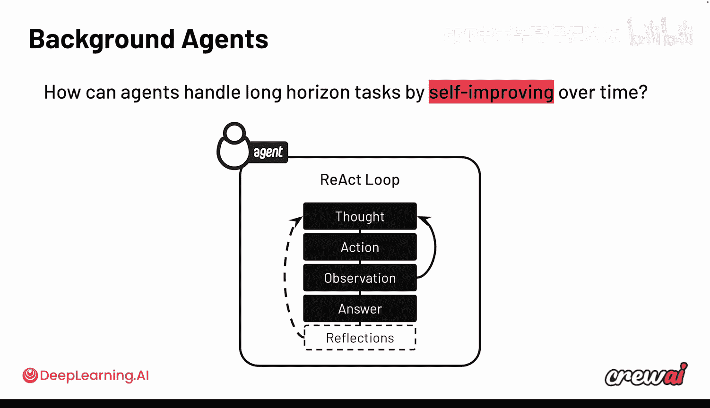
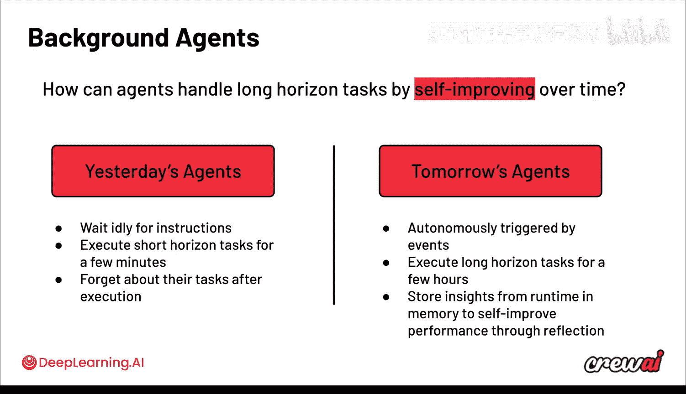
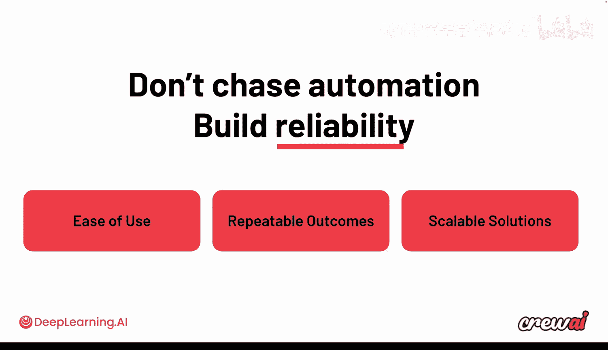

# 吴恩达《使用 CrewAI 设计、开发与部署多智能体系统｜Design, Develop, and Deploy Multi-Agent Systems》 - P37：7.future-of-ai-agents.zh_en - GPT中英字幕课程资源 - BV12eCQBAECM

Fantastic progress so far。 You're almost there。 We're almost completing this course。

 and you have learned so much from designing to development， to deploying AI agents。

 and I'm very excited to see what you are going to build in the future。

 now that you have learned all this。 So let's explore a few different ways that AI agents are reshaping that future and how you can be part of that as well。

 Now， I want to make sure that we are spending some time talking about what is the future of AI agent。

 One is actually going to look like six months from now or a year from now。

 We don't have as much control over that as would like to believe but there is definitely some patterns that have been emerging that a hints us on the direction that things are going。

 First thing is there is this idea of an agent management platform that has been coming up in that agent management platform who take different shapes and forms depending on the tag that the customers are choosing or that the users and the companies are choosing。

 But organizations definitely need to have a management layer。😊。

To orchestrate their agent adoption across their company。

 These platforms can serve as a single source of control for not only reusable use cases。

 but centralized monitoring and futuring and security and the agent management platforms here will provide three core capabilities。

 the ability to build and integrate these use cases。 So getting started extremely fast。

 the ability to build trust in these use cases。 So observing and optimizing these use cases as they go and the ability to deliver value。

 basically managing and scale these use cases as they get more and more traction and this orchestration layer sits on top of running agents and gives the company's control over what happens how it happens And when it happens。

 So this is definitely one of the patterns that we are seeing in there as people are talking about adopting AI agents。

 Now， if you zoom in into those specific capabilities。

 what you will see is that they go into smaller。😊，Cic features and these features are many to name on the orchestration side。

 you're going to see planning and reasoning and memory and guardrails and knowledge。

 But then when you're talking about observing you see how the traces and training and testing that we have talked about。

 including eventsbased automations。 You then have the building and integrate piece where you might want to build with code or you might want to build with no code like what we did in studio you might want to use local tools or you might want to use other As or even external triggers and on the management and scale side。

 you want to make sure that you can deploy these things extremely fast that you can invite your team members over that you can control permissions and that you actually have some monitoring behind us。

Some projects and companies address the entire workflow went to end while others will focus on specific capabilities。

 But the thing is there is an orchestration layer that encompasses the entire process in here。

 Tra software engineering patterns to apply as we have talking about。

 So from the observing and optimizing to the building you're going to find a lot of common things。

 So if you look across all these things that we're talking about。

 there is definitely a few patterns that you can recognize between traditional software engineering。

 and the agent engineering in here。 like the observation layers that are typically very separate from the building and integration layers。

 So there is a separation of concern。 And this is just one example。

 but there are many other concerns in here。 So what we're seeing is as the word evolves。

 theres a new text stack coming together and this stack stack extends from the data management out the way to the large language models to the orchestration to the observability。

😊，To the authenticentation the connectors and culminating into the Gen AI applications or what we call Gen apps at the almostmost layer。

 the users are interacting with agents through interfaces that can be conversational。

 like chat Ept or even traditional button based designs。 Three teams， though。

 consistently emerged from the user' feedback。 And we talked about those before。

 but I really want to drive them home。 across the entire stack。

 There was a lot of most common and frequentlyly raised concerns And one of those is something that we mentioned briefly on early lessons。

 And that was the customers there are avoiding vendor lock in。 The concern traces back to the cloud。

 where migration experiences were that companies became dependent on managing services。

 and organizations found themselves locked in as costs increased is struggling to migrate workloads to another alternative。

 like using Kubernetes， for example， So leaders who have experienced those challenges。

NAI an AI agent adoption way more cautiously。 so companies do want flexibility and is not only about vendor lock in what is definitely a problem when you think about hyperscaleals or different deployment approaches but also the ability to use the right tools for the job because you can use different LLms for different agents you can actually have an actual layer of optimization in there and that also open room for you to use open source models as well or even find tunes but the idea here is that organizations once the freedom to run their workloads anywhere。

 even their on services on premises or whatever hyperscale they're using and companies also want to use many different models not only open the eye or cloud but pick and choose from whatever vendors they have procured So at queryI or framework and platform allows you to download the code for anything generated on your user So at query AI or framework and platform。

Was torn out from the ground up to allow you to tap into this interoperability， not only on the LLMs。

 but even on the crews themselves。 So even on the no code experience that we had before。

 you're not locked into that， because you can download your code at any time for anything that you generate on the user interface and take that with you because that's your I。

 So everything that you created remains your intellectual property。

 addressing many of these concerns about platform dependency。

 So this is something that we should keep top of mind。 again。

 choosing the right model can and you have a major impact。

 And since we're talking about models is important for us to understand when to use open source models and when to use closed source models and some of the benefits on doing so。

 Comp usually optimized either for open or closed source models， depending on their needs。

 like running models yourself has become significantly easier especially with tools like the LLM。

Or Tensor Rt LM and others。 And that means that you can get some of these amazing models that are being produced ever in the globe and host them yourself or even fine tune them to get them better。

 So closed models like G40 and cloudson at 4。5 definitely come with better is included and work out of the box what give them an edge but open models have actually caught up in capabilities with many companies now actually open source their own models and you can not only tap into those models。

 but you can actually fine tune them for specific application domains making them better agents for you and your use cases。

 you can also run them locally for privacy and making sure that you're still compliant with whatever governance policies that you have and you can actually drastically reduce the usage costs and avoid any rate limits that you might encounter with these external providers as they're trying to serve the entire globe to use their models。

 Now， if you look at the closed source models。😊。

You actually will find that they offer more advanced reasoning models for complex tasks。

 and they do provide a lot of safetyties and robustness features for predictable behavior。

 What allows you for easy integration through mentioned services。

 that there is no singlery choice between open and close models。

 However you should be wary about running your agents on smaller models。

 models is modern than 14 B or 20 billion parameters actually typically don't work when you try to scale them for agenttic behavior。

 They just cannot adhere to the instructions because you are not as capableable as bigger ones。

 So agents usually require more powerful models to perform effectively。

 That said as new models comes up， they are usually more advanced So you're now seeing an entire new breed of models。

 there are smaller but are extremely powerful as well。 Like for example。

 G open source 20 B while can definitely be used for some agent behavior。 you will find。

Better performance on bigger models， though。 Now， I want to focus on fine tune for a second。

 And fine tune has been discussed extensively over the past few years。

 but most companies have not adopted it again。 And this is unfortunate because fine tuning offers significant potential for cost savings and performance improvements。

 particularly in speed。 The barrier for adoption is high， though。

 companies without foul AI training experience find it difficult to wrap their hands around fine tuning models confidently as the barrier for entry decreases and fine tuning becomes more accessible for agents。

 Ad will likely increase。 And the companies do want the benefits that comes from fine tuning。

 For example， you will save money because you can run smaller models。

 and they will run faster because they are more efficient。

 So companies beautying this AI agents use cases。 They actually want the results from fine tuning。

 but they struggle with the execution as friction decreases， though， more companies will。

We pursue fine tuning and fine tuning models through an agents is a very effective approach to get better results as well。

So looking ahead， there are two trends that are converging in AI agents development。

 And it's what we are hearing from the cutting edge from agent development。

 And that is self improvement and longerrun agents。 And this is very important。

 for self improving agents， we not only wants them to acquire memory over time。

 the way that they do right now。 But we want to make sure that they keep getting even better at that。

 And they do that more effectively。 And we also want this agents to keep selfe their performance and adjusting that behavior accordingly。

 improving continuously。 So the ability to do that across hundreds of thousands of executions is something that people are aiming to get it better and better at。

 These selfimprov capability is built into Ci。 And we are still investing heavily on how to enhance it further。

 Now， longrun agents is something else that companies are also thinking about this idea of agents that can operate it for extended periods。

 sometimes even hours of work。😊，Without having humans interact with that and is still achieving an amazing outcome。

 So the duration depends on your configuration。 The number of agents and your system set up。

 But definitely there is a sentiment that the industry is actively optimizing for self improving and long termm agents and how to crack the code and build them effectively。

 So if you think about yesterdayday agents， you will find that they will wait idly for instructions。

 They will execute very short horizontal tasks， maybe just a few minutes。

 and they will forget about their tasks after the executions。 Now。

 to mor's agents are all about being autonomously triggered by events。

 They execute in a way longer horizon for hours， sometimes。

 and they are great at storing all the insights from their runtime in a way that they can selfimp to reflection over time。

 And that is a major drive on how the industry is trying to get into the next level of AI agents here。

 Now， I do want to make sure that as we're wrapping things up。😊。

I come back to one very important principle。 So even after hearing about all these features。

 if there is one thing that you' got to take away from this course is that as you build a agentent automations。

 You should not chase automation alone。 You should build reliability into everything you create。

 and that makes your AI agents production ready， when you design when you build when you deploy your agents with in mind。

 you can achieve remarkable results， I see on our final video， and I'm very excited about that one。

 Hopefully you have a great time with this lesson。 I know I hand， and I see there in a second。😊。

