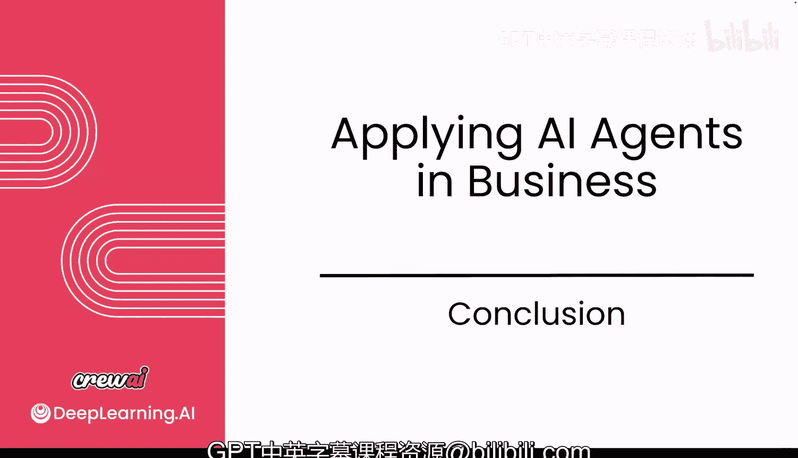

# 吴恩达《使用 CrewAI 设计、开发与部署多智能体系统｜Design, Develop, and Deploy Multi-Agent Systems》 - P38：8.conclusion.zh_en - GPT中英字幕课程资源 - BV12eCQBAECM

Congratulations on completing this course。 I'm so excited for you。 You learned a lot about AI agents。

 We talk about how to build them， how to deploy them and everything in between。

 Now you got to apply everything that you learn on your day to day and on building these use cases。

 In case you found there is anything missing or you want to know more about AI agents。

 reach out to us。 You can find me on LinkedIn or Twitter， whatever you choose。

 but I'm very excited to engage with you on all the things regarding AI agents。

 I'm really impressed with all the effort that you put into this。

 And hopefully you got to see what this means for the future of tech and the future of AI agents。

 I hope to see around soon。 Have a good one。😊。

