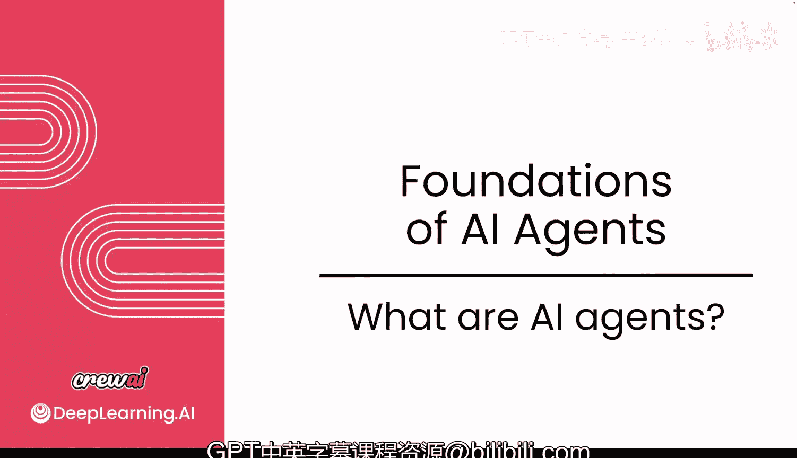
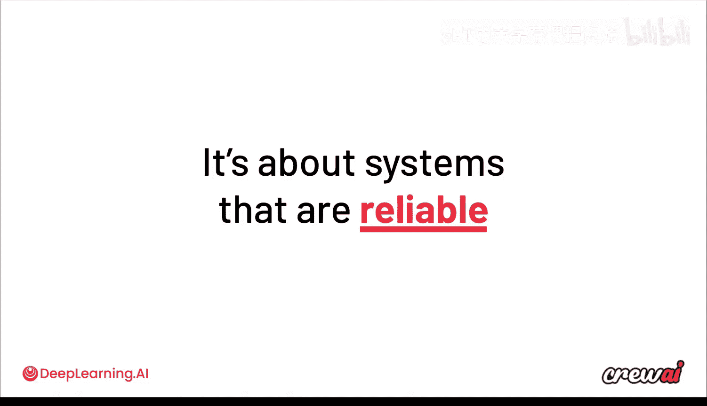

# 吴恩达《使用 CrewAI 设计、开发与部署多智能体系统｜Design, Develop, and Deploy Multi-Agent Systems》 - P3：3.what-are-ai-agents.zh_en - GPT中英字幕课程资源 - BV12eCQBAECM

What are AI agents。 You might have your own definition。

 So I want to make sure that we talk about how the different options。

 what A agents actually are and how they work。 So in this lesson term。

 we're going to talk about all the ins and outs of this agents and how they tick。

 So let's look into that right now， There's so much being said about AI agents。

 But before we dive in， let's just agree on the definition。

 And the way that I would put it is that an AI agent is a system that can decide what happens next in order to accomplish should go。

 Let's dive into that。 at their core， all agents start with an LLm。

 a large language model And draw this course， you see how to add all kinds of tools and guardrails and controls that make the LM behave as an agent。

 Now， this Lm is their great at creating content。 If you go in and ask them to write an email。

 they would do it for you。 And if you ask them to make it funnier， they at least give it a try。

 But it's more interesting。 if you actually give them options。

 One that is maybe a little more serious。😊。

Another one thats a little different。 And now the LM will get to choose and will tell you version A is better because A B or C。

 or version B is better because1 Q or3。 So in the end of the day。

 is dis ability of making reasonable choices that we have been referring as cognition that allow these models to choose what email is better。

 Now， if you forget emails for a second。 And instead we start talking about a business go an objective。

 and the LLm is actually deciding what steps to take in order to accomplish that。

 that's basically when we stop having a chat。 and now the AI is controlling the application flow where these LLms are making these choices in order to accomplish the final go that you set up for them。

 But you might be wondering， why do I care about this。

 And the reason why you should care about AI agents is because we're talking about automations in the end of the day。

 And now automations that were not possible before。😊，In particular。

 it allows you to build these very sophisticated and flexible automations。

 So let's look at one example of a use case for customer support chat bot to compare the oldcho style of automation with an AI agent style off today。

 When you think about an automation likes how they use to you usually have all these different branches that you map to and from。

 So in this case， you have a point A that is a customer input。

 and that takes you to a point B that is showing helping articles。

 But this is not only one edge as you start to think about these use case。

 you start to realize there's a lot more going on in there。 So point C appears。

 And now you got to check the user login status。 Then point D appears where you need to see if it actually can access purchases。

 And you might add other points of escalations。 So you can see how busy this can get as you add all these different。

😊，PointsSo in more traditional automation， you have to map all the different edges and connections in order to make sure that you have something that works。

 And what happens if you miss one， then it breaks， then it doesn't work。 Now。

 if you think about AI agents， you can do something else entirely。

 the agent got to decide based on the customer input。 one it's gonna to do in what order。

 So it might decide to show articles right away。 and later check for logging status and eventually escalate。

 So you can see how the different options。 And the agent got to choose how to navigate them the same way that it was choosing which may was better before。

 And there is a few things that you get from this。 One of those is this ability of cognition。

 So the agent choosing。 the other is idea of real time reacting to whatever you throw into that。

 So depending on the customer input， whatever it might be。

 the agent will decide what is the most appropriate next。Then is this idea of self healingal。

 meaning that what happens if the check logging status fails。 it might find a way to work around。

 use another API， maybe do another step。 and the selfimproving come of this idea of this agents making sure that they are learning off what they are doing so as they do more examples and more use cases and more run。

 they learn about what works and what it doesn't。 so that it reinforce that behavior。

 and that is something else that you don't get from more traditional automation。

 So in the end of the day， if you really zoom out the two main things that are driving agent automation and agent systems。

 One is the ability to create write an email， create an image， whatever it might be。

 And the other one is is ability to decide what tools to use， what data to use。

 how to recover from a failure。 in the end of the day or this agents to be scalable。

Need to be reliable。 So it's easy to build。 It's trust worth it， and it's manageable。

 If a customer support fails to serve the user request， most of the time。

 or if it provides refunds to a customers。 that aren't actually eligible。

 Then it's not going to be very useful for your company。

 So a big focus on the scores is how you can design the system so they provide highqu outputs。

 Then we're gonna to go into data pretty soon。 as you work with AI agents more and more。

 you will notice that not all use cases are created equal。

 And some use cases are better for agents than others。

 Let's go on our next video where you see how to figure out the best use cases for AI agents。

 You do want to miss that one。 So I see right there。

