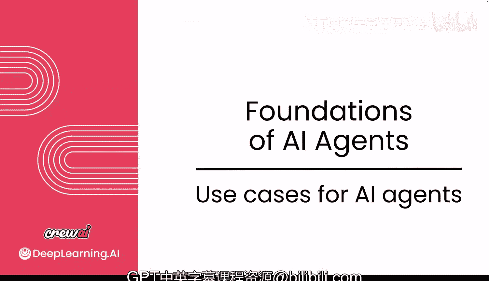
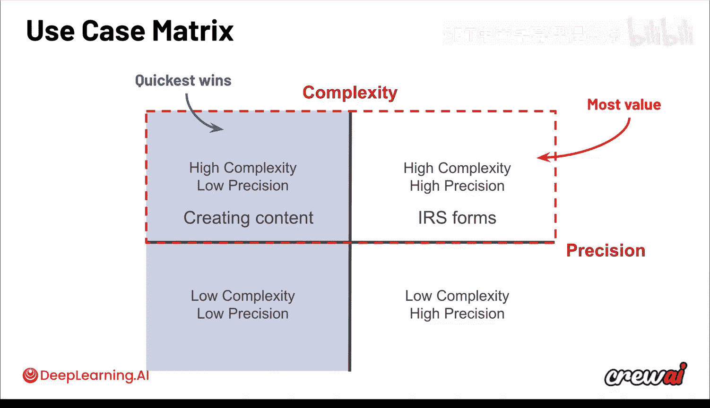
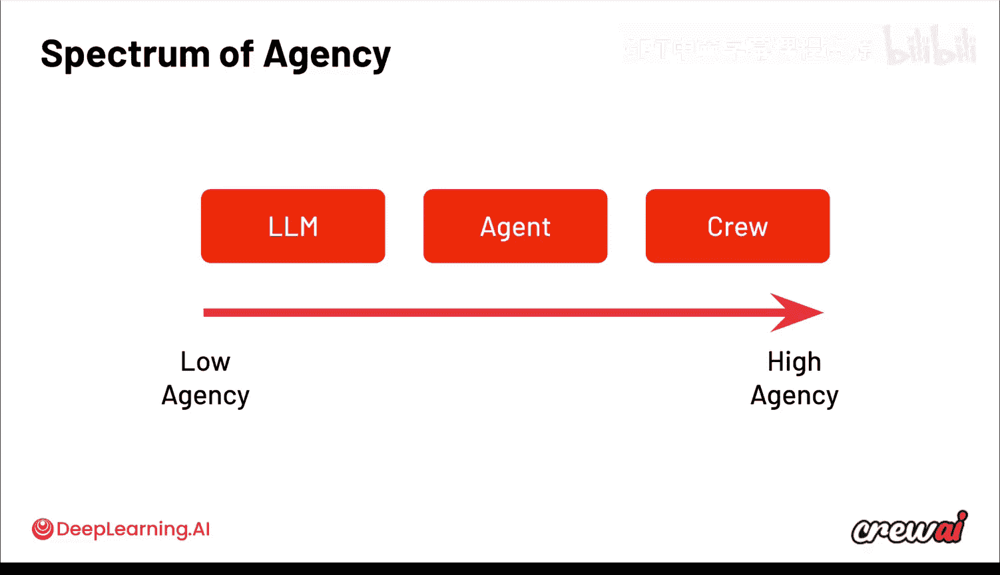
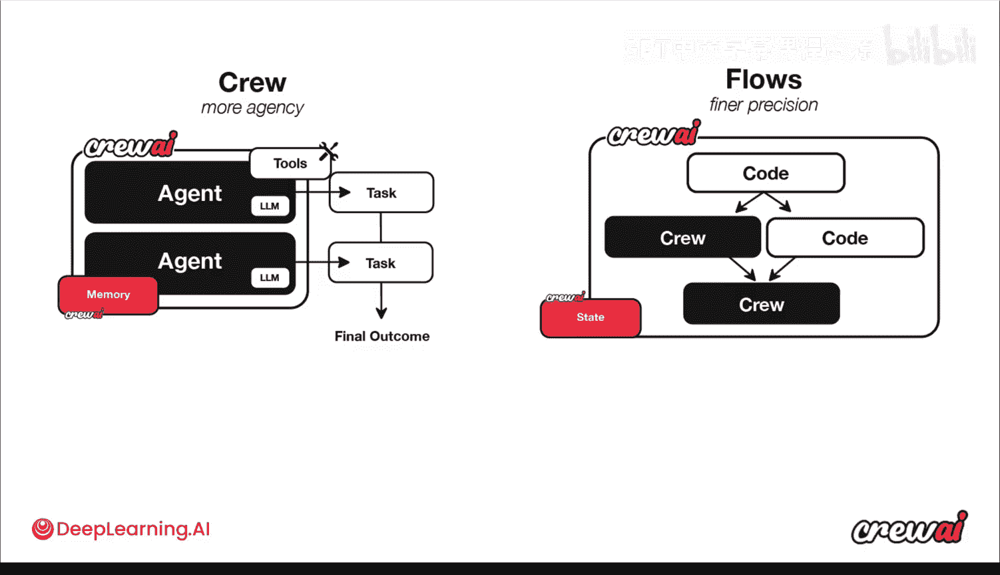
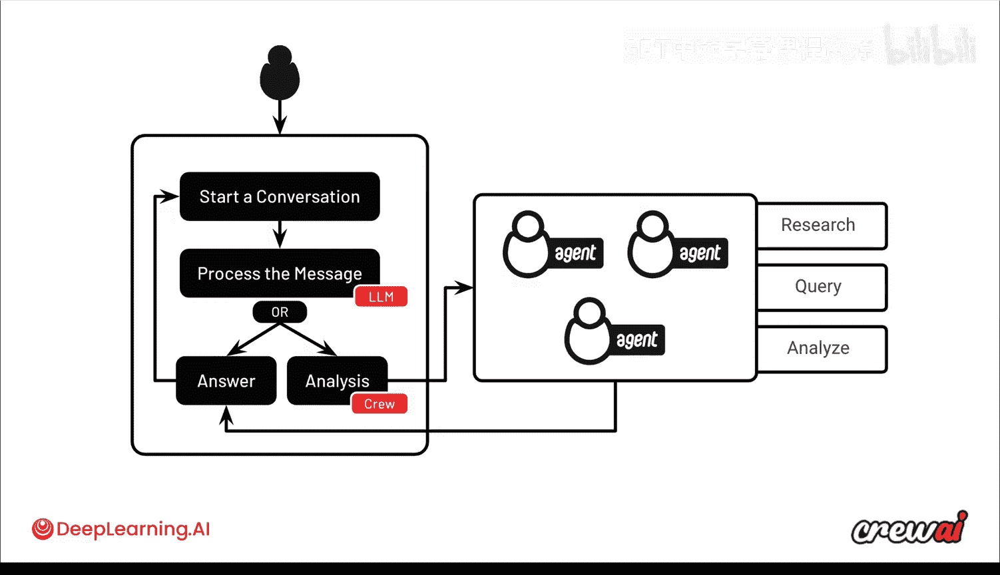

# 吴恩达《使用 CrewAI 设计、开发与部署多智能体系统｜Design, Develop, and Deploy Multi-Agent Systems》 - P4：4.use-cases-for-ai-agents.zh_en - GPT中英字幕课程资源 - BV12eCQBAECM

So you probably already have some use cases top of mind on how you can use the ZI agents on your day to day or your company or your team。

 But there are so many use cases and not all use cases are made the same。

 How do you think about them， How do you measure them。

 How do you think about complexity and precision and how you choose what to build and how to build it。

 So let's look into that right now， I really love this idea of a use case matrix that allows you to think about where your use case really falls under Is a use case that favors more complexity or more precision。

 And by use case， I just mean a problem that you're deciding if you want to apply agents to。

 Is an agent going to be the best way to solve this。 And remember， there is a spectrum here。

 So if you really think about this use cases， you might actually have high complexity and high precision use cases like filling up IRS forms。

 And we're actually working with a bank on helping build a use case around that。 And the form is。

70 pages long and come with a manual that is over 700 pages long。 So very complex。

 and you don't want to get that wrong。 You want to make sure that it's very precise。

 Now you can also see high complexity， but low precision use cases， For example。

 creating content where you want to make sure that you're creating great content。

 but there is more of a leeway on how that content might be structured。

 So while AI agents can tackle use cases across all these dimensions。

 you will find that the most valuable problems are high complexity。

 and the quickest wins are the low precisions。 The good place to start in this is the high complexityly low precision quadrant。

 And that's because you get a lot of value out of solving highly complex tasks。

 which agents excel at， but you will get a quick win if your agents can get a creative with the output。

 Some companies will start one way another companies are going to start or another。

 There is no right or wrong here。 and you're going to learn all about those strategies in the coming modules。

😊，But I just want to make sure that as you're going through your day to day。

 you're really start to thinking about what are the use cases that you're seeing out there。

 What are the things is going to give the most return。

 given investment that you're going to make on it Now doesn't really matter what kind of use cases you're thinking about there are always going to be a spectrum of agency that you're gonna be considering in one side。

 some use cases might only requiring an LLM you can do one single call to a large language model and get the information that you need other use cases might requiring you to build one agent And in other use cases you might require an entire crew。

 a group of agents working together specialize each one focused on its own thing in one side。

 you're only using the LLM more as a two So there is low agency in there and in the other side where you have a crew with many agents working together。

 you have a lot of agency where the agents are deciding what happens across every different step Now in order to support。

this， You got to acknowledge that sometimes you're gonna win more control。 And that's why in a crew。

 you have two main abstractions to help you with this。

 You have crews that are optimized for more agency。

 meaning that you can have this agency gather working and they have memories and tools and tasks。

 All things that were going talk about。 And the meeting preparation crew that you saw previously is a great use case for a crew instead of one single agent。

 for example， But you also have crew AI flows。 that is a very lowle framework that give you all the control that you need to decide what happens in what order。

 So you can say I want a function that is just regular python code to execute first。

 and then maybe I have one single LLM call， and eventually I might have an entire crew。

 but you get to choose what happens in what order with this very thin layer that gives you all the control that you need。

 You previously saw that example of a crew of agents working together。

To do a meeting prep use case。 And that is a great example。

 So I really want to make sure I show you what would be a great use case for a flow and is gonna to be a conversational example。

 let's say that you want to have an a system that is a conversational experience that allows your employees to talk about some of their benefits。

 there's a lot of different use case that apply to this pattern。

 and this pattern usually start with a person that is activating the system through a conversation So like a regular chat bo from this conversation。

 you're gonna probably need to process that message and processing the message here doesn't really require a lot of agency。

 Youre gonna the agent to do it you're gonna need a crew to do it。 you can just use one single LLM。

 So the LLM here is going to just understanding if given the information in the context so far。

 if it requires to do something else or if it's ready to give an answer。

 if it's to give an answer that can go right。😊，Back into the conversation。

 and that will feel like a regular chat。 Now， if that online call indicates that there are some further analysis that needs to happen。

 again， in the example of a financial use case， it might need to query data from a database。

 or if it's a help desk use case， it might query your internal system to check a little bit of the benefits involved on that。

 Well， that feels like an entire crew。 because you can have many agents that will actually do the research。

 they will do the querying， theyll make sure that everything is working right， theyll do an analysis。

 and in the end， provide an answer back。 So it still feels like that conversational。

 you can see how much more control we have on what is happening。

 And that's why this is suitable for a queryflow。 because you're controlling on what happens in what order and just opt in on agency on when and where you need it in this case on the analysis step alone。

 And this is why the systems， when they start to get complex， they start。

Look like they start to look at this mix of LLM and agents and crews in a structured way that can unlock so many use cases Now I want to make sure that we keep going because on the next one。

 we're going to talk about the foundation of AI agents and why are these agents actually intelligent what make themque this is going to be a very interesting one I know that they're going to love it so let's make sure that you jump right into that。

