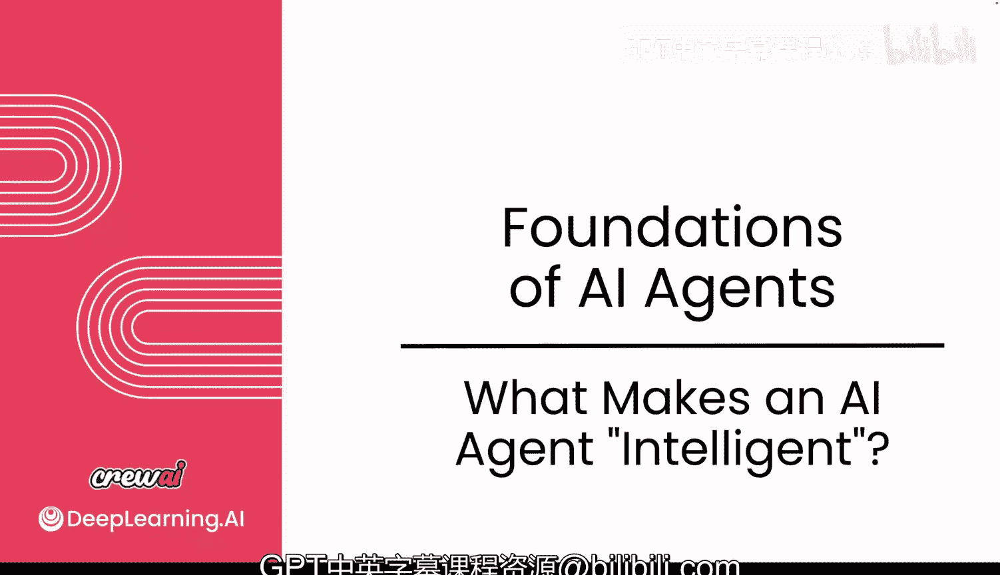
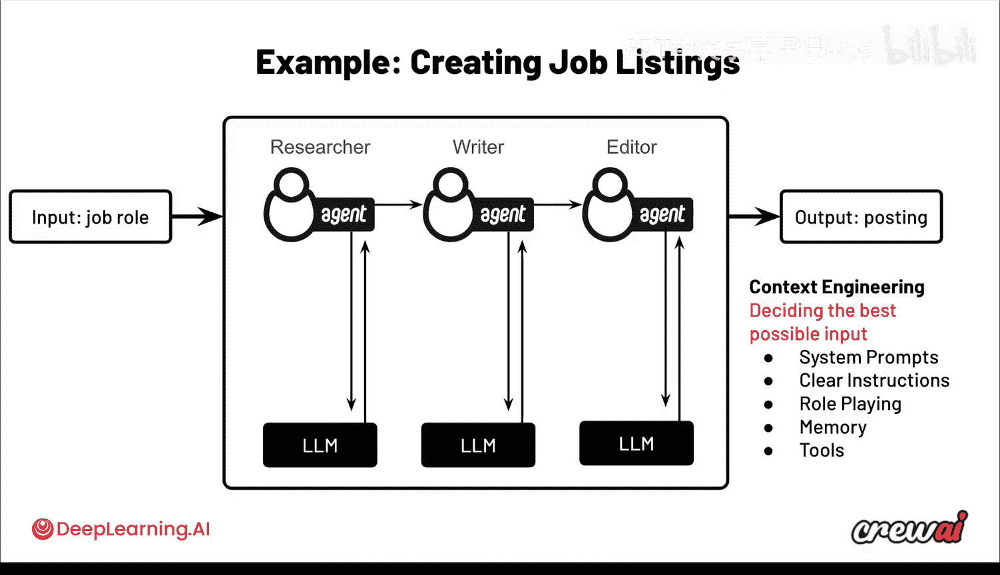

# 吴恩达《使用 CrewAI 设计、开发与部署多智能体系统｜Design, Develop, and Deploy Multi-Agent Systems》 - P5：5.what-makes-an-ai-agent-intelligent.zh_en - GPT中英字幕课程资源 - BV12eCQBAECM

So what makes an AI agent intelligent。 Let's think about it In the end of the day。

 Do AI agents that go into production means that they give you reliable and repeatable results。

 That means that you've got to think about the context engineering that you' are doing behind the scenes。

 how the information that you're providing to this model on every single API call that you make。

 So let's look into that so that you can start understanding more how you can optimize your agents for maximum output quality。

 All right， so I'm very excited about this lesson， because we're going take a step back here to understand better how large language models work in a nutshell and how they compare to more traditional AI systems。

 So at their core， the more traditional AI systems try to take sense of inputs to predict output。

 So let's talk about a simple example here。 Let's talk about a traditional AI system that it tries to predict whether it's going to rank or not。

 in you are to do that it's going to use a few different data points， like location or。😊。

Season or temperature。 and using those features， we then try to predict if it's going ring or not。

 So a good example would be Mumbai in the summer at 90 degrees Frenheit。

 let's say that it's not going ring。 but in tempe in the winter at 65 Fahrenheit， it is going ring。

 So the way that this model work is that you expose them to enough examples of locations。

 seasons and temperatures， and it's going to start to understand the correlation between all those features in order to create the prediction。

 So the more examples that you expose this model to and that's what we refer as straining the more it we will start to understand the correlation between all the different features in the actual output so that in the future。

 if you show something that it has in Cia， for example， takyo in the summer at 85 degree Frenheit。

 it will be able to predict if。Going to ring or not。

 The idea here is that it's using these features in order to try to understand how they correlate with the actual prediction And this translates very well into LLms I know it's gonna be a simplistic comparison but in LLms there's a lot of that that is also playing It's a regular AI model but in this case the features or all the words that you have type it so far。

 So when you go into chat Ept for example， when you say give me a stock report on Tesla and that it spits out an answer。

 the way to think about it is that your prompt is actually the features that inform the prediction that is the answer。

 meaning that you have a lot more control over the prediction the answer that you're getting that you like to believe So you can change the prompt to get a different response and that's in a nutshell what people have been referencing as prompting is the ability to。

Understand how to form the sentences in a way that is steer the model to give you the best answer possible。

 A good example that you can do yourself for prompt engineering is instead of running this。

 you change the prompting to say as an exceptional F approved advise giving me a stock report on Tsla So you can see that we have a few more words in here and this is like we have change the season or that we have central location。

 the temperature So now we're giving different information that will actually drastically impact the prediction so you get a different answer。

 the intelligence of the systems comes from a massive amount of features that they can take us input and as many complex connections they can make between all those inputs to predict what comes next and the reason why this matters is one goes into the LLM heavily impacts how it responds and the ability to do。

That effectively is what makes great intelligent agents。 So let's take one step back。

 if you think about more traditional software， all the the software is strongly typed What I mean by that is that you have a very good understanding and what is the data coming in。

 what are the transformations that are happening and what is the data coming out。

 and that's why you can do things like testing where you know that two plus2 always before。 Now。

 when you think about a systems， they're nondeterministic。

 meaning that you don't know the data coming in。 the model itself is a black box and you don't know what the data coming out will be Think about jetgptT。

 you can go in there and you can type in the recipe for a cake or a PhD teasus。

 sometimes you won't know exactly what kind of data you're getting。

 and that's what makes the beauty of it， but also plays a role on how much control you can add to the systems to make sure that you're getting those reliable outputs。

Let's say you're working with a crew that will be able to create job listings。

 And the idea here is that this will be a crew that will help you research。

 write a job description and edit， make sure that its stopped notch。

 that crew will have three agents， a research analyst， a writer in an editor。

 And the idea here is that the research will take the job role as an input and go do a research on other job listings。

 see what skills are related to that， what are competitors looking for。

 The writer will then take all that research and the job specifications and actually write down the job description。

 And then the editor will review everything and make sure that it matches your company style in your company culture。

 First， let's talk about how context engineering allows you to steer this crew together。

 deciding what is the best possible input for every single request and the context engineering is all about optimizing all those set of。

😊，Inputs to serve as features to get you the best output that you can。

 So what goes into this context engineering。 Well， first， this idea of the system prompts。

 what are the prompts that are being sent。 They are providing the guidance on how this LM should behave。

 Then second， clear instructions。 especially explaining what is expected from this agents。

 what a good definition of done is then three， you want to make sure that you get this agents through row play。

 because remember the features that you are providing to these models will impact the output that you're getting。

 So if you get these agents to play along a specific role like what we did before Fingha approved stock advisor you are gonna get better responses out of these agents as they impersonate a researcher writer and an editor。

 you also have memory here that will play a role that will give these agents the capability to remember what they have done bad in the past and what they have done right。

 And at the end， there is also。TheTo are the things that these agents will need in order to be able to do the research。

 Sc the web， write the thing and reveal it。 I know there's a lot of information， but don't worry。

 because we're going to dig into every single aspect down the road。 So coming up in the next video。

 we're going to boot our first agent together to see some of the context engineering happening in real time。

 I see in there in a second。

