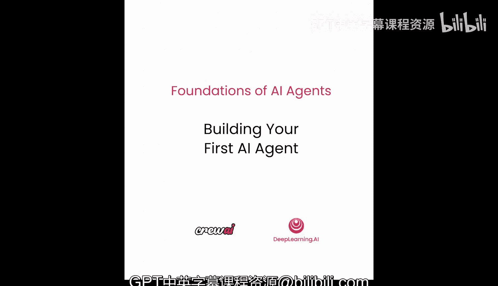
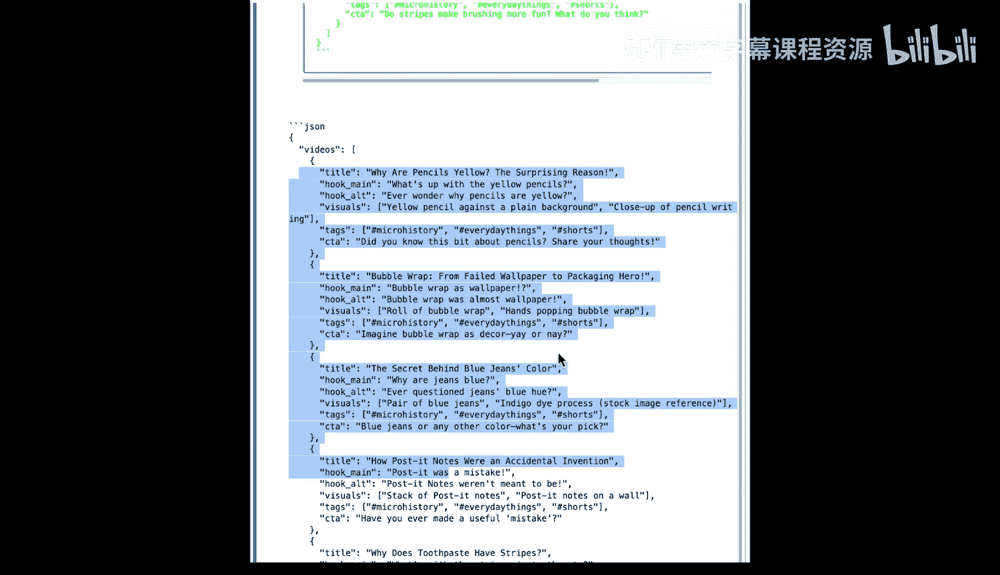

# 吴恩达《使用 CrewAI 设计、开发与部署多智能体系统｜Design, Develop, and Deploy Multi-Agent Systems》 - P6：6.building-your-first-ai-agent.zh_en - GPT中英字幕课程资源 - BV12eCQBAECM

Now， let's get our hands dirty。 Let's actually build your first AI agent。 So in this video。

 you will learn how to use the context engineering that we talked about to construct the best possible agents that you can。

 And you're gonna apply the same principles on all use cases that you build independently of using crew AI or any other thing out there。

 this same principles applies to how you build agents in any place。

 So let's look into that right now。 So I want to make sure that we're thinking about this。

 and I provide you with some advice。 And the idea here is that is that 8020% rule。

 should focus more on the tasks than on the agents。

 Not saying that the agents themselves are not important。

 but what we have found out through many use cases is that working more on the tasks and providing clear tasks usually drive most of the impact on the actual output。

 was that you get your tasks right， you start to focusing on the agent a little bit。

 and we going to see that in the moment， this agent can be reused quite frequently。

 But the task that。😊。

Agents do， if they're poorly defined， they can actually make the agent unperformed quite a lot。

So I would say that my main advice is that you should actually think like a manager。

 and I know this sounds funny， but most of the managers turned out to be amazing agent creators。

 And the reason behind that is because not only when they are thinking about agents they are actually thinking about who they hire for doing this。

 What is the person that I would hire for getting this job done。

 And when they're thinking about the tasks， they're not only thinking about what this agent should do。

 but they have a very clear understanding of the importance of setting the expectation of what a success looks like。

 So let's talk about tasks a little more deeply for a second。

 T are meant to be single purpose and single output。

 And they do that by basically focusing on two attributes， the description and the expected output。

 descriptions and describes why needs to be accomplished and the expected output describes not only what the format you want but what success looks。

😊，Like what the output should be， how we should be formatted， how we should sound。

 how positive it should be and remember both the description and the expected output will play roles in here on the context engineering side of things because we're going use those on different moments for system prompts or the roleplay or writing to memory or when the agents kind of self critiquing based on the actual result。

 it will be looking back into the expected output to see how better maps to its final result and remember that as we're beating those those tasks will be assigned to agents either if you're doing one single agent or if you're doing many agents together for what we're going to be next。

 that's actually what we're doing assigning tasks to agents。Now。

 let's talk about agents for one hot second。 And in agents， there's three main components。

 We talked about them already。 The role， the go and the backs storyory。 The row。

 as much as you can should be a realor job title。 or should convey very specifically what you want this LLM to row play S。

 The goal is， what is this agent final go throughout many different tasks that it could do。

 What good looks like for it。 What are the things they actually pursues when doing every single task that's assigned to it。

 And the backst is where you can go a little crazy on the expertise， the working style or the values。

 Whatever that you want to throw in there to contribute for the row playing to make sure that you get the expected output that you want。

 Now， let's jump in the notebook to take a look on how this task and agents come together and be our first crew。

😊，And the first thing that you want to do is to import crew AIs  three main building blocks。

 The task the agents and the crew。 And it's as simple as just importing those classes the same way that you would do for any other Python code。

 Now， after this code is important， you're ready to start building your agents Let me show an example of what not a great agent and task actually looks like。

 Let's say that you want to create a content creator assistant。

 something to help us create YouTube shorts， for example。

 interesting videos that have between 30 to 45 seconds long。

 Well I could create my agent by giving it a simple role like content creator assistant。

 And I could give it a very short goal， just saying I come up with video ideas and a very lame backstory。

 Someone who has a lot of experience creating video content in specifying the specifically model that it's using the same way。

 the task that I want this agent to perform could be something that I wouldn't spend too。😊。

Time thinking about and I just type it away by saying that this only objective is to come up with five new video ideas and the expected output should be a least off those ideas and then I assign this task to the agent that we would have just created Now I can bring this agents and task together into one crew so that we have all that together and ready to go and now that I need to do is basically call crew do kickoff to get the actual output and then print whatever is the final output of this agents you can see how I didn't really give a lot of information for this agent and it doesn't even know that it's actually doing this for YouTube So in the end of the day。

 this is not a very， really thought out agent。Now， if you actually run this crew with this agent and task as is。

 youll see that the result is actually going to be a little poor。

And here you can see that it basically gave me straight away 5 ideas of what it could do。

 The idea of 24 livings like a minimalist。 the evolution of dense and trends over the ears。

 virtual reality， cooking word cuisine and natural resilience。

 but it has no understanding that this is a very short video and not a documentary style video。

 and that it is meant for YouTube and that it could be optimizing that video in so many ways for that is specifically algorithm。

 Now， I want to show you the opposite。 What a good example looks like。 So for your agent。

 the role is going to be very specific。 A YouTube shorts microcrohistory strategist。

 And you can see that the whole goal is to put for one week's late of high retention YouTube shorts。

 Look at how much more information is going into this。

 And think about what we talk early on our lessons about how the information that you're putting into the LLM actually serve as features that will inform the。

😊，that you're getting。 And for the task， we're actually going take it to the next level by being very descriptive about what we actually want to be done and what is the expected output that we want to have out of this。

 And you can see that in here we're going the extra mile and even asking for a specific Jasonson output。

 So we get exactly a format that we want that we can use it。 Now。

 we can put this agent and task together gather in a crew， and we can kick it off。

 And you see the vast difference between what we had before in this new definition。

 let it just run this。 So in here we can tag along some of these logs。

 And you can actually see your agent going on perform the task and give you your final answer。

 And the final answer is exactly the jason that we're looking for with a title， a hookman。

 an alternative hook， visuals tags and even a call to action。 And if you go in the end here。

 you can see the entire thing printed out for us。 Now， you can see how vastly different。😊。

Those you get from actually spending time thinking about your agents and tasks。

 And this is just an isolated example of how that plays out on an individual agent level。

 These use case could be expanded with many other agents to create marked crew content production like drafting scripts doing deeper research thinking about marketing ideas and how we can actually post about this and other social networks。

 There's a lot different ways that we can actually expand on this。 But for now。

 we're going to keep at this so that we can go when jumping to our next lesson。

 And I see in there in a second。😊。

