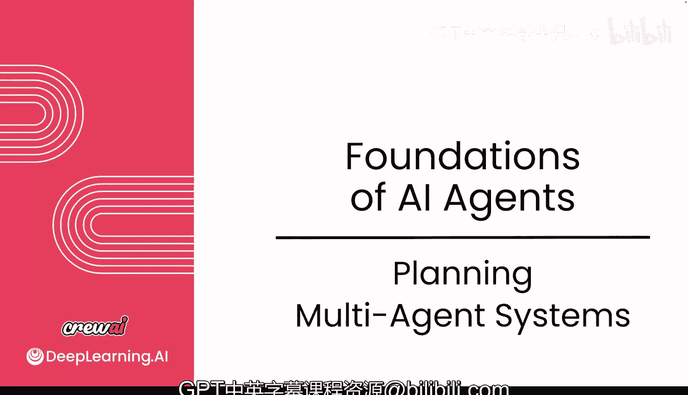
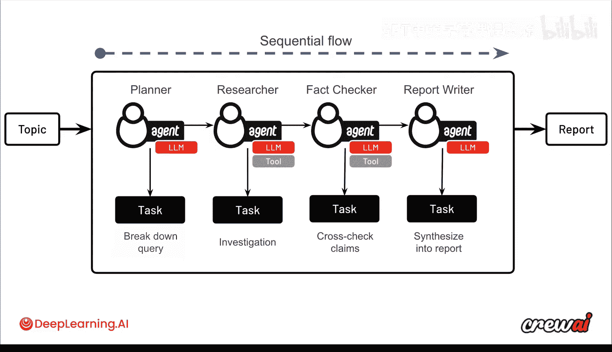

# 吴恩达《使用 CrewAI 设计、开发与部署多智能体系统｜Design, Develop, and Deploy Multi-Agent Systems》 - P7：7.planning-multi-agent-systems.zh_en - GPT中英字幕课程资源 - BV12eCQBAECM

One agent can be very powerful。 But if you really think about it。

 the best way for you to extract value of these agents。

 if you could get them to specialize into their own thing。 So we set up from one agent。

 you can have multiple agents， Each agent specialize on something with its own tools。

 It's on knowledge and it's on prompt。 So let's look into that。 So in the previous lesson。

 you build your first agent crew and task。 So you're ready start to understand some of the primitives in here。

 And this is something that you're going to see across the entire industry。

 whether you're using Ci or any other agent building tool out there。

 this idea of agents doing work and agents being assigned to task is a common team throughout the entire thing。

 Now， I do want to focus about not only that you can use one agent。

 but the fact that you can use moy agents as well。 And there is a balance in here on when you bring more agents and how many agents you bring。

 And the whole idea behind this is that moy agents allow you to have more。😊。

Targeted agents and its through their combined effort that you get to more high complex use cases。

 So if we look back at our use case matrix， for example。

 you will see that this idea of high complexity and low precision or even high complexity and high precision usually we require more agents to do it than one single agent because you want to make sure that you're dividing and conquering here and you're setting up your agents even to use different Lms if necessary。

 everything to benefit the best output that you can get。

 So let's talk about what we're going to be one of our next videos the use case that we're going to be building together is a deep research crew。

 Basically a group of agents that are able to do a deep research on the topic and report back。

 So there's an initial topic that's going to pop in on one side。

 and then you're going to have the report on the other side。

 and the way that we're going to get from topic to the report is by having a series of four agents working in a sequence。

manner。So the first task going to be about breaking down the initial query。 So whatever topic we get。

 we want to make sure that we break that down into more manageable chunks and that it will be a simpler planner agent but then we need more advanced agents going from there because we will need to do some investigation on that topic and that agent now will probably require some tools to be able to research the web and find the information that requires to build that report effectively we do want to make sure that that report is factually correct so we will have a separate agent to just fact check it will crosscheck the claims。

 make sure that everything is valid and minimize any hallucination that we might be and then the final agent。

 the one that is putting the report together it's bringing all this knowledge from the planning the researching and the fact checking into one single cohesive report so that we have something that is high quality at the end and again。

 to give this symbol we're just doing a。ShowF where these agents are working in a certain order in order to bring us that final report。

 but as you build these use cases， you might not always benefit of the sequential order。

 you might actually want to explore you might actually try different communication styles between this agents and there is so many you're going to find things like hierarchical or hybrid or parallel or even a synchronously where you can have many agents where you can in parallel and eventually regrouping into one single agent but right now I'm very excited to jump in the next video so that we can start building this out So you're see there in a second。

