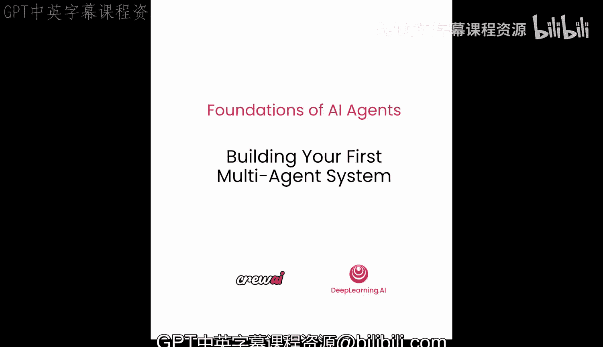
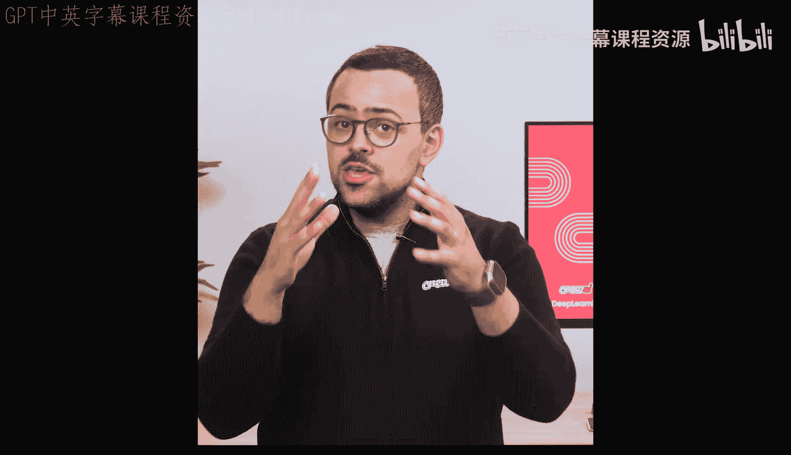
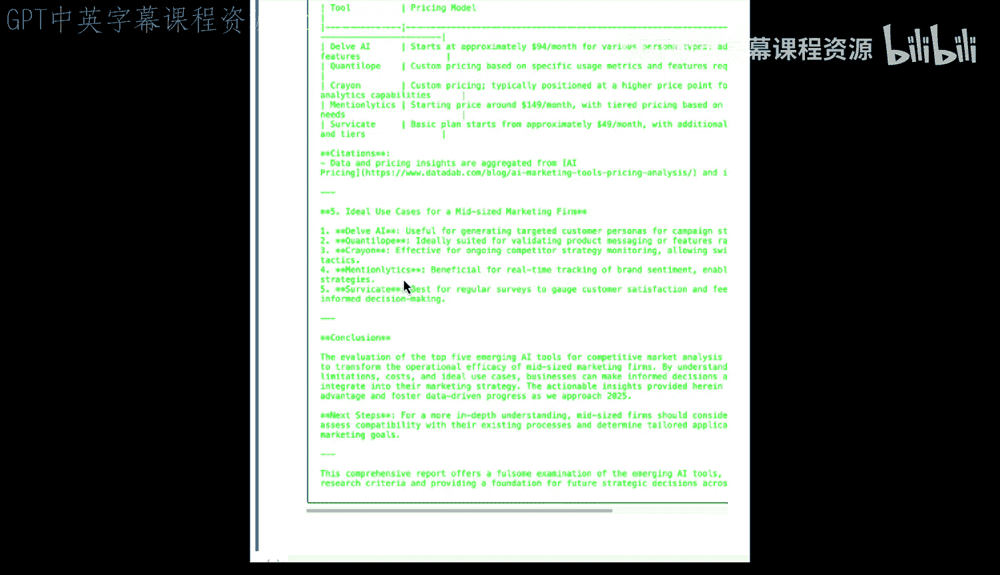

# 吴恩达《使用 CrewAI 设计、开发与部署多智能体系统｜Design, Develop, and Deploy Multi-Agent Systems》 - P8：8.building-multi-agent-systems.zh_en - GPT中英字幕课程资源 - BV12eCQBAECM

Now， let's build your first moy agent system。 And I'm very excited about this because you already learn a lot of these concepts and you're ready spend a lot of time planning about these use cases。

 Let's dive right into the code。 This is a deep research crew。

 And this is a crew that we're going to carry with us throughout many lessons because we're going to keep making it better and improving it with the things that we learn。

 This crew will start with four agents， a research planner， an Internet researcher。

 a fact checker and a report writer。 together， these agents who perform a series of tasks sequentially to allow us to get to an entire report on whatever we want to research about。

 Now， there are tools that we're going need to provide for the Internet researcher agent。

 And we're going to talk way more about tools down the road on future lessons。 For now。

 we're just going to use a two that is prebued and eventually。

 we're gonna getting to even build their own custom tools。

 So you want to make sure that you stick around for that。 Now。

 let's go over to our notebook to make sure。😊。

That we get our hands dirty So the first thing that we would do is import our main crew AI classes。

 the agent， the task and the crew and these are the same classes that we use on our last notebook we also need for the sake of getting our API keys for open AI in here import a few pieces of code to make or life a little easier and this is just botherp code that you can copy and paste and it's all going to work out for you。

I will invite you later at the end of this notebook to actually change the model and see how that works for you。

 Now， because we need to provide this agent with some sort of research tool so we can gather its data we will be using the A application to do web searching for us。

 And again， don't get to hang up on this because we will talk about tools at length down the road and other lessons。

 We just import those modules and we make sure that we configure them accordingly by loading the key and creating an instance of the access search tool and creating an instance of our scrape website to that it should work out of the gate。

 Now， let's jump into actually creating our agent the first agent that we're going to create is a research planner。

 The idea here is that this agent is able to analyze the queries and break down into smaller。

 more specific research topics。 The next agent right after this one is actually your。😊。

Rearch agent that will basically work off the research planner and execute that plan into the research。

 you can also see that very specific role a very specific role in the very specific backstory for that and you're going to see the same pattern and happen to both for fact checker and reporter agent So I'm going to just create them right away Another thing that I also want to call out is that both of this agents are using these tools。

 they exit to in the scrape website too both our researcher and our fact checker are using the same subset of tools Now that we have our agents we're going move in into creating our tasks。

 So we're going to start with for research plan task and this task is being very specific about what it wants it to do it wants the agent to based off the user query to research those topics understand one are the main questions and create the research plan and you can see here for the first time that we are。

Ppating some variables into this task。 And this is important because as you run these agents。

 there always be a component of the user input。 something that you're sending into the screw。

 whether there is a query， There is some sort of input that you want to be injected into the agent。

 And in this case， is the user query that we're injecting right on from the first task and is going to basically inform the entire plan from this point forward。

 Now， if we look at the remainder of our tasks， you can see that we are basically using the same standard that we applied so far for the other ones。

 you can see we're using a lot of adjects。 for example， comprehensive。

 and saying exactly what one to be included in there and what kind of like search as or want to be in there。

So now let's bring together the agents and the task into this crew so that we can actually run this。

 And it is exactly the same thing that we have done before。

 But now it's just more agents and more tasks。 And remember the whole planning here is that this agents and tasks will be working in a sequential fashion where one is going to take the output from the last。

 That means that we're gonna do the planning first。 then gather the research based on the planning。

 then verify that information and then writing the final report。 Now。

 we still need to inject the user query into that。 So you can see in here that we just will have this one single query that is a string。

 And again， I invite you to update this query later so that you can play around with different topics and see what kind of answers you have。

 But mean， I'm just going to use this idea of evaluating the top five emerging AI tools for automating competitive market analysis。

 Now that we have this set up。 What we can actually do is kick off our crew。😊。

But differently than before， we're gonna pass an input into that。

 And this is where that interpolation magic is happening where we're getting the user query that we wrote on the cell above and we're passing into the crew and that will automatically interpolate that query into the tasks and agents in anywhere that it's mentioned。

 Now， let's kick this off so that we can actually see the result and plot it out for us。 Now。

 if we tag along this execution， we can see a researcher planar agent kick things off and start to creating the entire plan of what do we need to find in terms of information to create a report。

 Now， if we keep tagging along， things starts to get it even more interesting because when you get to our Internet researcher this is the agent that actually can use tools and you can see in here that it's going to be using the access search tool and is' actually performing a search or emerging AI tools for the market analysis into 2025。

 and you can actually see the two。😊，Output right under this， their URLs， the titles， the Is。

 and when this website were actually publish now the Internet researcher decide to scrape a specific website to gather more information about one specific tool and we will do that for probably many of the websites that it's found as it scrapes this website It creates a final answer and gives you an entire response and what is all the different tools that it found and all the information that it has about them。

 I do invite you again， change the motto and see how this impact some of the outputs and you're gonna have a great time playing around。

 If we keep is scrolling down all the way to your fact checker agent。

 we can now see that it's also doing searches， but it's doing searches more targeted to find features and pricing make sure that it validates the information that it found out earlier and doing this for all the different software that we found out like Quantal lope as well and all that will then go into this report that we're putting。

😊，er the report writer finally gives a markdown file with the comprehensive research report on the top five emerging AI tools for automating competitive analysis market in 2025。

 and it goes over all the tools that we found from what seems to be 12 AI to Quentaloupe， citations。

 cryon and going to the details of each one and even mentioning specific websites where it found information about those。

 it also plots out a table for us， going over the features of each two and showing the potential limitations of them as well。

 including potential cost analysis in a few are things。If you stick around for the next lesson。

 you're going to see that as we're learning more things。

 we're actually going to bring them back into this use case and make this use case way more complex。

 not only more complex， but way more reliable as well。 Talk about lessons。

 Let's jump into our next one。 And I want to see you in there in a second。

