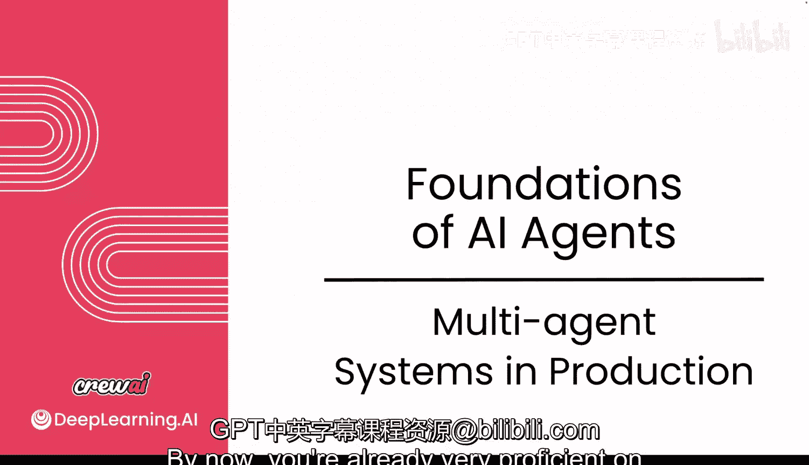
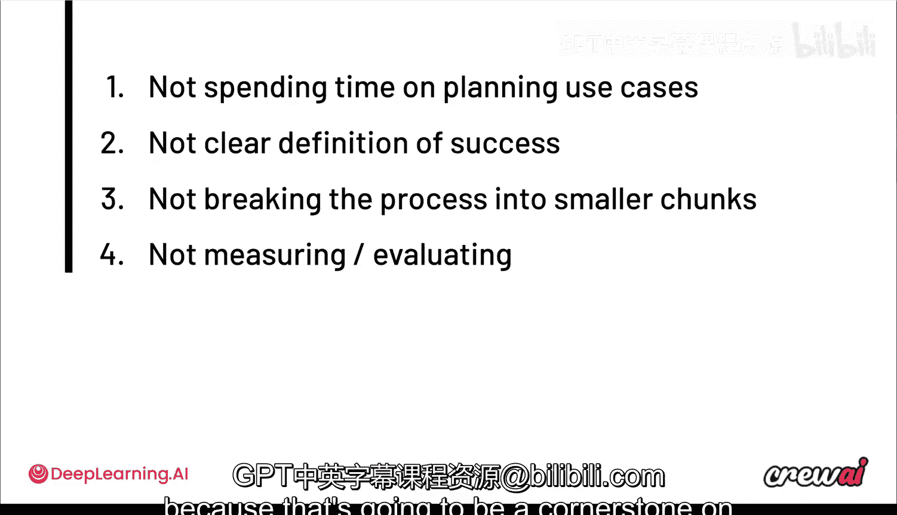

# 吴恩达《使用 CrewAI 设计、开发与部署多智能体系统｜Design, Develop, and Deploy Multi-Agent Systems》 - P9：9.multi-agent-systems-in-production.zh_en - GPT中英字幕课程资源 - BV12eCQBAECM

By now， you're already very proficient on building some of these use cases， right。

 You learn a lot about how the systems works and what the different components are。 That said。

 the gap between building things as a prototype and getting into production is huge。

 There's a lot going on in there。 So now we're going start to dive into what actually means to take one of the systems into a production environment。

 Let's go into the lights。 A lot of these companies and teams that are viewing this AI agent systems。

 they're now getting to a point where they're moving out of a prototyping stage and going into fully flashed production use cases。

 What it can be very hard to do if you're not building these the right way。

 One of the biggest jumps is that as a prototype， you're often running these agents as a one off automation。

 So， for example， you saw the crew that we built early that helps you organize and prepare for meetings。

 We could do another use case where it's summarized transcripts with action items and help you draft emails。

 for example。😊。

n steps So in the prototype stage， that crew might be triggered manually by you when you're having a meeting。

 you run that crew and you get the result or you might have a deploy at this to run for say your engineering team at a small scale But the thing is once that you turn this on to1 and you turn this entire company you're moving away from human time to machine time So in human time you have fewer users。

 fewer executions iss very easy to monitor and fix when you're talking about machine time。

 you're talking about thousands of users， hundreds of thousands of executions。

 what makes it very difficult to monitor and fix at a scale if you didn't put some time into this early on when you just have a few crew executions in a day。

 maybe a couple doesn in a day， it's pretty easy to understand the traces and understand where the problem is and how you fix it and you're probably also working with a mouseat of relativelyively proficient users if it's just you。

That's even easier。 but as you scale to hundreds， thousands or even hundreds of thousands executions。

 you can monitor those ad hoc anymore， so you need to make sure that the vulnerabilities don't start to pile up So that's what I mean by machine time the agents that are getting now into this very fast pace environment doing many executions and you still need to be able to track their performance in some way。

 shape or form。 So there's two kind of metrics that you really care about in here。

 One is zoom in metrics and that means the ability to bug to reproduce errors， checking traces。

 prompt tokens is's all about zooming in into any specific execution and being able to trace it and understand everything that is going on with that。

 The other one is zoom out metrics and those metrics will be more around using LLm as a judge checking for quality hallucinations。

 Ri or success matrix the idea。Here is that you might be able to look at some zoom in matrix for ad hoc debugging。

 but once that you're running these things at a larger scale。

 you want to make sure that you have the systems in place to check for quality as a whole for the entire system。

 So this is very exciting， but I also want to spend some time talking about the pitfalls。

 What are the things that go wrong。 and this is interesting because the tech is there。

 you have so many powerful models out there right now and with some of the features that we have shown and the ones that were going to show ahead。

 you have so much that you can beat already， if anything。

 what we're finding out is that most of the companies and the teams that are struggling with getting the systems in production。

 they're having pitfalls on their process， not on their tech。

 So they're not spending enough time planning these use cases， for example。

 or they don't have a clear definition of success。 or not breaking the process into smaller。

Chunk so that they can have many agents use it。 And even if they do have a clear definition of success。

 then they're not measuring or evaluating it。 And that's an entire new problem。

 The idea that you deploy these things and you can tell if they're actually adding value to you or not。

 it's something that will hinge your ability to make further investments and as you improve those systems。

 you need to be able to tell if they're training in the right direction。

 So now that you know some of the challenges of these production systems。

 it's important that you understand how to actually address those。

 So the next video you see have many different tactics you have with Ci to debug。

 observe and optimize your moy agent systems So you want to make sure that you don't miss the next lesson because that's going to be a cornerstone on some of the new examples for ahead。

