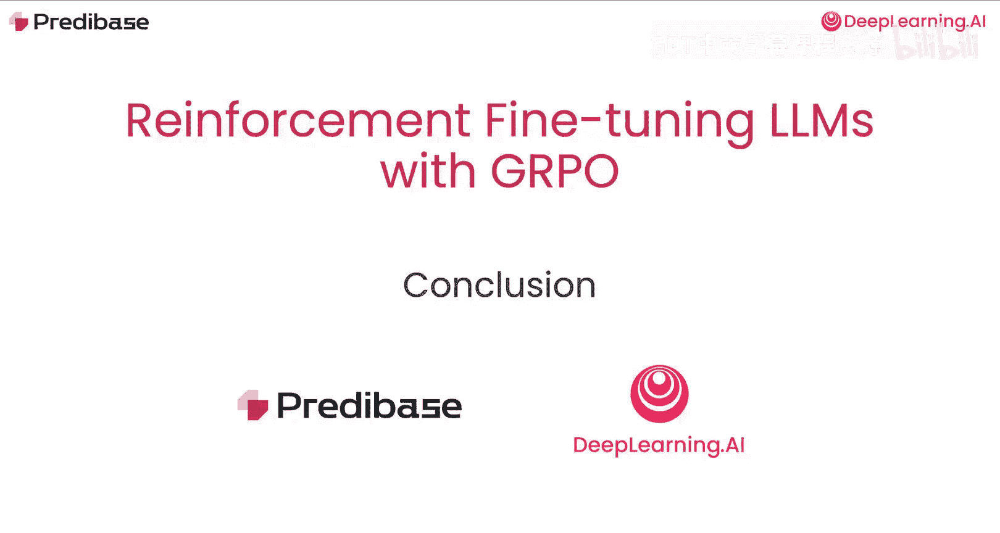
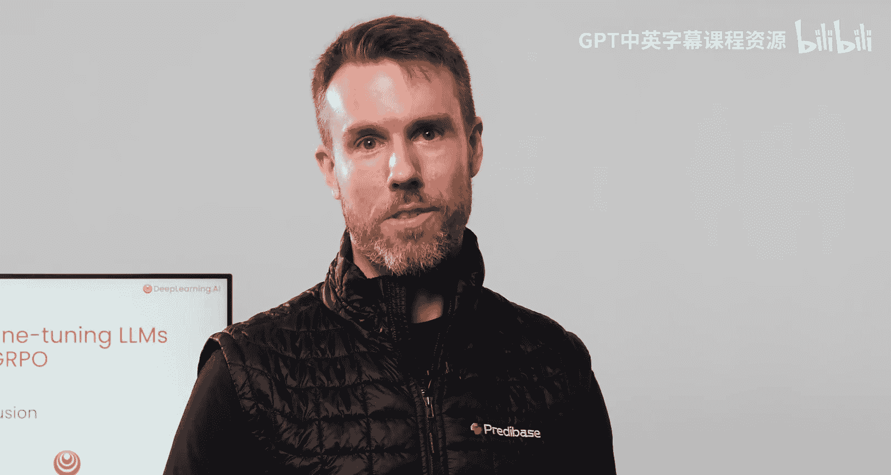

# 吴恩达《使用 GRPO 对大型语言模型进行强化微调Reinforcement Fine-Tuning LLMs with GRPO》 - P10：10.conclusion.zh_en - GPT中英字幕课程资源 - BV1RMjJziEH2

Congratulations on making it to the end of the course。

 You've covered a lot from the detailed foundations of reinforcement learning with GRPO to the art and science of creating reward functions at steer Lms to good performance on complex tasks。

 Cring reward functions for RFD is very flexible。 and there is a lot of scope to insert your own domain knowledge since you build the functions from scratch。

😊，Weve worked with lots of customers at Pratabase who are coming up with interesting and creative RFT solutions for their business problems。

 including thequizta reward function for summarization that you saw earlier in the course。

 If you are interested in going deeper， there are more RFFT learning resources on the Prabase website。

 And because this technique is still in its infancy。

 we'd love to hear from you about any use cases you explore， We hope you enjoy the course。

 and we can't wait to see what you build。😊。

